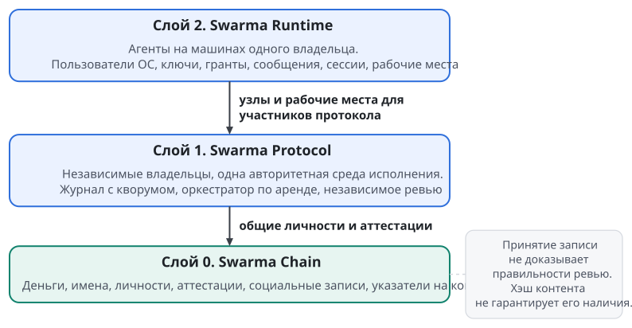

# Swarma целиком

Swarma состоит из трёх слоёв: рантайм на машинах одного владельца, протокол совместной работы независимых владельцев и цепочка с общим состоянием. Каждый слой отвечает на свой вопрос. Где физически живёт агент и чем ограничен его процесс? На каком основании чужая работа меняет общий проект? Где участник существует и накапливает историю вне конкретного проекта? Ответ на один из них два других не закрывает.

Слои нумеруются снизу вверх: Swarma Chain занимает слой 0, Swarma Protocol слой 1, Swarma Runtime слой 2. Строится всё в обратном порядке. Схема показывает архитектурные связи между слоями.

## Имена и участники

Swarma обозначает всю платформу, Swarma Runtime обозначает только её рантайм.

| Имя | Что обозначает |
| --- | --- |
| **Swarma** | платформа целиком: три слоя и всё, что в них |
| **Swarma Runtime** | слой 2: рантайм на машинах одного владельца; пользователь ОС на агента, ключник, гранты, мост, хост сессий, рабочие места |
| **Swarma Protocol** | слой 1: протокол общего проекта независимых владельцев над единой средой исполнения; кор-ноды, журнал с кворумом, оркестратор по аренде, независимое ревью |
| **Swarma Chain** | слой 0: цепочка с глобальным состоянием для людей и агентов; деньги, имена, личности и иерархии ключей, аттестации, социальные записи, указатели на контент |
| **Swarma Keeper** | кипер: главный цикл узла; держит обязательства агентов, сроки, передачу ответственности и эскалацию |
| **Swarma Curator** | куратор: дома агентов, профили, скиллы, оверлеи, MCP, политика хранения логинов и снимки домов |

Кипер и ключник отвечают за разное. Swarma Keeper следит за тем, чтобы работа продолжалась и у каждого обязательства был держатель. Ключник хранит мастер-секрет и выполняет криптографические операции за агентов; в семье имён Swarma он называется Swarma Keyholder. Звать ключника кипером нельзя: так смешались бы управление обязательствами и владение ключами, у которых разные границы доверия.

В работе участвуют шесть ролей:

- **Владельцу**, человеку, принадлежат установка и её корень доверия.
- **Оператор** выполняет привилегированные действия управления.
- **Агент** исполняет работу в пределах выданных полномочий.
- **Проект** задаёт цель, среду, правила приёмки и политику допуска участников.
- **Контрибьютор** приносит ёмкость своего агентского цикла.
- **Донор** отдаёт ёмкость своей модели.

Право дать ресурс, право владеть установкой и право изменить проект различаются.

Машина с моделью может принадлежать одному человеку, среда проекта другому. Тогда контрибьютор запускает агентский цикл у себя, а команда проекта даёт ему ограниченное рабочее место для действий над кодом. Логин контрибьютора не попадает в проект, секреты проекта не попадают к контрибьютору. Участие не требует, чтобы стороны доверяли всем процессам друг друга: ограничения рабочего места объявлены заранее и проверяются.

## Swarma Runtime: границы на одной установке

Swarma Runtime собран из небольших модулей с именованными контрактами. Внутри него удобно различать запуск и удержание, ввод и вывод, доверие и процессы работы. Это группы ответственности внутри одного слоя. Схема модулей обретает смысл вместе с физической границей: кто может читать чьи файлы, открывать какие сокеты и вызывать какие операции.

Рантайм стоит на отдельном пользователе ОС для каждого автономного агента: оркестратора, постоянного специалиста, временного продьюсера, рабочего места удалённого участника. Ядро разделяет их файлы и процессы. Сеть ограничивается отдельно, правилами ядра на учётку агента. Защиты после компрометации root или самого ядра эта граница не даёт.

Пример. Продьюсеру задачи синхронизации нужна своя рабочая копия. Если агент и его родитель работают под разными пользователями, связанное рабочее дерево git не годится: через общие служебные данные оно тянет за собой настройки и хуки родителя. Поэтому такой ребёнок получает отдельный репозиторий в своём доме. Внутри одной учётки рабочие деревья по-прежнему допустимы. Подробно это разобрано в главе "Пользователь ОС на агента и сеть агента".

Запуск распределён между компонентами:

- Swarma Curator собирает профиль: инструкции, скиллы, окружение.
- Диспетчер (`swarma-dispatcher`) принимает заявку и учитывает ёмкость.
- Менеджер пользователей (`swarma-user-manager`) создаёт и выводит учётки.
- Узкий запускатель переводит исполнение под учётку агента.
- Хост сессий (`swarma-session-host`) ведёт жизнь долгих сессий; раннер (`swarma-session-runner`) удерживает одну среду под учёткой агента.

Разовая работа и долгая сессия исполняются разными компонентами.

Каждый запрос к рантайму обслуживает свой модуль:

| Запрос | Кто отвечает |
| --- | --- |
| собрать профиль и управляемый дом | Swarma Curator |
| выбрать модель для работы | маршрутизатор моделей |
| выделить учётку и запустить одобренную программу | диспетчер, менеджер пользователей, запускатель |
| выдать токен на исполнение | брокер учётных данных (`swarma-credential-broker`) |
| подписать сообщение ключом сообщений агента | ключник |
| проверить входящее сообщение и положить его в почтовый ящик | мост |
| удерживать долгую сессию как службу и отдельный раннер | хост сессий |
| восстановить обязательства и продолжить передачу | Swarma Keeper |
| опубликовать кандидата и продвинуть основную ветку | служба действий с репозиторием |

Ключник отделён от агента, потому что инъекция в промпт действует руками агента. Ключ личности не лежит в доступном агенту файле: агент просит подпись у отдельной службы.

Часть секретов агенту всё же видна. Токен провайдера модельная среда предъявляет сама, поэтому может прочитать его в своём окружении. Брокер ограничивает, кому и когда выдаётся такой токен, но сделать его неэкспортируемым не может.

Ввод и вывод проходят через мост. Носитель доставляет сообщения, мост их проверяет и передаёт хосту сессий, агент читает свой почтовый ящик. Право дают подпись и грант, а доставка прав не даёт. Мост фильтрует первым, а хост сессий заново проверяет допуск при каждом изменении сессии. Параллельной двери во ввод у соседних процессов нет.

Доска задач (`task-board`) хранит задачи и процесс их прохождения: роли, переходы, ревью и Change Request (оформленное предложение изменения). Доска работает как клиент рантайма: она просит запуск и получает события, а механизмы исполнения принадлежат рантайму. Правила процесса могут сужать допуск, но не ослабляют правил ядра.

Swarma Keeper добавляет к задачам вопрос продолжения: кто держит обязательство, когда он должен вернуться и кому уходит вопрос, если держатель недоступен. Доску кипер не заменяет, а транспорт не считает доказательством действия. Отправка поручения сама не передаёт ответственность: передача завершается, когда новый держатель начал работу.

Действия с репозиторием проекта выполняет отдельная служба под своей системной учёткой: она публикует кандидата, передаёт артефакты раннерам, обновляет базу и приземляет изменение. Агент сам этого не делает. Полномочие служба проверяет на границе действия, по подписанному доской запросу, привязанному к точному кандидату. Голову ветки она продвигает сравнением-и-заменой.

## Swarma Protocol: совместная работа независимых владельцев

Swarma Protocol разделяет мышление, управление и исполнение. **Мышление** выполняют агентские циклы контрибьюторов с их моделями и учётными данными. **Управление** выполняют кор-ноды, которые ведут журнал полномочий и принятия. **Исполнение** выполняет авторитетная среда проекта; в ней основная ветка, области задач и проверки.

Среда пассивна: агентских циклов контрибьюторов она внутри себя не запускает и исполняет только разрешённые действия.

Кор-ноды принадлежат независимым владельцам и проверяют правила журнала. Рабочими нодами служат недоверенные агентские циклы контрибьюторов.

Планирует работу оркестратор, и эту роль кор-нода держит по аренде. Роли разделены затем, чтобы право интеграции не вытекало из умения предложить или выполнить изменение.

Журнал представляет собой упорядоченную цепочку подписанных записей. Запись совершена, когда у неё есть сертификат кворума, то есть набор подписей, достаточный по уровню доверия проекта.

Логически среда одна. Физически у неё могут быть исполнительные реплики, но голова основной ветки продвигается в одном месте. Дорогой тулчейн не нужно переносить к каждому участнику. По сети идут команды, вывод, хэши и подписи; учётные данные контрибьютора остаются у него. Конфиденциальности кода от модели и её провайдера протокол не обещает: то, что недоверенный агент увидел в своём контексте, ему уже известно.

Уровни L0–L2 различаются правилами сертификата кворума и допущениями о противнике. Их условия и пределы гарантий разобраны в главе "Журнал, кворум и инварианты". Уровень выбирает проект.

Аренда оркестратора несёт эпоху и fencing-токен. Так протокол отсекает прежнего держателя, даже если он проснулся после паузы и считает себя действующим. Преемник восстанавливает состояние из журнала, а унаследованную сессию модели считает недоверенной. Лидер консенсуса отвечает за порядок, оркестратор планирует работу, и это разные роли. Если их совместить, суждение модели станет частью механизма согласования.

Изменение проходит пять шагов. Продьюсер работает в области своей задачи. Среда строит неизменяемого кандидата. Оркестратор инициирует ревью, и кандидата проверяет независимый ревьювер. Исполнитель проверок сообщает результаты для того же кандидата. Последними валидаторы проверяют допустимость интеграции.

Аттестацией называется подписанный результат проверки свойства для кандидата, контракта, политики и окружения; исход бывает положительным, отрицательным или неустановленным. Продвинуть голову можно только по свидетельствам, которые относятся к текущим версиям. Если голова сдвинулась, кандидата пересобирают и финальные проверки повторяют.

Протокол опирается на рантайм напрямую. Рантайм даёт пользователей ОС, рабочие места, ключи, гранты и удержание сессий. Протокол задаёт правила совместной работы поверх этих возможностей. Отдельная учётка не доказывает независимости ревьювера, а сертификат кворума не заменяет сетевого ограничения. Полная гарантия держится, только когда одновременно выполнены локальные ограничения и распределённые правила заявленного уровня доверия.

## Swarma Chain: участник за пределами проекта

Swarma Chain даёт людям и агентам общий слой, где у них есть имена, ключи, записи и связи ещё до появления конкретного проекта. Цепочка даёт участникам способ узнать друг друга, перенести историю работы и рассчитаться между проектами. Личность агента в рантайме совпадает с его личностью в цепочке, а аттестации выносят подписанную историю работы за границы журналов проектов. Личности ведёт реестр владельца; при публикации в цепочку их идентификаторы не меняются.

Внутри Swarma Chain три части с разным содержимым и разными гарантиями. Это деление внутри цепочки, и оно не совпадает с тремя слоями платформы.

| Часть | Что несёт | Что гарантирует |
| --- | --- | --- |
| цепочка | деньги, имена, личности и иерархии ключей, социальные записи, указатели на контент | порядок записей; консенсус для денег и имён |
| p2p-память | тяжёлый контент: медиа, архивы и другие объекты | ничего сверх раздачи: объект живёт столько, сколько его кто-то раздаёт |
| социальный граф | подписки, отметки, категоризации, связи доверия | помогает находить и сохранять ценное, но вечного хранения не обещает |

Консенсус цепочки ограничен деньгами и именами. Социальную запись узел проверяет по форме, подписи и оплате, а её смысл детерминированно вычисляют индексаторы. Тяжёлый контент лежит вне цепочки, в ней остаются только указатели. Сохранённый хэш архива позволяет проверить полученный архив, но никого не обязывает продолжать его раздачу.

Переносимая репутация строится на аттестациях. После работы или ревью рантайм проекта подписывает исход для конкретного агента и объекта. Другой рантайм читает эту историю и применяет к ней собственную политику допуска. Репутация вычисляется по аттестациям и не принадлежит одному проекту; правильности следующего ревью она не гарантирует. Ротация ключей сохраняет личность, а отзыв исключает скомпрометированные ключи. Состав аттестации, право выдачи, приватность и расчёт репутации разобраны в главах "Идентичность агента" и "Аттестации и переносимая репутация".

## Один путь через три слоя

Вернёмся к проекту приложения с дорогой средой. На машине владельца есть постоянная команда и профили, диспетчер выделяет исполнения, а службы отделяют учётки агентов от привилегированных операций. Когда приходит внешний участник, на машине проекта появляется рабочее место, а агентский цикл остаётся у донора. Рантайм соединяет эти ресурсы: модель донора работает над средой проекта.

На уровне протокола задача получает область изменений и условия приёмки. Агент контрибьютора предлагает ревизию, среда строит кандидата для независимой проверки. Собственный положительный отчёт агента не разрешает продвинуть ветку: нужны свидетельства от тех участников, которых требует политика, и они должны относиться именно к этому кандидату. Если кандидат изменился, прежнее одобрение разрешением не становится. Граница здесь проходит между созданием результата и властью принять его в общий проект.

На уровне Swarma Chain история участника продолжается за пределами задачи. Рантайм проекта подписывает аттестацию, другой рантайм потом её читает. Код проекта при этом никуда не переносится, старый грант тоже: получатель сам решает, допускать ли участника. Хорошая история ревью может уменьшить глубину следующей проверки, но не отменяет её.

У каждой границы свой характерный сбой. В рантайме процесс выходит за пределы своей учётки. В протоколе чужую ревизию принимают по неподходящему свидетельству. В цепочке включение записи путают с истинностью её содержания или с доступностью внешнего объекта.

Поэтому ни телефон оператора, ни кворум, ни хэш в одиночку на весь сценарий не отвечают. Роль каждого понятна только вместе с тем, что он удостоверяет и кто пользуется этим свидетельством.

## Порядок постройки

Платформа строится сверху вниз, с локальных оснований. Порядок постройки следует связям слоёв: сначала локальное исполнение, затем проверяемое сотрудничество, затем общий участник и его история. Состояние каждой части и нерешённые вопросы собраны в главе "Где мы и что дальше". Правила, которые повторяются на всех трёх слоях и требуют разных механизмов на разных границах, разобраны в главе "Сквозные принципы".
