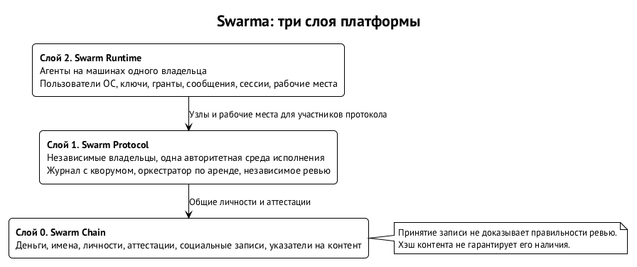

# Swarma целиком

Swarma — платформа из трёх слоёв: рантайма на машинах одного владельца, протокола совместной работы независимых владельцев и цепочки с общим состоянием. Слои отвечают на разные вопросы. Где физически живёт агент и чем ограничен его процесс? На каком основании чужая работа меняет общий проект? Где участник существует и накапливает историю за пределами одного проекта? Ответ на один из этих вопросов не заменяет остальных.

Нумерация идёт снизу вверх: Swarm Chain — слой 0, Swarm Protocol — слой 1, Swarm Runtime — слой 2. Строим в обратном порядке. Рантайм уже имеет работающие компоненты, но целевая установка ещё строится; распределённый протокол описан, цепочка остаётся замыслом. Поэтому схема показывает архитектурную связь, а не готовую зависимость работающего рантайма от работающего блокчейна. Общие личности и аттестации в цепочке — предлагаемое направление. ⟦предложено⟧

## Имена и участники

Имена закрепляют границы: Swarma обозначает всю платформу, а Swarm Runtime — только её рантайм. Карта ниже задаёт употребление имён в этой книге; она не утверждает, что перечисленные механизмы уже реализованы. ⟦решено⟧

| Имя | Что обозначает |
| --- | --- |
| **Swarma** | платформа целиком: три слоя и всё, что в них |
| **Swarm Runtime** | слой 2: рантайм на машинах одного владельца; пользователь ОС на агента, ключник, гранты, мост, хост сессий, рабочие места |
| **Swarm Protocol** | слой 1: протокол общего проекта независимых владельцев над единой средой исполнения; кор-ноды, журнал с кворумом, оркестратор по аренде, независимое ревью |
| **Swarm Chain** | слой 0: цепочка с глобальным состоянием для людей и агентов; деньги, имена, личности и иерархии ключей, аттестации, социальные записи, указатели на контент |
| **Swarm Keeper** | кипер: главный цикл узла; держит обязательства агентов, сроки, передачу ответственности и эскалацию |
| **Swarm Curator** | куратор: дома агентов, профили, скиллы, оверлеи, MCP, политика хранения логинов и снимки домов |

Кипер и ключник — разные компоненты. Swarm Keeper следит за продолжением работы и ответственностью. Ключник хранит мастер-секрет и выполняет криптографические операции за агентов; отдельного имени со Swarm у него пока нет. Называть ключник кипером нельзя: такое сокращение смешало бы управление обязательствами с владением ключами и скрыло бы разные границы доверия.

Владелец — человек, которому принадлежит установка и её корень доверия. Оператор выполняет привилегированные действия управления. Агент исполняет работу в пределах выданных полномочий. Проект задаёт цель, среду, правила приёмки и политику допуска участников. Контрибьютор приносит ёмкость своего агентского цикла; донор — тот, кто отдаёт ёмкость модели. Эти роли нужны для чтения схемы: предоставление ресурса, владение установкой и разрешение изменить проект не являются одним правом.

Один человек может владеть машиной с моделью, другой — средой проекта. В предлагаемом сценарии контрибьютор запускает агентский цикл у себя, а команда проекта предоставляет ограниченное рабочее место для действий над кодом. Это позволяет обсуждать участие без передачи проекту логина контрибьютора и без передачи контрибьютору секретов проекта. Какие именно ограничения доступны, должно быть объявлено и проверено; участие не предполагает общего доверия ко всем процессам обеих сторон. ⟦предложено⟧

## Swarm Runtime: границы на одной установке

Swarm Runtime объединяет небольшие модули с именованными контрактами. Внутри него удобно различать запуск и удержание, ввод и вывод, доверие и процессы работы. Это группы ответственности одного рантайма, а не дополнительные слои Swarma. Физическая граница проходит между пользователями ОС и службами: схема модулей имеет смысл только вместе с тем, кто может читать чьи файлы, открывать какие сокеты и вызывать какие операции. ⟦предложено⟧

Фундамент рантайма — отдельный пользователь ОС для каждого автономного агента: оркестратора, постоянного специалиста, временного продьюсера и рабочего места удалённого участника. ⟦решено⟧

Ядро разделяет файлы и процессы при корректно выставленных правах; сеть ограничивается отдельно. Это не обещание защиты после компрометации root или ядра. И это не утверждение, что работающие сегодня сессии уже все размещены за целевой границей. Принудительная сеть и применение правил описаны в спецификациях модулей. ⟦спецификация⟧

Например, продьюсеру задачи синхронизации нужна собственная рабочая копия. Если агент и его родитель работают под разными пользователями, нельзя просто считать связанное рабочее дерево git самостоятельным репозиторием: общие служебные данные создают связь с настройками и хуками родителя. Выбрано давать такому ребёнку отдельный репозиторий в его доме; рабочие деревья остаются допустимы внутри одной учётки. Подробности границы — в главе «Пользователь ОС на агента и сеть агента». ⟦решено⟧

Запуск распределён между компонентами. Swarm Curator собирает профиль: инструкции, скиллы и окружение. Диспетчер (`swarma-dispatcher`) принимает заявку и учитывает ёмкость. Менеджер пользователей (`swarma-user-manager`) создаёт и выводит учётки, а узкий запускатель переводит исполнение под учётку агента. Разовая работа и долгая сессия имеют разных исполнителей; хост сессий (`agent-session-host` в спецификациях) ведёт жизнь сессий, а раннер удерживает одну среду. Контракты менеджера, диспетчера и целевого хоста описаны; эти модули ещё не реализованы. ⟦спецификация⟧

Таблица связывает запрос с ответственным модулем. Она показывает целевое разделение, поэтому статус указан отдельно для каждой строки.

| Запрос | Ответственная часть | Состояние |
| --- | --- | --- |
| собрать профиль и управляемый дом | Swarm Curator | профили и управляемые дома используются ⟦работает сегодня⟧ |
| выбрать модель для работы | маршрутизатор моделей | используется ⟦работает сегодня⟧ |
| выделить учётку и запустить одобренную программу | диспетчер, менеджер пользователей, запускатель | черновики контрактов, без кода ⟦спецификация⟧ |
| выдать токен на исполнение | брокер учётных данных (`swarma-credential-broker`) | черновик контракта, без кода ⟦спецификация⟧ |
| подписать сообщение ключом личности агента | ключник | только архитектура ⟦предложено⟧ |
| проверить входящее сообщение и положить его в почтовый ящик | мост | только архитектура ⟦предложено⟧ |
| удерживать долгую сессию как службу и отдельный раннер | хост сессий | целевой контракт, без реализации этой схемы ⟦спецификация⟧ |
| восстановить обязательства и продолжить передачу | Swarm Keeper | направление ядра обязательств ⟦предложено⟧ |

Ключник отделён от агента потому, что инъекция действует его руками. Ключ личности не должен лежать в доступном агенту файле: агент просит подпись у отдельной службы. ⟦решено⟧

Из этого не следует, что все секреты агенту невидимы. Выданный токен провайдера модельная среда должна предъявить сама и может прочитать в своём окружении. Брокер ограничивает выдачу, но не превращает такой токен в неэкспортируемый ключ. Это предел целевой схемы брокера. ⟦спецификация⟧

Ввод и вывод связывает мост: носитель доставляет сообщения, мост проверяет их и взаимодействует с хостом сессий, агент читает свой почтовый ящик. Подпись и грант должны давать право независимо от того, каким мессенджером пришло сообщение. Мост — первый фильтр, а хост сессий заново проверяет допуск при изменении сессии; произвольный соседний процесс не должен иметь параллельной двери во ввод. Полная схема моста и общего языка грантов пока является архитектурой. ⟦предложено⟧

Доска задач (`task-board`) хранит задачи и процесс их прохождения: роли, переходы, ревью и Change Request — оформленное предложение изменения. Сегодня доска уже работает вместе со своим демоном сессий. ⟦работает сегодня⟧

Целевая архитектура делает её клиентом рантайма: доска просит запуск и получает события, а не владеет всеми механизмами исполнения. Правила конкретного процесса могут сужать допуск, но не ослаблять неизменные правила ядра. ⟦предложено⟧

Swarm Keeper добавляет к задачам вопрос продолжения: кто держит обязательство, когда должен вернуться и кому передаётся вопрос при недоступности держателя. Он не заменяет доску и не делает транспорт доказательством действия. Например, отправленное поручение ещё не завершает передачу ответственности; нужен подтверждённый переход к работе нового держателя. Это направление ядра обязательств, его подробные правила остаются предложением. ⟦предложено⟧

## Swarm Protocol: совместная работа независимых владельцев

Swarm Protocol отделяет мышление, управление и исполнение. Мышление — агентские циклы контрибьюторов с их моделями и учётными данными. Управление — кор-ноды, ведущие журнал полномочий и принятия. Исполнение — авторитетная среда проекта: основная ветка, области задач и проверки. Среда пассивна: она не запускает внутри себя агентский цикл контрибьютора и исполняет только разрешённые действия. Это устройство спроектированного распределённого слоя. ⟦предложено⟧

Кор-ноды принадлежат независимым владельцам и проверяют правила журнала. Рабочие ноды — недоверенные агентские циклы контрибьюторов. Оркестратор — роль планирования, которую кор-нода держит по аренде. Журнал — упорядоченная цепочка подписанных записей; запись считается совершённой после получения сертификата кворума, то есть достаточного набора подписей по объявленному уровню доверия. Все эти роли разделены, чтобы право интеграции не возникало из способности предложить или выполнить изменение. ⟦предложено⟧

Логически среда одна; физически возможны исполнительные реплики, но голова основной ветки продвигается в одном месте. Дорогой тулчейн не требуется переносить к каждому участнику. По сети передаются команды, вывод, хэши и подписи; учётные данные контрибьютора остаются у него. Это не обещает конфиденциальности прочитанного кода от модели и её провайдера. Вопрос того, что увидел недоверенный агент внутри своего контекста, протокол полностью не удостоверяет. ⟦предложено⟧

Уровни L0–L2 различаются правилами сертификата кворума и допущениями о противнике. Их условия и границы гарантий разобраны в главе «Журнал, кворум и инварианты». Это параметры проекта в протоколе, а не достигнутые свойства действующей сети. ⟦предложено⟧

Аренда оркестратора содержит эпоху и fencing-токен: средство отсечь прежнего держателя, даже если он проснулся после паузы и считает себя действующим. Преемник восстанавливает состояние из журнала, а унаследованную сессию модели считает недоверенной. Лидер консенсуса и оркестратор при этом разные роли: один отвечает за порядок, другой планирует работу. Их смешение сделало бы суждение модели частью механизма согласования. ⟦предложено⟧

Путь изменения выглядит так: продьюсер работает в области задачи, среда строит неизменяемого кандидата, назначается независимый ревьювер, выполняются проверки, затем проверяется допустимость интеграции. Аттестация — подписанный результат проверки свойства для кандидата, контракта, политики и окружения; её исход может быть положительным, отрицательным или неустановленным. Только согласованные с текущими версиями свидетельства дают основание продвигать голову. Смена головы требует пересобрать кандидата и повторить финальные проверки. ⟦предложено⟧

Связь с рантаймом прямая, но не тождественная. Рантайм даёт пользователей ОС, рабочие места, ключи, гранты и удержание сессий. Протокол задаёт правила совместной работы независимых владельцев поверх этих возможностей. Отдельная учётка не доказывает независимости ревьювера; сертификат кворума не заменяет сетевого ограничения. Для полной гарантии должны одновременно выполняться локальные ограничения и распределённые правила, причём на заявленном уровне доверия. ⟦предложено⟧

## Swarm Chain: общий участник за пределами проекта

Swarm Chain задуман как общий слой, где люди и агенты имеют имена, ключи, записи и связи до появления отдельного проекта. Это не журнал задач конкретной установки. Он даёт возможную основу знакомства участников, переноса истории и расчётов между проектами. Направление идентичности связывает публичный ключ агента в рантайме с личностью в цепочке; направление аттестаций переносит подписанную историю работы за границу журналов проектов. Обе связи предложены, а не реализованы. ⟦предложено⟧

Внутри Swarm Chain различаются цепочка, p2p-память и социальный граф. Это ещё одно внутреннее деление, его нельзя путать с тремя слоями платформы. Для этих частей выбраны разное содержимое и разные гарантии; работающая сеть пока не заявлена. ⟦решено⟧

| Часть | Что несёт | Что означает её свидетельство |
| --- | --- | --- |
| цепочка | деньги, имена, личности и иерархии ключей, социальные записи, указатели на контент | порядок записей; консенсус для денег и имён |
| p2p-память | тяжёлый контент: медиа, архивы и другие объекты | хранение зависит от тех, кто раздаёт; гарантии наличия нет |
| социальный граф | подписки, отметки, категоризации, связи доверия | поведение участников помогает находить и сохранять контент, но не обещает вечного хранения |

Консенсус цепочки ограничен деньгами и именами. Для социальных записей узел проверяет форму, подпись и оплату; смысл детерминированно вычисляют индексаторы. Тяжёлый контент находится вне цепочки, в ней остаются указатели. Например, сохранённый хэш архива позволяет проверить полученный архив, но не обязывает кого-либо продолжать его раздачу. Такое разделение принято в замысле слоя; работающей реализации оно не подразумевает. ⟦решено⟧

Предлагаемая переносимая репутация использует аттестации рантаймов проектов. После работы или ревью рантайм подписывает исход для определённого агента и объекта, а другой рантайм читает эту историю и применяет собственную политику допуска. Репутация вычисляется по аттестациям; она не принадлежит одному проекту и не является гарантией правильности следующего ревью. Ротация ключей должна сохранять личность, отзыв — исключать использование скомпрометированных ключей по установленным правилам. ⟦предложено⟧

Из этого нельзя вывести готовый формат аттестации, тариф записи или универсальную оценку агента. Пока открыты правила выдачи, отрицательные исходы и апелляции, приватность связей между участниками, точная функция репутации и её связь с экономикой. Вариант с публикацией только хэш-обязательства приватной аттестации также требует решения. Здесь важна роль слоя в общей схеме; состав записей и незакрытые вопросы разбираются в главах «Идентичность агента» и «Аттестации и переносимая репутация». ⟦открыто⟧

## Один путь через три слоя

Вернёмся к проекту приложения с дорогой средой. На локальном уровне владелец задаёт постоянную команду и профили, диспетчер выделяет исполнения, а службы отделяют учётки агентов от привилегированных операций. Приход внешнего участника добавляет рабочее место на машине проекта, но его агентский цикл остаётся у донора. Именно такой мост между ресурсами описывает целевой рантайм; форматы некоторых связующих операций ещё не опубликованы, поэтому это архитектурный сценарий, а не рецепт развёртывания. ⟦предложено⟧

На уровне протокола задача получает область изменений и условия приёмки. Агент контрибьютора предлагает ревизию, а среда строит кандидата для независимой проверки. Его собственный положительный отчёт не разрешает продвижение ветки: нужны свидетельства от требуемых политикой участников и проверка их адресации. Если кандидат изменился, прежнее одобрение не превращается в разрешение автоматически. Здесь граница проходит между созданием результата и властью принять его в общий проект. ⟦предложено⟧

На уровне Swarm Chain предлагается продолжить историю участника за пределы этой задачи. Рантайм проекта подписывает аттестацию, которую позже может прочитать другой рантайм. Это не перенос кода проекта и не передача старого гранта: получатель принимает собственное решение о допуске. Например, полезная история ревью может влиять на глубину следующей проверки, но не отменяет проверку и не удостоверяет все будущие суждения. Готовая сеть для такого сценария пока не заявлена. ⟦предложено⟧

Каждая граница имеет собственный сбой. В рантайме важно не дать процессу выйти из области учётки; в протоколе — не принять чужую ревизию по неподходящему свидетельству; в цепочке — не спутать включение записи с истинностью её содержания или доступностью внешнего объекта. Поэтому ни телефон оператора, ни кворум, ни хэш сами по себе не отвечают на весь сценарий. Их роль становится понятной только вместе с тем, что они удостоверяют и кто использует это свидетельство.

## Порядок постройки и граница сегодняшнего состояния

Сверху вниз строятся сначала локальные основания. Сегодня используются доска задач с ревью и интеграцией, её демон сессий, Swarm Curator с профилями и управляемыми домами, маршрутизатор моделей, кооперативные сетевые профили и связь агентов через Matrix. Это конкретные работающие части, а не свидетельство готовности всей картины. ⟦работает сегодня⟧

Менеджер пользователей, запускатель, диспетчер, брокер и целевая схема хоста сессий описаны черновиками без кода. ⟦спецификация⟧

Следующий смысловой шаг — собрать локальные контракты в проверяемую установку и рабочее место для внешнего агента. Но нельзя дорисовать отсутствующий механизм стрелкой: исполнитель публикации и интеграции при закрытом выходе агентов, жизненный цикл входящего SSH-реле и некоторые процедуры управления ключами ещё требуют определения. Их нужно закрыть до соответствующего обещания, а не считать следствием существования других модулей. ⟦открыто⟧

Распределённый протокол спроектирован; ограниченный фрагмент интеграции проверен моделью, а готовая распределённая реализация пока не заявлена. Swarm Chain остаётся замыслом. Связь слоёв задаёт направление постройки: локальное исполнение, проверяемое сотрудничество, общий участник и история. Дальше глава «Сквозные принципы» показывает, какие правила повторяются на этом пути и почему одинаковое правило требует разных механизмов на разных границах.
