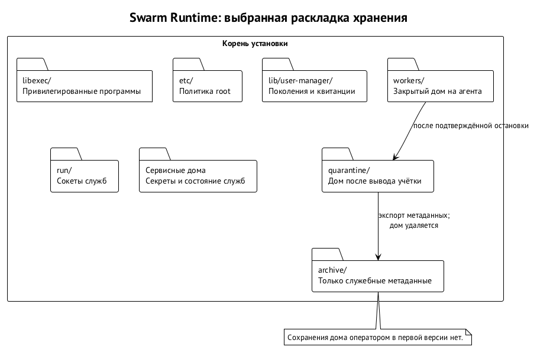

# Пользователь ОС на агента и сеть агента

Эта часть — о Swarm Runtime: как рой работает на машинах одного владельца. Начинаем с границы файлов, процессов и сети, затем переходим к ключам, полномочиям, сообщениям и запуску. Дальше — службы, которые держат обязательства, готовят дома агентов и выдают учётные данные.

Каждый автономный агент работает как отдельный пользователь ОС: оркестратор, постоянный специалист, временный воркер, рабочее место удалённого участника. Собственный UID отделяет процессы и файлы одного агента от другого. Сеть ограничивается отдельно — ядром и доверенным прокси, а нагрузку на машину — группой ресурсов ядра на каждое поколение учётки.

## Почему пользователь ОС

Инъекция в промпт действует с правами агента. Значит, правило «не читать соседний дом» должно действовать и тогда, когда модель решила его нарушить. При закрытых правах на файлы и каталоги другой пользователь не получит доступа к дому, связке ключей и памяти процессов агента, не сможет писать в его терминал и слать сигналы его процессам. Граница держится на ядре, правильной установке прав и закрытой сети; root и установка платформы считаются доверенными.

Контейнеры и виртуальные машины здесь не нужны: рантайму нужна граница между агентами одной машины, а не отдельный образ окружения для каждого. Пользователь ОС даёт её без контейнерного оркестратора. Продьюсер и ревьювер получают разные UID, и процесс продьюсера не прочитает рабочий каталог ревьювера, даже зная, где тот лежит. Защиты от ошибки в самом ядре этот выбор не обещает.

Модель привычна для Unix: службы запускают под разными пользователями, чтобы ошибка одной не давала прав другой. В Swarm Runtime создавать и выводить пользователей — обязанность платформы. Администратор и root при этом разные роли: обычная учётка администратора получает UID 0 только на время привилегированной операции. Кода, работающего под root, должно быть как можно меньше.

## Нагрузка: группа ресурсов на поколение

Отдельный UID разделяет файлы, но не процессор, память и число процессов. Агент, запустивший сборку на все ядра или форк-бомбу, иначе положит соседей и управляющие службы. Поэтому на Linux у каждого поколения учётки агента своя cgroup v2 под управлением root с лимитами `cpu.max`, `memory.max`, `memory.swap.max`, `pids.max` и ограничениями ввода-вывода. Группы агентов живут в общем поддереве недоверенной нагрузки, а управляющие службы — вне его. На каждое поколение также ставятся квоты файловой системы на блоки и inode.

Для рабочих мест удалённых участников граница строже:

- приватные пространства имён PID и сети без внешнего интерфейса — они же отделяют абстрактные Unix-сокеты;
- пустые capabilities и `no_new_privs`;
- небольшой профиль seccomp;
- `nosuid`, `nodev` и `noexec` на записываемых путях.

Это примитивы ядра, а не контейнеры: образа и контейнерного рантайма нет.

На macOS роль этой границы играет квалифицированный профиль Seatbelt для класса задачи. Пока совокупные лимиты на macOS не доказаны, инвентарь macOS честно помечен как частичный. Допустимая одновременность на первом хосте снижена, чтобы управляющим службам оставался запас; квоты и резерв задаёт профиль нагрузки.

Остановку агента подтверждает ядро. Сначала мягкий сигнал, затем `cgroup.kill`, а доказательство полной остановки — `populated 0` в `cgroup.events`, а не обход списка процессов. Двойной `fork`, `setsid` и `nohup` из группы не выводят.

## Два узких привилегированных входа

Менеджер пользователей (`swarma-user-manager`) создаёт, перечисляет и выводит учётки и управляет их сетевыми правилами и группами ресурсов. Запускатель (`swarma-user-launcher`) запускает одну одобренную программу под активной учёткой. Первый ничего не запускает, второй не создаёт учёток и правил. Произвольных команд, путей и окружения не принимает ни тот, ни другой.

Вход — вызов через `sudo` по абсолютному пути без аргументов. В правиле `sudoers` это требует пустой строки `""` в конце: правило без ограничения аргументов разрешило бы любые аргументы. Сами программы аргументы тоже отвергают. Запрос — один JSON на stdin, читать его можно не дольше 5 секунд. Пределы размера:

- менеджеру — до 16 КиБ;
- запускателю — до 80 КиБ;
- план запуска — до 48 КиБ, в base64 — до 64 КиБ.

Повторные ключи, лишние поля, второй документ и слишком длинные строки отклоняются. `SUDO_UID` говорит, какой пользователь вызвал программу, но не какая программа это сделала.

Роли задаёт конфигурация root. Доступ к бинарю сам по себе не даёт всем вызывающим одинаковых полномочий. Диспетчер (`swarma-dispatcher`) одного агента не может удалить чужого агента или учётку брокера учётных данных (`swarma-credential-broker`).

| Роль | Область действий |
| --- | --- |
| установщик | создаёт и выводит сервисные учётки, ставит и снимает их сетевые правила |
| диспетчер | создаёт агентов в пределах квоты; запускает, останавливает, выводит и меняет правила только своих учёток |
| оператор | действует через `swarma-operator`, в том числе выводит защищённые сервисы; расширяющее действие требует подтверждения человека; запускать не может |

У хоста сессий (`agent-session-host`) отдельной роли у менеджера нет: начать или остановить исполнение он просит диспетчер. Второго привилегированного пути в обход нет, жизненным циклом запуска владеет один участник. Подробно — в главе «Запуск агента и хост сессий».

Операторская подпись отделена от учётки человека и живёт в защищённой сервисной учётке, где сессий агентов нет. Для чтения есть обязательная учётка `swarma-observer`: состояние, гранты, учётки и привязки видны без подтверждений, изменить их нельзя. Расширение полномочий требует входа и подтверждения точного действия, отзыв и отключение — только входа. Устройство подписи — в главе «Ключи и ключник».

## Учётка, поколение и журнал

Учётка проходит состояния `creating → active → retiring → removed`. Менеджер журналирует шаги, откатывает неудачное создание, а войдя в `retiring`, движется только вперёд. В этот момент запускатель уже отказывает, брокер не выдаёт аренд, а восстановление после падения продолжает вывод. Каждое создание получает случайное 128-битное поколение, которое отличает его от прежнего владельца того же UID. На поколение опираются привязки, гранты и группа ресурсов; его запись хранится в журнале.

Пример. Временного разработчика вывели, а потом его UID достался ревьюверу. Одинаковый номер пользователя не возвращает старую привязку токена и не даёт доступа к личности разработчика: проверяется активное поколение, а не только UID или имя. Поколение — не счётчик, его не откатить вместе с копией журнала.

Операции менеджера и запускателя, выбор UID и восстановление координирует общий замок. Повтор того же `request_id` с теми же аргументами возвращает записанный результат и текущее состояние; с другими аргументами — отказ. У каждого шага заявки свой идентификатор эффекта, выведенный диспетчером из номера запроса и шага. После сбоя повторяются те же шаги, и получатель узнаёт уже выполненную операцию.

Если ответ потерялся, диспетчер вызывает `effect.observe`. Исходов шесть:

- записанный результат;
- операция ещё идёт;
- откат;
- достоверное отсутствие записи;
- отсутствие свидетельства;
- противоречивые свидетельства.

Последние два не позволяют считать, что эффекта не было. Даже откат или подтверждённое отсутствие записи сами по себе не разрешают создать учётку заново. Так потеря ответа не превращается в разрешение повторить весь запуск с новой личностью.

Восстановление ограничено зависимостями текущей операции и конечным бюджетом. Большой дом удаляется пачками, и между пачками общий замок отпускается, чтобы чужой запуск или остановка не ждали всей очистки. Служба не держит замок своего состояния во время синхронного вызова другой службы: она фиксирует операцию в полёте, отпускает замок, а затем заново сверяет состояние. Граф ожиданий каждой службы не содержит циклов.

Восстановление журнала из старой копии — отдельный инцидент. До публикации восстановленных данных ставится внешняя отметка и закрываются потребители журнала: брокер, запускатель, диспетчер и хост сессий. Поколение, которое по сохранившимся свидетельствам выводилось или уже выведено, в `active` не возвращается. За утраченный период отсутствие свидетельства не считается отсутствием события. Открывает доступ оператор после сверки.

Пример неполного запуска: учётка создана, а ответ о следующем шаге не пришёл. Диспетчер не выбирает между слепым повтором всей заявки и тем, чтобы забыть пользователя. Он хранит идентификаторы шагов, запрашивает наблюдение эффекта и продолжает сверку по записанному исходу. Запись об учётке и квитанция запуска отвечают на разные вопросы: существование пользователя не доказывает, что программа стартовала, а потеря ответа не доказывает, что не стартовала. Тот же разбор нужен после перезапуска службы.

## Бюджет состояния служб

Службы пишут на диск за агентов: мост — почту, хост сессий — заявки и журнал, исполнитель рабочего места — спулы и сохранённые экспорты. Если эти записи ничем не ограничены, агент забьёт диск чужими руками и сломает восстановление. Поэтому у всех трёх служб один общий контракт бюджета:

- лимиты байтов и числа записей на принципала и на узел;
- ограниченный приём добавлений и явные квитанции обратного давления;
- аудит отклонённых запросов в пределах того же бюджета.

Массовые спулы отделены от журналов, без которых не восстановиться, либо жёсткий бюджет файловой системы оставляет исключительный резерв для записей остановки и отзыва. Остановить агента и отозвать грант можно и тогда, когда всё остальное место занято.

## Переход от root к агенту

Запускатель проверяет, что поколение активно и принадлежит диспетчеру, под замком, который держит до сброса привилегий. До открытия своих файлов он закрывает унаследованные дескрипторы выше 0–2; дескриптор 3 зарезервирован под план. Программу он открывает из списка root, сверяет SHA-256 и держит проверенный дескриптор до `exec`. Для разовой работы предназначен `curator-run`, для сессии — `swarma-session-runner`.

План целиком лежит на дескрипторе 3 до старта: неизменяемые байты ограниченного размера, доступные только на чтение. На Linux это `memfd` с печатями, на macOS — неименованный файл в режиме `0400`, открытый только для чтения. Труба для этого не годится: если её ещё некому читать, запускатель встанет под замком.

Окружение собирается из фиксированного набора. Ещё под root и замком записывается квитанция старта с номером исполнения; второй старт того же исполнения отвергается. Затем процесс переносится в группу ресурсов поколения, сбрасываются дополнительные группы, GID и все виды UID, и проверяется, что вернуться в root нельзя. Только после этого отпускается замок поколения и программа выполняется через проверенный дескриптор, на Linux — `execveat`. Агент получает дескрипторы 0–2 и план; дескрипторов журнала, каталогов, брокера и замка у него нет.

Так агент не может помешать записи квитанции и не наследует привилегированного соединения с брокером: своё соединение он открывает уже из своей учётки. При сбое внутренние дескрипторы закрываются, а записи остаются для сверки. Хост сессий пользуется тем же путём запуска, своей последовательности перехода привилегий у него нет.

Остановка через `exec.stop` охватывает всю группу ресурсов поколения: мягкий сигнал, ожидание, `cgroup.kill` и подтверждение `populated 0`. На macOS, где групп нет, остановка охватывает все процессы UID: TERM, ожидание, KILL и проверку периода тишины. Агентам закрыты `cron` и `at`, а квалификация проверяет, что закрепиться через пользовательский `launchd` или `systemd --user` нельзя. Пока процессы остались или исход неизвестен, квитанции остановки нет: продолжается тот же эффект.

После замены демона старый надзиратель продолжать запись не может: каждая запись сверяется с эпохой экземпляра демона. Смерть от OOM — это потеря исполнения, а не подтверждённая остановка. При перезапуске соседних служб менеджер явно учитывает судьбу процессов диспетчера, его надзирателей, исполнения, обновления токена и хоста сессий.

## Дома и результаты

Корень установки — `/opt/swarma`:

- привилегированные программы — в `libexec/`;
- политика root — в `etc/`;
- журнал учёток и квитанции — в `lib/user-manager/`;
- сокеты — в `run/`.

Сервисные дома отделены от `workers/`, карантин — от архива метаданных. Снаружи только то, чему ОС сама назначает место: записи пользователей, `sudoers`, описания служб и файрвол. Установка требует администратора, но отключать SIP на macOS не нужно.

У агента своя основная группа с тем же именем и номером, дополнительных групп нет. Дома закрыты режимом 0700. Агентские UID и GID берутся из диапазона 30000–59999, сервисные — 450–499 на macOS и 900–999 на Linux. Курсор выдачи идёт по кругу. Номер используется повторно только после полного круга и проверки, что под корнем платформы и во временных каталогах не осталось файлов прежнего владельца; иначе — `uid_not_clean`.

Файловые операции идут относительно открытых дескрипторов каталогов и не следуют по ссылкам: на Linux — `openat2` с `RESOLVE_BENEATH` и `RESOLVE_NO_SYMLINKS`, на macOS — последовательный `openat` с `O_NOFOLLOW`. Дом создаётся пустым, рекурсивного `chown` нет. Ссылка из дома на чужой каталог при удалении отвязывается как ссылка, очистка к её цели не переходит.

При выводе дом удаляется. Агент мог прочитать выданный токен и спрятать копию в содержимом, имени файла или цели ссылки. Сканирование не обещает отсутствия секретов, а сложный классификатор раздул бы доверенный код root. Поэтому архивирования домов нет, и сохранить дом оператором в первой версии тоже нельзя. Код и результаты уходят через git и приёмку задач; приёмка, впрочем, тоже не доказывает, что в результатах нет секретов.

Привязку у брокера диспетчер или оператор снимают отдельно, до вывода: менеджер под своим замком брокеру не звонит. Если брокер недоступен при прямом выводе, неподтверждённая отвязка остаётся явным долгом. Дальше менеджер останавливает процессы, переносит дом в карантин, уничтожает ключи по объявленным путям и удаляет содержимое по дескрипторам. Неизвестный результат уничтожения ключа или нечитаемый объект успехом не считаются. Пока удаление не подтверждено, состояние `removed` недостижимо.

В журнале остаются исходы шагов, включая ошибки и неизвестные результаты, но не секреты. Для вывода по истечению срока скачка системных часов мало: нужен ещё реально прошедший монотонный срок с учётом сна. Экспорт метаданных содержит только собственные служебные записи, без строк, имён и содержимого агента; схему и проверку происхождения задаёт спецификация менеджера.

Архив предназначен только для экспортов метаданных: каталог root 0700, файлы root 0600. Очистка при выводе и по суточному таймеру удаляет экспорты старше недели и сверх общего объёма, но не свидетельства, ещё нужные для сверки эффектов. Каталог архива не разрешает складывать туда дома.

Родительский оркестратор дом ребёнка по умолчанию не читает. Чтение через ACL появится во второй версии, но гарантии наблюдаемости не даст: на Linux маска режима ограничит чтение файлов 0600, а на macOS владелец может снять ACL. Транскрипты и журнал принадлежат хосту сессий, результаты уходят через доску и пакет передачи.

Постоянную команду объявляет подписанное оператором описание ролей, профилей, сред и учётных записей — объект `swarma-dispatcher team/1`. Диспетчер идемпотентно сверяет или создаёт их, в том числе после перезагрузки. Формат объекта задаёт спецификация диспетчера.

Постоянные учётки и исполнения сроком не ограничены, их вывод или пересоздание требует оператора. Для остальных есть пределы: учётка — 24 часа с продлением до 7 дней, исполнение — 4 часа с продлением до 12. Вывод пользователя не отзывает постоянную личность. Разовую личность диспетчер отзывает отдельным шагом, если сам регистрировал её как разовую. Подробно — в главе «Ключи и ключник».

Связанный `git worktree` между разными учётками использовать нельзя: его служебные данные ссылаются на общие ссылки, настройки и хуки. Ребёнок получает самостоятельный репозиторий со своим `.git`, без исполняемых настроек родителя и его credential helpers. Копировать дёшево можно клоном APFS или `cp --reflink` на Btrfs и XFS. Внутри одной учётки рабочие деревья допустимы. Логи сессий в git не попадают.

## Кто имеет привилегии

Службы разделены, чтобы захват одного процесса не давал всего. Размещение такое:

| Компонент | Учётка и граница |
| --- | --- |
| ключник | root, системная служба; доступ к ключам по UID собеседника |
| менеджер и запускатель | root на одну узкую операцию через `sudo` |
| брокер учётных данных | отдельная сервисная учётка; подписки и аренды токенов |
| диспетчер | отдельная сервисная учётка; учёт запусков и ёмкости |
| хост сессий | отдельная сервисная учётка; сессии, почта и границы управления |
| исполнитель действий с репозиторием | отдельная сервисная учётка; публикация кандидата, передача раннерам, обновление базы, приземление |
| прокси | своя сервисная учётка; выход по обслуживаемой политике |
| мост | отдельная непривилегированная учётка; учётные данные носителя |
| агентская среда | учётка агента |

## Машина выбирает сеть

Пользователь ОС сам по себе сеть не закрывает. В v1 `pf` на macOS или `nftables` на Linux пускает локального агента только к его слушателю прокси; прямого выхода и запасного маршрута нет. Unix-сокеты файрвол не фильтрует: служба узнаёт UID собеседника от ядра, а квалификация проверяет, что агенту достижимы только объявленные сокеты. Аутентификация службы ещё не доказывает, что посторонний сокет недоступен.

Политика root сопоставляет допущенный профиль Swarm Curator — имя и отпечаток lock-файла — ровно одному сетевому профилю. Агент эту политику читает, но не меняет. Выбор сети, наследование и умолчания сверяются с ней; несовпадение даёт `network_profile_denied`. Локальная настройка оркестратора не может разрешить ребёнку более широкий выход. Отдельного сетевого измерения у гранта нет: сужение разрешённых профилей сужает и сеть.

Диспетчер фиксирует профиль и отпечаток при допуске, повтор и восстановление их сохраняют. Если политика изменилась до применения правил, следует отказ, а не подмена выхода. На машине платформы варианты `direct` и `external-http-proxy` не привязываются: первый сеть не ограничивает, второй не доказывает обслуживаемой политики. Они остаются для машин оператора без платформы.

У прокси отдельный слушатель на каждое привязанное поколение, и строка ядра разрешает учётке только его порт. Сам TCP-слушатель UID не знает, соответствие обеспечивает ядро. Менеджер проверяет поколение и реально обслуживаемую политику, а не только владельца порта. Как отпечатки сетевого профиля соотносятся с обслуживаемой политикой, задаёт спецификация сетевых профилей.

Правила ставятся до первого запуска, в операции активации, и снимаются в конце вывода. Чтобы сузить работающую политику, нужно сбросить состояния ядра и оборвать или перепроверить старые сессии прокси. В v0 есть только статический запрет агентского диапазона с доступом к слушателям платформы; собственный слушатель на поколение и полный запрет — это v1. Заявленный профиль v0 не доказывает применённого ограничения, поэтому недоверенные рабочие места в v0 не допускаются.

Кооперативные профили, которые направляют среду через прокси настройкой запуска, работают уже сегодня. Это маршрут, а не принуждение.

Принуждение требует отдельной квалификации ядра и прокси для каждой поддерживаемой версии ОС. Проверяются IPv4, IPv6, loopback, DNS, QUIC, открытые сокеты, состояния и приоритет правил на всех интерфейсах, включая туннельные. `pf` связывает с пользователем только TCP и UDP; остальное либо ограничивает запускатель, либо сочетание признаётся неподдерживаемым. Неполная матрица не позволяет назвать профиль принудительным.

### Сетевая заморозка поколения

Заморозка сначала сужает правило ядра для поколения, затем сбрасывает сессии прокси этого поколения и только потом снимает слушатель. Запись о заморозке переживает перезапуск, а повторное применение старого правила отсекается номером поколения. Соседнее поколение не затрагивается. Остановка процесса сама по себе сетевого сдерживания не доказывает, поэтому заморозка — отдельный шаг с собственной квитанцией.

## Что ограничивает CONNECT

Прокси пропускает `CONNECT` к наблюдённым адресатам провайдера для квалифицированного сочетания среды и версии. Гарантия касается имени, порта и проверенного адреса соединения. TLS прокси не расшифровывает и приложения внутри туннеля не видит. Поэтому разрешённый адресат остаётся каналом выноса данных, а общий фронт может через domain fronting обслужить другой сайт. Успешный вызов модели не доказывает защиты сильнее этой.

Пример. Попытку агента обратиться к запрещённому Matrix-адресату прокси остановит, а передачу данных внутри разрешённого туннеля к провайдеру — нет. `dial-guard/1` проверяет адрес до соединения: отвергает внутренние, локальные, tailnet- и metadata-адреса, включая обходные представления и преобразования, и не даёт подменить проверенный адрес при соединении. Точные диапазоны задаёт спецификация сетевых профилей.

Частота, число соединений, суточный объём и длительность туннеля ограничены; почтовые порты закрыты. Расход принадлежит поколению: перезапуск прокси или новый слушатель новой нормы не дают, а неизвестный остаток означает отказ. В журнале решения и объём — без тел, заголовков, токенов и URL запросов.

DNS требует отдельной границы. На macOS имена может разрешать `mDNSResponder`, на Linux — `systemd-resolved`, и уже не от UID агента. Для `CONNECT` имена разрешает прокси, а доступ агента к собственному резолверу закрывает квалифицированная песочница. Одним пакетным фильтром по UID этого не доказать.

## Службы, рабочее место и проверка кода

Диспетчеру и хосту сессий закрыт весь исходящий трафик, включая loopback и прямой DNS; управление идёт через Unix-сокеты. У брокера свой профиль и свой слушатель для входа и обновления токенов. Адресаты определяются наблюдением точной одобренной сборки, а не заявлением `credential_binding`; прямого запасного пути нет. Исполнитель действий с репозиторием выходит только к хостингу кода проекта и к раннерам по своему квалифицированному маршруту; частный адрес раннеров исключения из защиты адресов не делает. У прокси выход шире, но ограничен политиками и выразимым средствами ядра запретом адресов. Каждая непривилегированная служба получает явную строку сети.

Строки, слушатели, резолвинг и приоритет правил проверяются при старте и по расписанию. Нечитаемое или несовпавшее свидетельство снимает готовность к принуждению. Периодическая проверка оставляет окно обнаружения, так что называть её непрерывным контролем нельзя.

Пример: после перезапуска прокси его порт может занять другой слушатель. Совпадения номера порта и даже ожидаемой сервисной учётки мало, нужно подтвердить нужное поколение и обслуживаемую политику. Если подтверждение не прочиталось, прежняя готовность не доказывает текущую. То же с расходом: неизвестный суточный остаток нельзя заменить новой полной нормой. Перезапуск сохраняет ограничения, а не тихо расширяет выход.

У рабочего места удалённого участника на нашей машине — zero egress, включая loopback: ни профиля, ни слушателя, ни прокси. Модель вызывается у донора. На Linux это сетевое пространство имён без внешних интерфейсов и ограничение семейств адресов, на macOS — песочница без сети вместе с запретом по UID. Входящий SSH принадлежит `sshd`, переадресация запрещена. Запрет выхода не закрывает вход, поэтому у входа свой жизненный цикл.

### SSH-вход и жизненный цикл поколения

SSH-канал привязан к поколению: принципал сертификата сопоставляется с конкретным поколением через `AuthorizedPrincipalsCommand`, а таблица сопоставления лежит вне контроля работника. Закрытие поколения идёт строго по порядку:

1. заморозить поколение;
2. закрыть вход — принципалы закрытого поколения больше ни с чем не сопоставляются;
3. остановить через `cgroup.kill`;
4. выполнить экспорт;
5. заменить поколение.

Войти в закрытое поколение нельзя, поэтому переподключение донора во время остановки или экспорта не породит процесса под старым UID. Единица отмены — остановка всего UID, она закрывает и полосу работы, и SSH-сессию. Постоянный отзыв сертификата и запрет инструментов этот порядок дополняют, но не заменяют.

Веб по умолчанию выключен. Задача получает документацию и ресурсы только для чтения, с отпечатками; недостающее собирает доверенная сторона. Поиск возможен по отдельному допуску личности доверенного круга — через провайдера, MCP донора или службу платформы. Такой допуск не ослабляет zero egress рабочего места и не передаёт проекту ключ поиска донора.

Сборки, тесты и исполнение кода кандидата вынесены на изолированные эфемерные раннеры другой машины, без наших секретов. Агент заказывает проверку и читает результат; реестров пакетов и хостинга кода в его профиле нет.

Проверка идёт в две фазы:

1. **Выборка.** Зависимости приходят по lock-файлам через контролируемый выход, без install-скриптов, build hooks и кода кандидата.
2. **Исполнение.** Зависимости уже есть, но маршрута и сокета выхода нет; остаётся loopback без резолвера.

Недостающая зависимость ломает сборку, а не открывает сеть снова. Вендоринг запрета ОС не отменяет. Где возможно, зеркало ограничивает методы и пути; `CONNECT` непрозрачен и может нести загрузку наружу. Журнал выборки возвращается вместе с результатом и привязан к отпечатку кандидата.

## Действия с репозиторием

Публикацию кандидата, передачу пакета раннерам, обновление базы и приземление выполняет отдельная служба — исполнитель действий с репозиторием — под собственной системной учёткой. Ни у агента, ни у диспетчера, ни у хоста, ни у брокера пути к хостингу кода нет. Свои учётные данные исполнитель получает через брокер. Каждое действие он выполняет только по подписанному доской запросу, привязанному к точному кандидату, и проверяет полномочие на границе действия. Голову ветки он продвигает сравнением-и-заменой: если голова сдвинулась, действие отказывает и кандидата пересобирают.

## Пределы границы

Граница пользователя не защищает от захваченного root или ошибки ядра, не прячет от среды выданный ей токен и не гарантирует качества работы в пределах разрешённых прав. Её задача — удерживать область доступных действий при оговорённых условиях. Следующие главы добавляют к этой области проверяемого отправителя и полномочия, но этих допущений не отменяют.
