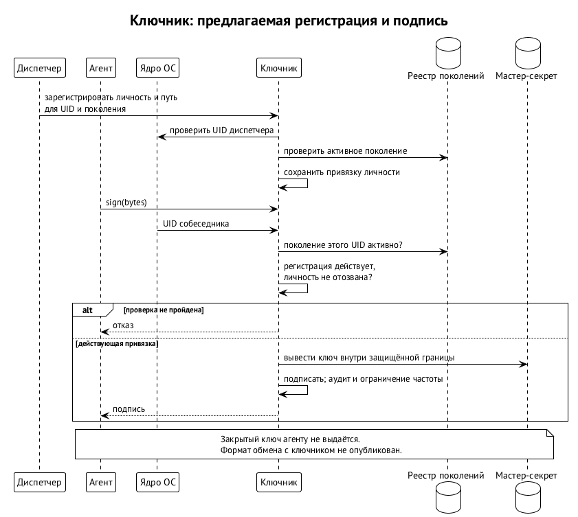

# Ключи и ключник

Криптографическая личность агента — ключевая пара, которой удостоверяются его сообщения и квитанции. Она отвечает на вопрос, кто отправитель, но сама по себе ничего не разрешает. Принцип Swarm Runtime: закрытого ключа личности у агента нет. Вместо того чтобы читать секрет, агент просит отдельную привилегированную службу — ключника — выполнить операцию за него.

Это защита от конкретного последствия инъекции. Если ключ лежит в доме агента или в доступной ему связке ключей, достаточно уговорить модель прочитать файл. Когда закрытого ключа у процесса нет, так его не украсть. Но захваченный агент всё ещё может просить допустимые операции от своей личности: сохранность ключа не делает правильным каждое подписанное сообщение.

Ключник — не Swarm Keeper. Кипер ведёт обязательства и передачу ответственности, ключник обслуживает ключи. Дизайн ключника решён; модуля и контракта у него пока нет, поэтому до его появления действует временное исключение, описанное ниже.

## Какие секреты есть в системе

Важно не принять ключ заявки диспетчеру (`swarma-dispatcher`) за ключ личности, а токен провайдера — за ключ подписи. Таблица разводит назначения.

| Ключ или секрет | Где находится | Назначение | Готовность |
| --- | --- | --- | --- |
| ключ личности агента | у ключника, выведен из мастер-секрета; агенту не выдаётся | сообщения и квитанции | спроектирован |
| ключи личности в Swarm Chain | у ключника, выведены из мастер-секрета хэш-деривацией | подписи SLH-DSA для ячейки личности и пачек аттестаций | спроектированы |
| ключ вызывающего | в доме оркестратора; публичная часть зарегистрирована у диспетчера на поколение | заявки `swarma-dispatcher request/1` | временный, до ключника; контракт опубликован |
| корневой ключ брокера учётных данных (`swarma-credential-broker`) v0 | программный Ed25519 в `swarma-operator`, файл 0600 | гранты и отзывы брокера | контракт v0 опубликован; переносится в реестр |
| ключ оператора на телефоне | Secure Enclave или StrongBox, не покидает телефон | одно точное действие оператора | спроектирован |
| ключи донора | на машине донора | подпись, расшифровка пакета, вход по SSH | спроектированы |
| ключи центров SSH | у ключника или на аппаратном токене | сертификаты серверов и короткие сертификаты работников | спроектированы |
| токен провайдера модели | у брокера, на время запуска — в окружении среды | доступ к провайдеру; ничего не подписывает | контракт опубликован |

Ключ вызывающего — явное исключение из принципа. Он лежит в доме оркестратора, поэтому инъекция в оркестратор может им воспользоваться. Его силу ограничивает грант оркестратора, а отзыв гранта отрезает права агентов, заведённых по его заявкам. Перенос ключей под ключника — отдельная процедура со своими шагами. Цепочки и отзыв — в главе «Гранты и полномочия».

Корректная подпись заявки этим ключом доказывает, какой зарегистрированный вызывающий её подписал. Она не доказывает права создать ребёнка с любыми аккаунтами и профилями: цепочку разрешений диспетчер проверяет отдельно. По той же причине аппаратное хранение операторского ключа не заменяет показа человеку точного содержания действия. Разные назначения у ключей нужны затем, чтобы одно свидетельство нельзя было выдать за другое.

## Мастер-секрет и стабильная личность

У установки один мастер-секрет. Где возможно, он защищён аппаратным хранилищем: Secure Enclave на Mac, TPM на Linux, DPAPI или TPM через CNG на Windows. Ключи агентов для рантайма выводятся иерархически по BIP-32 в варианте SLIP-0010 для Ed25519, только жёсткой деривацией: зная дочерний ключ, нельзя вычислить ни родительский, ни соседний. Ключи для Swarm Chain выводятся из того же секрета хэш-функцией (SHAKE256 от пути и номера ротации): подписи цепочки — SLH-DSA, и кривые им не нужны.

Путь деривации кодирует стабильную личность: `назначение'/продукт'/проект'/агент'`. Это не путь в файловой системе и не UID. Пользователь ОС может исчезнуть и появиться снова, а постоянная личность остаётся. Оркестратор переехал на другую машину с тем же мастер-секретом и зарегистрировал тот же путь — у него прежний ключ и прежняя личность, хотя номер пользователя новый.

Ключник публикует публичный корень, который владелец подтверждает при установке в клиентском приложении. Новому агенту соответствует публичный ключ и удостоверяющая подпись корня. Тот, у кого есть этот корень, проверит происхождение ключа без запроса к серверу. Подлинность цепочки держится на закреплённом корне и сохранности закрытого материала; знакомое имя агента подписи не заменяет.

Иерархия связывает личности одного владельца, но не делает агентов под одним корнем независимыми и не гарантирует честности владельца. В Swarm Chain у каждой личности есть ячейка с текущими ключами и хэшем следующих, а корень владельца — её родитель. Подробно — в главе «Идентичность агента».

### Смена и компрометация мастер-секрета

Мастер-секрет общий для всех агентов установки, поэтому его компрометация компрометирует всех. Защищаются от этого минимальным привилегированным ключником с аудитом и, где возможно, аппаратным хранением. Отдельные UID и суженные гранты потерянный корень сохранным не делают.

Плановая смена: ключник создаёт новый корень, все агенты заново регистрируются под ним. Непрерывность личностей держит долгоживущий ключ владельца, который удостоверяет оба корня — старый и новый. Проверяющая сторона видит, что новая ветка продолжает старую.

Компрометация: старый корень отзывается в реестре. С этого момента все ключи агентов под ним недействительны, и ключи выдаются заново под новым корнем. Предротация здесь не помогает: следующие ключи агентов выводятся из того же мастер-секрета, и укравший его знает их тоже. Поэтому в Swarm Chain ячейки агентов переводит на ключи нового корня их родитель — ячейка владельца, ключи которой из мастер-секрета не выводятся и хранятся отдельно. После этой траты у вора нет ни текущих, ни следующих ключей ячейки, и личности агентов сохраняются (глава «Идентичность агента»).

## Собеседника устанавливает ядро

Ключник слушает Unix-сокет. При подключении UID собеседника сообщает ядро: `LOCAL_PEERCRED` на macOS, `SO_PEERCRED` на Linux. Агент не выбирает свою личность текстовым полем запроса. Служба находит разрешённый путь деривации по зарегистрированной привязке и работает только с соответствующим ключом. Сокет доступен всем пользователям машины, но ключи — нет.

Видно это на попытке подмены. Процесс ревьювера может написать в запросе имя оркестратора, но его соединение всё равно несёт UID ревьювера. Ключник опирается на сведения ядра и регистрацию; самоописание клиента ему не нужно. То, что служба работает от root, не мешает обслуживать непривилегированных пользователей: права службы нужны для доступа к секрету, а права клиента определяют, какую операцию можно выполнить.

Набор операций узок:

| Операция | Что делает и чем ограничена |
| --- | --- |
| `sign(bytes)` | подписывает байты ключом личности подключившегося агента |
| `decrypt(blob)` | расшифровывает пакет, адресованный этому агенту |
| `pubkey(identity)` | возвращает публичный ключ |
| `register` | диспетчер связывает учётку и личность |
| `revoke(identity)` | отзывает личность в пределах полномочий оператора или зарегистрировавшего её диспетчера |

Формат обмена задаёт спецификация ключника.

Привязка содержит не только UID: поколение учётки, путь деривации, владельца, номер регистрации и признак разовой или постоянной личности. Подключение допустимо, только если поколение этого UID активно в журнале менеджера пользователей (`swarma-user-manager`). Поэтому новый пользователь с повторно выданным UID не наследует ключ прежнего владельца. Устройство поколений — в главе «Пользователь ОС на агента и сеть агента».

Нужны обе проверки. UID от ядра говорит, какой процесс подключился сейчас, но не говорит, кому этот номер принадлежал раньше. Регистрация связывает учётку с личностью, но устаревшая запись не должна давать доступа после вывода поколения. Постоянная таблица «числовой UID — ключ» этого контракта не выражает. И новая учётка не считается продолжением старой только потому, что совпало имя.

Закрытую пару не кладут в связку ключей агента даже ради удобства системных утилит: иначе граница снова зависела бы от того, откажется ли модель читать свой секрет. Ключник удерживает материал ключа у себя и копий не заводит. И для подписи, и для расшифровки личность выбирается по подтверждённой привязке.

У расшифровки свой предел конфиденциальности. Оркестратор получает пакет, зашифрованный на его публичный ключ, обращается к ключнику и получает открытый текст в свой процесс; операция попадает в аудит и ограничена по частоте. После ответа текст уже у процесса и может оказаться в доме оркестратора. Поэтому пакет адресуют тому, кому действительно нужно его читать, и не кладут в него лишнего. Отдельное хранение ключа не защищает расшифрованное содержимое от самого адресата.

## Учётка заканчивается, личность остаётся

Вывод учётки и отзыв личности — разные операции. Вывод отключает доступ через эту учётку, но постоянную личность не уничтожает. Повторная регистрация того же пути после создания новой учётки может вернуть прежний ключ. Так разделяются три жизненных цикла: процесса, пользователя ОС и криптографической личности.

Разовую личность диспетчер отзывает отдельным шагом после вывода учётки — если сам зарегистрировал её как разовую. Задним числом из имени пользователя или запроса на удаление это не выводится. Постоянного участника — оркестратора или закреплённую роль команды — отзывает только оператор, подписанной записью. Уборка временных исполнений не может уничтожить личность постоянного участника.

Право регистрации не равно праву любого последующего отзыва. Диспетчер, который создаёт временных воркеров, не становится владельцем постоянных личностей команды. Запрос вывести постоянного специалиста не даёт права переобозначить его разовым и потом отозвать автоматически. Признак задаётся при регистрации, а источник полномочия на отзыв остаётся отдельным. Обслуживание учёток не смешивается с решением владельца о судьбе личности.

Остановка постоянного специалиста на обслуживание — не его криптографическая смерть. Вернувшись с тем же путём, он узнаваемо продолжает работу. У разового воркера другой контракт: его учётку выводят, а затем отдельной операцией отзывают разовую личность. В обоих случаях проверяющая сторона не угадывает намерение по исчезновению процесса или имени каталога.

## Оператор подписывает одно действие

Отдельной человеческой границы требуют:

- выдача гранта;
- подключение подписки;
- постоянная команда;
- вывод или пересоздание постоянного агента;
- полномочия на остановку для обслуживания;
- продление постоянных грантов.

Сессия агента не может расширить права от имени человека. Основной путь — телефон с неэкспортируемым ключом в Secure Enclave или StrongBox и подтверждением биометрией.

Приложение подключается по SSH через tailnet к `swarma-operator`. Вместо shell там принудительная узкая операторская команда: без произвольного исполнения, без входа по паролю и без сессий агентов. Приложение показывает точное содержание — кому, что и до какого срока разрешается, — и после подтверждения подписывает именно его. Машина проверяет подпись по закреплённому ключу телефона. Прежняя подпись не подтверждает будущего действия. Имя и формат команды, настройку `sshd`, домен подписи и её канонические байты задаёт спецификация операторского пути.

Расширение требует входа и явного подтверждения содержания. Отзыв — одно касание с биометрией: остановить возможность действия должно быть проще, чем её выдать. Чтение состояния идёт через `swarma-observer`, где подписи нет. Наблюдение, расширение и сужение разделены, и подтверждать человеком каждое чтение не нужно.

### Регистрация, второе устройство и потеря телефона

Ключ телефона регистрируется при установке: сопряжение по QR с подтверждением и на терминале, и на телефоне. Второе устройство обязательно — резервный ключ FIDO2 или второй телефон. Заменяют ключ подписью второго устройства, потерянный — им же отзывают. Без второго устройства установка регистрацию оператора не завершает: потеря единственного телефона иначе означала бы потерю управления.

Ключи и гранты держит одна служба реестра владельца. Она единственный авторитетный писатель, ведёт журнал на git для аудита и раздаёт службам подписанные снимки, которые не старше 60 секунд. Корень брокера v0 переносится в этот реестр под подпись ключа оператора.

Запасной путь — терминал. Оператор входит в защищённую учётку через `sudo` с паролем, без `NOPASSWD` и без кэша, с `timestamp_timeout=0`, и выполняет те же узкие команды. Это не парольный SSH-вход, который для телефонного пути запрещён. Если телефона нет, это не повод запускать агентскую сессию под операторской учёткой или копировать операторский ключ в дом агента.

### Общий стоп

Общий стоп всей установки — одна команда оператора, подписанная телефоном. Она доставляется напрямую каждой службе, чтобы отказ одной не мешал остальным:

- менеджер замораживает все поколения и закрывает вход;
- брокер отзывает аренды;
- хост сессий (`swarma-session-host`) останавливает сессии;
- диспетчер прекращает запуски.

Возобновить работу можно только подписью оператора, после сверки надёжных частей всех служб. Кипер может получить от оператора доверенность на стоп с названным поводом. Это право только остановить; возобновляет оператор.

Если учётку ни разу не запускали, отсутствие процессов подтверждает авторитетное свидетельство, что запуска под границей остановки не было. Пробный старт ради проверки и общий kill по UID этого свидетельства не заменяют. Общее правило: то, что процесса не видно, не доказывает, что новое исполнение уже нельзя создать.

## Внешняя личность

Внешний работник нашим ключником не пользуется: у него свои ключи для подписи, расшифровки пакета и SSH. При регистрации он подписывает своим ключом сертификат с метаданными и нашим challenge. Это доказывает владение ключом, но ещё не связь с известным человеком. Связь сверяется с подписанной карточкой на бирже, если она есть, или с приглашением с одноразовым кодом. После проверки ключи закрепляются в реестре, а корень подписывает допуск с ролью. Согласие донора на подключение его учётных данных — отдельное подтверждение ключом с присутствием человека; подробно — в главе «Удалённое рабочее место».

Второго голосового канала не предполагается: у человека, впервые пришедшего в среду, его может не быть. У каждого работника свои ключи, чтобы отзыв одного не задевал остальных. Доказательство владения, закрепление ключа и выдача роли — три разных шага, и ни один из них не подменяется самоподписанным заявлением о широких правах.

На Mac без административной установки ключи донора создаются в Secure Enclave и не экспортируются; для подписи и SSH используется P-256. На Linux в этом варианте ключи лежат в файлах 0600, TPM появится позже. При установке с отдельными учётками мост работает под служебной учёткой без интерактивного входа: Keychain он не использует и держит ключи в файлах 0600, которые читает только учётка моста. Аппаратная неэкспортируемость есть не во всех вариантах.

## Два центра SSH

Ключ хоста удостоверяет SSH-сервер перед донором; ключ работника удостоверяет входящего работника перед сервером. Первый одинаков для всех клиентов сервера, второй принадлежит конкретному работнику и создаётся у донора, и его закрытая часть машину донора не покидает. Назначения разные, поэтому и центров сертификации два.

Центр хостов держит закрытый Ed25519 у ключника или на аппаратном токене, но не на SSH-серверах. Он подписывает ключи серверов на имена и срок около года, с автоматическим продлением; сервер использует `HostCertificate`. Публичный ключ центра публикуется в `TXT _swarma-ssh-ca.<домен>` под DNSSEC и входит в пакет допуска; `SSHFP` для ключа центра не подходит. Клиент доверяет центру через `@cert-authority`. Добавление сервера не требует новой DNS-записи для каждого работника.

Отдельный центр пользователей выдаёт ключу работника сертификат примерно на сутки; принципал — поколение рабочего места. Продление идёт по проверенному каналу, сервер доверяет центру через `TrustedUserCAKeys`. KRL доставляется клиентам для отозванных ключей хостов через `RevokedHostKeys` и серверам — для ключей работников. При смене ключа центра новый публикуют рядом со старым, выдерживают период доверия обоим и только потом убирают старый.

Опция `restrict` в сертификате и запреты переадресации, PTY и файлов запуска в конфигурации сервера — разные вещи, и нужны обе. Первая ограничивает то, что разрешено этому сертификату, вторая — то, что сервер вообще допускает.

Пример. Новый SSH-сервер получает свой ключ хоста и сертификат центра хостов. Работник проверяет его через уже закреплённый центр, а сервер отдельно проверяет короткий сертификат работника. Доверие в одну сторону не заменяет доверия в другую: сертификат сервера не даёт клиенту входа, а допуск работника не удостоверяет любой встреченный сервер. Публичность ключа центра не делает доступной его закрытую часть. Так серверы добавляются, а отдельных работников можно отзывать без общего ключа доступа на всех.

## Дальше

Глава «Гранты и полномочия» отвечает на следующий вопрос: что разрешено подлинному отправителю. Ключ, который никогда не покидал защищённую службу, всё равно может подписать запрос, на который у отправителя нет полномочия. Проверка подписи — необходимая часть допуска, но решение об эффекте принимает его исполнитель.
