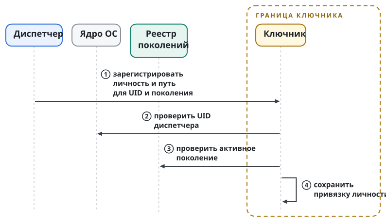
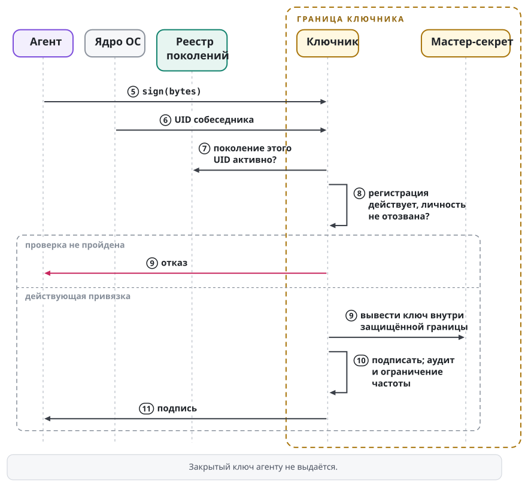

# Ключи и ключник

Криптографическую личность агента задаёт ключевая пара, ключ личности. Личность отвечает на вопрос, кто отправитель, и сама по себе ничего не разрешает. Сообщения агента подписывает отдельный ключ сообщений, и аттестация связывает этот ключ с личностью агента (раздел "Ключ сообщений и его аттестация"). Принцип Swarma Runtime: закрытого ключа личности у агента нет. Операцию с ключом за агента выполняет отдельная привилегированная служба, ключник; агент только просит её об операции и секрета не читает.

Принцип защищает от конкретного последствия инъекции. Если ключ лежит в доме агента или в доступной ему связке ключей, достаточно уговорить модель прочитать файл. Когда закрытого ключа у процесса нет, так его не украсть. Захваченный агент при этом может просить допустимые операции от своей личности: сохранность ключа не делает правильным каждое подписанное сообщение.

Ключник и Swarma Keeper отвечают за разное. Кипер ведёт обязательства и передачу ответственности, ключник обслуживает ключи.

## Какие секреты есть в системе

В установке несколько ключей и секретов с разными назначениями. Ключ заявки диспетчеру (`swarma-dispatcher`) не служит ключом личности, и токен провайдера не служит ключом подписи. Таблица разводит назначения:

| Ключ или секрет | Где находится | Назначение |
| --- | --- | --- |
| ключ личности агента | у ключника, выведен из мастер-секрета; агенту не выдаётся | подписи от имени личности агента |
| ключ сообщений агента | у ключника, выведен по отдельному назначению рядом с ключом личности; агенту не выдаётся | подписанные сообщения агента |
| корень аттестаций ключника | у ключника, отдельное назначение | только аттестации ключей сообщений агентов |
| ключи личности в Swarma Chain | у ключника, выведены из мастер-секрета хэш-деривацией | подписи SLH-DSA для ячейки личности и пачек аттестаций |
| ключ вызывающего | в доме оркестратора; публичная часть зарегистрирована у диспетчера на поколение | заявки `swarma-dispatcher request/1` |
| корневой ключ брокера учётных данных (`swarma-credential-broker`) v0 | программный Ed25519 в `swarma-operator`, файл 0600 | гранты и отзывы брокера |
| ключ оператора на телефоне | Secure Enclave или StrongBox, не покидает телефон | одно точное действие оператора |
| ключи донора | на машине донора | подпись, расшифровка пакета, вход по SSH |
| ключи центров SSH | у ключника или на аппаратном токене | сертификаты серверов и короткие сертификаты работников |
| ключ реестра владельца | в изолированном процессе подписи под своей учёткой на узле доверия | снимки отзывов, контрольные точки журнала и записи свежести реестра |
| ключ службы грантов | у отдельной службы подписи грантов | гранты внутри родительского гранта |
| токен провайдера модели | у брокера; на время запуска в окружении среды | доступ к провайдеру; ничего не подписывает |

Ключ вызывающего составляет явное исключение из принципа. Он лежит в доме оркестратора, поэтому инъекция в оркестратор может им воспользоваться. Силу этого ключа ограничивает грант оркестратора, и отзыв гранта отрезает права агентов, заведённых по его заявкам. Перенос ключей под ключника идёт отдельной процедурой со своими шагами. Цепочки и отзыв разобраны в главе "Гранты и полномочия".

Корректная подпись заявки этим ключом доказывает, какой зарегистрированный вызывающий её подписал. Права создать ребёнка с любыми аккаунтами и профилями она не доказывает: цепочку разрешений диспетчер проверяет отдельно. По той же причине аппаратное хранение операторского ключа не заменяет показа человеку точного содержания действия. Ключам дают разные назначения, чтобы одно свидетельство нельзя было выдать за другое.

## Мастер-секрет и стабильная личность

У установки один мастер-секрет. Где возможно, его защищает аппаратное хранилище: Secure Enclave на Mac, TPM на Linux, DPAPI или TPM через CNG на Windows. Ключи агентов для рантайма выводятся иерархически по BIP-32 в варианте SLIP-0010 для Ed25519, только жёсткой деривацией: зная дочерний ключ, нельзя вычислить ни родительский, ни соседний. Ключи для Swarma Chain выводятся из того же секрета хэш-функцией (SHAKE256 от пути и номера ротации). Подписи цепочки используют SLH-DSA, и кривые им не нужны.

Путь деривации кодирует стабильную личность: `назначение'/продукт'/проект'/агент'`. Путь деривации не совпадает ни с путём в файловой системе, ни с UID. Пользователь ОС может исчезнуть и появиться снова, а постоянная личность остаётся. Пример: оркестратор переехал на другую машину с тем же мастер-секретом и зарегистрировал тот же путь. У него прежний ключ и прежняя личность, хотя номер пользователя новый.

Ключник публикует публичный корень, который владелец подтверждает при установке в клиентском приложении. Новому агенту соответствует публичный ключ и удостоверяющая подпись корня. Тот, у кого есть этот корень, проверит происхождение ключа без запроса к серверу. Подлинность цепочки держится на закреплённом корне и сохранности закрытого материала; знакомое имя агента подписи не заменяет.

Иерархия связывает личности одного владельца. Иерархия не делает агентов под одним корнем независимыми и не гарантирует честности владельца. В Swarma Chain у каждой личности есть ячейка с текущими ключами и хэшем следующих, и родителем этой ячейки служит корень владельца. Подробно об этом в главе "Идентичность агента".

### Смена и компрометация мастер-секрета

Мастер-секрет общий для всех агентов установки, поэтому его компрометация компрометирует всех. От этого защищают минимальный привилегированный ключник с аудитом и, где возможно, аппаратное хранение. Отдельные UID и суженные гранты потерянный корень сохранным не делают.

Плановая смена: ключник создаёт новый корень, все агенты заново регистрируются под ним. Непрерывность личностей держит долгоживущий ключ владельца, который удостоверяет оба корня, старый и новый. Проверяющая сторона видит, что новая ветка продолжает старую.

Компрометация: старый корень отзывается в реестре. С этого момента все ключи агентов под ним недействительны, и ключи выдаются заново под новым корнем. Предротация здесь не помогает: следующие ключи агентов выводятся из того же мастер-секрета, и укравший его знает их тоже. Поэтому в Swarma Chain ячейки агентов переводит на ключи нового корня их родитель, ячейка владельца. Ключи ячейки владельца из мастер-секрета не выводятся и хранятся отдельно. После этой траты у вора нет ни текущих, ни следующих ключей ячейки, и личности агентов сохраняются (глава "Идентичность агента").

## Собеседника устанавливает ядро

Ключник слушает Unix-сокет. При подключении UID собеседника сообщает ядро: `LOCAL_PEERCRED` на macOS, `SO_PEERCRED` на Linux. Агент не выбирает свою личность текстовым полем запроса. Служба находит разрешённый путь деривации по зарегистрированной привязке и работает только с соответствующим ключом. Сокет доступен всем пользователям машины, ключи им недоступны.

Видно это на попытке подмены. Процесс ревьювера может написать в запросе имя оркестратора, но его соединение всё равно несёт UID ревьювера. Ключник опирается на сведения ядра и регистрацию; самоописание клиента ему не нужно. Служба работает от root и при этом обслуживает непривилегированных пользователей: права службы нужны для доступа к секрету, а права клиента определяют, какую операцию можно выполнить.

Набор операций узок:

| Операция | Что делает и чем ограничена |
| --- | --- |
| `sign(bytes)` | подписывает байты ключом личности подключившегося агента |
| `sign_message` | подписывает документ сообщения ключом сообщений подключившегося агента: только метка `swarma-msg/2`, и полный подписываемый прообраз (метка, перевод строки и канонические байты) не длиннее 24 576 байт |
| `decrypt(blob)` | расшифровывает пакет, адресованный этому агенту |
| `pubkey(identity)` | возвращает публичный ключ |
| `register` | диспетчер связывает учётку и личность |
| `revoke(identity)` | отзывает личность в пределах полномочий оператора или зарегистрировавшего её диспетчера |

Формат обмена задаёт спецификация ключника.

Привязка содержит UID, поколение учётки, путь деривации, владельца, номер регистрации и признак разовой или постоянной личности. Подключение допустимо, только если поколение этого UID активно в журнале менеджера пользователей (`swarma-user-manager`). Поэтому новый пользователь с повторно выданным UID не наследует ключ прежнего владельца. Устройство поколений описано в главе "Пользователь ОС на агента и сеть агента".

Нужны обе проверки. UID от ядра говорит, какой процесс подключился сейчас, и не говорит, кому этот номер принадлежал раньше. Регистрация связывает учётку с личностью, и устаревшая запись не должна давать доступа после вывода поколения. Постоянная таблица соответствия числового UID ключу этого контракта не выражает. Новая учётка не считается продолжением старой только потому, что совпало имя.

Закрытая пара не попадает в связку ключей агента даже ради удобства системных утилит: иначе граница снова зависела бы от того, откажется ли модель читать свой секрет. Ключник удерживает материал ключа у себя и копий не заводит. И для подписи, и для расшифровки личность выбирается по подтверждённой привязке.

У расшифровки свой предел конфиденциальности. Оркестратор получает пакет, зашифрованный на его публичный ключ, обращается к ключнику и получает открытый текст в свой процесс; операция попадает в аудит и ограничена по частоте. После ответа текст уже у процесса и может оказаться в доме оркестратора. Поэтому пакет адресуют тому, кому действительно нужно его читать, и не кладут в него лишнего. Отдельное хранение ключа не защищает расшифрованное содержимое от самого адресата.

Регистрация и подпись показаны двумя рисунками с общей нумерацией шагов. Сначала диспетчер регистрирует личность для UID и поколения учётки:

Затем агент просит подпись, и ключник проверяет его по UID от ядра, по реестру поколений и по своей регистрации:

{.tall}

## Ключ сообщений и его аттестация

Сообщения агента ключник подписывает отдельным ключом сообщений. Ключ сообщений Ed25519 выводится по своему назначению, по пути `m/4'/продукт'/проект'/агент'`, рядом с ключом личности того же агента. Путь выбирает служба по активной привязке; клиент пути не называет. Разные назначения дают разные ключи, а разные метки дают непересекающиеся подписываемые байты. Ключ сообщений не подписывает прообразов SSHSIG для git, регистраций и свидетеля, а ключ личности не подписывает сообщений.

Принадлежность ключа сообщений агенту удостоверяет аттестация `attestation/1`. Её подписывает корень аттестаций ключника, ключ отдельного назначения, который подписывает только такие аттестации. Аттестация связывает ключ с активной привязкой: UID, поколением учётки, номером регистрации, эпохой мастер-секрета, владельцем и путём. Срок аттестации положителен и не длиннее 86 400 секунд, и этот предел проверяют и выдающий, и проверяющий. Ключник продлевает аттестацию до истечения её срока, заранее, чтобы новая аттестация успела опубликоваться. Он выпускает новую аттестацию того же ключа, и сам ключ сообщений при этом не меняется. Пропущенный срок закрывает подпись и прежнюю аттестацию не продлевает.

Подписанное сообщение ссылается на свою аттестацию по её идентификатору содержимого. Проверяющий находит аттестацию по этой ссылке и не подставляет вместо неё более новую аттестацию того же ключа. Затем он проверяет аттестацию целиком: подпись корня, привязку к активному поколению, срок и отзыв. Пример. Учётку агента пересоздали, ключ сообщений остался прежним. Сообщение, которое ссылается на аттестацию выведенного поколения, проверку не проходит: привязка аттестации не совпадает с активным поколением.

Ключник подписывает сообщение только ключом, чья аттестация действует и опубликована в реестре владельца. Новая аттестация становится текущей, когда она сама, её запись в журнале реестра, контрольная точка и подтверждение свидетеля сохранены вместе (раздел "Реестр владельца на узле доверия"). До этого момента ключник новых подписей не выдаёт и к прежней аттестации не возвращается. Исключение одно: доказанная отмена до фиксации выпуска снова открывает прежнюю действующую аттестацию. Неизвестный исход выпуска оставляет подпись закрытой. Без опубликованной аттестации подпись сообщений закрыта. Аттестация удостоверяет авторство и ничего не разрешает: права на действие несёт грант (глава "Гранты и полномочия").

## Учётка заканчивается, личность остаётся

Вывод учётки и отзыв личности выполняются отдельно. Вывод отключает доступ через эту учётку и постоянную личность не уничтожает. Повторная регистрация того же пути после создания новой учётки может вернуть прежний ключ. Так разделяются три жизненных цикла: процесса, пользователя ОС и криптографической личности.

Разовую личность диспетчер отзывает отдельным шагом после вывода учётки, если сам зарегистрировал её как разовую. Задним числом из имени пользователя или запроса на удаление это не выводится. Постоянного участника (оркестратора или закреплённую роль команды) отзывает только оператор, подписанной записью. Уборка временных исполнений не может уничтожить личность постоянного участника.

Право регистрации не равно праву любого последующего отзыва. Диспетчер, который создаёт временных воркеров, не становится владельцем постоянных личностей команды. Запрос вывести постоянного специалиста не даёт права переобозначить его разовым и потом отозвать автоматически. Признак задаётся при регистрации, а источник полномочия на отзыв остаётся отдельным. Обслуживание учёток не смешивается с решением владельца о судьбе личности.

Остановка постоянного специалиста на обслуживание не означает его криптографической смерти. Вернувшись с тем же путём, он узнаваемо продолжает работу. У разового воркера другой контракт: его учётку выводят, а затем отдельной операцией отзывают разовую личность. В обоих случаях проверяющая сторона не угадывает намерение по исчезновению процесса или имени каталога.

## Оператор подписывает одно действие

Отдельной человеческой границы требуют выдача гранта, подключение подписки, постоянная команда, вывод или пересоздание постоянного агента, полномочия на остановку для обслуживания и продление постоянных грантов. Сессия агента не может расширить права от имени человека. Основной путь проходит через телефон с неэкспортируемым ключом в Secure Enclave или StrongBox и подтверждением биометрией.

Приложение подключается по SSH через tailnet к `swarma-operator`. Вместо shell там принудительная узкая операторская команда: без произвольного исполнения, без входа по паролю и без сессий агентов. Приложение показывает точное содержание (кому, что и до какого срока разрешается) и после подтверждения подписывает именно его. Машина проверяет подпись по закреплённому ключу телефона. Прежняя подпись не подтверждает будущего действия. Имя и формат команды, настройку `sshd`, домен подписи и её канонические байты задаёт спецификация операторского пути.

Расширение требует входа и явного подтверждения содержания. Отзыв выполняется одним касанием с биометрией: остановить возможность действия должно быть проще, чем её выдать. Чтение состояния идёт через `swarma-observer`, где подписи нет. Наблюдение, расширение и сужение разделены, и подтверждать человеком каждое чтение не нужно.

### Регистрация, второе устройство и потеря телефона

Ключ телефона регистрируется при установке: сопряжение по QR с подтверждением и на терминале, и на телефоне. Второе устройство обязательно: резервный ключ FIDO2 или второй телефон. Ключ заменяют подписью второго устройства, потерянный ключ им же отзывают. Без второго устройства установка регистрацию оператора не завершает: потеря единственного телефона иначе означала бы потерю управления.

Ключи и гранты держит реестр владельца (раздел "Реестр владельца на узле доверия"). Корень брокера v0 переносится в этот реестр под подпись ключа оператора.

Запасной путь проходит через терминал. Оператор входит в защищённую учётку через `sudo` с паролем, без `NOPASSWD` и без кэша, с `timestamp_timeout=0`, и выполняет те же узкие команды. Такой вход отличается от парольного SSH-входа, который для телефонного пути запрещён. Если телефона нет, оператор всё равно не запускает агентскую сессию под операторской учёткой и не копирует операторский ключ в дом агента.

### Общий стоп

Общий стоп всей установки выполняется одной командой оператора, подписанной телефоном. Команда доставляется напрямую каждой службе, чтобы отказ одной не мешал остальным:

- менеджер замораживает все поколения и закрывает вход;
- брокер отзывает аренды;
- хост сессий (`swarma-session-host`) останавливает сессии;
- диспетчер прекращает запуски.

Возобновить работу можно только подписью оператора, после сверки надёжных частей всех служб. Кипер может получить от оператора доверенность на стоп с названным поводом. Это право только остановить; возобновляет оператор.

Если учётку ни разу не запускали, отсутствие процессов подтверждает авторитетное свидетельство, что запуска под границей остановки не было. Пробный старт ради проверки и общий kill по UID этого свидетельства не заменяют. Общее правило: то, что процесса не видно, не доказывает, что новое исполнение уже нельзя создать.

## Реестр владельца на узле доверия

**Реестр владельца** служит единственным авторитетным писателем ключей, аттестаций, грантов, отзывов и журналов личностей. Он хранит записи, упорядочивает их и публикует. Содержимое реестр не переподписывает: каждая запись сохраняет подпись своего автора. Аттестацию ключа сообщений подписывает корень аттестаций ключника, аттестацию устройства оператора подписывает корень оператора, грант подписывает его издатель. Записи машин `enrollment/1` для регистратора (глава "Допуск к носителю") сохраняют подпись офлайнового издателя, и реестр их только хранит и раздаёт.

Свой ключ реестр ставит на три вида записей: снимки отзывов своей области, контрольные точки журнала и записи свежести. Своя область означает отзывы ключей и аттестаций агентов. Отзывы в области оператора и в области грантов подписывают их собственные корни. Поэтому кража ключа реестра не даёт выпустить грант или аттестацию: эти записи требуют чужих корней. Укравший ключ может задержать или скрыть публикацию и подписать ложный отзыв или ложную контрольную точку в пределах своей области.

Реестр работает на **узле доверия**, отдельной машине вне административного домена платформы. Узел снимается у провайдера, который не зависит от платформы, и администрирует его только владелец. У платформы там нет административного доступа, у агентов нет root. Рядом с реестром работает **свидетель отката**: служба, которая хранит упорядоченные потоки записей и по свежему запросу с вызовом отвечает, какая голова последняя. Реестр и свидетель используют разные учётки, процессы и потоки, и писатель реестра не может дописать в поток свидетеля. Доверенная контрольная точка свидетеля хранится вне узла, у отдельно администрируемого хранителя.

Ключ реестра держит отдельный процесс подписи под собственной учёткой на узле доверия. Процесс принимает только заранее одобренные профили записей и произвольных байтов не подписывает. Разделение процессов и учёток сужает случайную утечку. От захвата всего узла оно не защищает: захвативший узел достаёт и процесс подписи, и свидетеля. Реестр и свидетель на одной машине образуют один домен отказа. Потеря узла лишает обеих служб, и потребители закрывают допуск.

Журнал реестра состоит из неподписанных записей `journal-entry/1`. Запись несёт номер, ссылку на предыдущую запись, время, операцию `add` или `revoke`, тип хранимой записи и её идентификатор содержимого. Контрольная точка `checkpoint/1` подписана ключом реестра, называет голову журнала и идентификатор текущего снимка отзывов. Свидетель фиксирует контрольные точки. Две разные контрольные точки с одним номером проверяющий считает раздвоением (`journal_fork`), а точку с номером меньше уже засвидетельствованного считает откатом (`journal_rollback`). Журнал удостоверяет порядок и ссылки. Схему, происхождение и полномочия каждой записи потребитель проверяет по её собственному профилю.

Потребители принимают снимок отзывов не старше 60 секунд. При каждой смене головы журнала реестр перевыпускает свой снимок с тем же полным набором записей и большим временем выпуска, записывает его в журнал в той же транзакции и ссылается на него из новой контрольной точки. Между сменами головы снимок не меняется, и его возраст продлевает отдельная **запись свежести**, подписанная ключом реестра, вместе со свежим чтением головы у свидетеля. Реестр публикует запись свежести каждые 20 секунд и сразу после смены головы. Запись свежести не возвращает истёкших грантов и аттестаций и не снимает отзывов.

Записи отзыва накапливаются. Выпускающий хранит в каждом снимке все прежние записи, не удаляет их и не сдвигает время вступления в силу. Снимок, в котором пропала прежняя запись, не считается полным, сколько бы ни стоял флаг полноты. Экстренная остановка от реестра не зависит: стоп исполняется и при недоступном узле, а возобновление требует отдельного текущего полномочия (глава "Гранты и полномочия").

### Проверка свежести, перепривязка и квитанция

Потребитель хранит **якорь свежести**: последнюю принятую им запись свежести вместе с номером её публикации, временем выпуска, снимком, номером записи журнала и контрольной точкой. Якорь лежит в защищённом состоянии потребителя и сохраняется в той же транзакции, что и принятие новой записи. Без якоря проверка свежести отказывает.

Возраст неизменного снимка потребитель принимает по **цепочке публикаций свежести** от якоря до текущей записи, от самой старой к самой новой. Каждая публикация подписана ключом реестра, несёт глобальный номер ровно на единицу больше предыдущего и строго большее время выпуска. При той же голове журнала публикация ссылается на предыдущую. У первой публикации после смены головы ссылка пуста, а номер всё равно растёт на единицу, поэтому смена головы не прячет пропущенную публикацию. Пропущенный номер проверяющий считает разрывом (`freshness_gap`), другую запись с тем же номером считает раздвоением (`freshness_fork`), меньший номер считает откатом (`freshness_rollback`). Возраст даёт только текущая запись. Промежуточные записи доказывают полноту позиций и полномочий не несут.

Цепочка ограничена: не больше 64 публикаций и одной контрольной точки, каждая не больше 8192 байт, всего не больше 532480 байт. При публикации каждые 20 секунд 64 позиции покрывают около 21 минуты 20 секунд. После более долгого перерыва, например при остановке потребителя, цепочка от якоря до текущей записи в эти пределы не помещается, и обычная проверка `VerifyFreshness` отказывает.

Для долгого перерыва служит **явная перепривязка** `VerifyFreshnessReanchor`. Она принимает одну текущую запись свежести и одну контрольную точку. Обычная проверка на неё сама не переключается: потребитель вызывает перепривязку отдельно, автоматически после перерыва длиннее цепочки или по своему выбору. Подписи корней, свежее чтение головы у свидетеля, полный накопительный снимок и совпадение снимка в записи, контрольной точке и проверенном снимке остаются обязательными. С якорем перепривязка сравнивает только концы. Номер записи журнала не меньше, чем у якоря, и при равном номере контрольная точка и снимок те же. Номер публикации и время выпуска строго больше, чем у якоря. Нарушение даёт отказ `freshness_rollback`, `freshness_fork` или `freshness_binding_mismatch`.

Перепривязка оставляет след. Её план несёт отметку о перепривязке: число пропущенных позиций публикаций (разность номеров минус один, ноль тоже записывается) и идентификаторы старой и новой записей свежести и их контрольных точек. Потребитель в одной транзакции сохраняет новый якорь, водяной знак и запись об этом пропуске. Водяной знак здесь означает сохранённое наибольшее проверенное время, которое не убывает: проверяющий сравнивает сроки с большим из текущего времени и знака (подробно в главе "Гранты и полномочия"). Отказ возвращает пустой план и состояния не меняет.

У перепривязки есть цена. Внутри пропущенного отрезка потребитель теряет способность заметить раздвоение публикаций свежести, когда разным потребителям показывают разные цепочки. На отзывы эта потеря не влияет только при отдельно квалифицированном условии: принятый снимок совпадает со снимком засвидетельствованной контрольной точки, и публикация снимков накопительна и защищена от отката. Сравнение концов накопительности не доказывает. Потерю компенсируют три обязательства: реестр хранит всю историю записей свежести без усечения, свидетель и хранимые вне узла головы позволяют позже сверить эту историю, потребитель хранит запись аудита с обеими концевыми головами. При условии накопительной публикации перепривязка не расширяет полномочий и не снимает отзывов. Недоступный свидетель закрывает допуск и на обычном пути, и при перепривязке.

Ни одна из двух проверок не удостоверяет, что предъявленная запись свежести самая новая из опубликованных. Более новый удержанный хвост потребитель замечает только после того, как получит и сохранит его, и после этого старая запись становится откатом. Граница здесь задана возрастом текущей записи, не больше 60 секунд.

Проверка аттестации агента, проверка сообщения, авторизация и проверка отзыва принимают результат проверки свежести через **квитанцию свежести**. Успешная обычная проверка или перепривязка выдаёт её вместе с планом, только после всех шагов, включая сопоставление с отзывами снимка. При отказе квитанции нет. Квитанция живёт в памяти одного процесса и не меняется. Формата хранения и передачи у неё нет: её нельзя сохранить, восстановить из байтов или предъявить в сообщении. Действует только исходная квитанция; её копия недействительна.

Квитанция привязана к ключу и владельцу реестра, к точным байтам снимка, к номеру, голове и контрольной точке у свидетеля, к принятому якорю и к одному неизменному набору подписанных снимков. Потребитель сначала сохраняет якорь, затем передаёт квитанцию вместе с этим якорем, тем же набором подписанных снимков и текущим временем чтения у свидетеля. Пересобранный набор, даже побайтно одинаковый, делает квитанцию недействительной. После смены снимка, перепривязки или перезапуска процесса потребитель снова проходит проверку свежести.

Квитанция заменяет ровно одно условие: проверку возраста снимка отзывов, подписанного ключом реестра. По ней эти четыре проверки принимают снимок реестра старше допустимого возраста. Подпись снимка, схема, полнота, проверка записей и сопоставление с отзывами остаются обязательными. Снимки корня грантов и корня оператора сохраняют собственный допустимый возраст, не больше 60 секунд, и квитанция его не продлевает. Предъявленную квитанцию проверяют и тогда, когда снимок укладывается в собственный допустимый возраст. Если квитанция проверку не проходит, проверяющий отказывает и к прежнему правилу возраста не возвращается. Фиксации и эффекта квитанция не разрешает: на границе эффекта текущие проверки повторяются.

Срок квитанции фиксирован при выдаче. Пусть A означает допустимый возраст при выдаче, не больше 60 секунд. Квитанция действует до момента E, меньшего из двух значений: времени выпуска текущей записи свежести плюс A и времени чтения головы у свидетеля при выдаче плюс A. Проверка принимает квитанцию, только если большее из текущего времени и водяного знака строго меньше E за вычетом запаса. Запас задаёт потребитель целым числом от 0 до 60 секунд, и он только ужесточает допуск. Более новое чтение у свидетеля срок не продлевает. Истёкшая квитанция даёт отказ `freshness_receipt_expired`.

## Роли корней

Каждый корень подписывает только свой язык записей. Ключи разных ролей попарно различны. Проверяющий сравнивает все настроенные роли до того, как примет подписанное свидетельство, и совпадение ключей двух ролей ведёт к отказу. Ни подписанные байты, ни дополнительный пин не расширяют язык роли. Таблица перечисляет роли:

| Роль | Что подписывает |
| --- | --- |
| корень аттестаций ключника | только аттестации ключей сообщений агентов |
| корень оператора | аттестации устройств оператора и снимки отзывов своей области |
| корень грантов владельца | гранты, снимки отзывов своей области и аттестации ключей служб грантов |
| ключ реестра владельца | снимки отзывов ключей и аттестаций агентов, контрольные точки журнала и записи свежести |
| ключ службы грантов | только гранты внутри родительского гранта (глава "Гранты и полномочия") |
| офлайновый издатель регистраций | только записи машин `enrollment/1` |
| ключ коммитов репозитория | ни одной записи протокола; подпись git удостоверяет хранение и перевозку |

Ключ агента и ключ устройства оператора тоже не могут занять роль службы или подписанта коммитов. Хранение записи не повышает роли: реестр, который хранит гранты, корнем грантов не становится. Формат записей и порядок проверок задаёт спецификация подписанных записей платформы (`swarm-envelope/2`, срез v0).

## Внешняя личность

Внешний работник нашим ключником не пользуется: у него свои ключи для подписи, расшифровки пакета и SSH. При регистрации он подписывает своим ключом сертификат с метаданными и нашим challenge. Подпись доказывает владение ключом; связи с известным человеком она не доказывает. Связь сверяется с подписанной карточкой на бирже, если она есть, или с приглашением с одноразовым кодом. После проверки ключи закрепляются в реестре, а корень подписывает допуск с ролью. Согласие донора на подключение его учётных данных требует отдельного подтверждения ключом с присутствием человека; подробно об этом в главе "Удалённое рабочее место".

Второй голосовой канал не используется: у человека, впервые пришедшего в среду, его может не быть. У каждого работника свои ключи, чтобы отзыв одного не задевал остальных. Доказательство владения, закрепление ключа и выдача роли выполняются тремя разными шагами, и ни один из них не подменяется самоподписанным заявлением о широких правах.

На Mac без административной установки ключи донора создаются в Secure Enclave и не экспортируются; для подписи и SSH используется P-256. На Linux в этом варианте ключи лежат в файлах 0600. При установке с отдельными учётками мост работает под служебной учёткой без интерактивного входа: Keychain он не использует и держит ключи в файлах 0600, которые читает только учётка моста. Аппаратная неэкспортируемость есть не во всех вариантах.

## Два центра SSH

Ключ хоста удостоверяет SSH-сервер перед донором; ключ работника удостоверяет входящего работника перед сервером. Первый одинаков для всех клиентов сервера. Второй принадлежит конкретному работнику и создаётся у донора, и его закрытая часть машину донора не покидает. Назначения разные, поэтому и центров сертификации два.

Центр хостов держит закрытый Ed25519 у ключника или на аппаратном токене, но не на SSH-серверах. Он подписывает ключи серверов на имена и срок около года, с автоматическим продлением; сервер использует `HostCertificate`. Публичный ключ центра публикуется в `TXT _swarma-ssh-ca.<домен>` под DNSSEC и входит в пакет допуска; `SSHFP` для ключа центра не подходит. Клиент доверяет центру через `@cert-authority`. Добавление сервера не требует новой DNS-записи для каждого работника.

Отдельный центр пользователей выдаёт ключу работника сертификат примерно на сутки; принципалом служит поколение рабочего места. Продление идёт по проверенному каналу, сервер доверяет центру через `TrustedUserCAKeys`. KRL доставляется клиентам через `RevokedHostKeys` для отозванных ключей хостов, а серверам для отозванных ключей работников. При смене ключа центра новый публикуют рядом со старым, выдерживают период доверия обоим и только потом убирают старый.

Опция `restrict` в сертификате и запреты переадресации, PTY и файлов запуска в конфигурации сервера действуют на разных уровнях, и нужны обе меры. Опция ограничивает то, что разрешено этому сертификату. Запреты сервера ограничивают то, что сервер вообще допускает.

Пример. Новый SSH-сервер получает свой ключ хоста и сертификат центра хостов. Работник проверяет его через уже закреплённый центр, а сервер отдельно проверяет короткий сертификат работника. Доверие в одну сторону не заменяет доверия в другую: сертификат сервера не даёт клиенту входа, а допуск работника не удостоверяет любой встреченный сервер. Публичность ключа центра не делает доступной его закрытую часть. Так серверы добавляются, а отдельных работников можно отзывать без общего ключа доступа на всех.

## Дальше

Глава "Гранты и полномочия" отвечает на следующий вопрос: что разрешено подлинному отправителю. Ключ, который никогда не покидал защищённую службу, всё равно может подписать запрос, на который у отправителя нет полномочия. Проверка подписи входит в допуск как необходимая часть, но решение об эффекте принимает его исполнитель.
