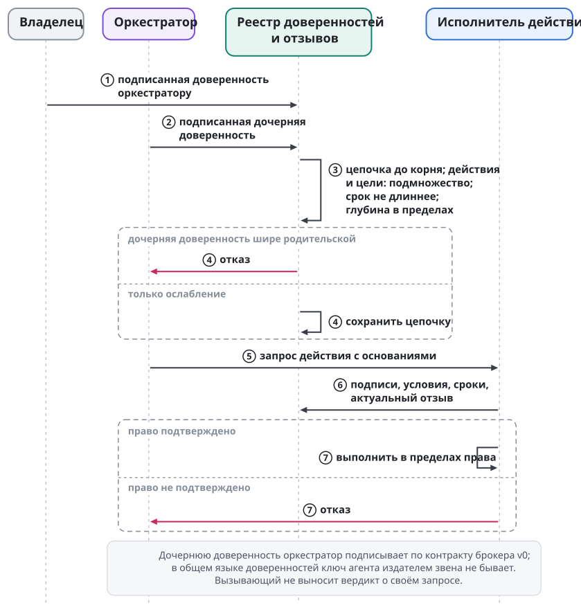
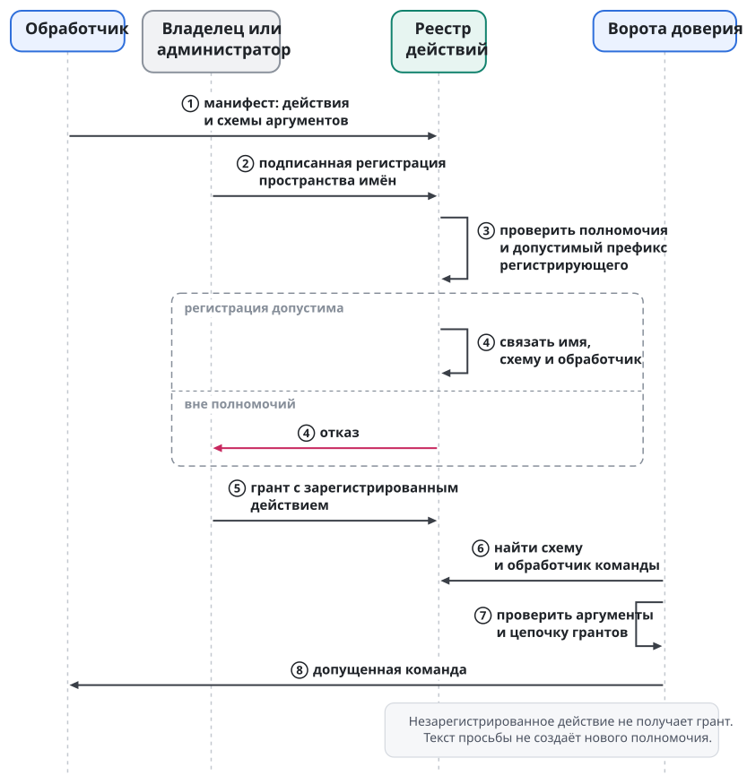

# Гранты и полномочия

Ключ отвечает на вопрос "кто", грант отвечает на вопрос "что ему разрешено". Грантом называется подписанное утверждение: кто выдал полномочие, кому, на какие действия и цели, при каких условиях, до какого срока и можно ли делегировать его дальше. Полномочие (capability) не возникает из убедительного текста сообщения. Исполнитель проверяет основание действия до того, как оно станет эффектом.

Модель общая для людей, агентов и ролей. Связь участника с ролью тоже задаётся отдельной подписанной записью, и грант роли распространяется на всех, кто её занимает. Общий язык грантов и узкий контракт брокера учётных данных (`swarma-credential-broker`) v0 задают разные словари действий и правила проверки.

## Общая модель и брокер v0

Грант общей модели может разрешать, например, перезапуск и остановку раннеров и ограничивать цели, часы, частоту и глубину передачи права. Субъектом гранта служит ключ или роль. Владелец разрешает участнику перезапускать раннеры только в определённом наборе целей. Такой грант не разрешает управлять сессиями и не даёт права менять реестр действий.

Конкретнее: `github-runner.restart` и `github-runner.stop`, окно 09–21, не больше 6 действий в час, глубина делегирования 1. Проверяющий одновременно устанавливает действие, цель, условие времени, счётчик и цепочку. Подходящий ключ при исчерпанном счётчике не делает команду допустимой. В брокер v0 этот пример не переносится: у брокера нет такого словаря и почасового счётчика. Числа здесь иллюстрируют модель; системные пределы задаёт конфигурация.

| Свойство | Общий язык | Брокер v0 |
| --- | --- | --- |
| имя | `grant/1`; формат задаёт спецификация грантов | `swarma-credential-broker grant/1`: доменная метка, перевод строки, каноничный JSON |
| субъект | ключ или роль | ключ либо лист агента `agent:<поколение>` |
| действия | пространства имён, например `session.*` | только `agent.spawn` и `credential.lease` |
| область | типизированные цели; шаблоны только в гранте | списки аккаунтов, сред и профилей без шаблонов |
| условия | `caveats/v1` | только окно времени |
| делегирование | роли, глубина и ослабление | без ролей, не больше четырёх звеньев, каждое проверяется |
| корень | корень владельца в реестре | программный ключ в `swarma-operator`, переносится в реестр |
| отзыв | подписанный снимок реестра | `swarma-credential-broker revocation/1` в локальном состоянии брокера |

Правая колонка описывает контракт брокера, левая описывает общую модель. Передать брокеру роль, шаблон цели или счётчик только потому, что они есть в общей модели, нельзя. Переход брокера на общий язык и на ключник идёт через версионированный адаптер: гранты переподписываются, привязки заменяются, отзывы сохраняются, а оба корня какое-то время поддерживаются одновременно. Одинаковое назначение не делает форматы взаимозаменяемыми.

Для брокера `agent.spawn` значит завести и запустить агента, `credential.lease` значит взять аренду токена. Менеджер пользователей (`swarma-user-manager`) версий v0 и v1 допускает вызывающего по роли `sudo` и конфигурации root. В v2 он проверяет грант `user.create`. Версия контракта определяет проверку на этой границе.

## Кто проверяет право

Проверяет тот, кто совершает действие. Оркестратор может попросить создать воркера, но его утверждение о собственном праве вердиктом не служит. В общей модели проверку выполняет единая библиотека: она разбирает запись, проходит подписи до корня, проверяет срок, условия и отзыв. Исполнитель проверяет заново, даже если на предыдущем участке маршрута проверка уже была.

| Действие | Кто проверяет |
| --- | --- |
| смена статуса задачи, роли, принятие результата | ядро плейбуков доски |
| запуск агента с ролью | диспетчер (`swarma-dispatcher`): подпись заявки и цепочка вызывающего |
| выдача учётных данных | брокер: цепочки диспетчера и вызывающего при привязке, аренде и каждом продлении |
| создание учётки и запуск под ней | менеджер и запускатель (`swarma-user-launcher`): роль по `sudo`, гранты с v2 |
| доставка агенту | брокер сообщений, ворота моста |
| отправка наружу | мост (аудитория) и ключник (подпись) |
| исполнение зарегистрированного действия | обработчик |

Право передать ввод в сессию не равно праву одобрить конкретное исполнение или управлять другой целью. Это отдельные действия `session.input`, `session.approve` и `session.control`. Ключ оператора регистрируется для привязки; транскрипт выдаётся как проекция для её аудитории и общего права оператора не даёт.

## Делегирование только с ослаблением

Дочернее полномочие ограничено родительским: подмножество действий и целей, срок не длиннее, глубина в разрешённых пределах. Каждая запись ссылается на родительскую, и проверка доходит до корня. Если ребёнку запрошены права шире, чем есть у вызывающего, диспетчер отказывает до запуска. Вызывающий не увеличивает свою власть, создавая нового агента.

Участник может передать оркестратору право остановить часть своих раннеров на меньший срок. Включить чужой раннер, добавить право перезапуска, которого у него самого нет, или продлить разрешение за предел родительского оркестратор не может. Исполнитель проверяет это по цепочке; обещание ребёнка уважать намерение родителя здесь ничего не значит. Модель опирается на способности с ослаблением; ориентиры: SPKI/SDSI, Macaroons, UCAN и Biscuit. Формат выбирает спецификация грантов.

Условия лежат в `conditions`, язык обозначается полем `lang`. `caveats/v1` описывает окно времени, счётчики, требование подтверждения и перечень целей. Подключаемые вычислители общей библиотеки позволяют развивать политики, а сообщения при этом лишь ссылаются на гранты. В контракт брокера v0 ни счётчики, ни язык правил не входят.

{.tall}

### Ключи служб и агентов

Гранты общего языка выдают корень грантов владельца, устройства оператора и службы грантов. Агенты гранты не выдают. **Ключ службы грантов** принадлежит отдельной службе, которая выдаёт гранты в пределах переданного ей полномочия. Его удостоверяет аттестация корня грантов владельца с отдельно настроенным назначением службы. Ключ службы использует Ed25519, срок его аттестации не длиннее 86 400 секунд, и подписывать он может только гранты.

Ключ службы выдаёт звено, только если у него есть родительский грант, адресованный этому ключу, с глубиной делегирования не меньше 1. Родитель должен покрывать ребёнка по действиям, целям и сроку по общим правилам ослабления. Цепочку, которая начинается с самого ключа службы, проверяющий отклоняет с `grant_root_unknown`: аттестация удостоверяет, что ключ принадлежит службе, и родительского гранта не заменяет. Отзыв ключа службы, его аттестации или родительского гранта распространяют снимки корня грантов, и отзыв обрывает всю цепочку. Лист, чей срок пережил родителя, ослабления не соблюдает и тоже отклоняется.

Ключ агента бывает субъектом гранта и листом цепочки, но издателем звена не бывает. Проверяющий отклоняет цепочку, где издателем стоит ключ с аттестацией агента, даже если все подписи математически верны. Пример. Захваченный оркестратор подписал соседу грант на перезапуск раннера, который получил сам. Подпись верна, но издатель звена удостоверен как агент, и проверка отказывает. Правило относится к общему языку грантов. Контракт брокера v0 сохраняет собственные правила цепочки, разобранные в разделе "Вызывающий остаётся в цепочке".

Адрес на носителе субъектом гранта не служит: человека другого владельца грант называет по ключу. Как этот ключ связывается с учёткой человека на носителе, разобрано в главе "Путь сообщения и мост".

## Действие имеет имя и обработчик

В слое полномочий действием называется зарегистрированное имя со схемой аргументов и обработчиком. Базовый словарь: `session.*`, `goal.*`, `board.*`, `user.*`, `spawn.*`, `post`, `inbox`, `terminal.raw`. Цели типизированы: сессия, комната, элемент доски или ресурс службы. Шаблон со звёздочкой допустим в гранте, а команда всегда называет конкретную цель. Свободный текст остаётся данными для модели и прав не несёт.

Новое пространство действий появляется через подписанные записи реестра. Возьмём помощник управления раннерами. Сначала обработчик публикует манифест: какие действия выполняет, с какими аргументами и целями, обратимы ли эффекты. Затем владелец связывает пространство `github-runner.*` с обработчиком и отпечатком манифеста и решает, кто выдаёт гранты. Только после этого разрешения и команды могут ссылаться на это имя. Записи называются `handler-manifest/1` и `action-namespace/1`; их схемы задаёт спецификация грантов.

Делегированный администратор с `registry.actions.register` ограничен своим префиксом: право регистрировать `ops.*` не позволяет захватить `session.*`. Грант на незарегистрированное действие отклоняется при выдаче, а лишний или неверный аргумент команды отклоняется при проверке по манифесту. Получателю не нужно угадывать, что исполнить: имя операции зарегистрировано вместе с её обработчиком.

Системные и необратимые операции выполняет обработчик-процесс, детерминированный помощник. Он заново проверяет цепочку, выполняет ровно свою зарегистрированную операцию, пишет аудит и подписывает квитанцию. На каждый вызов он получает полномочие, ограниченное разрешённым действием и точными целями; цепочка вызывающих при этом остаётся зависимостью отзыва. То, что мост проверку уже провёл, не позволяет помощнику пропустить собственную проверку перед перезапуском раннера. Разрешение привязано к границе эффекта; доставки сообщения для него мало.

Обработчик-агент получает типизированную команду с записью проверки и может добавить суждение о моменте исполнения. Он действует в пределах собственных прав и не расширяет их полученной просьбой. Пометка `effects: irreversible` в манифесте подсказывает политике выбрать обработчик-процесс. Суждение модели о том, безопасно ли сейчас остановить работу, не заменяет проверки права на остановку.

{.tall}

## Вызывающий остаётся в цепочке

Права ребёнка зависят одновременно от разрешений диспетчера и от того, кто попросил запуск. Иначе после отзыва гранта оркестратора его потомки сохранили бы доступ к токенам до конца собственных сроков.

Вызывающий подписывает заявку с доменной меткой `swarma-dispatcher request/1`. Диспетчер сверяет ключ с регистрацией на учётку и не верит заявленному полю автора. Версионированные имена платформы строятся как `swarma-<компонент> <объект>/<n>`. Метка отделяет назначение подписи заявки от остальных подписываемых объектов, но проверки прав подписанта не заменяет.

Лист `agent:<поколение>` образуется пересечением запроса, гранта вызывающего и гранта диспетчера. В нём только `credential.lease` и глубина 0. Цепочка диспетчера содержит не больше трёх конвертов и допускает ещё одно делегирование, чтобы лист уложился в общий предел четырёх. Проверяется каждое звено, включая лист. Если цепочку построить нельзя, ответом служит `grant_unconstructible`, и он приходит до любых эффектов.

Положительный пример: запрос на среду, аккаунт и профиль, которые входят в разрешённые списки обеих сторон. Отрицательный пример: один лишний профиль, доступный диспетчеру, но отсутствующий у вызывающего. Широкий грант диспетчера этот пробел не заполняет. Передать аренду следующему ребёнку лист не может из-за глубины 0. Пересечение и глубина решают разные задачи: пересечение ограничивает область, глубина ограничивает дальнейшее делегирование.

Когда один оркестратор создаёт другого, грант вызывающего для нового подписывает родительский оркестратор, сужая свой. Если бы подписывал один диспетчер, родитель выпал бы из последующих зависимостей. До создания проверяется глубина: у родителя не меньше 2, у нового оркестратора не меньше 1, всего не больше четырёх конвертов. Ключ нового оркестратора регистрируется отдельно, и регистрация сама права спавна не даёт.

Проследим отзыв. Родитель создал оркестратора, тот попросил диспетчер создать рабочего агента. Если связь с родителем сохранена в цепочке, при следующей аренде или продлении проверка обнаружит отзыв его гранта. Если бы диспетчер выдал новому оркестратору независимое разрешение, проверять родительский отзыв было бы не по чему. Поэтому мало записать имя инициатора в аудит: зависимость должна оставаться в проверяемом полномочии потомка.

## Отзыв и неизвестное состояние

Брокер хранит разрешение вызывающего в привязке агента и проверяет его при каждой аренде и продлении токена. Отзыв гранта оркестратора отрезает такие выдачи его агентам сразу, не дожидаясь конца срока; для этого есть `lease_caller_revoked`. Токен, который уже лежит в процессе агента, отзыв из памяти не вернёт: "немедленный отзыв" останавливает новые выдачи, но уже раскрытого секрета не возвращает.

Поэтому сдерживание шире отзыва гранта. У него три независимых состояния:

| Состояние | Что значит |
| --- | --- |
| полномочие брокера отозвано | новых аренд и продлений нет |
| локальное исполнение и сеть отгорожены | поколение заморожено и остановлено, сеть сужена |
| учётные данные провайдера | аннулированы у провайдера или ещё пригодны |

Одна операция "отозвать и остановить" переводит первые два состояния разом и честно сообщает третье: токен, выданный провайдером, может оставаться пригодным до аннулирования у самого провайдера. Для разбора утечек брокер ведёт инвентарь соответствия версий учётных данных поколениям: по нему видно, каким поколениям выдавалась каждая версия.

До создания учётки и перед каждым стартом диспетчер запрашивает у брокера `revocation.check` для точной цепочки. Отзывы хранит только брокер, а диспетчер получает узкий ответ на момент проверки: не отозвано, отозвано или недоступно. Ответ "недоступно" означает отказ. Потеря соединения с брокером не доказывает отсутствия отзыва и не разрешает продолжить запуск по старому положительному ответу.

Три исхода не сводятся к логическому признаку, где ошибка чтения превращается в "отзыва нет". Положительный ответ устанавливает состояние точной цепочки на момент проверки; отрицательный запрещает запуск; недоступность не устанавливает ни того, ни другого и тоже закрывает допуск. Доступ к закрытому каталогу брокера диспетчеру для этого не нужен, но запрашивать вердикт на каждой предусмотренной границе эффекта он обязан.

Службы опираются на подписанные снимки реестра со свежестью не старше 60 секунд. Если снимок старше, новые аренды и продления не выдаются. Возраст неизменного снимка отзывов, подписанного ключом реестра, продлевают запись свежести и квитанция свежести (глава "Ключи и ключник"). Снимки корня грантов и корня оператора отсчитывают возраст от собственного времени выпуска. Экстренная остановка от снимка не зависит: стоп исполняется и тогда, когда реестр недоступен.

Снимок даёт отзыву точную границу распространения. Обозначим через S время выпуска первого подписанного полного снимка, в котором появилась запись отзыва, через A допустимый возраст снимка (не больше 60 секунд), через F время вступления записи в силу. Тогда запись действует на каждой проверке не позже max(S + A, F) и никогда раньше F. До подписанной публикации снимок ничего не обещает: время, когда отзыв попросили, отсчёта не начинает.

Распространение и завершение отзыва различаются. Отзыв завершён, когда названный набор потребителей подтвердил его с долговечной записью или когда истёк срок всех прежде допущенных полномочий. До завершения допустима только ограниченная задержка распространения, после завершения окна допуска для отозванного права нет. Критический эффект, который выбрала политика потребителя, перед исполнением проверяет право у владельца полномочия по сети, и недоступность владельца означает отказ. Квитанция о приёме отзыва его завершения не доказывает.

Копия состояния брокера, сделанная до отзыва, не должна оживить права. Перед восстановлением ставится отметка вне восстанавливаемых данных. Отметка закрывает аренды, продления и автозапуск, и проверка отзыва при ней отвечает "недоступно". Открывает доступ только подтверждённая история отзывов, пережившая сбой. Если истории нет, доступ остаётся закрытым или оператор меняет корни и выдаёт полномочия заново. Автоматически доверять старому снимку нельзя.

Отдельной сетевой оси у полномочий нет. Машинная политика выбирает сетевой профиль по допущенному профилю Swarma Curator, так что сужение профилей в цепочке сужает и допустимую сеть, но не даёт вызывающему выбрать произвольный прокси. Проверка гранта и применение правил ядра составляют две разные обязательные проверки.

## Продление без расширения

У постоянной команды нет срока жизни, а у грантов он есть. Для продления диспетчер переподписывает лист под текущими цепочками, а брокер заменяет привязку той же учётки и поколения: сначала снимает старую, с записью об удалении и завершением её аренд, потом публикует новую. Двух привязок одновременно не бывает, учётка не пересоздаётся. Каждый такой эффект требует свежего вердикта отзыва.

Новая область образуется пересечением текущих цепочек с первоначально допущенным запросом. Добавить аккаунт, среду или профиль нельзя, даже если родительский грант с тех пор стал шире: для расширения нужен новый запуск. Продлевать вправе только участник существующей цепочки, одной подписи диспетчера мало. Автоматическое обслуживание отозванных прав не перевыпускает: для этого нужно новое решение оператора.

Постоянный разработчик после планового обновления грантов продолжает работать с тем же набором сред. Ещё один аккаунт он не получает только потому, что тот появился у оркестратора. Если грант отозван, продление останавливается: отзыв не считается обычным истечением срока. Сохранившаяся учётка не означает сохранившегося доступа.

Время проверяется по водяному знаку брокера и диспетчера. Истечение проверяется по большему из текущего времени и знака, начало действия проверяется по меньшему. Шаг часов назад не возвращает истёкшего, шаг вперёд не открывает будущего раньше срока. Установке нужен проверенный или контролируемый оператором источник времени, например NTS. Непроверенное время знак не двигает, сбрасывает знак только оператор явным действием. Если проверенное время потеряно, службы держатся не дольше 10 минут по монотонным часам, а затем всё, что зависит от времени, останавливается.

Когда срок права уже истёк, перевод часов назад его не вернёт: проверка конца срока хранит более поздний водяной знак. Для не начавшегося разрешения осторожность обратная: берётся меньшее значение времени. Правило водяного знака не даёт повода доверять произвольному источнику часов и не обнуляет историю отзывов при восстановлении: проверка времени и сохранение отзывов нужны вместе.

## Человеческое разрешение и реестр

Человек может делегировать оркестратору отдельный шаг с потолками и сроком (например, одобрение заказов до 500 евро), но не право менять сами правила. Подтверждение требует ключа с присутствием человека и показа подписываемого действия. Одно подтверждение не превращается в общее разрешение агенту действовать дальше.

Расширяющие действия на операторском пути требуют входа и подтверждения точного содержания с телефона или через парольный вход в терминале. Отзыв сужает полномочие и устроен проще. Изнутри сессии агента расширение не принимается. Устройство операторской подписи описано в главе "Ключи и ключник".

Ключи, гранты и журналы личностей держит реестр владельца на узле доверия (глава "Ключи и ключник"; журналы личностей описаны в главе "Идентичность агента"). Клиентское приложение отправляет в него подписанные изменения. Службы получают подписанные снимки не старше 60 секунд и перепроверяют допуск при доставке по последнему снимку. Локальное состояние брокера v0 подчиняется его собственному контракту, который действует до переноса корня в реестр владельца.

Грант ограничивает действие только там, где проверку действительно вызывают и где исполнитель удерживает область эффекта. Он не делает владельца ключа добросовестным и не гарантирует качества работы. Подлинный запрос может быть отклонён из-за срока, отзыва, слишком широкой области или недоступности нужного свидетельства. Так автономный рой действует в проверяемых пределах, и доверие к модели не превращается в полномочие.
