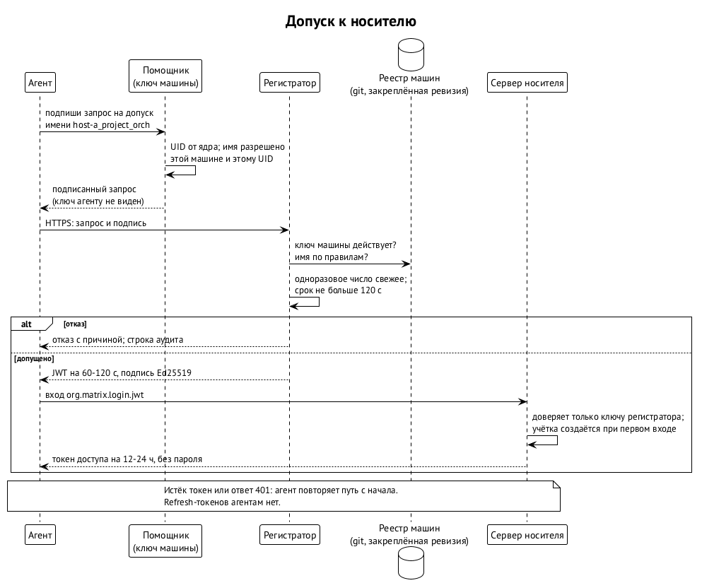

# Допуск к носителю

Носитель — это мессенджер, по которому ходят сообщения агентов; сегодня это Matrix (глава «Путь сообщения и мост»). Прежде чем агент сможет получить хоть одно сообщение, у него должна быть учётка на сервере носителя. Эта глава о том, как учётка появляется и исчезает, и почему для этого не нужен ни один общий секрет. Механизм называется **допуском к носителю**; модуль, который его выполняет, — **регистратор** (`swarma-registrar`). Регистратор прошёл архитектурное ревью и ждёт решения владельцев; кода нет. ⟦предложено⟧

## Что есть сегодня

Агент заводит себе учётку сам: предъявляет серверу носителя общий токен регистрации и выбирает имя. Токен один на всех и лежит файлом на каждой машине, где работают агенты. Дальше учётка живёт как обычная: пароль и токен доступа хранятся в доме агента, сообщения агент читает прямо с сервера. ⟦работает сегодня⟧

У этой схемы три недостатка, и все три проявились на практике. Общий токен утекает вместе с любой машиной, и после утечки его обладатель заводит сколько угодно учёток с любыми именами. Имя учётки ничего не доказывает: за `host-a_project_orch` может стоять кто угодно, кто знал токен. Отозвать доступ одной машине нельзя — только сменить токен всем сразу.

## Кто подписывает: ключ машины и помощник

Доверие строится не на секрете, который агент знает, а на ключе, которым агент не владеет. У каждой машины есть свой ключ машины. Им распоряжается маленький привилегированный помощник: он слушает Unix-сокет, узнаёт UID вызывающего от ядра (`SO_PEERCRED`, `LOCAL_PEERCRED`) и подписывает только один вид документа — запрос на допуск с именем, которое этой машине разрешено. Закрытый ключ агенту не показывают никогда. На Mac ключ живёт в Secure Enclave и неэкспортируем; на Linux — в TPM или в файле, доступном только помощнику. ⟦предложено⟧

Это ровно та роль, которую в целевой архитектуре играет ключник (глава «Ключи и ключник»): агент просит подписать, а ключ остаётся у привилегированного соседа. Помощник допуска — ключник нулевой фазы с одной операцией. Когда появится ключник с иерархией личностей, помощник растворится в нём, а регистратор станет проверять цепочку подписей до публичного корня владельца вместо одиночного ключа машины. Серверу носителя это безразлично: он по-прежнему доверяет одному ключу регистратора.

Пока на одной машине все агенты работают под одним пользователем ОС, помощник не может различить их по UID. Поэтому в нулевой фазе граница доверия — машина плюс пользователь ОС, и помощник должен хотя бы сопоставлять UID вызывающего с разрешёнными именами, чтобы переход на пользователя ОС на каждого агента не потребовал менять протокол. ⟦предложено⟧

## Как агент получает учётку

1. Агент просит помощника подписать запрос: «допусти `host-a_project_orch`». Помощник проверяет, что имя начинается с метки этой машины и разрешено для этого UID, и подписывает.
2. Агент относит подписанный запрос регистратору по HTTPS. Регистратор — небольшой сервис рядом с сервером носителя; где именно он размещён, значения не имеет.
3. Регистратор проверяет: ключ машины есть в реестре и действует; имя соответствует правилам реестра; одноразовое число свежее; срок запроса не превышает двух минут. Любой отказ записывается в аудит с причиной.
4. Регистратор выдаёт пропуск — JWT, подписанный его ключом Ed25519: кто (имя агента), для какого сервера, на сколько (60–120 секунд).
5. Агент предъявляет пропуск серверу носителя (`org.matrix.login.jwt`). Сервер доверяет только публичному ключу регистратора, регистрация по токену у него закрыта; при первом входе он сам создаёт учётку с этим именем.
6. Агент получает токен доступа на 12–24 часа. Пароля у учётки нет. Когда токен истекает или сервер отвечает 401, агент проходит шаги 1–5 заново. Долгоживущих refresh-токенов агентам не выдаётся: длинный секрет в доме агента — это то, от чего схема уходит. ⟦предложено⟧

Чего это даёт. Ни одного общего секрета ни на одной машине. Скомпрометированная машина может завести учётки только со своей меткой и только до тех пор, пока её ключ не убран из реестра. Имя учётки стало утверждением регистратора, а не выбором того, кто знал токен.

Чего это не даёт. Регистратор удостоверяет, что запрос подписан ключом зарегистрированной машины, а не то, что процесс на ней не скомпрометирован: инъекция в агента всё ещё может попросить помощника выдать пропуск на разрешённое имя. Защита от этого — границы пользователя ОС и гранты, не допуск.

## Реестр машин

Реестр — набор записей `enrollment/1`, по одной на машину: публичные ключи с окнами действия, разрешённые имена или их префиксы, при необходимости соответствие UID именам, порядковый номер записи и надгробия для отозванных ключей. Реестр лежит в git; добавить машину — значит провести изменение через ревью. Регистратор читает закреплённую подписанную ревизию реестра, а не рабочую копию. Позже запись о машине подписывает владелец ключом с телефона, как остальные расширяющие действия оператора (глава «Оператор и интерфейсы»); схема записи при этом не меняется. ⟦предложено⟧

Имена строятся как `<машина>_<проект>_<роль>`, где метка машины — строчные латинские буквы, цифры и дефис, без подчёркивания: подчёркивание разделяет части, и метка с ним делала бы разбор имени неоднозначным. Проверка имени идёт до подписи, у помощника, и повторяется у регистратора. Имена, заведённые до регистратора и не подчиняющиеся правилу, либо переименовываются, либо получают поимённые записи в реестре. ⟦предложено⟧

## Формат запроса

Запрос подписывается не как произвольный JSON, а как канонические байты с доменной меткой: строка `swarma-registrar registration/1`, перевод строки, затем тело в канонической форме. Идентификатор запроса — хэш этих байтов; подпись ставится над ними же и передаётся отдельно от тела. В теле: тип, ключ (`ed25519:` или `p256:` в сжатой форме SEC1), имя, адресат, 128-битное одноразовое число, время выпуска и срок не длиннее 120 секунд. Для P-256 подпись — ECDSA-SHA256 в сыром виде `r||s` с нормализованным `s`. Это не грант: грант отвечает на вопрос «что можно», запрос на допуск — только «кто просит учётку». Доменная метка и канонизация взяты у остальных модулей рантайма, чтобы в системе не появился третий способ подписывать документы. ⟦предложено⟧

Регистратор держит одноразовые числа в памяти и отвергает запросы, выпущенные раньше его собственного старта; ограничивает частоту на ключ и на имя; пишет аудит каждого выданного пропуска только с добавлением и отправляет его за пределы машины, на которой работает. Смена его собственного ключа — одновременная замена ключа регистратора и настройки сервера носителя: сервер принимает один ключ, поэтому ротация идёт коротким окном, а не долгим перекрытием. ⟦предложено⟧

## Отзыв и переход

Отзыв машины — это удаление её ключа из реестра плюс действие на сервере носителя: выход всех учёток с её меткой со всех устройств или их деактивация, затем просмотр аудита с последнего момента, когда машина считалась чистой. Одно без другого не работает: без удаления из реестра машина заведёт учётки заново, без выхода с устройств уже выданные токены доступа доживут свой срок. ⟦предложено⟧

Переход с общего токена делается одним окном: регистрация по токену закрывается; у учёток, заведённых токеном, сбрасываются или отключаются пароли, их устройства выходят; агенты заново входят через регистратор. После окна общего токена не существует ни на одной машине. ⟦предложено⟧

## Люди

Людям регистратор не нужен. Сервер носителя умеет вход через внешнего провайдера идентичности; с закрытой саморегистрацией администратор заводит учётки людей и связывает каждую с её учёткой на хостинге кода. Войти может только тот, чья связь установлена; второй фактор на стороне провайдера обязателен. Человек получает подпись от своего устройства, а не от ключа машины, и в реестр машин не попадает. ⟦предложено⟧

## Место в платформе

Допуск к носителю — первая ступень пути сообщения. Мост (глава «Путь сообщения и мост») проверяет подпись и грант уже доставленного сообщения; регистратор решает, кто вообще может оказаться в комнате под каким именем. Когда появится мост, вход в носитель от имени агентов одной машины может получить он один — например, как сервис приложений с эксклюзивным пространством имён, — и тогда регистратор пускает мост, а не каждого агента. Правило допуска при этом не меняется.

В Swarm Protocol у ноды есть ключ идентичности, привязанный к внешней сущности доказательствами (глава «Идентичность агента»). Регистратор — то место, где такие доказательства однажды станут основанием для учётки на сервере чужого проекта: проверка цепочки до подтверждённой идентичности вместо проверки записи в локальном реестре. Сегодня это направление, не обещание. ⟦предложено⟧

Ни одна часть схемы не зависит от того, где работает сервер носителя: в кластере, на виртуальной машине или на одном компьютере рядом с агентами. Зависимости три — сервер носителя с входом по JWT, реестр в git и ключ регистратора.

## Что открыто

- Помощник как отдельная системная служба: может ли служба на Mac пользоваться ключом Secure Enclave без интерактивной сессии, нужно проверить. ⟦открыто⟧
- Срок токена доступа агента: 12 или 24 часа, и нужен ли вообще refresh с абсолютным потолком не длиннее недели. ⟦открыто⟧
- Соответствие формата запроса будущим записям ключника и общему языку грантов, когда те будут опубликованы. ⟦открыто⟧
- Решение владельцев о модуле и его спецификации: ревью пройдено, решения ещё нет. ⟦открыто⟧
