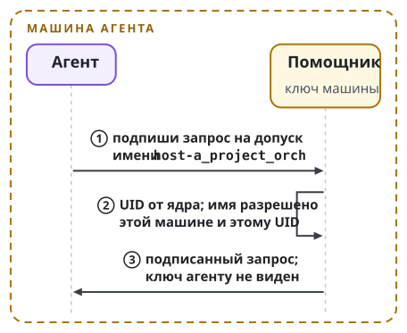
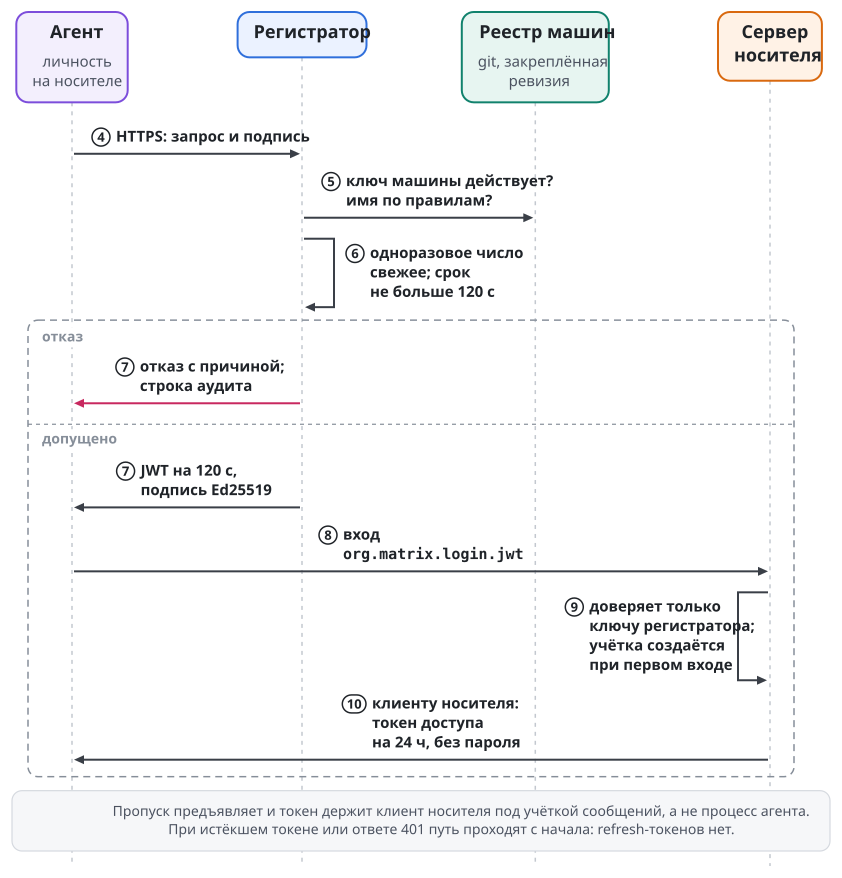

# Допуск к носителю

Носитель доставляет сообщения агентов и людей (глава "Путь сообщения и мост"). Прежде чем агент получит хоть одно сообщение, у него должна появиться учётка на сервере носителя. Учётка появляется и исчезает без единого общего секрета. Механизм называется **допуском к носителю**, а выполняет его модуль **регистратор** (Swarma Registrar, `swarma-registrar`). Ключ машины, помощник, проверка запроса регистратором и реестр машин от протокола носителя не зависят. Форму имени учётки, аудиторию пропуска, вход по пропуску, требования к серверу и завершение сессий при отзыве задаёт профиль носителя; в этой главе они даны для профиля Matrix.

## Зачем нужен допуск

Проще всего заводить учётки общим токеном регистрации: агент предъявляет серверу носителя один токен на всех и выбирает себе имя. Токен лежит файлом на каждой машине, где работают агенты, а пароль и токен доступа учётки хранятся в доме агента.

У такой схемы три изъяна. **Утечка с любой машины открывает всё.** Обладатель токена заводит сколько угодно учёток с любыми именами. **Имя учётки ничего не доказывает.** За `host-a_project_orch` может стоять кто угодно, кто знал токен. **Отзыв только сразу у всех.** Закрыть доступ одной машине нельзя, можно только сменить токен всем.

Допуск к носителю убирает общий секрет: учётку получает тот, за кого поручился ключ зарегистрированной машины.

## Кто подписывает: ключ машины и помощник

Доверие строится на ключе, которым агент не владеет. У каждой машины свой ключ машины. Распоряжается им маленький привилегированный помощник. Помощник слушает Unix-сокет и узнаёт UID вызывающего от ядра (`SO_PEERCRED`, `LOCAL_PEERCRED`). Он подписывает только один вид документа: запрос на допуск с именем, которое этой машине разрешено. Закрытый ключ агенту помощник не показывает никогда.

На Mac ключ живёт в Secure Enclave и не экспортируется. На Linux ключ лежит в TPM или в файле, доступном только помощнику.

Помощник выполняет роль ключника из главы "Ключи и ключник": агент просит подписать, а ключ остаётся у привилегированного соседа. Помощник допуска работает как ключник с одной операцией. Когда эту операцию выполняет ключник с иерархией личностей, регистратор проверяет цепочку подписей до публичного корня владельца вместо одиночного ключа машины. Сервер носителя разницы не видит: он по-прежнему доверяет одному ключу регистратора.

Граница доверия помощника проходит по машине и пользователю ОС. Если агенты машины работают под одним пользователем ОС, помощник различает их только по разрешённым именам. Поэтому он с самого начала сопоставляет UID вызывающего с разрешёнными именами, и переход на отдельного пользователя ОС для каждого агента протокол не меняет.

## Как агент получает учётку

Путь показан двумя рисунками с общей нумерацией шагов: первые три шага идут на машине агента, остальные у регистратора и сервера носителя.

{.tall}

Сначала агент просит помощника подписать запрос "допусти `host-a_project_orch`". Помощник проверяет, что имя начинается с метки этой машины и разрешено для этого UID, и подписывает.

Затем агент относит подписанный запрос регистратору по HTTPS. Регистратор работает небольшим сервисом рядом с сервером носителя; где именно он размещён, значения не имеет.

Регистратор проверяет, что ключ машины есть в реестре и действует, что имя соответствует правилам реестра, что одноразовое число свежее и что срок запроса не больше двух минут. Любой отказ регистратор записывает в аудит с причиной.

Если проверка прошла, регистратор выдаёт пропуск. Пропуск представляет собой JWT, подписанный ключом регистратора Ed25519. Он называет, кому выдан (локальную часть имени агента), для какого сервера и на сколько: пропуск действует 120 секунд, и запрос не может выбрать другой срок.

Агент предъявляет пропуск серверу носителя; в профиле Matrix это вход `org.matrix.login.jwt`. Сервер доверяет только публичному ключу регистратора, регистрация по токену у него закрыта. При первом входе сервер сам создаёт учётку с этим именем.

Пропуск предъявляет и токен доступа держит клиент носителя этой личности агента, то есть экземпляр моста под служебной учёткой сообщений (глава "Путь сообщения и мост"). Процесс агента под своей учёткой токена доступа не получает, и слово "агент" на стороне сервера носителя в этой главе означает его личность. Клиент получает токен доступа, который сервер сам аннулирует через 86 400 секунд, то есть через сутки. Пароля у учётки нет. Когда токен истекает или сервер отвечает 401, путь проходят заново с самого начала. Refresh-токенов агенты не запрашивают, и сервер их не выдаёт: длинный секрет в доме агента и есть то, от чего уходит схема. Деактивированная или заблокированная учётка по пропуску не входит, и первый вход её заново не заводит.

В итоге общего секрета нет ни на одной машине. Скомпрометированная машина заводит учётки только со своей меткой и только если её ключ остаётся в реестре. Имя учётки удостоверяет регистратор.

У этой гарантии есть предел. Регистратор удостоверяет, что запрос подписан ключом зарегистрированной машины. Исправность процессов на этой машине он не удостоверяет: агент, поддавшийся инъекции, может попросить помощника выдать пропуск на разрешённое ему имя. От этого защищают граница пользователя ОС и гранты.

## Реестр машин

Реестр состоит из записей `enrollment/1`, по одной на машину. Запись содержит публичные ключи с окнами действия, разрешённые имена или их префиксы, при необходимости соответствие UID именам, порядковый номер записи и надгробия для отозванных ключей.

Реестр лежит в git, и добавить машину значит провести изменение через ревью. Регистратор читает закреплённую подписанную ревизию реестра; рабочую копию он не читает. Запись о машине подписывает владелец ключом с телефона, как и остальные расширяющие действия оператора (глава "Оператор и интерфейсы").

Имена строятся как `<машина>_<проект>_<роль>`. Метка машины состоит из строчных латинских букв, цифр и дефиса, без подчёркивания: подчёркивание разделяет части, и метка с ним сделала бы разбор имени неоднозначным. Имя проверяет помощник до подписи, и регистратор проверяет его ещё раз. Имена, заведённые до регистратора и не подчиняющиеся правилу, переименовываются или получают поимённые записи в реестре.

## Ключи и профиль на хэшах

Ключ машины (Ed25519 или P-256 в Secure Enclave) и ключ регистратора (Ed25519) построены на эллиптических кривых. По общему правилу Swarma (глава "Цепочка: устройство") долгоживущие корни подписываются хэш-подписями, а ключи на кривых служат короткоживущими листьями под ними. Допуск следует этому правилу.

Корень владельца удостоверяет запись о машине и ключ регистратора. Ключ регистратора меняется по расписанию. Сервер носителя принимает один ключ, поэтому смена идёт коротким окном с одновременной заменой ключа регистратора и настройки сервера. При переходе корней на хэш-подписи (четыре шага миграции) листья перевыпускаются под новым корнем, а протокол допуска не меняется.

## Формат запроса

Запрос подписывается как канонические байты с доменной меткой: строка `swarma-registrar registration/1`, перевод строки, затем тело в канонической форме. Идентификатором запроса служит хэш этих байтов. Подпись ставится над ними же и передаётся отдельно от тела.

Тело содержит тип, ключ (`ed25519:` или `p256:` в сжатой форме SEC1), имя и адресат, 128-битное одноразовое число, время выпуска и срок не длиннее 120 секунд.

Для P-256 подпись делается ECDSA-SHA256 и кодируется в сыром виде `r||s` с нормализованным `s`.

Запрос на допуск отвечает только на вопрос "кто просит учётку"; что этому участнику разрешено, решают гранты. Доменная метка и канонизация взяты у остальных модулей рантайма, чтобы в системе не появился третий способ подписывать документы.

Регистратор держит одноразовые числа в памяти и отвергает запросы, выпущенные до его собственного старта. Он ограничивает частоту на ключ и на имя. Аудит каждого выданного пропуска регистратор пишет только с добавлением и отправляет за пределы машины, на которой работает.

## Отзыв и переход

Отзыв машины состоит из двух действий, и одно без другого не работает. Первое действие удаляет ключ машины из реестра. Без первого действия машина заведёт учётки заново. Второе действие выводит все учётки с меткой машины на сервере носителя, завершая их действующие и возобновляемые сессии на всех устройствах, и, где этого требует квалифицированный путь сервера, деактивирует или блокирует их, а затем аудит просматривается с последнего момента, когда машина считалась чистой. Без второго действия уже выданные токены доступа доживут свой срок. Выход завершает сессии устройств и аннулирует их токены, а деактивированная учётка больше не входит и по действительному пропуску.

Переход с общего токена делается одним окном. В это окно регистрация по токену закрывается, у учёток, заведённых токеном, пароли сбрасываются или отключаются и их устройства выходят, а агенты заново входят через регистратор.

После окна общего токена нет ни на одной машине.

## Требования к серверу носителя

Требования HR1–HR9 спецификации регистратора составляют профиль Matrix для сервера носителя: регистратору подходит любой сервер Matrix, который их выполняет, независимо от реализации. Профиль другого протокола задаёт свои требования с теми же итогами: вход по пропуску регистратора остаётся единственным способом завести учётку агента, срок сессии ограничивает сервер, а отзыв завершает все действующие и возобновляемые сессии. Каждое требование проходит свои отрицательные и положительные случаи на изолированном тестовом сервере. До такой квалификации конкретную сборку сервера не развёртывают; осмотр исходников и запрос конфигурации её не заменяют. Требования перечислены в таблице:

| Требование | Что выполняет сервер |
| --- | --- |
| HR1 | принимает `org.matrix.login.jwt` только с подписью настроенного ключа Ed25519 и `alg=EdDSA`; отклоняет `none`, HMAC, другие алгоритмы и чужие ключи и не выбирает ключ по `kid` |
| HR2 | требует издателя `swarma-registrar` и ровно одну аудиторию, равную имени сервера |
| HR3 | требует и проверяет `exp` и `nbf`; допуск по времени записан при квалификации и учтён в процедуре отзыва |
| HR4 | читает `sub` как локальную часть имени, заводит ровно одну учётку при первом входе и приводит следующие входы к тому же MXID; неверная подпись не создаёт ни учётки, ни устройства, ни токена |
| HR5 | аннулирует токен доступа на своей стороне через 86 400 секунд и не выдаёт refresh-токена |
| HR6 | отказывает деактивированной и заблокированной учётке без создания устройства и токена и не заводит деактивированную учётку заново |
| HR7 | выключает регистрацию по паролю, по токену регистрации, гостевую и по общему секрету; вход по JWT остаётся единственным способом завести учётку агента |
| HR8 | держит один ключ проверки JWT, после согласованной смены ключа отклоняет подписи старым и завершает действующие токены только отдельным выходом |
| HR9 | при выходе и удалении устройства завершает его сессии и аннулирует токены |

Допуск по времени удлиняет жизнь пропуска. Для закреплённого профиля сервера он равен 60 секундам, и пропуск с номинальным сроком 120 секунд принимается до `exp + 60` включительно. Процедура отзыва учитывает это окно отдельно от допуска регистратора на сдвиг часов. Срок токена задаёт сервер: выбрасывание токена клиентом и тайм-аут утилиты требования HR5 не выполняют.

## Люди

Людям регистратор не нужен. Сервер носителя умеет вход через внешнего провайдера идентичности. При закрытой саморегистрации администратор заводит учётки людей и связывает каждую с учёткой человека на хостинге кода. Войти может только тот, чья связь установлена, и второй фактор на стороне провайдера обязателен. Человек получает подпись от своего устройства и в реестр машин не попадает.

## Место в платформе

С допуска к носителю начинается путь сообщения. Мост (глава "Путь сообщения и мост") проверяет подпись и грант уже доставленного сообщения, а регистратор решает, кто вообще может оказаться в комнате и под каким именем. Вход в носитель от имени агентов машины может взять на себя мост, в профиле Matrix например как сервис приложений с эксклюзивным пространством имён. Тогда регистратор пускает один мост вместо каждого агента. Правило допуска при этом не меняется.

В Swarma Protocol у ноды есть ключ идентичности, привязанный к внешней сущности доказательствами (глава "Идентичность агента"). В регистраторе такие доказательства становятся основанием для учётки на сервере чужого проекта: регистратор проверяет цепочку до подтверждённой идентичности вместо записи в локальном реестре.

Схема не зависит от того, где работает сервер носителя: в кластере, на виртуальной машине или на одном компьютере рядом с агентами. Зависимостей три: сервер носителя с входом по пропуску регистратора, реестр в git и ключ регистратора.
