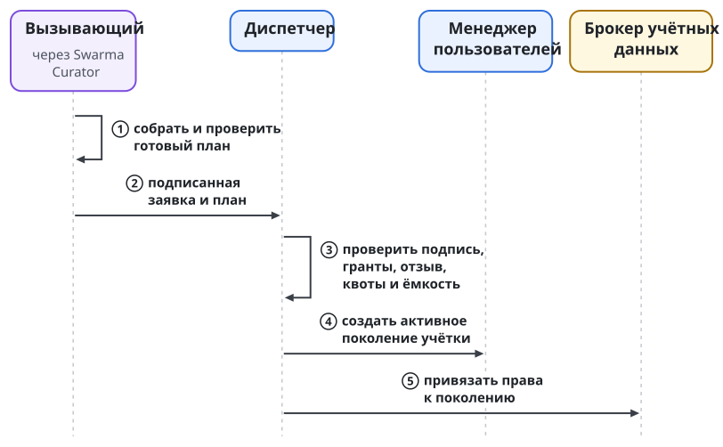
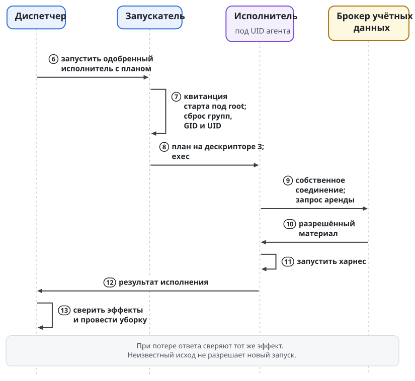
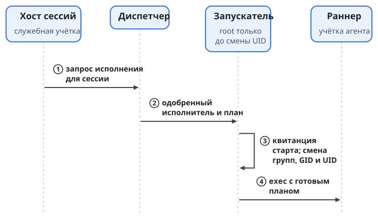
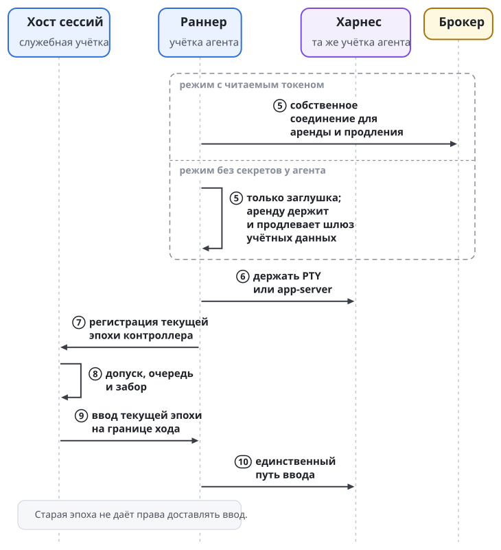
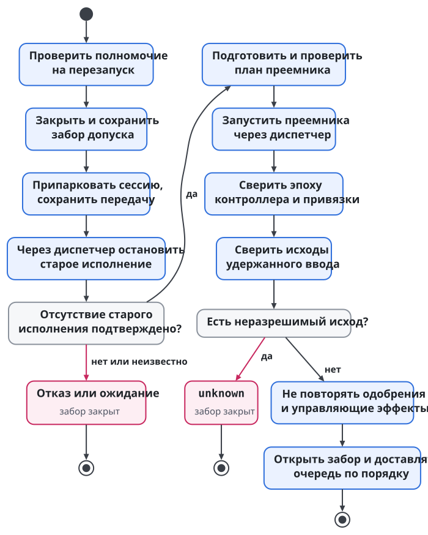
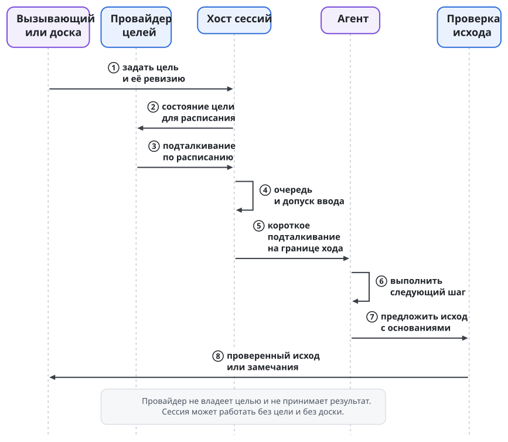

# Запуск агента и хост сессий

Запустить процесс среды мало. Нужно определить роль агента, модель и усилие, подготовить дом и инструменты, проверить право вызывающего, найти ёмкость машины, а после сбоя понять, был запуск или нет. Для долгой работы добавляются ввод, почта, парковка и восстановление. Swarma Runtime разделяет эти обязанности между программами. Сборщик плана не получает привилегий запускателя, и владелец сессии не владеет всеми процессами машины.

**Хост сессий** управляет жизнью логической сессии: её записями, очередью ввода, допуском доставки и восстановлением. Хост сессий состоит из службы `swarma-session-host` и отдельного раннера `swarma-session-runner` под учёткой агента.

## Матрёшка запуска

У человека и дочернего агента разные входы: человек пользуется `curator run`, дочерние исполнения запускает `task-board spawn`. Под ними по очереди раскрываются настройка окружения, подготовка плана и исполнение среды. Реестр моделей и адаптеры запуска превращают выбор среды, модели и усилия в аргументы и окружение, но сами процессов не запускают.

Ответственность за запуск распределена так. Слово "диспетчер" в таблице означает диспетчер запусков; диспетчер ввода внутри хоста сессий играет другую роль:

| Вопрос | Кто отвечает |
| --- | --- |
| Какая роль нужна задаче? | оркестратор или ядро процессов |
| Какая модель и какое усилие подходят? | маршрутизатор моделей |
| Как собрать профиль, дом, инструкции, скиллы и MCP? | Swarma Curator |
| Есть ли право на запуск и место на машине? | диспетчер (`swarma-dispatcher`) |
| Кто создаёт учётку и запускает программу под ней? | менеджер пользователей (`swarma-user-manager`) и запускатель `swarma-user-launcher` |
| Кто исполняет готовый план разовой работы? | `curator-run` |
| Кто держит долгую сессию? | хост сессий и её раннер |
| Кто принимает результат работы? | ядро процессов, отдельно от выхода программы |

Пример. Разработчику нужна модель для изменения кода. Маршрутизатор выбирает модель, но места на машине не резервирует. Swarma Curator собирает окружение, но не решает, вправе ли проситель породить агента с такими полномочиями. Диспетчер проверяет право и ёмкость, но не пересобирает профиль на свой вкус. Поэтому отказ по политике, нехватка ресурса и ошибка исполнения различимы.

## План собирает вызывающий

**План запуска** фиксирует результат подготовки окружения: выбранный профиль с пином, управляемый дом, инструкции, скиллы, MCP, сетевой профиль и режим учётных данных: режим без секретов у агента или выбранный владельцем машины режим с читаемым токеном (глава "Учётные данные и логины"). Пин означает хэш профиля; по нему проверяют, что окружение соответствует заявленному. Планы запуска собирает Swarma Curator. Выбор модели разобран в главе "Модели и деньги", состав дома разобран в главе "Swarma Curator".

`curator-run` работает с планом. `swarma-user-launcher` выполняет привилегированный переход под учётку агента и запускает одобренную программу; это две разные программы. Вход человека через `curator run` разрешает профиль и собирает план под учёткой человека. Разовый режим под учёткой агента только проверяет уже готовый план, через отдельный вход `curator-run exec --plan-fd N`.

Граница проведена из недоверия к процессам под учёткой агента. Если бы агент сам разрешал профиль из настроек, которые может менять, инъекция влияла бы на сборку собственного окружения. Поэтому план собирает тот, кто отвечает за запуск. Исполнитель под учёткой агента проверяет и исполняет эти байты; заново выбирать полномочия по конфигурации ему не нужно. Раннер долгой сессии пользуется той же библиотекой проверки плана.

Настройки самого проекта тоже не становятся полномочиями автоматически. Среды умеют читать `CLAUDE.md`, настройки MCP и хуки из репозитория. В управляемом запуске такие настройки выдаются после проверки и одобрения защищённых копий: изменения проекта становятся кандидатами, а запуск сохраняет прежнюю одобренную версию. Читать и править код агент по-прежнему может. Слой проекта разобран в главе "Swarma Curator".

Итоговый PATH покрыт дайджестом плана. Сначала идёт защищённый каталог инструментов запуска, затем допущенный базовый PATH пользователя в прежнем порядке, затем защищённый каталог-диспетчер менеджера. Каталог `.agents/bin` из репозитория в управляемом запуске не исполняется: иначе код проекта мог бы подложить программу под знакомым именем. Исполнитель проверяет PATH из плана и заново его не собирает.

## Диспетчер и транзакция разовой работы

Диспетчер необязателен: без него возможен прямой запуск через `curator run`, без учёта. Если диспетчер установлен, все запуски проходят через него. Недоступный диспетчер означает отказ, и диспетчер, который не закончил восстановление, тоже означает отказ; запасного прямого старта нет. Диспетчер работает как служба на Unix-сокете. После сбоя он сначала сверяет состояние и только потом объявляет готовность. Сетевых соединений, включая loopback, диспетчеру не нужно.

Swarma Runtime различает **выделение агента**, то есть учётку с её поколением, и **исполнение**, то есть один запуск программы с заявкой на ёмкость и квитанцией старта. Одна учётка может пережить несколько исполнений. В заявке сохраняется ещё и сетевой профиль, выбранный по политике машины, с его дайджестом; повтор и восстановление используют ту же пару.

Разовая работа начинается с вызывающего: он собирает план через Swarma Curator и подписывает заявку. Диспетчер проверяет подпись, цепочку грантов, отзыв, квоту и ёмкость машины; если места нет, диспетчер отказывает. Он же сверяет гарантии, которые объявила задача, с квалифицированным профилем станции и допускает только пересечение полномочий запроса, класса, минимумов платформы, политики владельца и текущих квалифицированных возможностей (глава "Пользователь ОС на агента и сеть агента"). Недостающая гарантия даёт типизированный отказ: диспетчер не выбирает молча более слабый бэкенд и не отбрасывает требование. Затем менеджер пользователей создаёт учётку с новым поколением и её группой ресурсов. Брокер учётных данных привязывает поколение к аккаунту подписки; права агента зависят от цепочки вызывающего. Допуск агента и выдача материала разделены: в режиме без секретов у агента материал получает по служебной аренде шлюз учётных данных, а запуск получает только заглушку, связанную с этим поколением.

Перед стартом диспетчер снова проверяет отзыв. Запускатель очищает унаследованные дескрипторы, проверяет поколение и исполнитель, кладёт план на дескриптор, записывает квитанцию старта от root, сбрасывает права и запускает `curator-run`. `curator-run` проверяет план и запускает среду. В режиме с читаемым токеном он перед этим получает у брокера аренду, и токен оказывается в окружении процесса среды. В режиме без секретов у агента `curator-run` аренды у брокера не получает и не продлевает: среда получает заглушку через принимаемый ею канал и настроенный адрес шлюза, а аренду материала держит и продлевает шлюз учётных данных. Когда процесс вышел и отсутствие процессов подтверждено, ёмкость исполнения освобождается. Уборка учётки учитывает обязательство сохранить результат рабочей копии.

Отзыв хранится у брокера. `revocation.check` возвращает для проверяемой цепочки "не отозвано", "отозвано" или "недоступно" с номером состояния отзывов. Два последних ответа означают отказ. Положительный ответ описывает снимок на момент проверки: привязку, аренду и каждое продление брокер проверяет отдельно. Потерянная связь с проверкой отсутствием отзыва не считается.

У каждого внешнего шага свой идентификатор эффекта. Если после создания учётки не удалась привязка, учётку выводят. Если потерялся ответ о старте, диспетчер сверяет тот же эффект и его квитанцию; второй программы он не запускает. Неизвестный исход не равен отсутствию исполнения. Отмена ведёт к `exec.stop`, уборка начинается после подтверждения, что процессов больше нет.

Если у агента была рабочая копия, до удаления дома результат обязательно выгружает фиксированная программа под его учёткой. Частичный, неизвестный или неуспешный исход удерживает дом; снять обязательство может только оператор отдельным действием. Затем снимается привязка, уничтожаются ключи учётки и удаляется дом. Отзыв личности разового работника идёт отдельным шагом, если диспетчер зарегистрировал её как разовую. Выход процесса не разрешает потерять результат.

Постоянная команда устроена иначе, чем временные работники. Заранее заданного срока у её учёток и исполнений нет, и парковка или перезапуск их не завершают. Поднять команду может оператор по подписанному описанию. Регистрация ключа нового оркестратора права запускать детей не даёт: суженную цепочку должен передать тот, кто запросил. Рекурсивный запуск оркестраторов требует загруженного и проверенного делегирования.

Для временной работы есть начальные квоты, которые меняет конфигурация. Превышение квоты даёт постоянный отказ `quota_exceeded`; в очередь за свободным слотом такой запрос не встаёт. На постоянную команду эти пределы не распространяются:

| Ограничение | На вызывающего | На машину |
| --- | ---: | ---: |
| Одновременные исполнения | 2 | 6 |
| Живые учётки агентов | 4 | 16 |
| Срок учётки | по умолчанию 24 часа, максимум 7 дней | не задан |
| Одно исполнение | по умолчанию 4 часа, максимум 12 | не задан |

Кроме квоты диспетчер проверяет текущую ёмкость: диск, простой процессора, слоты провайдеров, паузу и замок сборки. Непрочитанное состояние паузы считается паузой: диспетчер не запускает работу только потому, что не смог выяснить, запрещён ли запуск. Эти ворота задаёт локальная политика машины, и выбор более подходящей модели её не отменяет.

Во время сверки после сбоя доступны статус, списки, наблюдение эффектов и уже разрешённая остановка, даже если новые старты закрыты. Неизвестные записи удерживают свои поколения, учётки и квоты. Остальную работу допускают, только если неизвестность доказанно локализована; иначе закрывается весь узел. После потери состояния диспетчера или восстановления из копии нужна обратная опись учёток, привязок и квитанций. Сирот не подхватывают и не удаляют по одному имени или UID; открыть узел после внешней сверки может подписанное решение оператора.

Транзакция разового запуска показана двумя рисунками с общей нумерацией шагов. Первый доходит до привязки прав к новому поколению учётки, второй начинается с запуска исполнителя.

{.tall}

Рисунок показывает доставку в режиме с читаемым токеном. В режиме без секретов у агента исполнитель под UID агента аренды не получает: среде достаётся только заглушка, а аренду материала держит шлюз учётных данных.

## Служба, раннер и единственный писатель

Для долгой сессии вместо разового `curator-run` запускается раннер. Служба хоста сессий работает под своей учёткой и ведёт реестр, журнал, очереди и заборы допуска. Раннер работает под учёткой агента и держит PTY или app-server среды. В режиме с читаемым токеном раннер продлевает аренду у брокера. В режиме без секретов у агента раннер держит только заглушку и аренды у брокера не получает и не продлевает: настоящий токен по служебной аренде держит и продлевает шлюз учётных данных, а обновляет его единственный обновляющий у брокера (глава "Учётные данные и логины"). О доске, целях и носителе раннер ничего не знает. Так граница пользователя ОС сохраняется.

Один процесс не может работать одновременно под служебной учёткой и под учёткой агента. Поэтому общего сервера среды с общим пулом учётных данных у службы нет: у каждой сессии Codex свой app-server под учёткой её агента. Шлюз учётных данных этому правилу не противоречит: он отдельно допущенная служба под своей учёткой, держит настоящий токен для запросов, которые пересылает, и проверяет на каждом использовании право вызывающего. Частный app-server сессии при этом остаётся под учёткой агента и получает только заглушку. Контекстный движок внутри хоста сессий оформлен пакетом с адаптерами, нормализацией событий, журналом, диспетчером ввода и экспортом контекста. Вывод берётся из нативных транскриптов сред. Журнал и заявки хоста подчиняются общему бюджету состояния служб.

Главный инвариант: **во ввод пишет один диспетчер хоста сессий**. Он передаёт только допущенные элементы долговечной очереди, нетипизированного обхода нет. Раннер физически держит канал среды, но принимает команды только текущей эпохи контроллера. Эпоха отделяет новую власть над сессией от старой после падения или замены службы, так что пережившее сбой соединение права старого контроллера писать не сохраняет.

При начальном старте служба сначала сохраняет намерение и закрывает доставку, затем просит диспетчер выполнить `host_start`. Запрос связывает логическую сессию, номер исполнения, эпоху контроллера и номер операции. Долговечное разрешение хоста на запуск относится к одной логической сессии, а каждый физический старт получает отдельную бронь, забор и квитанцию. Вызывать этот путь может только настроенная учётка службы.

Диспетчер запускает раннер обычным привилегированным путём менеджера пользователей. Раннер устанавливает новое аутентифицированное соединение и подтверждает, что принадлежит нужной сессии и исполнению. Регистрация в текущей эпохе и готовность предшествуют доставке. Если служба падает посреди старта, бронь и закрытый забор сохраняются до сверки. Форматы разрешений и аутентификацию `host_start` и `host_stop` задаёт спецификация хоста сессий.

Запуск раннера и путь ввода показаны двумя рисунками с общей нумерацией шагов.

{.tall}

## Разрешение на преемника

Право начать сессию не означает права бесконечно порождать новые процессы. Владелец может отдельно разрешить преемников логической сессии; такое разрешение называется **жизненный цикл сессии**. Без такого разрешения старт одноразовый. Преемник допустим только после подтверждённого отсутствия предыдущего исполнения, а повтор того же запроса возвращает того же преемника. План используется байт в байт; если пины или поза расходятся, нужен новый допуск владельца.

Владелец должен оставаться активным, цепочка должна оставаться неотозванной, и каждый старт снова проверяет отзыв. В обычной работе бюджет перезапусков не даёт преемникам обнулять временное окно; у постоянных сессий предела времени нет. Разрешение жизненного цикла отзывают: отмена владельцем, его вывод, отзыв цепочки, подписанный вывод постоянного агента, остановка на обслуживание. После этого автоматическое повторение запрещено.

`host_stop` позволяет службе попросить остановить только исполнение под своим разрешением. Диспетчер проводит остановку через журналируемый `exec.stop` с подтверждением отсутствия процессов. Такая просьба отменой владельцем не считается и сама по себе права на следующий запуск не даёт. Зависшую сессию так остановить можно, но запуск преемника всё равно требует разрешённого жизненного цикла.

## Очередь и вопросы среды

Элемент, переданный мостом, проходит состояния "принято", "в очереди", "доставлено в среду", "применено". Последнее требует подтверждения среды: эха с маркером у Claude, идентификатора элемента у Codex, подтверждения у Muse. Запись байтов в канал применения не означает. Если раннер умер до подтверждения, исход неизвестен, и до открытия сессии хост ищет маркер в нативном транскрипте. Ответы на запросы разрешения и команды управления автоматически не повторяются.

Пример. Среда спрашивает, разрешить ли команду. Адаптер создаёт типизированное событие ожидания с точным дайджестом вопроса. Ответить вправе держатель `session.approve` на это исполнение (родитель-оркестратор или человек); побеждает первый действительный ответ. Обычный текст в очереди ответом на вопрос не является. Автоответы допустимы только по списку разрешённых случаев и пишутся в аудит; всё вне списка паркуется и ждёт держателя гранта.

Хост сессий знает три режима доставки:

- `next_turn` доставляет элемент на границе хода.
- `steer` доставляет элемент внутри текущего хода, где среда поддерживает безопасное вмешательство.
- `interrupt` прерывает ход для остановки, парковки и аварийного стопа.

Режимы задают момент ввода; к уровням доверия они отношения не имеют. Адаптер может пользоваться нативными возможностями среды, но полномочий отправителя из них не извлекает.

## Забор, парковка и перезапуск

**Забором допуска** называется сохранённое состояние сессии, которое разрешает или запрещает её эффекты. Открытый забор разрешает доставку. Закрытый позволяет копить очередь без доставки. Заблокированный на обновление запрещает старты; его ставит оператор при замене бинарника. Во время восстановления сессии сообщение можно принять и не отдать его старому исполнению. Забор нужен для каждого эффекта: ввода, цели, подключения, прерывания, повторного подхватывания.

Контролируемый перезапуск идёт шагами, и каждый шаг зависит от свидетельства предыдущего. Хост сессий закрывает доставку и дожидается конца хода, отсутствия дочерних инструментов и внешних эффектов в полёте. Затем он запрашивает записку и сохраняет пакет передачи, останавливает исполнение и подтверждает его отсутствие. После этого хост сравнивает пины профиля, привязки и позу, запускает новое исполнение и инициализирует его нативным возобновлением или посевом пакета. Последними хост разрешает неизвестные исходы доставки и открывает забор.

Сам хост сессий сигналов процессам не шлёт: он обращается к диспетчеру, а диспетчер обращается к менеджеру пользователей. Отсутствие процессов подтверждает `exec.stop`. Нативную блокировку сессии в доме агента проверяет уже свежий раннер под закрытым забором; если её состояние неизвестно, сессия остаётся запаркованной. При любом отказе путь останавливается с закрытым забором и указанием шага. Если человек принимает расхождение, это новая операция с пересборкой сессии.

**Парковка** сохраняет возможность продолжить работу: закрывает доставку и долговечно сохраняет записку или явно помеченный снимок. Если к сессии привязана цель доски, нужна ещё её подтверждённая ревизия со ссылкой на записку; без доски этого шага нет. Записка перечисляет исполнения в полёте, Change Request, решения для человека и следующие шаги. Сжатие контекста тоже требует передачи дел.

Сессия служит кэшем. Авторитетны журнал хоста сессий и записка, а если есть доска, то ещё её задача и цель. Контекст среды может исчезнуть, и задача от этого не становится выполненной или забытой. Выход процесса не завершает задачу доски: у неё свой барьер приёмки. Во время парковки оператору показываются незакрытые элементы отложенного ввода, потому что возобновление может восстановить старый черновик или очередь.

{.tall}

## Цель не принадлежит агенту

Сессию можно запустить без цели и без доски: почта, пробуждение, остановка и восстановление от них не зависят. Доска обращается к общему интерфейсу целей как необязательный клиент. Когда цель есть, её передаёт вызывающий при запуске или публикует доска; у учётки самого агента прав на операции с целями нет.

Ставить и менять цель сессии вправе тот, кто отвечает за её запуск, на любой глубине иерархии, а также оператор. Прежний держатель этого права после передачи меняет цель только с отказом. Интерфейс целей остаётся в хосте сессий, и доска пользуется им как необязательный клиент: она действует по праву того, кто отвечает за запуск, а не по собственному. Своей связи с доской у хоста сессий нет. Правило "хост принимает от носителя только звонок" относится ко входу почты: текст собеседника в хост не попадает, а звонок только будит сессию (глава "Пробуждение" книги об a2a).

Клиент целей обращается к службе через сокет. Служба проверяет сообщённые ядром UID и активное поколение, полномочие (capability) на конкретную сессию, срок, отзыв и забор. Затем записывает ревизию в журнал и передаёт её раннеру текущей эпохи на границе хода. Доска не управляет чужими сессиями, а результат агента остаётся предложением исхода. Отзыв полномочия прекращает операции с целями; остановку исполнения проводит диспетчер отдельной операцией.

Если цель поставил вызывающий без доски, её бюджет подталкиваний задаёт грант вызывающего, а предложение "готово" уходит самому вызывающему: он принимает исход или отклоняет его, как доска для своих целей. Цель агенту задаёт вызывающий или доска; собственных целей агент не ставит. Форму полномочия и действия интерфейса целей задаёт спецификация хоста сессий.

{.tall}

## Пробуждение и перенос контекста

Приём почты и пробуждение обеспечивают мост и хост сессий. Агенту не нужно после пробуждения самому ставить ожидание почты, которое пропало бы, если агент забыл его поставить или ход упал. Раннер сообщает конец хода и готовность по правилам адаптера; неизвестная готовность означает парковку. Привязка адресата называет сессию, исполнение и эпоху.

Остановленную или запаркованную оператором сессию не будят. При закрытом заборе письма копятся; если нужен новый вход у провайдера, сессия ждёт его. Возобновлённая сессия проходит проверку готовности шлюза учётных данных и текущего полномочия заново: перезапуск не возвращает использования, которое отозвано или закрыто блокировкой аккаунта. После перезагрузки смена идентификатора загрузки подтверждает, что старых процессов нет, но права автоматически поднять всё заново не даёт. Постоянные команды поднимает Swarma Keeper: при загрузке он выполняет `keeper up` под своей системной учёткой через диспетчер, в пределах разрешённого жизненного цикла каждой сессии. Остановленное человеком остаётся остановленным.

**Пакет передачи** содержит проекцию журнала на фиксированный момент для названного получателя: краткое содержание, решения, открытые пункты, ссылки на цели и защищённое хранилище. Токенов, учётных данных, сырых транскриптов и ожидающих одобрения в нём нет. Элементы сохраняют авторство и вердикт, чтобы чужие данные при посеве не становились пользовательскими командами. Пакет ограничивает переносимое содержимое, но не стирает секрета, который исходная модель уже видела.

Нативное возобновление допустимо на той же машине, в той же среде, с тем же управляемым домом и пином профиля. Версия может меняться только совместимо по semver (тот же major, а для 0.x тот же minor). При неудаче вызывающий получает `resume-failed` и решает сам; автоматической пересборки взамен нет. Другая машина, профиль или среда требуют пересборки из пакета с отчётом о потерях.

## Верстак: постоянное рабочее место агента

**Верстак** (Werkstatt) означает постоянное рабочее место агента, связку "ячейка проекта × роль × среда". Ячейкой проекта называется проект внутри продукта со своей командой, доской и плейбуком (глава "Доска задач и процесс"). У верстака есть свой управляемый дом Swarma Curator с профилем роли, свой клон репозитория, своя личность на носителе и запись в реестре верстаков на доске.

Верстак различает место и агента на месте. **Место** принадлежит ячейке проекта и живёт долго: у него есть клон, профиль, шаблон грантов и запись в реестре, а обязательства роли записаны в журнале кипера на место. Агент на месте сменяем, и смена агента не теряет обязательств места (глава "Swarma Keeper"). Чья долгоживущая личность держит место и его обязательства, личность агента или личность самого места, и как поэтому оформляется занятие места, решают владельцы (глава "Где мы и что дальше").

Место может занять и агент другого владельца. Ячейка проекта проверяет его аттестации по нужной оси, например историю ревью для места ревьювера, и его независимость от других участников (глава "Аттестации и переносимая репутация"). Занятие места не заменяет назначения на конкретную задачу. Формат допуска на место и то, чья личность подписывает результаты и получает аттестации, зависят от того же выбора (глава "Где мы и что дальше").

Число верстаков на роль ограничено ёмкостью и квотами хоста; где оно задаётся, в плейбуке или в карточке продукта, решают владельцы (глава "Где мы и что дальше"). Оператор хоста, кипер или мета-кипер поднимает верстаки в своей зоне без особого разрешения, если иерархия не требует спросить вышестоящего.

Запись хранит описание запуска: среду, модель и effort, профиль, клон и личность. `werkstatt up` поднимает по этой записи сессию через хост сессий, а `werkstatt down` её останавливает. Без хоста сессий верстак не запускается: такую сессию нельзя было бы ни разбудить, ни проверить, жива ли она, ни восстановить после сбоя.

Задачи приходят верстаку сообщениями в комнатах проекта со звонком. Право на задачу даёт запись на доске; сам текст сообщения права не даёт. Разработчик сдаёт работу ревизией, а ревьювер пишет вердикт на доску и в репозиторий не пишет. Независимость ревью проверяется по личности.

У контекста верстака два режима. В режиме **"продолжать"** следующая задача идёт в ту же сессию, контекст сжимается штатными средствами среды, родная память среды включена. В режиме **"свежий"** каждая задача начинается в новой сессии той же личности. При любом режиме личность, дом и память верстака постоянны.

Клоны верстаков лежат в отдельном корне, где выше по дереву нет ни `CLAUDE.md`, ни `AGENTS.md`. Claude Code ищет эти файлы от рабочей папки вверх, и подмена дома этот подъём не останавливает.

Маршрутизатор моделей выбирает модель верстака при создании, а затем выбирает верстак под задачу. Сначала идут фильтры по роли, проекту, живости, доверию и независимости, потом сравниваются качество, загрузка и цена. Если подходящего верстака нет, маршрутизатор отказывает и не запускает ничего сам.

## Общий стоп

Общий стоп задаётся отдельной командой оператора, подписанной телефоном; спутать её с парковкой нельзя. Команда доставляется напрямую каждой службе: менеджер замораживает поколения и закрывает вход, брокер отзывает аренды, шлюз учётных данных и служба действий закрывают очереди, открытые потоки и текущие использования, хост сессий останавливает сессии, диспетчер прекращает запуски. Возобновить работу можно только подписью оператора. Swarma Keeper может получить доверенность на стоп с названным поводом; у оркестраторов и работников такого права нет. Снимки досок и записки позволяют потом продолжить работу. Общий стоп подробно разобран в главе "Ключи и ключник".

Обновление демонов выполняет человек в окне обслуживания: закрывает допуск, подтверждает остановку, заменяет программу, запускает её, сверяет состояние и только потом открывает работу. Агент может попросить перезапустить разрешённую ему сессию, но не может обновить или подменить хост сессий, мост и доску. Неизвестный исход остановки откладывает обслуживание. Работа с телефоном и терминалом оператора разобрана в главе "Оператор и интерфейсы".
