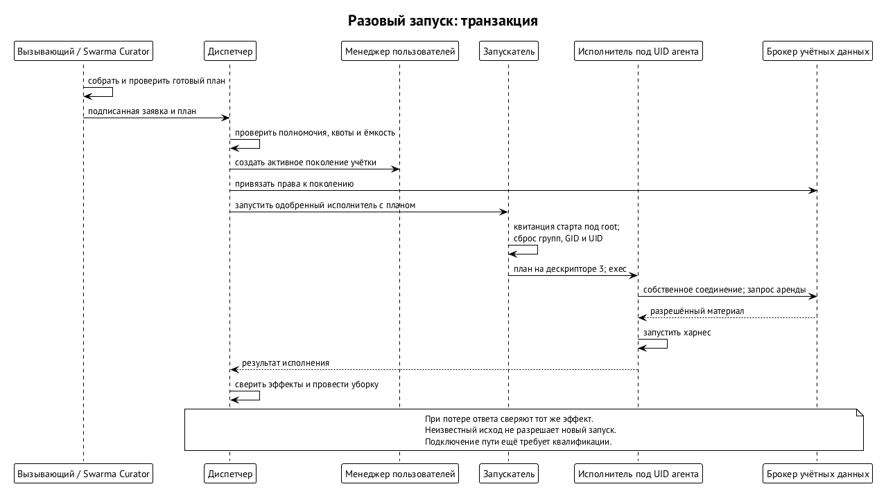
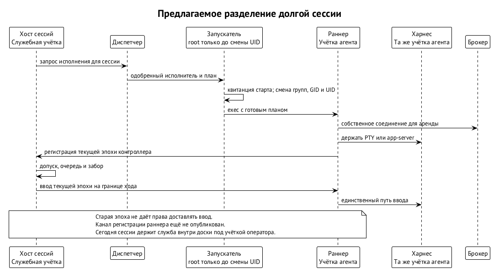
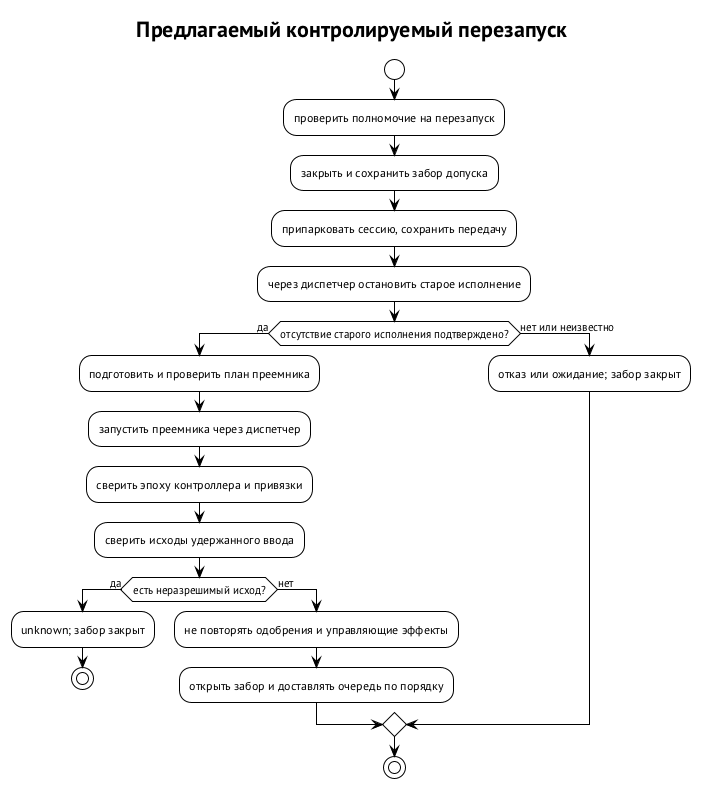
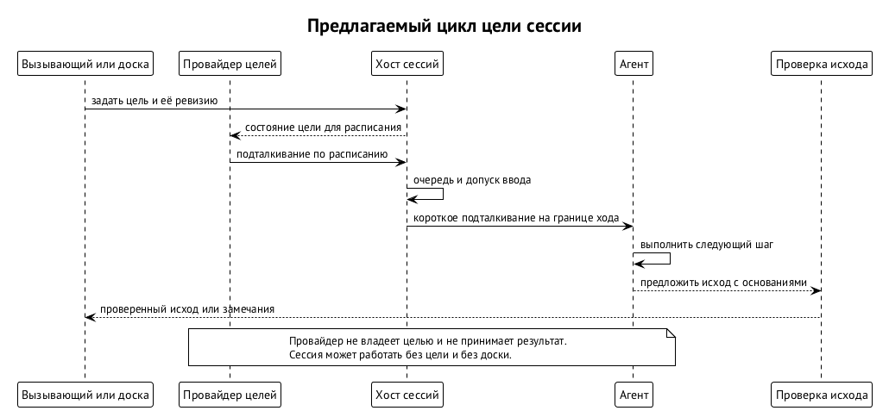

# Запуск агента и хост сессий

Запустить процесс среды недостаточно. Нужно определить роль агента, модель и усилие, подготовить дом и инструменты, проверить право вызывающего, найти ёмкость машины, а после сбоя понять, был ли запуск. Для долгой работы добавляются ввод, почта, парковка и восстановление. Swarm Runtime разделяет эти обязанности: сборщик плана не становится привилегированным запускателем, а владелец сессии не становится владельцем всех процессов машины. ⟦решено⟧

**Хост сессий** (`agent-session-host`) управляет жизнью логической сессии: её записями, очередью ввода, допуском доставки и восстановлением. В целевой схеме это служба `swarma-session-host` и отдельный раннер `swarma-session-runner` под учёткой агента. Сегодня работу с сессиями выполняет `tb-sessiond` внутри доски задач; служба, раннер и заборы относятся к спецификации следующего устройства. ⟦спецификация⟧

## Матрёшка запуска

У человека и дочернего агента разные входы: человек пользуется `curator run`, дочерние исполнения запускает `task-board spawn`. Под ними последовательно раскрываются настройка окружения, подготовка плана и исполнение среды. Реестр моделей и адаптеры запуска превращают выбор среды, модели и усилия в аргументы и окружение; сами по себе они процессов не запускают. Прямой запуск с подготовкой окружения уже работает. ⟦работает сегодня⟧

В целевом устройстве обязанности распределены так. Слово «диспетчер» здесь означает диспетчер запусков; диспетчер ввода внутри хоста сессий — другая ответственность. ⟦решено⟧

| Вопрос | Владелец ответа |
| --- | --- |
| Какая роль нужна задаче? | Оркестратор или ядро процессов |
| Какая модель и какое усилие подходят? | Маршрутизатор моделей |
| Как собрать профиль, дом, инструкции, скиллы и MCP? | Swarm Curator |
| Есть ли право на запуск и место на машине? | Диспетчер (`swarma-dispatcher`) |
| Кто создаёт учётку и запускает программу под ней? | Менеджер пользователей (`swarma-user-manager`) и запускатель `swarma-user-launcher` |
| Кто исполняет готовый план разовой работы? | `curator-run` |
| Кто держит долгую сессию? | Хост сессий и её раннер |
| Кто принимает результат работы? | Ядро процессов, отдельно от выхода программы |

Например, разработчику нужна модель для изменения кода. Маршрутизатор выбирает модель, но не резервирует место на машине. Swarm Curator собирает окружение, но не решает, вправе ли проситель породить агента с указанными полномочиями. Диспетчер проверяет право и ёмкость, но не пересобирает профиль на свой вкус. Это позволяет различать отказ по политике, отсутствие ресурса и ошибку исполнения. ⟦решено⟧

## План собирает вызывающий

**План запуска** — результат подготовки окружения: выбранный профиль с пином, управляемый дом, инструкции, скиллы, MCP, сетевой профиль и режим учётных данных. Пин — хэш профиля, по которому проверяется соответствие заявленному окружению. Swarm Curator уже собирает такие планы. Выбор модели рассматривается отдельно в главе «Модели и деньги», состав дома — в главе «Swarm Curator». ⟦работает сегодня⟧

`curator-run` и `swarma-user-launcher` — разные программы. Первая работает с планом. Вторая выполняет привилегированный переход под учётку агента и запускает одобренную программу. Вход человека через `curator run` разрешает профиль и собирает план под учёткой человека; разовый режим под учёткой агента только проверяет уже готовый план. Для него предусмотрен отдельный вход `curator-run exec --plan-fd N`, включаемый после проверки. ⟦решено⟧

Причина границы — недоверие к процессам под учёткой агента. Если агент мог бы сам разрешать профиль из изменяемых им настроек, инъекция получила бы влияние на сборку своего окружения. Поэтому план собирается у того, кто отвечает за запуск. Исполнитель под учёткой агента проверяет и исполняет байты, а не заново читает конфигурацию для выбора полномочий. Раннер долгой сессии использует ту же библиотеку проверки плана. ⟦решено⟧

Настройки самого проекта тоже не должны автоматически становиться полномочиями. Среды умеют читать `CLAUDE.md`, настройки MCP и хуки из репозитория. Для управляемого запуска решено выдавать такие настройки после проверки и одобрения защищённых копий; изменения проекта становятся кандидатами, а запуск сохраняет прежнюю одобренную версию. Читать и править код агент по-прежнему может. Подробности слоя проекта относятся к главе «Swarm Curator». ⟦решено⟧

Итоговый PATH покрывается дайджестом плана. В нём сначала защищённый каталог инструментов запуска, затем допущенный базовый PATH пользователя в прежнем порядке, затем защищённый каталог-диспетчер менеджера. Каталог `.agents/bin` из репозитория в управляемом запуске не исполняется: иначе код проекта мог бы подложить программу под знакомым именем. Исполнитель проверяет PATH из плана, а не собирает его заново. ⟦решено⟧

## Диспетчер и транзакция разовой работы

Диспетчер необязателен: без него возможен прямой запуск через `curator run` без его учёта. Если диспетчер установлен, все запуски проходят через него. Недоступный или ещё не восстановившийся диспетчер означает отказ, без запасного прямого старта. Это служба на Unix-сокете, которая сначала сверяет состояние после сбоя, затем объявляет готовность. Сетевых соединений ей не требуется, включая loopback. ⟦решено⟧

Нужно различать **выделение агента** — учётку с её поколением — и **исполнение** — один запуск программы с заявкой на ёмкость и квитанцией старта. Учётка может пережить несколько исполнений. В заявке сохраняется также выбранный по политике машины сетевой профиль с его дайджестом; повтор и восстановление используют ту же пару. Порядок разовой работы следующий. ⟦спецификация⟧

1. Вызывающий собирает план через Swarm Curator и подписывает заявку.
2. Диспетчер проверяет подпись, цепочку грантов, отзыв, квоту и ёмкость машины. Отсутствие места пока означает отказ; очередь отложена.
3. Менеджер пользователей создаёт учётку с новым поколением.
4. Брокер учётных данных привязывает поколение к аккаунту подписки. Права агента зависят от цепочки вызывающего.
5. Перед стартом диспетчер снова проверяет отзыв. Запускатель очищает унаследованные дескрипторы, проверяет поколение и исполнитель, готовит план на дескрипторе, записывает квитанцию старта от root, сбрасывает права и запускает `curator-run`.
6. `curator-run` проверяет план, получает у брокера аренду учётных данных и запускает среду; токен находится в окружении её процесса.
7. После выхода и подтверждённого отсутствия процессов освобождается ёмкость исполнения. Уборка учётки учитывает обязательство сохранить результат рабочей копии.

Отзыв хранится у брокера. Операция `revocation.check` возвращает «не отозвано», «отозвано» или «недоступно» для проверяемой цепочки, с номером состояния отзывов. Последние два ответа означают отказ. Положительный ответ — снимок на момент проверки, а не разрешение на будущий старт; брокер отдельно проверяет привязку, аренду и каждое продление. Поэтому потеря связи с проверкой не считается отсутствием отзыва. ⟦спецификация⟧

Каждый внешний шаг имеет свой идентификатор эффекта. Если после создания учётки не удалась привязка, учётку выводят. Если потерялся ответ о старте, диспетчер наблюдает тот же эффект и квитанцию, а не запускает вторую программу. Неизвестный исход не равен отсутствию исполнения. Отмена ведёт к `exec.stop`, уборка начинается после подтверждения, что процессов больше нет. ⟦спецификация⟧

Если у агента была рабочая копия, до удаления дома обязательна выгрузка результата фиксированной программой под его учёткой. Частичный, неизвестный или неуспешный исход удерживает дом; снять обязательство может оператор отдельным действием. Затем снимается привязка, уничтожаются ключи учётки и удаляется дом. Отзыв личности разового работника — отдельный шаг, если диспетчер зарегистрировал её как разовую. Выход процесса сам по себе не разрешает потерять результат. ⟦спецификация⟧

Постоянная команда отличается от временных работников. У её учёток и исполнений нет заранее заданного срока; парковка и перезапуск не завершают их автоматически. Поднять команду может оператор по подписанному описанию. Регистрация ключа нового оркестратора сама по себе не даёт права запускать детей: соответствующую суженную цепочку должен передать запросивший. Пока загрузка такого делегирования не опубликована и не проверена, рекурсивный запуск оркестраторов закрыт. ⟦спецификация⟧

Для временной работы приняты начальные квоты, изменяемые конфигурацией. Превышение квоты означает постоянный отказ `quota_exceeded`, а не ожидание свободного слота. Эти пределы нельзя переносить на постоянную команду. ⟦решено⟧

| Ограничение | На вызывающего | На машину |
| --- | ---: | ---: |
| Одновременные исполнения | 2 | 6 |
| Живые учётки агентов | 4 | 16 |
| Срок учётки | По умолчанию 24 часа, максимум 7 дней | — |
| Одно исполнение | По умолчанию 4 часа, максимум 12 | — |

Кроме квоты проверяется текущая ёмкость: диск, простой процессора, слоты провайдеров, пауза и замок сборки. Если состояние паузы прочитать не удалось, это считается паузой. Диспетчер не должен запустить работу только потому, что не смог выяснить, запрещён ли запуск. Эти ворота относятся к локальной политике машины, которую выбор более подходящей модели не отменяет. ⟦спецификация⟧

При сверке после сбоя остаются доступны статус, списки, наблюдение эффектов и уже разрешённая остановка, даже если новые старты закрыты. Неизвестные записи удерживают свои поколения, учётки и квоты. Остальную работу можно допускать лишь при доказанной локализации неизвестности; иначе закрывается весь узел. Потеря состояния диспетчера или восстановление из копии требует обратной описи учёток, привязок и квитанций. Сирот нельзя подхватывать или удалять по одному имени либо UID; открыть узел после внешней сверки может подписанное решение оператора. ⟦спецификация⟧

## Служба, раннер и единственный писатель

Для долгой сессии вместо разового `curator-run` запускается раннер. Служба хоста сессий работает под собственной учёткой и ведёт реестр, журнал, очереди и заборы допуска. Раннер работает под учёткой агента, держит PTY или app-server среды и продлевает аренду токена у брокера. О доске, целях и мессенджере раннер ничего не знает. Такое разделение позволяет сохранить границу пользователя ОС. ⟦решено⟧

Один процесс не может одновременно работать под отдельной служебной учёткой и под учёткой агента. Поэтому служба не держит общий сервер среды с общим пулом учётных данных. У каждой сессии Codex свой app-server под учёткой её агента. Контекстный движок внутри хоста сессий — пакет с адаптерами, нормализацией событий, журналом, диспетчером ввода и экспортом контекста. Вывод берётся из нативных транскриптов сред. ⟦спецификация⟧

Главный инвариант — **во ввод пишет один диспетчер хоста сессий**. Он передаёт только допущенные элементы долговечной очереди; нетипизированного обхода нет. Раннер физически держит канал среды, но принимает команды только текущей эпохи контроллера. Эпоха отделяет новую власть над сессией от старой после падения или замены службы. Пережившее сбой соединение не должно сохранять право старого контроллера писать. ⟦решено⟧

Для начального старта служба сначала сохраняет намерение и закрывает доставку, затем просит диспетчер выполнить `host_start`. Запрос связывает логическую сессию, номер исполнения, эпоху контроллера и номер операции. Долговечное разрешение хоста на запуск относится к одной логической сессии; каждый физический старт получает отдельную бронь, забор и квитанцию. Только настроенная учётка службы может вызывать этот путь. ⟦решено⟧

Диспетчер запускает раннер через обычный привилегированный путь менеджера пользователей. Раннер устанавливает новое аутентифицированное соединение и подтверждает принадлежность нужной сессии и исполнению. Регистрация в текущей эпохе и готовность предшествуют доставке. Если служба падает посреди старта, бронь и закрытый забор сохраняются до сверки. Форматы разрешений и аутентификация `host_start` и `host_stop` ещё не опубликованы; до этого связка выключена. ⟦открыто⟧

## Разрешение на преемника

Право начать сессию не означает права бесконечно порождать новые процессы. Владелец может отдельно разрешить преемников логической сессии — **жизненный цикл сессии**. Без такого разрешения старт одноразовый. Преемник допустим лишь после подтверждённого отсутствия предыдущего исполнения; повтор того же запроса возвращает того же преемника. План используется байт в байт, а расхождение пинов или позы требует нового допуска владельца. ⟦решено⟧

Владелец должен оставаться активным, цепочка — неотозванной, каждый старт снова проверяет отзыв. Для обычной работы бюджет перезапусков не позволяет преемникам обнулять временное окно. У постоянных сессий предела времени нет. Отмена владельцем, его вывод, отзыв цепочки, подписанный вывод постоянного агента или остановка для обслуживания отзывают разрешение жизненного цикла; автоматическое повторение после этого запрещено. ⟦решено⟧

`host_stop` позволяет службе попросить остановить только исполнение под своим разрешением. Диспетчер проводит остановку через журналируемый `exec.stop` с подтверждением отсутствия процессов. Такая просьба не является отменой владельцем и сама по себе не выдаёт права на следующий запуск. Например, зависшую сессию можно остановить по этому пути, но запуск преемника всё равно требует разрешённого жизненного цикла. ⟦решено⟧

## Очередь и вопросы среды

Переданный мостом элемент проходит состояния «принято», «в очереди», «доставлено в среду», «применено». Последнее требует подтверждения среды: эха с маркером у Claude, идентификатора элемента у Codex, подтверждения у Muse. Запись байтов в канал ещё не означает применения. Если раннер умер до подтверждения, исход неизвестен; до открытия сессии хост ищет маркер в нативном транскрипте. Ответы на запросы разрешения и команды управления автоматически не повторяются. ⟦предложено⟧

Например, среда спрашивает, разрешить ли команду. Адаптер создаёт типизированное событие ожидания с точным дайджестом вопроса. Ответить вправе держатель `session.approve` на это исполнение — родитель-оркестратор или человек; первый действительный ответ побеждает. Обычный текст в очереди не является ответом на этот вопрос. Автоответы допустимы лишь по списку разрешённых случаев, записываются в аудит; всё вне списка паркуется и ждёт держателя гранта. ⟦решено⟧

Для доставки предложены три режима: `next_turn` на границе хода, `steer` внутри текущего хода там, где среда поддерживает безопасное вмешательство, и `interrupt` для остановки, парковки и аварийного стопа. Они описывают момент ввода, а не разные уровни доверия. Адаптер может использовать нативные возможности среды, но не извлекать из них полномочия отправителя. ⟦предложено⟧

## Забор, парковка и перезапуск

**Забор допуска** — сохранённое состояние сессии. Открытый разрешает доставку; закрытый позволяет накапливать очередь без доставки; заблокированный на обновление запрещает старты и ставится оператором при замене бинарника. Это позволяет принять сообщение, пока сессия восстанавливается, и не передать его старому исполнению. Забор нужен для каждого эффекта, включая ввод, цель, подключение, прерывание и повторное подхватывание. ⟦спецификация⟧

Контролируемый перезапуск выполняет последовательность, в которой каждый следующий шаг зависит от свидетельства предыдущего. ⟦спецификация⟧

1. Закрыть доставку.
2. Дождаться конца хода, отсутствия дочерних инструментов и внешних эффектов в полёте.
3. Запросить записку и сохранить пакет передачи.
4. Остановить исполнение и подтвердить его отсутствие.
5. Сравнить пины профиля, привязки и позу.
6. Запустить новое исполнение.
7. Инициализировать его нативным возобновлением или посевом пакета.
8. Разрешить неизвестные исходы доставки.
9. Открыть забор.

Сам хост сессий сигналов процессам не посылает: он обращается к диспетчеру, а тот к менеджеру пользователей. Отсутствие процессов подтверждает `exec.stop`. Нативную блокировку сессии в доме агента проверяет уже свежий раннер под закрытым забором. Если состояние блокировки неизвестно, сессия остаётся запаркованной. При любом отказе путь останавливается с закрытым забором и указанием шага; принятие расхождения человеком — новая операция с пересборкой сессии. ⟦спецификация⟧

**Парковка** сохраняет возможность продолжить работу: закрывает доставку, долговечно сохраняет записку или явно помеченный снимок. Если привязана цель доски, требуется также её подтверждённая ревизия со ссылкой на записку; без доски этого шага нет. Записка перечисляет исполнения в полёте, Change Request, решения для человека и следующие шаги. Сжатие контекста также требует передачи дел. ⟦предложено⟧

Фраза «сессия — это кэш» означает, что авторитетны журнал хоста сессий и записка, а при наличии доски — ещё её задача и цель. Контекст среды может исчезнуть, не став основанием объявить задачу выполненной или забытой. Выход процесса не завершает задачу доски: у неё собственный барьер приёмки. Во время парковки нужно также показать оператору незакрытые элементы отложенного ввода; возобновление может восстановить старый черновик или очередь. ⟦решено⟧

## Цель не принадлежит агенту

Сессию можно запустить без цели и без доски: почта, пробуждение, остановка и восстановление от этого не должны зависеть. Доска — необязательный клиент общего интерфейса целей. Когда цель есть, её передаёт вызывающий при запуске или публикует доска; учётка самого агента права на операции с целями не имеет. ⟦решено⟧

Клиент целей обращается к службе через сокет. Та проверяет сообщённые ядром UID и активное поколение, полномочие — capability — на конкретную сессию, срок, отзыв и забор. Затем записывает ревизию в журнал и передаёт раннеру текущей эпохи на границе хода. Поэтому доска не управляет чужими сессиями, а результат агента остаётся предложением исхода. Отзыв полномочия прекращает операции с целями; остановка исполнения — отдельная операция диспетчера. ⟦спецификация⟧

Форма capability и действия интерфейса целей ещё не опубликованы. Не определены источник бюджета подталкиваний без доски и путь предложения «готово» для такой сессии. Эти пробелы нельзя заполнить правом агента самому менять цель. Собственные цели требуют отдельных ограничений и остаются открытым направлением. ⟦открыто⟧

## Пробуждение и перенос контекста

Сегодня агент сам ставит ожидание почты после пробуждения. Если он забыл это сделать или ход упал, ожидание может пропасть. В целевой схеме приём почты и пробуждение обеспечивают мост и хост сессий. Раннер сообщает конец хода и готовность по правилам адаптера; неизвестная готовность означает парковку, а не догадку о свободном вводе. Привязка адресата называет сессию, исполнение и эпоху. ⟦спецификация⟧

Остановленную или запаркованную оператором сессию не будят. При закрытом заборе письма копятся; при необходимости нового входа сессия ждёт его. После перезагрузки смена идентификатора загрузки подтверждает отсутствие старых процессов, но не даёт права автоматически поднять всё заново. Кто запрашивает восстановление, пока не выбран; запросчик в любом случае останется в пределах разрешённого жизненного цикла. Пока его нет, автоматического восстановления нет. ⟦открыто⟧

**Пакет передачи** — проекция журнала на фиксированный момент для названного получателя: краткое содержание, решения, открытые пункты, ссылки на цели и защищённое хранилище. В него не входят токены, учётные данные, сырые транскрипты и ожидающие одобрения. Элементы сохраняют авторство и вердикт, чтобы чужие данные при посеве не становились пользовательскими командами. Пакет ограничивает переносимое содержимое, но не стирает секрет, который исходная модель уже видела. ⟦спецификация⟧

Нативное возобновление допустимо на той же машине, в той же среде, управляемом доме и с тем же пином профиля. Изменение версии должно быть совместимым по semver: тот же major, а для 0.x — тот же minor. При неудаче вызывающий получает `resume-failed` и решает сам; автоматической пересборки взамен нет. Другая машина, профиль или среда означают пересборку из пакета с отчётом о потерях. ⟦решено⟧

## Аварийная остановка и граница реализации

Аварийная остановка — отдельная команда оператора, которую нельзя спутать с обычной парковкой. Swarm Keeper может получить доверенность на неё с названным поводом; оркестраторы и работники такого права не получают. Снимки досок и записки должны позволить продолжить работу, но форма команды и способ приостановить исполнение с продолжением остаются открытыми. Обещать готовый единый стоп-кран пока нельзя. ⟦открыто⟧

Вынос менеджера сессий из доски сначала сохраняет поведение: библиотека, адаптеры и тесты переезжают, команды доски остаются. Проверка требует неизменённых тестов и эталонов, реальной сборки доски на выпущенной версии модуля и собственных проверок модуля на macOS и Linux. Существующие инструменты проверки на искусственных данных сами по себе не доказывают выноса. Пользователи ОС, раннеры, заборы и новые права проверяются отдельно. ⟦решено⟧

Обновление демонов выполняет человек в окне обслуживания: закрывает допуск, подтверждает остановку, заменяет программу, запускает и сверяет состояние, затем открывает работу. Агент может попросить перезапуск разрешённой ему сессии, но не обновлять или подменять хост сессий, мост и доску. Неизвестный исход остановки откладывает обслуживание. Работа с телефоном и терминалом оператора описана в главе «Оператор и интерфейсы». ⟦решено⟧
