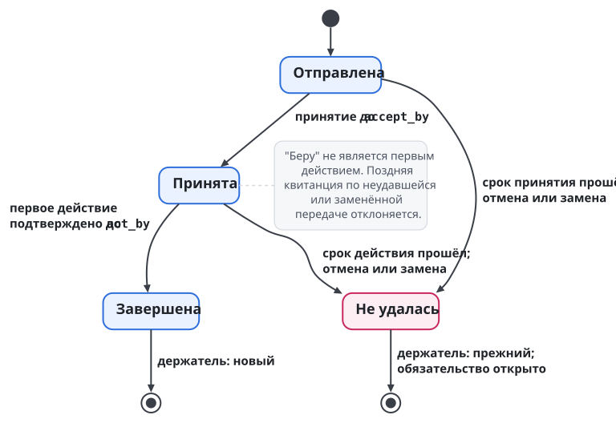
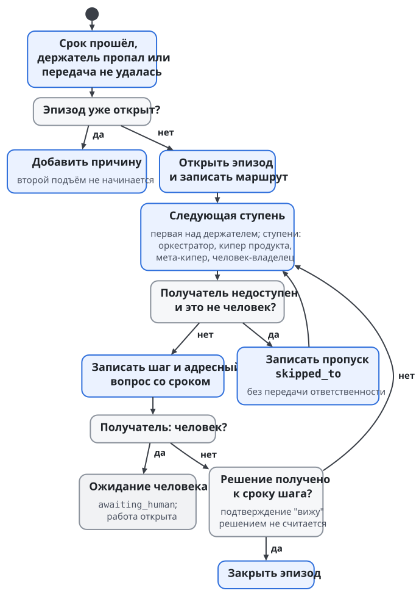
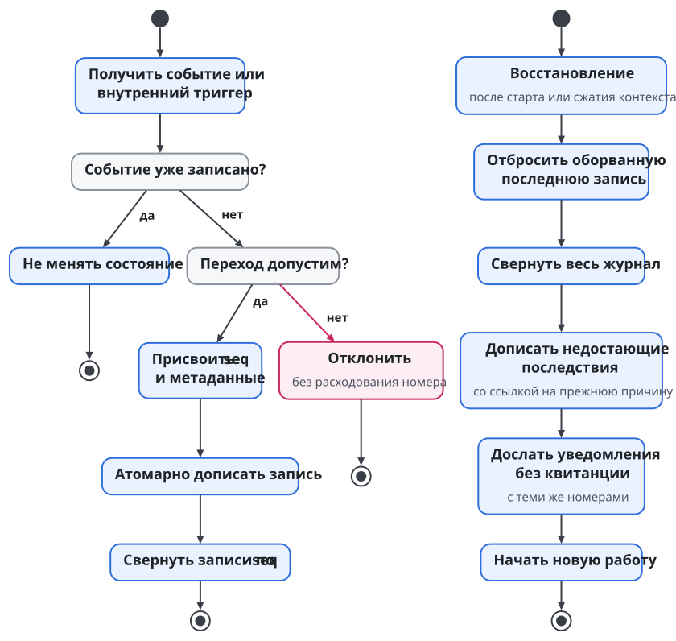

# Swarma Keeper

Swarma Keeper ведёт главный цикл узла. Он знает о процессах владельца, направляет в них запросы и следит, чтобы обязательства между участниками не пропадали при передаче, остановке или перезапуске. Процессом здесь называется отдельная область работы со своим корневым оркестратором, например календарь или разработка продукта. Кипер стоит над такими оркестраторами, но их работу не выполняет и на их доски не пишет.

Кипер закрывает разрыв между сообщением и ответственностью. Один агент написал "передаю", другой ответил "принял", и оба считают обязанность чужой. Или исполнитель остановился, а вопросы продолжают адресовать ему. Сохранённая переписка не отвечает, кто должен действовать сейчас. Кипер отвечает на это долговременным журналом обязательств с держателями, сроками и свидетельствами действий.

## Главный цикл и границы полномочий

У кипера две части, роль и модуль. Роль исполняет модель, которая разбирает просьбы и принимает решения в пределах своих полномочий. Модуль состоит из команды `keeper` и библиотеки, которые делают детерминированную работу. Журнал, проверка переходов и сверка сроков относятся к модулю. Поэтому, когда модель остановилась или её контекст сжали, часы обязательств не останавливаются.

Реестр процессов задаёт, какие процессы существуют и какие корневые оркестраторы за них отвечают. Он указывает на отдельные репозитории; подмодулей нет. Добавить, удалить или перенести процесс, сменить узел-владельца или корневую роль можно только с подтверждением человека. Кипер пользуется реестром для маршрутизации, запуска и восстановления, но права править внутреннюю работу процессов реестр ему не даёт.

Кипер выбирает процесс для запроса в таком порядке: явное указание процесса, затем привязанный к процессу канал, затем единственный уверенный кандидат. Если кандидаты близки, кипер задаёт один короткий вопрос и сохраняет ответ как подсказку маршрутизации. Если кандидата нет, запрос уходит проектировщику процессов. Запрос, затрагивающий два процесса, делится на два: перенос приёма и заказ продуктов не превращаются в одну неразделимую задачу.

Полномочия управления сессиями сужаются вниз по иерархии:

- Оператор может управлять любыми сессиями.
- Кипер может будить и парковать зарегистрированных корневых оркестраторов, а останавливать их только с подтверждением человека или по делегированию.
- Корневой оркестратор управляет своими дочерними исполнителями.
- Суб-оркестратор управляет исполнителями своего пула.
- Отдельный исполнитель другими сессиями не управляет.

Автономный кипер, как и другие агенты Swarma Runtime, работает под отдельным пользователем ОС. Привилегированный физический запуск делает диспетчер: хост сессий обращается к нему через `host_start`, а остановку запрашивает через `host_stop`. Это ограничивает и кипера. Просьба разбудить оркестратора не даёт права самому создать процесс под чужой учёткой.

Дочерний оркестратор будят через его уполномоченного родителя, затем через хост сессий и диспетчер. Форматы разрешений `host_start` и `host_stop` задаёт спецификация хоста сессий. Устройство хоста описано в главе "Запуск агента и хост сессий", право на действие разобрано в главе "Гранты и полномочия".

## Парковка, запуск и системные роли

Парковка не исполняет обязательств. `keeper park` запрашивает записку о передаче и привязывает её к цели процесса; затем сессия останавливается, а цель сохраняется. Следующий запуск получает цель и записку и читает её раньше новой работы. `keeper down` паркует корневых оркестраторов раньше самого кипера, чтобы последним не пропал тот, кто координирует остановку. Ни записка, ни остановка не означают, что открытые обязательства исполнены.

Хост сессий целей не ставит: цель задаёт доска или тот, кто запускает сессию, а у учётки агента такого права нет. Кипер хранит участника как постоянного держателя, а конкретную сессию и исполнение как свидетельство того, кто действует сейчас. Так продолжение работы обсуждается без предположения, что прежний процесс пережил перезагрузку.

Пример. Вечером оркестратор оставил записку о незавершённой доставке и остановился. Утром записка помогает восстановить контекст, а журнал отдельно показывает, кто держит доставку и какой срок действует. Если ночью работу уже передали другому и тот подтвердил первое действие, старая записка не вернёт её прежнему держателю. Записка даёт контекст продолжения, исполнение даёт свидетельство, журнал хранит запись ответственности, и друг друга они не заменяют.

Первое развёртывание начинается с закреплённого проверенного шаблона владельца, а код инструментов приходит через Swarma Curator. Системные Go и git не перетираются, полный Xcode не требуется. Первый запуск показывает размер скачивания, нужное место и время, просит согласия на локальную модель, если ресурсов хватает, или предлагает выбрать доступную залогиненную среду. Все исполняемые компоненты ставит единый инсталлятор.

Проектировщик процессов начинает с простейшего работающего процесса и усложняет его по наблюдаемым потребностям. Сначала используются опубликованные и собственные шаблоны, а изменения playbook идут человеку на подтверждение. Библиотекарь ищет похожие playbook и объединяет их только после одобрения. Это системные роли вокруг главного цикла. Писателями журнала они не становятся и чужих процессов молча не меняют.

Системный администратор резервирует состояние в собственном удалённом хранилище владельца: пакеты на точных коммитах и объявления профилей. Секретов в бэкапе нет. Перенос учётных данных требует отдельного подтверждения владельца; восстановленные файлы профиля не доказывают, что восстановлен доступ к провайдеру. Журнал обязательств входит в бэкап подписанным и без секретов.

Каналы общения и каналы одобрения разделены. Терминал и носитель могут нести просьбу или ответ, но расширяющее подтверждение проходит через приложение-компаньон или аутентификацию ОС. Иначе пересланное сообщение стало бы полномочием. Отдельно учитывается, что сообщение дошло и что уполномоченный участник действовал: эти свидетельства не возникают сами из выбора удобного интерфейса.

## Иерархия киперов и узлы

Кипер может стоять под другим кипером, и глубина такой иерархии не задана заранее. **Кипер продукта** ведёт процессы одного продукта: смотрит за их корневыми оркестраторами, держит их обязательства и служит запасным владельцем общих ресурсов продукта. Кипер, у которого в подчинении другие киперы, называется **мета-кипером**. Это позиция в иерархии, программа у него та же: модуль `keeper`, тот же журнал и те же правила передачи. Мета-кипер смотрит за киперами под собой и служит запасным владельцем ресурсов своего уровня, например ёмкости своего хоста.

Хост целиком со своим мета-кипером может быть узлом в иерархии кипера другого хоста. Тогда для внешнего кипера весь хост выглядит как один подчинённый участник: внешний кипер поручает работу мета-киперу хоста, а распределяет её внутри хоста сам мета-кипер. Так владелец собирает из нескольких машин одну иерархию и не делает общий реестр всех процессов.

Глубину на практике ограничивает делегирование грантов. Каждый уровень получает от вышестоящего грант, который только сужает полномочия (глава "Гранты и полномочия"), поэтому нижний уровень не может получить больше, чем было у верхнего. Длинная цепочка остаётся корректной, но каждое звено в ней сужает права и удлиняет путь эскалации.

Кто кому подчинён и кто кому равен, записано в карточке продукта и в реестре процессов кипера (глава "Доска задач и процесс"). Смысл этих отношений задаёт протокол координации: вышестоящий вправе поручить работу, равный вправе отказаться, и отказ даётся явным ответом. Молчание равного не означает ни согласия, ни отказа, и обязательство ответить открывается у него обычным порядком.

## Что считается обязательством

Обязательство значит: "участник должен другому участнику сделать определённую работу к сроку". Держатель обязательства означает того, за кем обязанность числится сейчас. Виды обязательств: "ответить" (`answer`), "нести обязанность" (`duty`), "доставить" (`delivery`), "проверить" (`review`) и "решить" (`authority`).

Основанием бывает адресный вопрос, событие доски или прямое поручение человека. Доставка отчёта и ответ на вопрос об отчёте учитываются как разные обязательства.

Запрос решения, которого ребёнок не вправе принять сам, и восстановление сломанного общего ресурса тоже ведутся как обязательства. Иначе у запроса полномочий было бы сообщение, но не было бы общей жизни со сроком, исполнением и эскалацией, а у поломки был бы сигнал тревоги, но не было бы ответственного за возвращение к ней. Общая модель позволяет применять к ним те же правила, что к передаче дежурства или проверке результата.

Журнал дописывает один процесс кипера. Текущее состояние получается последовательным применением записей; такое применение называется свёрткой. Единственного писателя закрепляют права ОС: журнал принадлежит пользователю кипера и лежит в каталоге состояния его системной учётки, а остальные агенты писать в него напрямую не могут. Внешний вопрос или решение сначала проходит через кипера, который записывает проверенного отправителя и событие-источник. Записи кипер подписывает своим ключом через ключник. При целой границе ОС другой непривилегированный агент записать в журнал ничего не может.

Журнал хранит ссылки на чужие факты: исполнение принадлежит диспетчеру и хосту сессий, результат запуска принадлежит доске, а сообщение принадлежит транспорту. Но сроки, результаты проверок и квитанции сохраняются значениями. Ссылка на сообщение со сроком не заменяет самого срока, иначе потеря доступа к сообщению лишила бы возможности проверить обязательство. Вид свидетельства первого действия берётся из закрытого списка адаптера доски; содержимое работы кипер не оценивает.

Единственный журнал не отнимает у доски собственных фактов. Непройденное ревью или незакреплённое изменение остаются состоянием доски. Если из них следует обязанность одного участника перед другим, журнал ссылается на соответствующий факт. Записка о парковке помогает продолжить работу, но вторым независимым хранилищем обязательств не становится.

## Передача завершается действием

У передачи три этапа: отправлена, принята, начата. Отправитель называет срок принятия `accept_by` и срок первого действия `act_by`. Ответ "беру" подтверждает принятие, но не начало. До того как первое действие нового держателя проверено и надёжно записано, обязанность остаётся у прежнего. Если новый держатель подтвердил сообщение и исчез, журнал не покажет успешной смены ответственности.

У каждой попытки передачи свой никогда не повторяющийся `handover_id`. Принятие и первое действие ссылаются на эту попытку, на получателя, его исполнение и свидетельство готовности. Активная передача у обязательства одна. Без отдельного номера старая квитанция получателя могла бы подтвердить новую попытку передачи тому же участнику; номер связывает квитанцию с конкретной попыткой.

Срок принятия `accept_by` раньше срока первого действия `act_by`, а `act_by` не позже срока обязательства; запись с другим порядком журнал отклоняет. Пропущенный срок означает неудачу передачи; обязательство остаётся открытым. Причиной может быть непринятие, отсутствие начала, отмена или замена новой попыткой. Поздние квитанции по неудавшейся или заменённой передаче отклоняются: журнал не переосмысливает их как подтверждение другой попытки.

Пример. Один агент передаёт другому утреннюю проверку результата CI. Второй подтверждает, проверяет результат и оставляет событие на доске. Адаптер отдаёт свидетельство, кипер проверяет его вид и записывает первое действие. Только после этой записи меняется держатель. Если проверка не началась вовремя, ответственным остаётся прежний держатель, а вопрос о неудаче уходит выше. Позднее действие по закрытой попытке её не оживляет: для новой передачи нужен новый номер.

Плановая смена исполнения внутри того же участника (например, перезапуск сессии на новую версию) тоже оформляется передачей с квитанциями. Участник прежний, но исполнение новое, и ответственность переходит к нему по тем же правилам: принятие, первое действие, запись.

Гарантия ограничена. Кипер проверяет допустимый вид свидетельства и его связь с передачей, но не качество выполненной проверки. Событие доски не равно правильности результата CI или полноте ревью. Содержательная приёмка остаётся у процесса, которому принадлежит работа. Журнал нужен, чтобы ответственность не потерялась между подтверждением и началом работы; результат проверяется отдельно.

## Сроки и проверенное время

Срок принимается только полной датой и временем UTC по RFC 3339 с `Z` на конце. Запись вроде "15:00" отклоняется до дописывания и номер записи не расходует. Промежуточная проверка `midpoint`, если она задана, раньше конечного срока. Так срок восстанавливается после сжатия контекста без догадки, к какому дню относилось время.

Промежуточная проверка выясняет, есть ли движение и свидетельства; конечная поднимает открытое обязательство выше. Истечение срока ничего не исполняет, не удаляет и не передаёт. Позднее исполнение открытого обязательства допустимо, а позднее подтверждение неудавшейся передачи недопустимо. Это разные переходы: срок обязательства запускает поиск решения, а срок попытки передачи определяет, можно ли ещё завершить именно эту попытку.

У постоянной команды нет заранее заданного предела жизни сессии, поэтому просроченное обязательство постоянного участника не даёт киперу права остановить его по таймеру. Отдельно учитываются срок работы, срок передачи, срок шага эскалации и срок наблюдения. У оркестратора одновременно бывают просроченный ответ и разрешённая долгая сессия, и эти состояния друг другу не противоречат.

Источник времени для рантайма проверенный или контролируемый оператором, например NTS. Шаг часов может сужать полномочия, но не расширять; удаление по сроку требует реально прошедшего времени по монотонным часам. Брокер и диспетчер хранят водяной знак времени, чтобы перевод часов назад не возвращал истёкших прав. Шлюз учётных данных и служба действий проверяют сроки на каждом использовании по тому же правилу; их окно и источник времени задаёт контракт времени, на который опирается спецификация брокера, и собственных допусков у них нет.

Кипер записывает системную и монотонную метки, хранит водяной знак и сравнивает сроки с большим из текущего времени и знака. Знак движется только по проверенному времени. Допуск расхождения `skew_bound` равен 2 минутам. Если монотонные и системные часы разошлись больше чем на эту границу, это происшествие, и цепочку эскалации оно не запускает. Без проверенного времени сроки считаются только по монотонным часам и не продлеваются; удержание без проверенного времени не дольше 10 минут, дальше всё, что зависит от времени, останавливается. После перезагрузки монотонные часы начинаются заново, и длительность простоя подтверждает проверенный источник. Повторное применение журнала не перезапускает проверок, результат которых уже сохранён.

## Эскалация: эпизод и шаг

Эскалация ищет того, кто может решить судьбу открытого обязательства. Цепочка начинается с оркестратора, отвечающего за держателя. Затем идёт кипер продукта, то есть кипер процесса, к которому относится работа. Затем идут киперы выше него по иерархии, вплоть до мета-кипера, который ведёт все процессы узла. Последний шаг всегда человек-владелец. На одном хосте с одним уровнем киперов цепочка состоит из четырёх ступеней; в иерархии из нескольких хостов в ней столько ступеней, сколько уровней киперов над держателем.

Эпизод начинается на ступени над держателем: сам держатель вопрос о собственном бездействии как новый уровень решения не получает.

Первый триггер открывает эпизод, следующие дописывают к нему причины. У шага ключ "обязательство, эпизод, шаг", и на шаг приходится один переход и одно уведомление. Истёкший срок, парковка держателя и потеря наблюдателя не создают трёх независимых эскалаций одной проблемы. Маршрут с версией и постоянными идентификаторами участников фиксируется при открытии эпизода, чтобы восстановление не зависело от изменившегося состава ролей.

Получателю приходит адресный вопрос со сроком ответа `reply-by`, равным сроку шага. Подтверждение "вижу" подъём не останавливает. Подъём останавливает решение: новая передача, новый срок, ожидание возвращения держателя до определённой даты, собственное исполнение или допустимое закрытие.

Новый срок вправе назначить получатель шага или участник выше. Продлений не больше двух на эпизод, и каждое не длиннее исходного шага. Без решения следующий шаг идёт только вверх, без возврата на пройденную ступень.

Недоступного получателя пропускают с записью `skipped_to`: например, кипер продукта сам остановлен или упёрся в лимит провайдера. Это поиск того, кто может распорядиться работой. Вернувшийся получатель доступен для будущих эпизодов, но текущий шаг к нему не возвращается. Когда цепочка дошла до человека, состояние становится `awaiting_human`: автоматический подъём останавливается, обязательство остаётся открытым, молчание согласием не считается.

У обязательства три исхода:

- `fulfilled`: обязательство исполнено, свидетельство записано.
- `closed_unresolved`: человек или оператор закрыл обязательство без решения и указал причину.
- `cancelled`: обязательство открыто ошибочно или дублирует другое; отмена тоже записывается с автором и причиной.

Просрочка, перезапуск и отсутствие ответа к исходам не относятся. Отмена не предназначена для удаления неудобной работы.

Уведомление сначала получает номер и сохраняется в журнале, потом отправляется. После сбоя повтор идёт с тем же номером, а восстановление досылает уведомления без квитанций доставки. Это правило о повторяемом намерении и учёте квитанций; физической доставки ровно один раз произвольный транспорт не обещает. Кипер различает сохранённый шаг, отправку и доказанную доставку.

Если автоматическое пробуждение не доказано, каждый шаг приходит двумя уведомлениями: адресным вопросом и видимым человеку `owner-needed`. Оба несут ключ шага, квитанции обоих сохраняются в журнале, и эскалация не считает пробуждение выполненным. Человека при этом просят помочь довести вопрос до действующего участника; закрытием обязательства или обходом полномочий это не является. Транспортные таймеры только советуют, решает журнал кипера.

### Один эпизод при нескольких причинах

Возьмём адресный вопрос. Срок ответа прошёл, сверка открыла эпизод и назначила шаг оркестратору держателя. Потом самого держателя поставили на паузу. Журнал добавляет причину сиротства, но второго независимого вопроса тому же оркестратору не шлёт. Если тот не принял решения к сроку шага, начинается следующий шаг. Каждому триггеру не нужно по отдельности проходить всю цепочку.

Если следующий получатель сам недоступен, сверка записывает пропуск и идёт к доступной ступени. Та может начать новую передачу с новым номером. Успешное решение закрывает эпизод, а само обязательство продолжается по правилам передачи. Если потом снова возникает проблема, это новый эпизод. Так журнал различает повтор уведомления, дополнительную причину старой проблемы и действительно новую проблему после принятого решения.

Если получатель эскалации берёт исполнение на себя, нужен след действия, например ответ в треде. Если он только назначает нового исполнителя, нужны квитанции передачи. Если решение состоит в ожидании прежнего держателя, нужен срок возвращения. "Эскалация обработана" никогда не бывает пустым подтверждением получения: записывается один из содержательных исходов шага. Сверка идёт раз в 5 минут.

{.tall}

## Пропавший держатель и сломанный ресурс

Недоступность держателя записывается явно, с причиной: парковка, ротация, лимит провайдера, отказ хоста или неизвестность. Каждое его открытое обязательство после этого становится осиротевшим. Если эпизод уже открыт, сиротство добавляет в него причину. Последствия записываются за один проход сверки, очередной или первый после старта. Проход идёт раз в 5 минут.

Доступность устанавливается наблюдением. После перезагрузки вчерашняя запись о запуске не доказывает, что процесс существует сегодня. Если адресата адресного вопроса запарковали, на ближайшей сверке вопрос осиротевает и эскалируется. Неизвестная причина недоступности сохраняется как неизвестная, без удобной догадки.

Получатель эскалации может передать работу или записать ожидание до срока возвращения. При передаче сиротство сохраняется до первого действия нового держателя. Если держатель к сроку ожидания не вернулся, открывается новый эпизод. Вернувшийся участник снова может получать работу, но уже переданное другому к нему автоматически не возвращается.

Поломка общего ресурса ведётся с собственным номером, держателем и сроком повторной проверки. Сообщение "раннер снова работает" закрывает только эту поломку и требует свидетельства, например факта задачи, которую раннер принял. Ответ "разбираюсь" восстановления не заменяет. Если ремонтирующий агент остановился, обязательство осиротевает по общему правилу, и восстановление не пропадает вместе с ним.

Сообщение о поломке без держателя нельзя ни молча принять, ни выбросить. Обязательство открывается на запасного владельца и поднимается происшествие. Запасным владельцем общего ресурса продукта служит кипер продукта, а общеплатформенного ресурса мета-кипер. Когда ресурс восстановлен, срок повторной проверки больше не нужен, а событие восстановления остаётся связанным с закрываемым эпизодом.

## Ребёнок просит полномочий

Запрос полномочий ведётся как обязательство родителя перед ребёнком. Дочерний оркестратор спрашивает, можно ли менять чужой модуль. Держатель должен ответить или поднять вопрос выше к сроку. Задачу ребёнок блокирует сам или через своего оркестратора; на его доску кипер не пишет. Если есть другая разрешённая работа, агент продолжает её, а ожидание не превращается в цикл опроса.

На половине срока уходит одно напоминание, по сроку открывается эпизод. Ответ засчитывается в треде запроса от проверенного родителя или получателя эскалации и записывается как исполнение со ссылкой на событие. Пересказ чужого ответа или сообщение в другом канале запроса не закрывают. Ответ "разрешаю только интерфейс" исполняет обязанность ответить и даёт ребёнку ровно названные полномочия.

Для обычного неблокирующего совета допустимо явное предположение: продолжить выбранным способом, если нет возражений. Для запроса полномочий такого пути нет. Ни истечение срока, ни отсутствие доступного родителя разрешения не создают. Эскалация переносит поиск решения, но прав ребёнка не расширяет, даже если вопрос задан теми же средствами транспорта, что обычный совет.

Отправленное сообщение и работающее фоновое ожидание доказательством пробуждения простаивающей среды не считаются. Без проверенного автоматического пробуждения и здесь действует правило двух уведомлений: адресный вопрос и видимый человеку `owner-needed`.

## Журнал, свёртка и восстановление

Общие поля записи `seq`, `at`, `actor` и `source` означают последовательный номер, полное время UTC, автора и источник. Кроме них запись несёт версию схемы и номер события. Внутреннее событие, например проверка срока, указывает триггер и запись-причину. Точное кодирование задаёт спецификация ядра.

Переход проверяется до записи. Неверный срок, квитанция чужой передачи или исполнение уже закрытого обязательства отвергаются без номера. Дописывание атомарно и долговечно: при старте оборванный хвост за целую запись не принимается. Повтор одного входного события даёт одну запись. Эти правила работают только вместе: номер без надёжного сохранения не доказывает, что смена держателя переживёт падение.

Свёртка идёт по `seq`: системные часы могут сдвинуться, поэтому `at` для порядка не годится. Таблица переходов явно различает допустимые и запрещённые пары из состояния и записи. Отклонённое событие не подгоняется под предполагаемое намерение: исполнение после срока открытой работы принимается, а подтверждение уже провалившейся передачи отклоняется. Два воспроизведения одного журнала дают одинаковое состояние.

Если кипер упал после записи недоступности, но до записи всех сирот, стартовая сверка дописывает недостающие последствия со ссылкой на ту же причину; уже записанное не повторяется. Так же досылаются уведомления без квитанций и выполняются пропущенные проверки, а проведённые узнаются по сохранённому результату. Новая работа начинается только после сверки незавершённых последствий.

Сжатие контекста касается роли: после него модель получает состояние из свёртки журнала. Сторож следит за контекстом и лимитами провайдера, просит записку перед сжатием и сообщает о недоступности держателя. Работу он не перераспределяет: парковка и сообщение о проблеме не заменяют решения уполномоченного оркестратора.

{.tall}

## Журнал как модуль

Журнал обязательств авторитетно отвечает на вопрос, кто держит обязанность сейчас. Память агентов (глава "Память агентов") сообщает свидетельства и полномочий не даёт: запись о вчерашнем гранте не разрешает сегодняшнего действия. Поэтому журнал устроен отдельным модулем, а с памятью его связывает общее устройство записи.

Каждая запись журнала относится к закрытому виду со своей схемой: открытие обязательства, предложение передачи, принятие, отказ, первое действие, новый срок, шаг эскалации, исход. Запись неизвестного вида или с полем вне схемы журнал отклоняет до дописывания. Так новый вид события сначала получает схему и правила перехода в свёртке и только потом появляется в журнале.

Кипер подписывает каждую запись над её каноническими байтами. Читатель журнала проверяет подпись, схему и право автора на этот переход раньше, чем использует запись. Порядок задаёт последовательный номер писателя, а не время прихода, как и порядок решений в памяти задают события самого решающего.

Исправление оформляется новой записью, которая называет исправляемую запись и версию, которую автор видел. Если с тех пор состояние изменилось, исправление отклоняется, и автор решает заново по новому состоянию. Прежняя запись остаётся в журнале с авторством. Читатель хранит курсор последней проверенной записи и отклоняет копию журнала, история которой короче его курсора или с ним расходится. Так подмена журнала старой копией видна при первом же чтении.

Память получает из журнала выводы: уроки разбора эскалаций, причины неудачных передач, решения о повторяющихся поломках. Каждый такой вывод записывается в память обычной записью со ссылкой на записи журнала. Обратного пути нет: запись памяти не открывает и не закрывает обязательства.

## Наблюдение тоже имеет состояние

У наблюдателя три состояния: "здоров", "ухудшился", "потерян". Ошибка чтения доски или транспорта ухудшает наблюдение и ведёт к повтору с растущей паузой, но сроков не отменяет. Если к записанному сроку нет квитанции или сигнала живости, наблюдатель потерян и поднимается выше как осиротевший держатель. Отсутствие результата чтения не доказывает отсутствия обязательства.

Транспорт показывает живость через `#status` и `a2a who`: устаревший сигнал, испорченную запись, часы в будущем, возраст запросов без ответа. Возможность разбудить среду, наличие хуков и факт ответа показываются раздельно. Кипер добавляет к этому долговременные курсоры входов, сроки следующего наблюдения и ссылки на основания оценок, чтобы после перезапуска продолжать с известного места.

Свидетельства образуют лестницу, и соседняя ступень не доказывает следующую. Сохраняется верхний подтверждённый уровень; то, чего не видно снаружи, остаётся неизвестным.

| Уровень | Какой факт установлен | Чего он не доказывает |
| --- | --- | --- |
| Сохранено | сервер принял сообщение, есть событие | доставки получателю |
| Доставлено | сообщение дошло до почтового ящика или принят звонок | обработки моделью |
| Прочитано | получатель обработал сообщение, есть квитанция | выполнения работы |
| Сделано | есть ответ, событие доски, коммит или событие исполнения | содержательной правильности результата |

Первое действие и исполнение требуют уровня "сделано". Лестница наблюдения охватывает и самих киперов: кипер продукта смотрит за оркестраторами, каждый кипер выше смотрит за киперами под собой, а человек видит верхнего мета-кипера через тревоги и вопросы к владельцу. Иначе падение самого писателя сделало бы остановку сроков неотличимой от отсутствия проблем.

## Швы с транспортом и платформой

Доска предоставляет свидетельства и второго журнала обязательств не ведёт. Транспорт передаёт пометки вопросов, полный `reply-by`, ответы с проверенным отправителем и чтение вопросов без ответа; решение об эскалации остаётся за журналом. Кипер подключается к транспорту и доске через адаптеры с общими интерфейсами. Проверка ядра на изолированных адаптерах сквозной доставки не доказывает. Нормативный формат этих сообщений задаёт спецификация транспорта.

Вопрос без ответа и открытое обязательство учитываются как разные факты. Первый транспорт выводит из истории сообщений сам, без кипера. Ответ "доставлю завтра" закрывает вопрос о планах, но доставку не исполняет. Транспортные таймеры только советуют; эскалация к человеку и решения остаются за журналом кипера.

На платформе сообщения идут через мост и почтовый ящик, а короткий звонок идёт через хост сессий. Записи журнала кипер подписывает своим ключом через ключник; устройство ключника описано в главе "Ключи и ключник".

Узел восстанавливает одна идемпотентная команда `keeper up`. Она поднимает хост, восстанавливает кипера, затем корневых оркестраторов по реестру, доставляет накопившиеся звонки и сообщает человеку результат. Остановленное человеком остаётся остановленным, а дочернюю работу корневые оркестраторы восстанавливают сами. После перезагрузки `keeper up` запускается при загрузке, под системной учёткой кипера, и все физические запуски идут через диспетчер.

Ядро проверяется парами из положительного сценария и запрещённого исхода: удачная передача и передача без первого действия, корректный полный срок и время без даты, ответ родителя и молчание без выдачи прав, восстановление ресурса и поломка без держателя. Падения между зависимыми записями, повторные входы и поздние квитанции должны сохранять держателя и единственность шага.
