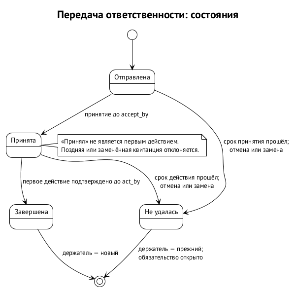
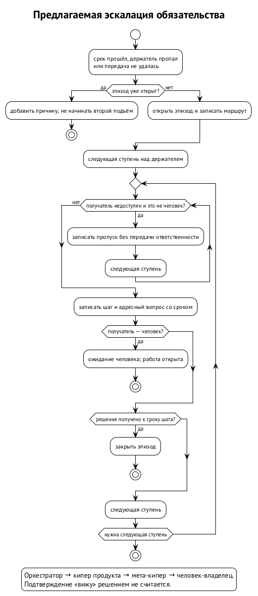
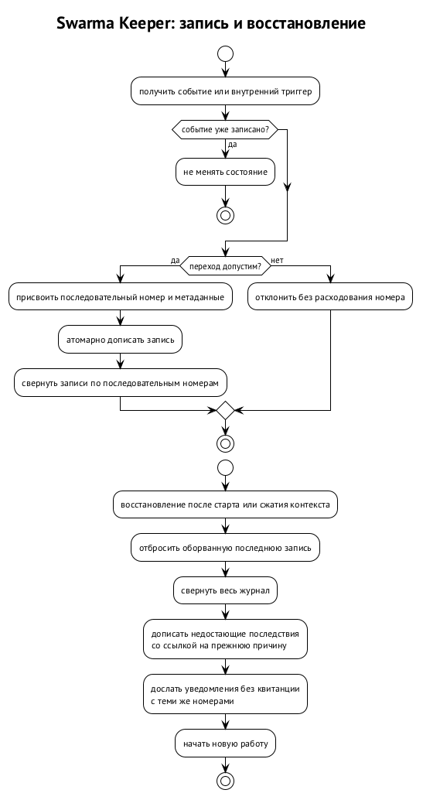

# Swarm Keeper

Swarm Keeper — главный цикл узла: он знает о процессах владельца, направляет в них запросы и следит, чтобы обязательства между участниками не исчезали при передаче, остановке или перезапуске. Процессом здесь называется отдельная область работы со своим корневым оркестратором: например, календарь или разработка продукта. Кипер стоит над такими оркестраторами, но не выполняет их работу и не пишет на их доски. На октябрь 2026 года это предлагаемое устройство; кода ядра обязательств ещё нет. ⟦предложено⟧

Главная проблема — разрыв между сообщением и ответственностью. Один агент написал «передаю», другой ответил «принял», после чего оба считают обязанность чужой. Или исполнитель остановился, а вопросы продолжают адресовать ему. Сохранённая переписка сама по себе не отвечает, кто должен действовать сейчас. Предлагаемый ответ кипера — долговременный журнал обязательств с держателями, сроками и свидетельствами действий. ⟦предложено⟧

## Главный цикл и границы полномочий

У кипера две части. Роль — модель, которая разбирает просьбы и принимает решения в пределах своих полномочий. Модуль — команда `keeper` и библиотека, выполняющие детерминированную работу. Журнал, проверка переходов и сверка сроков относятся к модулю. Поэтому остановка рассуждения модели или сжатие её контекста не должны останавливать часы обязательств. Это разделение предложено для ядра; оно не означает, что весь цикл уже реализован. ⟦предложено⟧

Реестр процессов задаёт, какие процессы существуют и какие корневые оркестраторы за них отвечают. Он указывает на отдельные репозитории, а не на подмодули. Добавление, удаление, перенос процесса, смена узла-владельца или корневой роли требуют подтверждения человека. Кипер пользуется реестром для маршрутизации, запуска и восстановления, но не получает через него права править внутреннюю работу процессов. ⟦предложено⟧

Порядок маршрутизации уже выбран: сначала явное указание процесса, затем привязанный к нему канал, затем единственный уверенный кандидат. Если кандидаты близки, кипер задаёт один короткий вопрос, а ответ сохраняет как подсказку маршрутизации. Если кандидата нет, запрос направляется проектировщику процессов; запрос, затрагивающий два процесса, делится на два. Например, перенос приёма и заказ продуктов не должны превращаться в одну неразделимую задачу. ⟦решено⟧

Полномочия управления сессиями сужаются вниз по иерархии. Оператор может управлять любыми сессиями. Киперу предлагается разрешить пробуждение и парковку зарегистрированных корневых оркестраторов; остановку — только с подтверждением человека или по делегированию. Корневой оркестратор управляет своими дочерними исполнителями, суб-оркестратор — исполнителями своего пула. Отдельный исполнитель другими сессиями не управляет. ⟦предложено⟧

При этом автономный кипер, как и другие агенты Swarm Runtime, работает под отдельным пользователем ОС. Привилегированный физический запуск делает диспетчер; хост сессий обращается к нему через `host_start`, а остановку запрашивает через `host_stop`. Это решения рантайма, которые ограничивают и кипера: просьба разбудить оркестратора не даёт права самостоятельно создавать процесс под чужой учёткой. ⟦решено⟧

Для пробуждения дочернего оркестратора предлагается проходить через его уполномоченного родителя, затем через хост сессий и диспетчер. Точные форматы разрешений `host_start` и `host_stop` ещё не опубликованы; до их появления связка выключена. Устройство хоста описано в главе «Запуск агента и хост сессий», а право на действие — в главе «Гранты и полномочия». ⟦открыто⟧

## Парковка, запуск и системные роли

Парковка отличается от исполнения обязательств. `keeper park` предлагается использовать для запроса записки о передаче: она привязывается к цели процесса, затем сессия останавливается, а сама цель сохраняется. Следующий запуск получает цель и записку и читает её прежде новой работы. `keeper down` паркует корневых оркестраторов раньше кипера, чтобы последним не исчез тот, кто координирует остановку. Ни записка, ни остановка не означают, что открытые обязательства исполнены. ⟦предложено⟧

Хосту сессий при этом не принадлежит постановка целей. Цель задаёт доска либо тот, кто запускает сессию; у учётки агента такого права нет. Киперу предлагается хранить участника как постоянного держателя, а конкретную сессию и исполнение — как свидетельства того, кто действует сейчас. Это позволяет обсуждать продолжение работы без предположения, что прежний процесс пережил перезагрузку. ⟦решено⟧ ⟦предложено⟧

Например, вечером оркестратор оставил записку о незавершённой доставке и остановился. Утром записка помогает восстановить контекст, а журнал независимо показывает, кто держит доставку и какой срок действует. Если ночью работу уже передали другому с подтверждённым первым действием, старая записка не возвращает её прежнему держателю. У каждого носителя своя роль: контекст продолжения, свидетельство исполнения и запись ответственности не подменяют друг друга. ⟦предложено⟧

Для первого развёртывания предложено начинать с закреплённого проверенного шаблона владельца, а код инструментов получать через Swarm Curator. Выбрано не перетирать системные Go и git и не требовать полного Xcode. Сам первый запуск предполагает показ размера скачивания, места и времени, согласие на локальную модель при достаточных ресурсах либо выбор доступной залогиненной среды. Доставка всех нужных исполняемых компонентов одной установкой пока имеет незакрытый шов. ⟦решено⟧ ⟦предложено⟧ ⟦открыто⟧

Проектировщику процессов выбран принцип начинать с простейшего работающего процесса и усложнять его по наблюдаемым потребностям. Сначала используются опубликованные и собственные шаблоны; изменения playbook предлагаются человеку на подтверждение. Библиотекарь ищет похожие playbook и объединяет их только после одобрения. Это системные роли вокруг главного цикла, а не дополнительные писатели журнала или участники, которым разрешено молча менять чужие процессы. ⟦решено⟧

Системному администратору предложено резервировать состояние в собственном удалённом хранилище владельца, сохраняя пакеты на точных коммитах и объявления профилей. Секреты в такой бэкап не включаются. Перенос учётных данных требует отдельного подтверждения владельца; восстановление файлов профиля не доказывает восстановления доступа к провайдеру. Конкретное включение журнала обязательств в резервную копию ещё не определено, поэтому общая идея бэкапа не закрывает этот вопрос. ⟦предложено⟧ ⟦открыто⟧

Каналы общения и каналы одобрения также разделены. Терминал и мессенджер могут нести просьбу или ответ, но расширяющее подтверждение должно проходить через приложение-компаньон либо аутентификацию ОС. Иначе пересланное сообщение стало бы полномочием. Отдельно нужен учёт того, что сообщение дошло и что уполномоченный участник действовал: эти свидетельства не возникают автоматически из выбора удобного интерфейса. ⟦решено⟧ ⟦предложено⟧

## Что считается обязательством

Обязательство имеет смысл «участник должен другому участнику сделать определённую работу к сроку». Держатель — тот, за кем обязанность числится сейчас. Предлагаются виды «ответить» (`answer`), «нести обязанность» (`duty`), «доставить» (`delivery`), «проверить» (`review`) и «решить» (`authority`). Основанием может быть адресный вопрос, событие доски или прямое поручение человека. Например, доставка отчёта и ответ на вопрос об отчёте — разные обязательства. ⟦предложено⟧

Запрос решения, которого ребёнок не вправе принять сам, и восстановление сломанного общего ресурса также предлагается вести как обязательства. Иначе у запроса полномочий есть сообщение, но нет общей жизни со сроком, исполнением и эскалацией; у поломки есть сигнал тревоги, но нет ответственного за возвращение к ней. Общая модель позволяет применять к ним те же правила, что к передаче дежурства или проверке результата. ⟦предложено⟧

Журнал дописывает один процесс кипера. Текущее состояние вычисляется последовательным применением записей — свёрткой. Для Swarm Runtime предлагается закрепить единственного писателя правами ОС: журнал принадлежит пользователю кипера, остальные агенты не могут писать в него напрямую. Внешний вопрос или решение сначала проходит через кипера, который записывает проверенного отправителя и событие-источник. Это защищает от записи другим непривилегированным агентом при сохранности границы ОС. ⟦предложено⟧

Журнал хранит ссылки на чужие факты: исполнение принадлежит диспетчеру и хосту сессий, результат запуска — доске, сообщение — транспорту. Но сроки, результаты проверок и квитанции сохраняются значениями. Ссылка на сообщение со сроком не заменяет сам срок: иначе потеря доступа к сообщению уничтожит возможность проверить обязательство. Вид свидетельства первого действия берётся из закрытого списка адаптера доски; содержимое работы кипер не оценивает. ⟦предложено⟧

Единственный журнал не означает, что доска теряет собственные факты. Непройденное ревью или незакреплённое изменение остаются состоянием доски. Если из этого следует обязанность одного участника перед другим, журнал ссылается на соответствующий факт. Записка о парковке помогает продолжить работу, но не становится вторым независимым хранилищем обязательств. Разделение ядра и адаптеров выбрано; точные правила их совместной работы ещё предлагаются. ⟦решено⟧ ⟦предложено⟧

## Передача завершается действием

У передачи три этапа: отправлена, принята, начата. Отправитель называет срок принятия `accept_by` и срок первого действия `act_by`. Ответ «беру» подтверждает принятие, но не начало. До проверенного и надёжно записанного первого действия нового держателя обязанность остаётся у прежнего. Если новый держатель только подтвердил сообщение и исчез, журнал не должен показывать успешную смену ответственности. ⟦предложено⟧

Каждой попытке передачи нужен собственный никогда не повторяющийся `handover_id`. Принятие и первое действие ссылаются на эту попытку, получателя, его исполнение и свидетельство готовности. На обязательство допускается одна активная передача. Без отдельного номера старая квитанция получателя могла бы подтвердить новую попытку передачи тому же участнику. Предлагаемый номер связывает квитанцию с конкретной попыткой, а не только с парой участников. ⟦предложено⟧

Срок принятия должен быть раньше срока первого действия, а первое действие — не позже срока обязательства. Пропуск одного из сроков означает неудачу передачи, а не закрытие обязательства. Причиной может быть непринятие, отсутствие начала, отмена или замена новой попыткой. Поздние квитанции по неудавшейся или заменённой передаче отклоняются: журнал не переосмысливает их как подтверждение другой попытки. ⟦предложено⟧

Например, один агент передаёт другому утреннюю проверку результата CI. Второй подтверждает, затем проверяет результат и оставляет событие на доске. Адаптер отдаёт свидетельство, кипер проверяет его вид и записывает первое действие — только теперь меняется держатель. Если проверка не началась вовремя, прежний держатель остаётся ответственным, а вопрос о неудаче уходит выше. Позднее действие по закрытой попытке не оживляет её; для новой передачи нужен новый номер. ⟦предложено⟧

Это ограниченная гарантия: кипер проверяет допустимый вид и связь свидетельства, но не доказывает качество выполненной проверки. Наличие события доски не равно правильности результата CI или полноте ревью. Решение о содержательной приёмке остаётся у процесса, которому принадлежит работа. Журнал нужен, чтобы ответственность не исчезла между подтверждением и началом, а не чтобы заменить проверку результата. ⟦предложено⟧

## Сроки и проверенное время

Срок предлагается принимать только как полную дату и время UTC по RFC 3339 с `Z` на конце. Запись со значением вроде «15:00» отклоняется до дописывания, без расходования номера записи. Если задана промежуточная проверка `midpoint`, она должна быть раньше конечного срока. Это позволяет восстановить срок после сжатия контекста без догадки о том, к какому дню относилось время. ⟦предложено⟧

Промежуточная проверка выясняет, есть ли движение и свидетельства; конечная поднимает открытое обязательство выше. Истечение срока ничего не исполняет, не удаляет и не передаёт. Позднее исполнение открытого обязательства допустимо, хотя позднее подтверждение неудавшейся передачи недопустимо. Это разные переходы: дедлайн обязательства запускает поиск решения, а срок попытки передачи определяет, можно ли ещё завершить именно эту попытку. ⟦предложено⟧

Постоянная команда не имеет заранее заданного предела жизни сессии. Поэтому просроченное обязательство постоянного участника не даёт киперу права остановить его по таймеру. Отдельно учитываются срок работы, срок передачи, срок шага эскалации и срок наблюдения. Например, у оркестратора может быть просроченный ответ и одновременно разрешённая долгая сессия; эти два факта не противоречат друг другу. ⟦решено⟧ ⟦предложено⟧

Для рантайма выбран проверенный либо контролируемый оператором источник времени, например NTS. Шаг часов может сужать полномочия, но не расширять; удаление по сроку требует настоящего прошедшего времени по монотонным часам. Брокер и диспетчер сохраняют водяной знак времени, чтобы перевод часов назад не возвращал истёкшие права. Это уже выбранное правило платформы, а не завершённый алгоритм часов кипера. ⟦решено⟧

Киперу предлагается записывать системную и монотонную метки, сохранять водяной знак и сравнивать сроки с большим из текущего времени и этого знака. Сам знак движется только по проверенному времени. Скачок системных часов вперёд за предел `skew_bound` не должен немедленно запускать всю цепочку эскалации: нужно подтверждение реально прошедшего времени. После перезагрузки монотонные часы начинаются заново, и длительность простоя подтверждает проверенный источник. ⟦предложено⟧

Число для `skew_bound`, критерий неисправности часов и поведение без проверенного времени не выбраны. Поэтому нельзя обещать, что произвольный скачок времени уже обработан. Сбой часов должен рассматриваться как самостоятельное происшествие, а не как основание незаметно продлить обязательства. Повторное применение журнала также не должно заново запускать проверки, результат которых уже сохранён. ⟦открыто⟧

## Эскалация: эпизод и шаг

Эскалация ищет того, кто может решить судьбу открытого обязательства. Предложена цепочка из четырёх ступеней: отвечающий за держателя оркестратор, кипер продукта, мета-кипер владельца, человек-владелец. Эпизод начинается на ступени над держателем; сам держатель не получает вопрос о собственном бездействии как новый уровень решения. Соответствие ролей продукта ролям узла ещё требуется согласовать. ⟦предложено⟧ ⟦открыто⟧

Первый триггер открывает эпизод, последующие дописывают причины к нему. У шага есть ключ «обязательство, эпизод, шаг»; на него приходится один переход и одно уведомление. Так истёкший срок, парковка держателя и потеря наблюдателя не создают три независимые эскалации одной проблемы. Маршрут с версией и постоянными идентификаторами участников фиксируется при открытии эпизода, чтобы последующее восстановление не зависело от изменившегося состава ролей. ⟦предложено⟧

Получателю приходит адресный вопрос со сроком ответа `reply-by`, равным сроку шага. Подтверждение «вижу» не останавливает подъём. Останавливает решение: новая передача, новый срок, ожидание возвращения держателя до определённой даты, собственное исполнение или допустимое закрытие. Кто вправе переназначать срок и сколько раз — ещё открыто. Пока решения нет, следующий шаг идёт только вверх, без возврата на пройденную ступень. ⟦предложено⟧ ⟦открыто⟧

Недоступного получателя предлагается пропускать с записью `skipped_to`: например, кипер продукта сам остановлен или ограничен провайдером. Это не передача работы следующему участнику, а поиск лица, способного распорядиться ею. Вернувшийся получатель доступен для будущих эпизодов, но текущий шаг назад не возвращается. По достижении человека состояние становится `awaiting_human`: автоматический подъём останавливается, обязательство остаётся открытым, молчание согласием не считается. ⟦предложено⟧

У обязательства предложены три исхода. `fulfilled` означает исполнение с записанным свидетельством. `closed_unresolved` означает закрытие человеком или оператором без решения с указанной причиной. `cancelled` служит для ошибочно открытого или дублирующего обязательства, также с автором и причиной. Просрочка, перезапуск и отсутствие ответа не относятся ни к одному из этих исходов. Отмена не предназначена для удаления неудобной работы. ⟦предложено⟧

Уведомление сначала получает номер и сохраняется в журнале, затем отправляется. После сбоя повтор идёт с тем же номером; восстановление досылает уведомления без квитанций доставки. Это правило о повторяемом намерении и учёте квитанций, а не обещание, что произвольный транспорт физически доставит пакет ровно один раз. Кипер должен различать сохранённый шаг, отправку и доказанную доставку. ⟦предложено⟧

Пока автоматическое пробуждение не проверено, каждый шаг должен приходить и адресным вопросом, и видимым человеку `owner-needed`. Оба уведомления несут ключ шага, квитанции обоих сохраняются в журнале. Человека здесь просят помочь довести вопрос до действующего участника; это не означает закрытия обязательства или обхода полномочий. Как согласовать эту помощь с лёгким правилом транспортных советов, ещё открыто. ⟦предложено⟧ ⟦открыто⟧

### Один эпизод при нескольких причинах

Рассмотрим предложенный порядок на примере адресного вопроса. Срок ответа прошёл, сверка открыла эпизод и назначила шаг оркестратору держателя. Затем самого держателя поставили на паузу. Журнал добавляет причину сиротства, но не посылает второй независимый вопрос тому же оркестратору. Если тот не принял решения к сроку шага, начинается следующий шаг. Он не ждёт, пока каждый из двух триггеров отдельно пройдёт всю цепочку. ⟦предложено⟧

Если следующий получатель сам недоступен, сверка сохраняет пропуск и идёт к доступной ступени. Та может начать новую передачу с новым номером; успешное решение закрывает эпизод, но само обязательство продолжается по правилам передачи. Если позже у него снова возникает проблема, это новый эпизод. Так журнал различает повтор уведомления, дополнительную причину старой проблемы и действительно новую проблему после принятого решения. ⟦предложено⟧

Когда исполнение принимает на себя получатель эскалации, нужен след действия, например ответ в треде. Когда он только назначает нового исполнителя, нужны квитанции передачи. Если решение — ждать прежнего держателя, нужен срок возвращения. Во всех случаях «эскалация обработана» не должна быть пустым подтверждением получения: должен быть записан один из содержательных исходов шага. Пределы назначения нового срока и допустимый интервал сверки ещё требуют решения. ⟦предложено⟧ ⟦открыто⟧

## Пропавший держатель и сломанный ресурс

Недоступность держателя предлагается записывать явно с причиной: парковка, ротация, лимит провайдера, отказ хоста или неизвестность. Затем каждое его открытое обязательство становится осиротевшим. Если эпизод уже открыт, сиротство добавляет причину, а не открывает второй. «Сразу» здесь означает последствия за один проход работающей сверки либо за первую сверку после старта; допустимый интервал проходов пока не выбран. ⟦предложено⟧ ⟦открыто⟧

Доступность устанавливается наблюдением, а не наличием старой записи об исполнении. Например, после перезагрузки запись о вчерашнем запуске не доказывает существование сегодняшнего процесса. Для адресного вопроса парковка адресата должна приводить к сиротству и эскалации на ближайшей сверке, чтобы вопрос не оставался ждать заведомо остановленного исполнителя. Неизвестная причина недоступности сохраняется как неизвестная, а не заменяется удобной догадкой. ⟦предложено⟧

Получатель эскалации может передать работу или записать ожидание до срока возвращения. При передаче сиротство сохраняется до первого действия нового держателя. При ожидании невозвращение к сроку открывает новый эпизод. Восстановленная доступность снова позволяет участнику получать работу, но уже переданное другому не возвращается автоматически. Плановая смена исполнения внутри того же участника как специальный случай передачи пока остаётся открытым вариантом. ⟦предложено⟧ ⟦открыто⟧

Поломку общего ресурса предлагается вести с собственным номером, держателем и сроком повторной проверки. Сообщение «раннер снова работает» закрывает только соответствующую поломку и требует свидетельства, например факта принятой раннером задачи. Ответ «разбираюсь» не заменяет восстановления. Если ремонтирующий агент остановился, обязательство осиротевает по общему правилу, и восстановление не исчезает вместе с его продолжением. ⟦предложено⟧

Сообщение о поломке без держателя нельзя ни молча принять, ни выбросить. Предлагается открыть обязательство на заранее назначенного запасного владельца и поднять происшествие. Кто является таким владельцем для каждого общего ресурса, ещё не определено. После восстановления срок повторной проверки открытой поломки больше не требуется; у события восстановления остаётся связь с закрываемым эпизодом. ⟦предложено⟧ ⟦открыто⟧

## Ребёнок просит полномочий

Запрос полномочий — обязательство родителя перед ребёнком. Например, дочерний оркестратор спрашивает, разрешено ли менять чужой модуль. Держатель должен ответить либо поднять вопрос выше к сроку. Ребёнок блокирует соответствующую задачу сам или через своего оркестратора; кипер на его доску не пишет. При наличии другой разрешённой работы агент продолжает её, а ожидание не превращает в цикл опроса. ⟦предложено⟧

На половине срока предлагается отправлять одно напоминание, по сроку — открывать эпизод. Ответ засчитывается в треде запроса от проверенного родителя либо получателя эскалации и записывается как исполнение со ссылкой на событие. Пересказ чужого ответа или сообщение в другом канале запрос не закрывают. Ответ «разрешаю только интерфейс» исполняет обязанность ответить, но даёт ребёнку ровно названные полномочия. ⟦предложено⟧

Для обычного неблокирующего совета допустимо явное предположение: продолжить выбранным способом, если возражений нет. Для запроса полномочий такого пути нет. Ни истечение срока, ни отсутствие доступного родителя не создают разрешения. Эскалация переносит поиск решения, а не расширяет права ребёнка. Это различие сохраняется и тогда, когда вопрос сформулирован теми же средствами транспорта, что обычный совет. ⟦предложено⟧

Проверенное автоматическое пробуждение простаивающей среды ещё отсутствует. Поэтому отправленное сообщение и работающее фоновое ожидание не считаются доказательством пробуждения. До проверки такого пути предусмотрены адресный вопрос и видимый человеку вопрос `owner-needed`. Это консервативное описание предлагаемой интеграции: обещать, что ядро уже будит родителя и получает его действие, нельзя. ⟦предложено⟧

## Журнал, свёртка и восстановление

Общие поля предложенной записи — `seq`, `at`, `actor` и `source`: последовательный номер, полное время UTC, автор и источник. Дополнительно предлагаются версия схемы и номер события. Внутреннее событие, например проверка срока, должно указывать триггер и запись-причину. Это описание направлений формата, а не опубликованная окончательная схема; точное кодирование должно определяться спецификацией ядра. ⟦предложено⟧

Переход проверяется до записи. Неверный срок, квитанция чужой передачи или исполнение уже закрытого обязательства отвергаются без номера. Дописывание должно быть атомарным и долговечным: при старте оборванный хвост не принимается за целую запись. Повтор одного входного события даёт одну запись. Эти правила нужны вместе: наличие номера без надёжного сохранения ещё не доказывает, что смена держателя переживёт падение. ⟦предложено⟧

Свёртка идёт по `seq`, а не по `at`: системные часы могут сдвинуться. Таблица переходов должна явно различать допустимые и запрещённые пары состояния и записи. Отклонённое событие не подгоняется под предполагаемое намерение. Например, исполнение после дедлайна открытой работы принимается, но подтверждение уже провалившейся передачи отклоняется. Два воспроизведения одного журнала должны получить одинаковое состояние. ⟦предложено⟧

Если кипер упал после записи недоступности, но до записи всех сирот, стартовая сверка дописывает недостающие последствия со ссылкой на ту же причину. Уже записанное не повторяется. Аналогично досылаются уведомления без квитанций и выполняются пропущенные проверки; проведённые проверки узнаются по сохранённому результату. Новая работа начинается после сверки незавершённых последствий. ⟦предложено⟧

Сжатие контекста касается роли, но не модуля. Модель после него получает состояние из свёртки, а не из пересказа разговора. Предлагаемый сторож следит за контекстом и лимитами провайдера, просит записку перед сжатием и сообщает недоступность держателя. Работу он не перераспределяет: парковка и сообщение о проблеме не заменяют решение уполномоченного оркестратора. Место журнала и порядок его резервного копирования пока открыты. ⟦предложено⟧ ⟦открыто⟧

## Наблюдение тоже имеет состояние

Наблюдателю предлагаются состояния «здоров», «ухудшился» и «потерян». Чтение доски или транспорта с ошибкой ухудшает наблюдение и ведёт к повтору с растущей паузой, но не отменяет дедлайны. Если к записанному сроку нет квитанции или сигнала живости, наблюдатель потерян и поднимается выше как осиротевший держатель. Отсутствие результата чтения не доказывает отсутствия обязательства. ⟦предложено⟧

Работающий транспорт уже показывает живость через `#status` и `a2a who`: устаревший сигнал, испорченную запись, часы в будущем и возраст запросов без ответа. Возможность разбудить среду, наличие хуков и факт ответа представлены раздельно. Киперу предлагается добавить долговременные курсоры входов, сроки следующего наблюдения и ссылки на основания оценок, чтобы после перезапуска продолжать с известного места. ⟦работает сегодня⟧ ⟦предложено⟧

Свидетельства образуют лестницу, и соседняя ступень не доказывает следующую. Предложено сохранять верхний подтверждённый уровень; невидимое снаружи остаётся неизвестным. ⟦предложено⟧

| Уровень | Какой факт установлен | Чего он ещё не доказывает |
| --- | --- | --- |
| Сохранено | Сервер принял сообщение, есть событие | Доставку получателю |
| Доставлено | Сообщение дошло до почтового ящика или принят звонок | Обработку моделью |
| Прочитано | Получатель обработал сообщение, есть квитанция | Выполнение работы |
| Сделано | Есть ответ, событие доски, коммит или событие исполнения | Содержательную правильность результата |

Первое действие и исполнение требуют уровня «сделано». Лестница наблюдения должна охватывать и кипера: кипер продукта смотрит за оркестраторами, мета-кипер — за киперами, человек видит мета-кипера через тревоги и вопросы к владельцу. Иначе падение самого писателя сделало бы остановку сроков неотличимой от отсутствия проблем. Это предлагаемая организация наблюдения, а не доказанная непрерывность службы. ⟦предложено⟧

## Швы с транспортом и платформой

Доска предоставляет свидетельства и не ведёт второй журнал обязательств — это выбранная граница. Транспорту предлагается передавать пометки вопросов, полный `reply-by`, ответы с проверенным отправителем и чтение вопросов без ответа. Решение об эскалации остаётся за журналом. Для первого изолированного среза предложены адаптеры транспорта и доски с теми же интерфейсами, что у будущих настоящих подключений; они не доказывают работу сквозной доставки. Нормативный формат этих сообщений ещё не заморожен; существующая договорённость о вопросах не означает, что все её поля уже проверяются программой. ⟦решено⟧ ⟦предложено⟧

Вопрос без ответа и открытое обязательство предлагается считать разными фактами. Транспорт может вывести первый из истории сообщений без зависимости от кипера. Ответ «доставлю завтра» закрывает вопрос о планах, но не исполняет доставку. Разделение транспортных таймеров и решений журнала, лёгких советов и эскалации к человеку, а также квитанций нескольких носителей пока требует окончательного согласования. ⟦предложено⟧ ⟦открыто⟧

На платформе сообщения должны идти через мост и почтовый ящик, а короткий звонок — через хост сессий. Хост описан спецификацией, мост остаётся архитектурным предложением. Поэтому будущая доставка во ввод агента не повышает статус нынешнего пробуждения. Подпись записей журнала также остаётся будущим швом: ещё не определены подписывающий модуль и ключ. Механизм ключника разобран в главе «Ключи и ключник». ⟦спецификация⟧ ⟦предложено⟧ ⟦открыто⟧

Команда `keeper up` предложена как единая идемпотентная точка восстановления: поднять хост, восстановить кипера, затем корневых оркестраторов по реестру, доставить накопившиеся звонки и сообщить человеку результат. Остановленное человеком остаётся остановленным; дочернюю работу восстанавливают сами корневые оркестраторы. Физические запуски при этом должны идти через диспетчер. Кто инициирует подъём постоянной команды до входа человека и под какой учёткой — ещё открыто. ⟦предложено⟧ ⟦открыто⟧

Проверять ядро предлагается на положительных сценариях рядом с запрещёнными исходами: удачная передача и передача без первого действия; корректный полный срок и время без даты; ответ родителя и молчание без выдачи прав; восстановление ресурса и поломка без держателя. Падения между зависимыми записями, повторные входы и поздние квитанции должны сохранять держателя и единственность шага. Это программа проверки предлагаемого ядра; результатов её исполнения пока нет. ⟦предложено⟧
