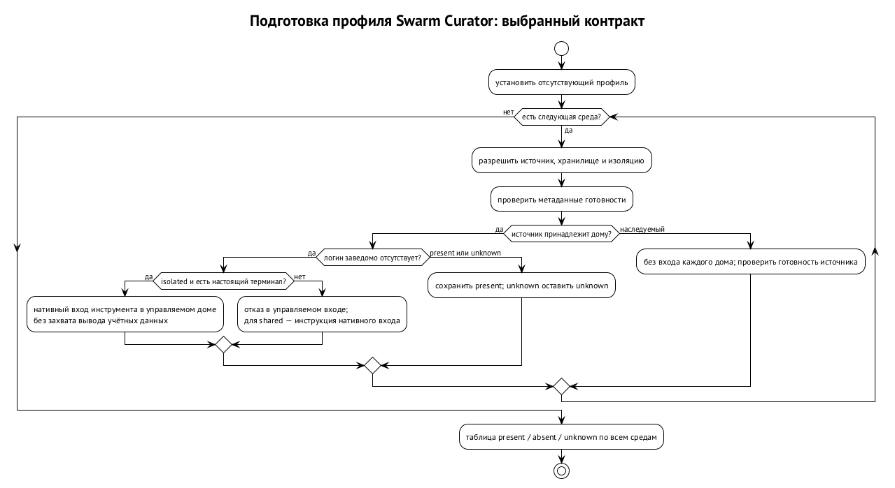

# Swarm Curator

Swarm Curator — менеджер окружения агентов. Он готовит инструкции, скиллы, настройки и подключения MCP, с которыми агент начинает работу. Единица сборки — профиль, а результат для конкретной агентской среды — управляемый дом. Так содержание окружения отделено от команды запуска и от живой сессии. Установка скиллов и профилей и сборка управляемых домов работают уже сегодня. Контракты снимков, готовности логина и подготовки профиля приняты в нормативной волне rc.7, их реализация идёт.

Проблема возникает, когда один дом готовят несколько компонентов. Менеджер профиля положил инструкции, хост создал свою папку только с конфигурацией, лаунчер угадал наличие контекста по одному файлу — и агент получил окружение, отличное от заявленного. Поэтому граница одна: содержимым домов и правилами его проверки владеет Swarm Curator, а остальные компоненты получают результат через его интерфейс.

## Скилл, профиль и оверлей

Скилл — пакет с `SKILL.md` и необязательными каталогами вспомогательных материалов: `agents/`, `references/`, `.skill_triggers/`, `assets/`, `templates/`, `examples/`, `data/`. К агенту попадают только предусмотренные корни пакета. Проект объявляет скиллы в `Skillfile.json`, Swarm Curator их устанавливает и фиксирует разрешённые версии в lock-файле. Такой набор воспроизводится без повторного выбора последней версии при каждом запуске.

Команды скилла становятся глобальными шимами с одним владельцем на имя и собираются из проверенного исходника. Режим зависимости `full` даёт сессии контекст скилла, `runtime` — только его команды. Утилита в `PATH` не требует, чтобы каждый агент получал инструкции роли, которая ею пользуется. Оба режима включают в окружение один и тот же пакет и пользуются одним механизмом установки.

Профиль объединяет корневой контекстный пакет, его `Skillfile.json` и объявления MCP, закреплённые в lock. Ставится он из git по тегу, диапазону или ревизии, в том числе из подпапки; без версии выбирается последняя через `--range latest`. Для каждой пары «профиль × агентская среда» собирается свой дом, на который указывают `CLAUDE_CONFIG_DIR`, `CODEX_HOME` или переменные XDG.

Исполнитель начинает работу с профилем своей роли; заранее разложенных по проекту «спящих» скиллов нет. Профили ревьювера и продьюсера могут пользоваться общими командами, но давать разные инструкции. Установка профиля не даёт системных полномочий на запуск другого пользователя или доступ к чужим секретам: эти границы держат механизмы рантайма из глав «Пользователь ОС на агента и сеть агента» и «Гранты и полномочия».

Оверлей добавляет к профилю машинные или операторские изменения. Он принимает git-репозитории или папки с весами, объявленные только в конфигурации машины. Для процессов порядок такой: профиль пакета, затем оверлей процесса, затем оверлей оператора с персоной и памятью. Закреплённые модули пакета оверлей убрать не может.

Версия, lock и оверлей отвечают на разные вопросы. Версия выбирает пакет, lock закрепляет разрешённое содержимое, машинная конфигурация говорит, какие местные дополнения применить. Репозиторий проекта не становится владельцем машинной политики только потому, что в нём есть `Skillfile.json`. Особенно это важно для MCP и хранилища логина: декларация зависимости сама не разрешает передать секрет новому получателю.

## Аудит и границы установки

`curator audit` проверяет пакет и публикует подписанную запись, связанную с хэшем его содержимого. Копия из зеркала с тем же содержимым совпадает с записью по этому хэшу, так что аудит относится к конкретному артефакту. Сервис реестра с журналом прозрачности ещё в реализации и выпущенного релиза не имеет.

Неизвестные источники по умолчанию отвергаются; самостоятельно ставить можно проверенные скиллы, а путь для нового пакета — аудит. Следующий шаг — быстрая установка по подписанной записи без долгого локального аудита и подписанный установщик. Подпись записи связывает проверку с артефактом, но скомпрометированный установщик мог бы проверку проигнорировать, поэтому доверие к установщику остаётся отдельной предпосылкой.

Если зеркало отдаёт неизменный пакет со знакомым хэшем, запись аудита к нему применима. Если в скрипте пакета изменился хотя бы байт, прежнее совпадение уже не устанавливается ни названием, ни той же папкой. Поэтому аудит привязан к содержимому.

Аттестации личности и репутации в Swarm Chain — другое: они описаны в главе «Аттестации и переносимая репутация». Общее слово «аттестация» не превращает аудит пакета в запись о личности агента.

## Один владелец дома

Дом агента — папка конфигурации, которую конкретная среда читает при старте: инструкции, скиллы, подключения MCP, настройки. Но среда пишет туда и собственные данные: историю сессий, доверие (trust) и одобрения (approvals). Поэтому управляемый дом — не неизменный архив: `env resolve --repair`, смена профиля и синхронизация скиллов могут переписать его на месте, пока сессия ещё работает.

Ответ `curator env resolve <агент> --profile P` называется fragment. Это данные о доме и окружении запуска: разрешения, каналы MCP и системного промпта, дайджест lock. Для Muse в него добавлено явное поле `root_context`, чтобы лаунчер узнавал о выданном корневом контексте из интерфейса: проверка файла может не распознать symlink и подмешать чужой контекст.

Ответственность распределена так:

| Компонент | Ответственность | Граница |
| --- | --- | --- |
| Swarm Curator | содержимое дома, проверка, ремонт, fragment, готовность логина, снимки, доверие к рабочему каталогу | живую сессию не ведёт |
| Лаунчер `agents-management` | команда запуска и окружение из fragment и плана | раскладку дома не угадывает, второго менеджера профилей не содержит |
| Доска и хост сессий | приватная папка сессии, политика инструментов, ввод и возобновление | своего списка файлов профиля и правил их проверки не заводят |

Пример. Если хост записал в историю `CLAUDE_CONFIG_DIR`, но не передал его процессу, отчёт о профиле не доказывает, что Claude прочитал нужный дом. Если в приватной папке Codex только конфигурация и ссылка на логин, инструкции и скиллы туда не попали. Такие нарушения границы найдены в существующем пути запуска, и исправление считается сделанным, только когда процесс действительно получает нужное окружение и содержимое дома.

Команду запуска собирает тоже один владелец — `agents-management`. Иначе два вызывающих станут по-разному добавлять флаги, и один забытый строгий канал MCP откроет дочернему агенту лишние серверы. `curator run` уже соединяет окружение Swarm Curator с планом лаунчера. Управление долгой сессией — дело хоста, разобранного в главе «Запуск агента и хост сессий».

## Доверие к рабочему каталогу

Среды спрашивают, доверять ли каталогу, в котором их запустили. Если ответ хранит только сама среда, его происхождение не проверить и не отозвать. Поэтому доверием для управляемых домов владеет Swarm Curator — через машинный журнал доверия:

- **Точные пути.** Записываются только точные абсолютные пути, с привязкой к среде и к действию оператора; доверия по префиксу нет.
- **Три события.** Явный грант, запуск в каталоге и привязка профиля или извлечение контекста из репозитория — три разных события. Привязка профиля сразу записывает доверие к этому репозиторию, без второго подтверждения.
- **Личность репозитория.** Корень, основной remote и корневой коммит. Если она сменилась, доверие пропадает до нового согласия.
- **Отзыв по привязкам.** Снятие привязки снимает только доверие, которое дала она: если тот же репозиторий привязан двумя профилями, доверие держится до последней.
- **Проекция в дома.** При ремонте журнал проецируется в управляемые дома Claude и Codex. Меняется ровно один ключ доверия, остальное состояние среды сохраняется.

Доска запуск в недоверенном каталоге отклоняет и подсказывает команду `curator env trust add`. Рабочее дерево задачи, созданное инструментами Curator внутри доверенного репозитория, наследует доверие только по записи о создании.

## Снимок для живой сессии

Живая сессия получает собственный снимок дома, и дальнейшие правки профиля её не задевают. Временный путь для Codex узкий:

1. Между двумя `env resolve` с одинаковыми дайджестами fragment и lock копируются обычными файлами `AGENTS.md`, `skills/` и слой MCP.
2. Копия побайтно сверяется с источником.
3. При расхождении — до трёх попыток, после чего запуск отказывает ещё до создания PTY.

`auth.json` на этом пути остаётся ссылкой на нативный файл и не копируется. При attach, resume и восстановлении записанные дайджесты fragment и lock сравниваются со свежим resolve: повторный resolve замечает, что источник переписали во время копирования. Это переходный механизм: формат дома по-прежнему задаёт только Swarm Curator.

Целевой интерфейс — `curator env materialize --into <dir>`. Swarm Curator пишет в папку вызывающего проверенные обычные файлы и манифест с дайджестами, и временное копирование у хоста исчезает. Контракт снимков (CIP-0014) принят в rc.7. Публикация снимка допускает только отсутствующее место назначения: снимок собирается рядом в приватном каталоге и появляется по переименованию без замены.

Для отдельного пользователя ОС принцип тот же. Вызывающий материализует снимок, план покрывает дайджест архива, диспетчер переносит архив, не зная, где лежат дома Swarm Curator. `curator-run exec` под учёткой агента сверяет дайджест, разворачивает снимок только для чтения и выставляет конфигурационные переменные. Секрет не попадает в план или fragment только потому, что вместе с ними переносится окружение.

Гарантия — соответствие конкретному снимку, если доверять материализации, проверке дайджеста и переносу. Неизменности живого исходного дома она не означает и доступности логина из любого процесса не доказывает. Одинаковые файлы Claude в двух видах сессий ещё не дают одинакового доступа к Keychain. Дом, источник аутентификации и хранилище логина разделены; свойства инструментов — в главе «Учётные данные и логины».

## Общий и отдельный логин

Swarm Curator применяет к управляемым домам режимы `shared` и `isolated`. Они уже работают, но допустимы не везде: это зависит от агентской среды и хранилища. Устройство режимов, ограничения адаптеров и порядок разрешения учётных данных — в главе «Учётные данные и логины».

## Готовность перед запуском

`env status` показывает строку `login: present | absent | unknown` — сведения о готовности без байтов секрета. Проверка готовности обязательна для каждого адаптера, и запуска без неё нет. Неквалифицированная проверка даёт `unknown`, а `unknown` не равен `absent` и запуска не разрешает. Сообщение о недоступном хранилище нельзя подменить выводом «логина нет» ради автоматической подготовки профиля.

`curator env login <env> --profile P` запускает нативную команду входа инструмента в нужном доме, из настоящего терминала, не перехватывая вывода учётных данных. Для `isolated` с собственным источником аутентификации она допустима. В `shared` — отказ и инструкция войти в нативный дом, чтобы у общего логина оставался один владелец.

`curator profile prepare P` ставит отсутствующий профиль, перечисляет участвующие среды, разрешает окружения и запускает вход только там, где собственного логина заведомо нет. Присутствующий логин заново не создаётся, наследуемый источник не требует входа в каждый дом. Результат — таблица по всем средам. Если Claude готов, а у Muse состояние неизвестно, успех одной строки не скрывает неизвестности другой.

У Claude есть `claude auth status --json`: он показывает `loggedIn` и `authMethod` без запроса к модели. Проверки остальных адаптеров проходят квалификацию по одной; пока её нет, адаптер отвечает `unknown`. Строка `present` никогда не выводится из общего предположения, что все агенты хранят логины одинаково. Команды диагностики и ограничения хранилищ — в главе «Учётные данные и логины».

## MCP: требование, декларация, согласие

MCP подключает агенту внешние инструменты. Swarm Curator различает четыре вещи:

- требование скилла;
- декларацию пакета сервера;
- запись конфигурации клиента;
- доступность сервиса.

Сервер может прийти из нативного файла, плагина клиента, облачного коннектора или управляемого профиля. Один список имён на диске не описывает все эти пути и не доказывает, что конкретный запуск получит нужный сервер.

Сегодня манифесты поддерживают `dependencies.mcp_servers`: имя сервера с `hint` и необязательными `transport` и `required_in`. Менеджер проверяет требование, читая нативные конфигурации: ищет имя, не считает выключенные записи, предупреждает об отсутствующей команде и о конфигурации только в проекте. Это проверка по имени. Ни идентичности сервиса, ни входа к нему она не устанавливает.

Целевое устройство — по требованию владельца — идёт дальше. Скилл сообщает идентичность сервера и способ входа, Swarm Curator готовит конфигурацию и для профиля, и для запуска из чекаута, а оператор может подменить сервер. В новой версии манифеста `server` выбирает ровно одно:

- точный HTTPS `endpoint`;
- `package` объявления `agent-mcp.json`.

Обычный HTTP допускается только для `localhost`, параметры запроса в адресе запрещены. `auth` задаёт вид входа и имена переменных или заголовков, но не значения. Старое закрытое определение требования в выпущенных версиях незаметно не расширяется: скиллы без новой декларации продолжают проверяться по имени.

| Вид входа | Декларация | Кто получает значение |
| --- | --- | --- |
| `none` | сервер без входа | секрет не нужен |
| `oauth` | вход через нативный клиент | клиент и его хранилище |
| `bearer_env` | имя переменной для Bearer | клиент при запуске |
| `header_env` | имя заголовка и переменной | клиент при запуске |
| `env` | имена переменных локального сервера | процесс сервера |

Литеральные токены, пароли и значения заголовков отвергаются при разборе. Пакет из диапазона разрешается до точного коммита и дайджеста в lock. Одинаковые требования объединяются, а разные серверы под одним именем — конфликт: два скилла не могут молча выбрать разных получателей одной переменной только потому, что назвали сервер одинаково. Имена у скилла и MCP-пакета должны различаться — это нынешнее ограничение резолвера.

Подмена принадлежит оператору: алиас на уже настроенный сервер, другой адрес или пакет либо сознательное отключение. По умолчанию подмена охватывает все требования с этим именем, поле `skill` сужает область. Репозиторий может предложить подмену, но не применить её сам, иначе сторонний чекаут направил бы переменную с токеном на свой адрес. Подмена видна в lock и статусе.

План показывает каждую цель отдельно: файл, сервер, адрес или команду, имена переменных и получателей. Любая экспозиция MCP требует явного согласия до первой записи — в том числе удалённый сервер без переменных. Повтор того же плана заново не спрашивает. Новый адрес, переменная или получатель требуют нового согласия. Для запуска без человека подходит заранее одобренная машинная политика, но не самоодобрение внутри скилла или проекта.

Учитывается совокупная экспозиция запуска. Расширить её можно как новым именем переменной, так и новым получателем прежнего набора. Если получатели наблюдаемы не полностью, нужно явно признать общий домен доверия с указанной границей видимости; изоляции между MCP-серверами сам план не создаёт.

## Свидетельство подключения

Свидетельство вычисляется отдельно для среды, области и типа запуска. Выключение на более высоком уровне переживает разрешение приоритетов, нижний селектор его не обходит. Строгое исключение нативных MCP у Claude доказывает только реально применённый непустой канал; отсутствие файла для пустого набора ничего не доказывает. `any` требует одного положительного свидетельства, `all` — свидетельства для каждой выбранной цели. Неизвестность требования не удовлетворяет.

Для скиллов без новой декларации и для непрозрачных облачных коннекторов есть операторская привязка. Оператор связывает точные требования конкретных пакетов, без масок, с выбранным провайдером для данной среды и запуска. Наблюдаемое и заявленное оператором помечаются раздельно: требование, связанное с облачным коннектором без файла на диске, имеет статус «заявлено оператором». Новый скилл или расширенная область прежней привязкой не покрываются. Данные проекта могут попросить привязку, но разрешить её не могут, а сама привязка не даёт согласия на установку кода или маршрутизацию токена.

Доверие к привязке заканчивается при отзыве оператором, при изменении области или идентичности требования и при полном отрицательном свидетельстве для того же провайдера и запуска. Отсутствие имени в файле непрозрачного коннектора не опровергает, но известное отсутствие поддержки в данном запуске заявлением не исправить. Проверка включается явно при установке скилла и по отдельной перепроверке; нового неявного фатального шлюза в `env resolve` нет.

Граница результата формулируется буквально: «настроен по имени; идентичность провайдера и аутентификация не проверены». Чужой сервис под нужным именем пройдёт проверку имени, поэтому писать «подключён» нельзя. Нативные файлы могут содержать секреты, так что «не управляет секретами» не означает «никогда не читает байтов, где они есть». Диагностика ограничена метаданными: без сырого окружения, заголовков и фрагментов разбора.

Рядом со скиллом допустим инертный `agent-mcp.json` как рекомендация. Полномочий на установку он не даёт. Подсказка указывает git-источник, ревизию, каталог и имя; путь на диске сам основанием принятия не становится. Скилл и MCP-пакет закрепляются независимо, а испорченные необязательные метаданные не ломают установку обычного скилла.

## Два пути записи конфигурации

Конфигурацию MCP пишет один писатель — Swarm Curator — по единому контракту для двух путей.

**Управляемый профиль.** MCP материализуется через отдельный канал: `--mcp-config` для Claude, `-p curator-mcp` для Codex, `OPENCODE_CONFIG` для OpenCode. Новая декларация идёт тем же путём вместе с `requires.mcp` профиля. Передача имён переменных заголовков по этому каналу требует доработки: сам канал существует, но не все виды входа сегодня проходят через него.

**Чекаут.** Писатель нативных файлов владеет записями: он меняет только созданные им записи, перечисленные в защищённом реестре вне проекта. Чужая одноимённая запись — конфликт, даже если байты равны; оператор разрешает его алиасом или явным принятием. Остальные байты и комментарии сохраняются. Если синтаксис сохранить нельзя, файл отклоняется до записи. Новые нативные файлы по умолчанию попадают в `.gitignore`, отслеживаемые правятся с видимым git diff. Глобальные пользовательские файлы требуют явной команды. Управляемый писатель в нативном доме не работает, нативный — в управляемом.

Адаптер записывает ссылку на переменную в синтаксисе клиента; само значение он не читает и в файл не вставляет. Поддержку такого синтаксиса подтверждают на точных версиях клиентов. Если клиент вид входа не умеет, результат — «не поддерживается для этого клиента».

OAuth остаётся у клиента. По явной просьбе Swarm Curator запускает его собственную команду входа в правильном доме, чтобы токен оказался в хранилище нужного запуска. Проверок здоровья по умолчанию нет: даже тестовый запрос может отправить серверу секрет. Настройка и вход показываются отдельно; наличие переменной означает только наличие имени; значение и права у сервиса проверяются отдельно.

Пример. Скилл объявил сервер дизайна с OAuth. Swarm Curator подготовил записи Claude и Codex, оператор вошёл каждым клиентом. Тот же скилл в профиле проходит вход в доме профиля. Если оператор заменяет сервер корпоративным прокси с переменной токена, появляется новый план и новое согласие на получателя.

## Что не проходит без квалификации

Отказ до квалификации получают:

- OAuth при подменённом доме;
- принудительные хранилища отдельных клиентов;
- локальные Windows-серверы через `.cmd` и `.bat`.

Неквалифицированная поддержка неотличима от неработающей. Внешнему вызывающему нужен проверяемый результат Swarm Curator с точным пределом; второй менеджер дома рядом с ним не нужен.

## Проверяемая граница результата

Установка профиля, разрешение окружения и запуск — три разных наблюдаемых результата:

- установленный пакет не доказывает, что конкретная сессия получила его инструкции;
- успешный resolve не доказывает, что вызывающий выставил процессу переменные;
- проверенная копия дома не доказывает, что OAuth доступен в используемом виде сессии.

Поэтому хост пользуется выданным fragment и снимком по контракту, а статус называет именно проверенный факт.

Пример. Оператор обновил профиль во время работы Codex. Дайджест исходного дома изменился, но уже созданный снимок сессии не превращается незаметно в смесь старых инструкций и новых скиллов. Временная процедура ловит изменение между resolve и побайтной сверкой, а целевая материализация переносит ответственность за проверенный снимок к Swarm Curator. При attach и resume свежий resolve сверяют с записанным состоянием, и подходящим дом становится только после этой сверки.

Для MCP формулировка столь же узкая. Объявление скилла, операторская подмена, согласие на план, запись конфигурации и вход клиента не сливаются в один зелёный признак. У сервера может быть корректная конфигурация и отсутствующий вход, у непрозрачного коннектора — только заявление оператора. Известное отключение или конфликт с чужой записью остаются видимыми даже рядом с успешно установленными серверами того же профиля.
