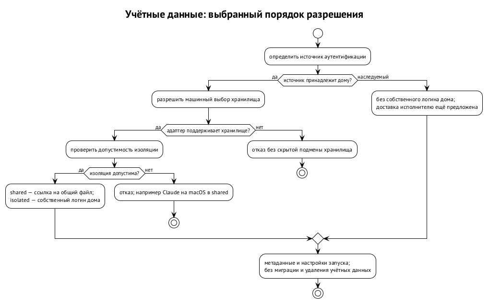
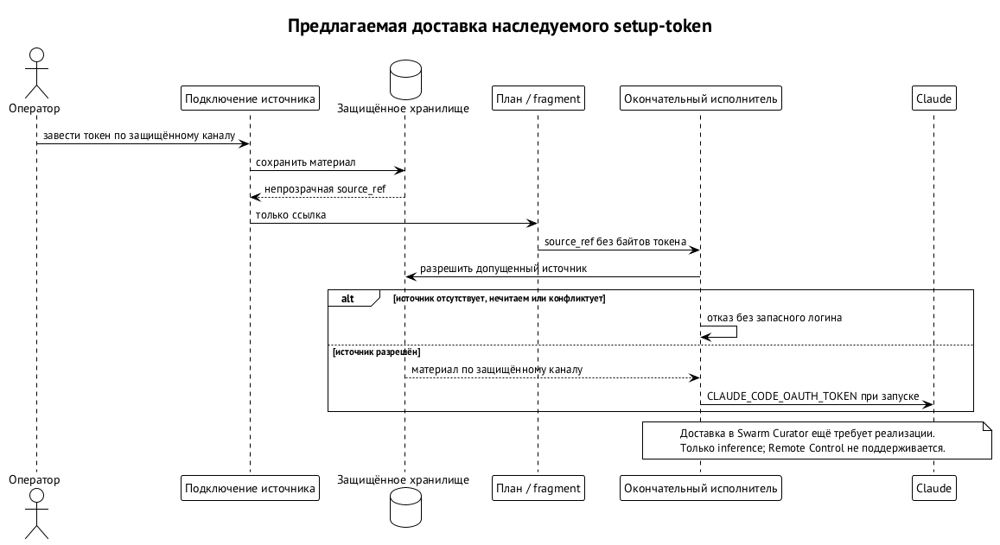
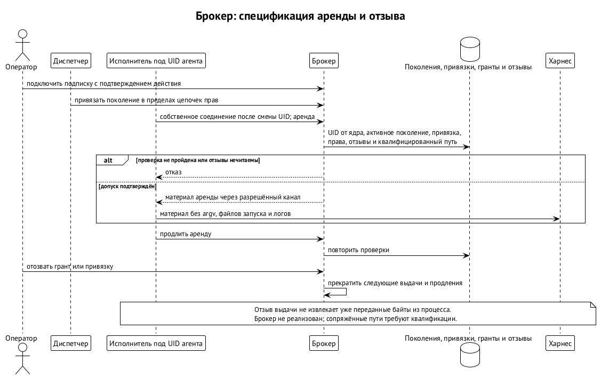

# Учётные данные и логины

Учётные данные дают агентской среде доступ к провайдеру модели: через подписку, ключ API или иной поддержанный канал. Логин — сохранённый результат входа, хранилище — место, откуда инструмент его берёт. Дом конфигурации и доступ к хранилищу — не одно и то же: одинаковые файлы дают разный результат в процессах с разным доступом к Keychain. Ниже — наблюдения октября 2026 года; будущие версии инструментов могут вести себя иначе.

Модель такая: один человек — одна подписка, и подставляется она только в его запуски. Долгоживущие учётные данные в первой версии рантайма допустимы. Брокер решает, кому и на какой запуск их выдать, но токен в окружении среда всё равно может прочитать. Неизвлекаемость секрета — отдельная будущая задача: ограниченная аренда не превращает годовой токен провайдера в короткоживущий.

## Где инструменты хранят вход

Наблюдения относятся к Claude Code 2.1.299 на macOS 15, Codex CLI 0.153.2 и Muse 1.4.8; опыты с Muse шли на macOS 27, и на Claude это уточнение не переносится. Проверки выполнялись в отдельных тестовых домах и пользователях ОС. Они различали успешный вход, отказ сохранения и потерю видимости файла, но не охватили всех политик ОС и вариантов обновления токенов.

### Claude Code

Когда есть доступ к login Keychain, Claude сохраняет вход отдельно для каждого `CLAUDE_CONFIG_DIR`. Элемент называется `Claude Code-credentials-<хэш>`, где хэш — первые восемь шестнадцатеричных символов SHA-256 от пути каталога. Файла учётных данных при этом нет. Новый управляемый дом требует собственного входа и логина нативного дома не трогает. Так вели себя desktop-сессия и её потомки.

Важно происхождение процесса. tmux или демон, запущенный с рабочего стола, наследуют доступ этой сессии к Keychain: отсутствие окна ещё не делает процесс похожим на ssh. В исследованной ssh-сессии без доступа к существующему login Keychain вход сохранялся в `<home>/.credentials.json` с правами 0600. После того как тестовый файл скрыли, Claude сообщал «Not logged in».

Desktop- и ssh-хранилища друг друга не видели: дом с desktop-логином показывал из ssh `loggedIn=false`, и наоборот. Другой случай — пользователь ОС вообще без login Keychain в фоновой сессии launchd. Там вход заканчивался «Couldn't save your login», а файлового запасного пути не было. Поэтому повторный вход — не универсальное лекарство от недоступного Keychain.

`claude setup-token` выдаёт токен, который передаётся через `CLAUDE_CODE_OAUTH_TOKEN`. В опыте он имел приоритет над логином дома, давал `authMethod=oauth_token` и не записывался ни в дом, ни в Keychain. Для inference канал годится, а Remote Control его отвергает. На Linux Claude пользуется файловым логином `<home>/.credentials.json`.

### Codex CLI

У Codex сначала нужно установить, какое хранилище выбрано. Ключ `cli_auth_credentials_store` в `config.toml` задаёт режим; если ключа нет, используется `file` и `$CODEX_HOME/auth.json`. Значения `keyring` и `auto` берут системное хранилище. Поэтому соседний `auth.json` не доказывает, что текущий процесс читает именно его.

Переопределение `-c cli_auth_credentials_store='"file"'` выбирает файловое хранение на один вызов и важнее файла конфигурации; вложенные кавычки сохраняют строковое значение TOML. Лаунчер применяет выбор, не переписывая принадлежащий Codex файл. Но общий транспорт настроек профиля не даёт самому профилю права решать, где окажутся токены: это решение владельца машины.

### Muse

По умолчанию Muse использует один глобальный элемент Keychain `ai.meta.dev.credentials`, а `auth.json` — запасной путь. Разные дома при этом не означают разных логинов. В опыте без Keychain OAuth проходил, но сохранение падало с `keychain write failed` и exit 1, и автоматического перехода к файлу не было. Название «запасной путь» не гарантирует, что он сработает.

С явным `TBH_CREDENTIAL_BACKEND=file` вход сохранялся в `$XDG_CONFIG_HOME/muse/auth.json` с правами 0600. Следующие запуски брали файл без обращения к Keychain, а когда его скрыли, учётных данных не стало. Ссылка на файл другого дома тоже работала. Запись при обновлении токена, атомарная замена, сохранение ссылки и конкуренция процессов в этом режиме не измерены; файловый backend Muse включается после такой квалификации.

Ключ API, выпущенный через вход и переданный Muse через `exec --api-key-stdin`, расходовал подписку, а `META_API_KEY` хранилище входа не трогал. Для Muse основной путь — подписка; канал выпущенного ключа — запасной и включается после квалификации ротации, сроков и повторного выпуска.

## Источник, хранилище и изоляция

Swarm Curator принимает три отдельных решения:

- **Источник** — чей вход используется: собственный логин дома или наследуемая аутентификация.
- **Хранилище** — нативный механизм, файл или Keychain.
- **Изоляция** — связан ли файл дома с общим нативным файлом (`shared`) или дому нужен собственный логин (`isolated`).

Порядок именно такой: источник, хранилище, допустимость изоляции и только затем стратегия ссылки.

`shared` и `isolated` работают в rc.6. Для Claude на macOS `shared` отклоняется с `environment_shared_unsupported`; файловый путь в ssh исключения в адаптере не делает. На Linux файловое хранение общий логин допускает. У Codex ссылка подходит к нативному файловому входу, но не заменяет выяснения настройки keyring. У Muse отдельные папки глобальный Keychain не изолируют — нужен явный файловый backend.

Хранилище выбирается одной машинной настройкой: `credential_store.<profile>.<env-id>` со значениями `native | file | keychain`, по умолчанию `native`. Пакеты, оверлеи, lock и репозитории её не выбирают. Смена значения старый логин не мигрирует и не удаляет: он может остаться в прежнем хранилище и стать невидимым для нового запуска. Интерфейс принят в контрактах rc.7.

Адаптер выполняет только то, что для него квалифицировано. `native` значит «выбор самого инструмента»; Keychain при этом не обязателен. Неквалифицированное хранилище — отказ.

| Среда | `file` | `keychain` |
| --- | --- | --- |
| Codex | override `cli_auth_credentials_store` при входе и запуске | `keyring` только на квалифицированном macOS backend, иначе отказ |
| Muse | `TBH_CREDENTIAL_BACKEND=file` при входе и запуске | отказ до квалификации принудительного интерфейса |
| Claude | отказ: интерфейса принудительного выбора нет | отказ: интерфейса принудительного выбора нет |

Перевести Claude на `file`, чтобы починить ssh-логин, нельзя: квалифицированного интерфейса принудительного файла у Swarm Curator нет. Разрешённый нативный файловый путь и возможность его принудительно выбрать — разные свойства. Содержимое домов, снимки и строка `login: present | absent | unknown` описаны в главе «Swarm Curator»; неизвестность там отсутствием входа не считается.



## Наследуемый setup-token

Токен один раз заводится в защищённое хранилище пользователя под узлом аутентификации. В переносимом профиле узел хранит только ссылки и метаданные. Дом получает непрозрачную ссылку `source_ref`, а окончательный исполнитель извлекает значение и передаёт его Claude через `CLAUDE_CODE_OAUTH_TOKEN`. В плане и fragment токена нет. Домам с наследуемым источником собственный вход не нужен.

Это снимает зависимость inference от отдельного элемента Keychain для каждого дома и от происхождения процесса — desktop или ssh. Контракт регистрации токена, проекции источника и отказов опубликован (локальный источник setup-token, этап T0); реализация в Swarm Curator идёт.

Отсутствующий узел, нечитаемое хранилище или два источника одновременно — отказ без запасного пути. Недоступный наследуемый источник незаметно чужим входом дома не подменяется. В первой версии без явного источника работает прежний собственный вход дома. Конечное направление — обязательная строка источника для каждой пары «профиль × среда», с миграцией существующих домашних входов в явный `per-home`.



## Брокер: одна подписка, аренды на запуски

Брокер учётных данных (`swarma-credential-broker`) — служба под отдельной учёткой с Unix-сокетом и без сетевого слушателя. Подписку заводят у него один раз, а запуск получает аренду — право на материал в пределах разрешённого запуска. Контракт брокера опубликован, кода пока нет. Обновляемый логин не копируется в несколько независимых домов: выдача и, где нужно, обновление сосредоточены в одном месте.

Подключение подписки — расширяющее действие оператора с подтверждением точного содержимого через телефон или пароль в терминале; из сессии агента оно не принимается. Claude передаёт брокеру результат обычного `setup-token` через stdin. Для личного плана Codex брокер под своей учёткой создаёт свежий дом и запускает нативный вход по коду устройства; повторное подключение того же аккаунта отклоняется. Вход у провайдера вместо человека брокер не проходит.

Вызывающего при выдаче определяет ядро ОС — по UID и поколению учётки. Исполнитель заново разрешает защищённую привязку: профиль, среду, аккаунт, канал, адрес провайдера, дайджест бинарника и поколение политики. Брокер под замком проверяет привязку, цепочку грантов и отзывы, покрытие прав, состояние аккаунта, квалификацию версии, одобренные адреса, бинарники и сеть. Нечитаемые отзывы означают отказ в выдаче.

Материал передаётся среде через разрешённый канал — окружение, stdin или внешний токен Codex — и не попадает в argv, файлы запуска и логи. Соединения закрываются при exec и агенту от диспетчера не наследуются. Продлить и освободить аренду может её владелец, и при продлении проверки повторяются. Старая успешная аренда не заменяет проверки свежего отзыва или истёкшей привязки.

Первый исполнитель — `curator-run` под учёткой агента. План требует понятного исполнителю расширения `works.relux.curator.credential/1`, а способность подстановки обозначается `credential-injection/1` для проверенной версии среды. Исполнитель, который его не понимает, отказывает. Доска и хост сессий второго клиента брокера не встраивают — они обращаются к диспетчеру. Источник вида `broker:<аккаунт>` настраивает владелец машины.

У каналов разная жизнь аренды. В канале `env` исполнитель получает токен до `exec`, а затем его место занимает процесс среды, и клиента для освобождения аренды уже нет. Выход среды сам аренду не освобождает: власть брокера ограничена `authorized_until`, отзывом или отвязкой. Ранний выпуск аренды `env` делает диспетчер — после того как `exec.stop` подтвердил, что процессов не осталось. В канале Codex исполнитель живёт рядом со своим app-server, продлевает аренду и в конце вызывает `lease.release`.

Отзыв записывается на диск до ответа и запрещает новые выдачи и продления. Уже переданного токена он не стирает: тот действует до своего срока или до отзыва у самого провайдера. Поэтому сдерживание различает три состояния — полномочие брокера, отгороженное исполнение и судьбу учётных данных у провайдера; подробно — в главе «Гранты и полномочия». Годовой токен Claude на месте не обновляется: по истечении нужны новый токен и перезапуск. Восстановление брокера из резервной копии закрыто до сверки подтверждённой истории отзывов, чтобы старая копия не вернула утраченного права.

Сроки проверяются по водяному знаку времени. Истёкшая привязка непригодна сразу, а удаление по сроку требует подтверждения реально прошедшего времени по монотонным часам. Для постоянных агентов замена привязки снимает старую вместе с концом её аренд и создаёт новую с никогда не повторявшимся номером — без двух одновременно действующих привязок и без расширения первоначального запроса.



## Почему Codex нужен один обновляющий

Копии обновляемого логина создают гонку: один процесс обновил токен, другой продолжает со старым. Для личного плана Codex у брокера один владелец обновления под замком, а `codex app-server` получает внешние токены. `codex exec` в этом режиме не обслуживается, а `auth.json` в доме запуска нет. Нативная ссылка `shared` — отдельный существующий режим Swarm Curator, к архитектуре брокера она не относится.

При ответе 401 исполнитель просит `lease.renew` и должен уложиться в дедлайн app-server; иначе ход завершается ошибкой без запасного входа. Успешное чтение общего файла не доказывает корректности внешнего обновления и не разрешает нескольких независимых писателей. Процесс провайдера замка брокера соблюдать не обязан.

Поэтому брокер сохраняет намерение попытки до запуска обновления, держит процесс в границах службы ОС и выясняет судьбу прежнего писателя, прежде чем запускать новый. Даже подтверждённая смерть процесса не доказывает, что провайдер не успел сменить токен. Если исход неизвестен, аккаунт остаётся недоступным или заводится заново; слепого повторения нет. Канал Codex включается только с этой гарантией и после квалификации версии app-server и её дедлайна.

Для Business- и Enterprise-входов Codex есть отдельный токен доступа, но в первый выпуск он не входит. Подстановка токена на расшифровывающем TLS-прокси — исследование, в план она не входит. Сетевые гарантии брокера — в главе «Пользователь ОС на агента и сеть агента»; заявленный профиль ещё не равен применённому принуждению.

## Пределы выдачи и порядок включения

Брокерный путь включается по шагам:

1. **Claude.** Один защищённый запуск на одной машине через цепочку пользователей ОС. Нужны настоящий диспетчер, хранилище брокера, гранты, отзывы, привязка, аренда и исполнитель под учёткой агента. Успешная подстановка переменной из того же пользователя этот шаг не проверяет: переход между пользователями и проверка вызывающего входят в саму гарантию.
2. **Канал Codex.**
3. **Принудительная сеть.**

Положительному запуску соответствуют отказы чужому вызывающему, чужому аккаунту и просроченной привязке. Для канала Codex отдельно проверяется, что несколько запусков с отклонённым токеном дают одно обновление, а падение брокера не создаёт второго писателя.

Управление разделено по полномочиям. Подключение аккаунта и выдача гранта — операторские действия с дополнительным подтверждением; отзыв остаётся операторским, но дополнительного подтверждения не требует. Статус, аккаунты и привязки читаются через наблюдателя, без раскрытия токенов. Для дома с брокерным источником статус показывает аккаунт, срок, доступность брокера и последний отказ; каналом получения материала статус не служит.

Граница с MCP принципиальна: подставленный токен провайдера модели дочерние MCP-процессы не наследуют. Защищённая привязка и зарезервированные имена окружения разделяют этих получателей — обычная переменная среды такого разделения не даёт. Удалённый агент пользуется собственными учётными данными владельца удалённой машины, и локальный брокер не становится их универсальным хранилищем.

## Диагностика и повторный вход

Ошибки отражаются событиями истечения, отказа и необходимости повторного входа; срок, если провайдер его не сообщил, не выдумывается. Классы ошибок — аутентификация, права, квота и неизвестность. Если 401 нельзя уверенно отличить от нехватки прав, результат — «неизвестно». Реакция — парковка и уведомление, без бесконечных повторов.

При «Not logged in» сначала проверяют версию, фактический дом и происхождение процесса. Проверка нативного дома не подтверждает готовности управляемого. У Claude полезны `loggedIn` и `authMethod` из `claude auth status --json`, у Codex — выбранное хранилище и override, у Muse — backend и ожидаемый файл или ссылка. Содержимое файла учётных данных для этого не нужно.

Повторный вход после разлогинивания ведёт брокер:

1. Хост сессий замечает отказ входа и паркует сессию.
2. Брокер шлёт владельцу аккаунта на телефон ссылку входа.
3. После входа брокер выдаёт новую аренду.
4. Хост возобновляет сессию.

Успешный старый логин не доказывает ни срока действия, ни возможности обновления, ни готовности нового запуска.

## Рецепты

Для Claude на macOS в rc.6 вход выполняют из того же вида сессии, в котором будет работать запуск. `P` — условное имя профиля. Команды выбирают дом и показывают только статус; токены к отчёту не прикладывают.

```bash
eval "$(curator env resolve claude_code --profile P --format shell)"
claude auth login
claude auth status --json
```

В ssh то же разрешение окружения выполняют внутри ssh, не рассчитывая, что desktop-логин виден. Для пользователя совсем без Keychain нативный вход не сохраняется, и повтор команды запасного пути не создаст. Источником для inference здесь может служить setup-token.

Для уже настроенного `isolated` Codex в контрактах rc.7 такой интерфейс. Первая команда выбирает хранилище, но изоляцию не переключает; в `shared` вторая команда отказывает и направляет к нативному входу.

```bash
curator env config set credential_store.P.codex_cli file
curator env login codex_cli --profile P
```

Для всех сред — предварительная `curator profile prepare P` с отдельной строкой готовности каждой среды. При наследуемой аутентификации проверяется доставка источника, собственный вход дома не нужен. Неизвестность обновления токена, клиентских адаптеров и сквозной доставки сохраняется до проверки соответствующего пути, сколь бы успешной ни была соседняя среда.
