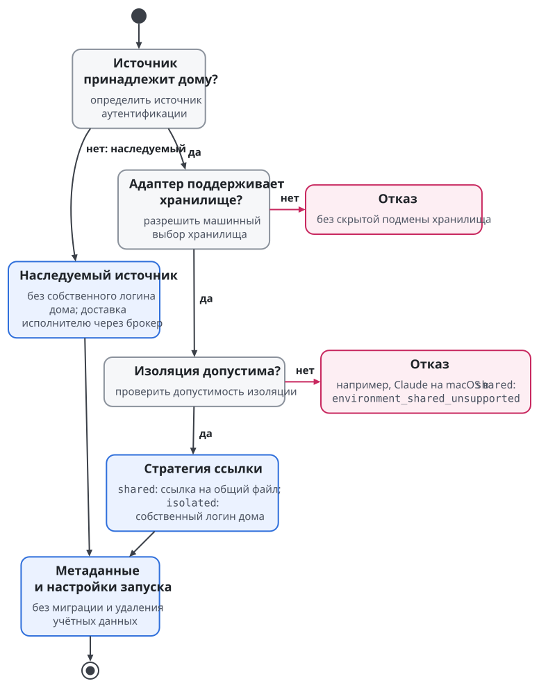
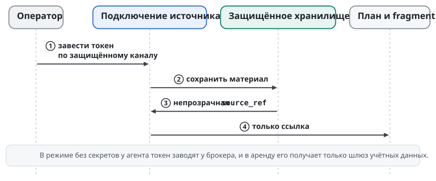
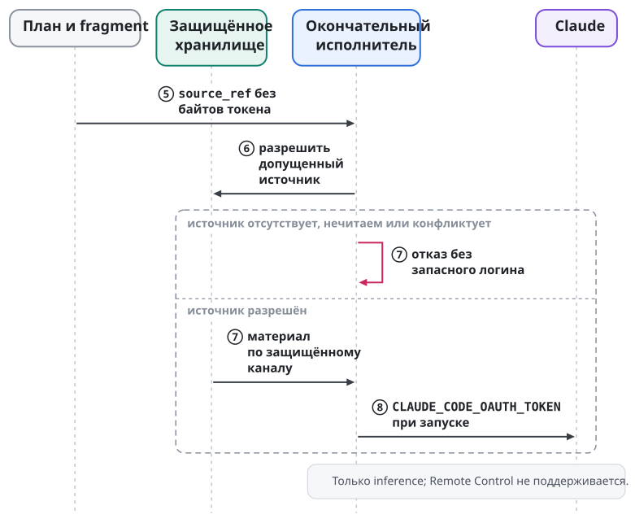
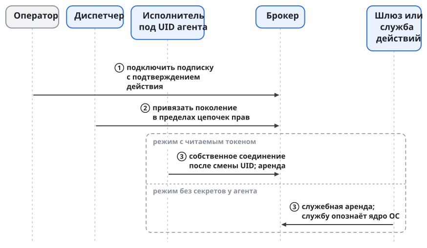
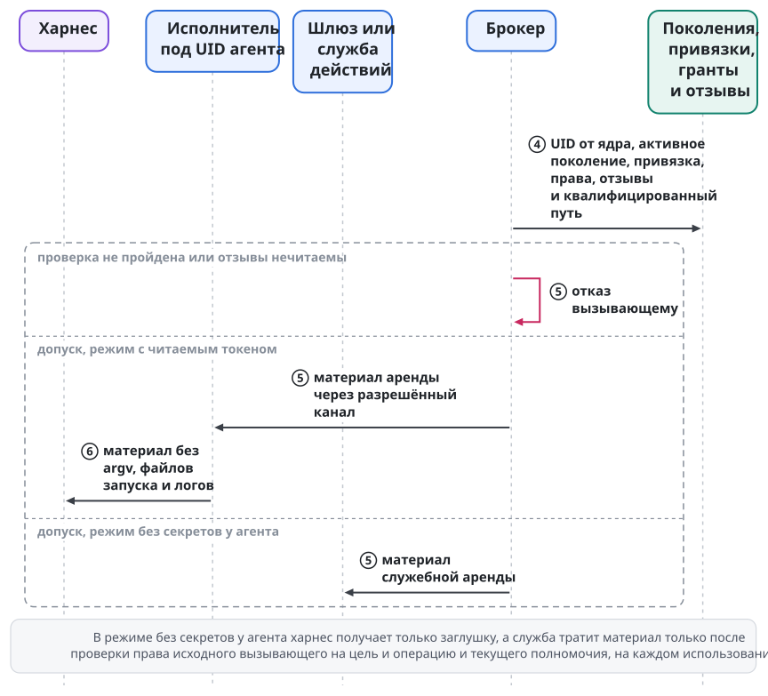
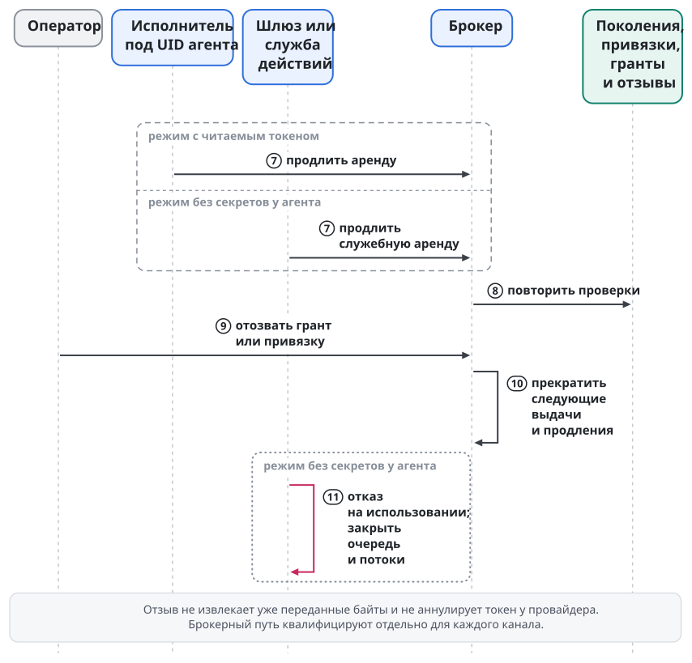

# Учётные данные и логины

Учётные данные дают агентской среде доступ к провайдеру модели через подписку, ключ API или иной поддержанный канал. Логином называется сохранённый результат входа, а хранилищем называется место, откуда инструмент берёт логин. Дом конфигурации и доступ к хранилищу задаются отдельно: одинаковые файлы дают разный результат в процессах с разным доступом к Keychain. Поведение инструментов наблюдалось в октябре 2026 года; будущие версии инструментов могут вести себя иначе.

У каждого человека одна подписка, и подставляется она только в его запуски. Рантайм допускает долгоживущие учётные данные и различает два режима их доставки. В **режиме без секретов у агента** учётка агента не получает секретного материала, который действует вне служб платформы: учётные данные тратят службы под собственными учётками, а агентская среда получает заглушку (раздел "Режим без секретов у агента"). В **режиме с читаемым токеном** брокер решает, кому и на какой запуск выдать учётные данные, но среда может прочитать токен в своём окружении. Ограниченная аренда не превращает годовой токен провайдера в короткоживущий.

## Где инструменты хранят вход

Наблюдения относятся к Claude Code 2.1.299 на macOS 15, Codex CLI 0.153.2 и Muse 1.4.8; опыты с Muse шли на macOS 27, и на Claude это уточнение не переносится. Мы проверяли поведение в отдельных тестовых домах и под отдельными пользователями ОС. Проверки различали успешный вход, отказ сохранения и потерю видимости файла и не охватили всех политик ОС и вариантов обновления токенов.

### Claude Code

Когда есть доступ к login Keychain, Claude сохраняет вход отдельно для каждого `CLAUDE_CONFIG_DIR`. Элемент называется `Claude Code-credentials-<хэш>`, где хэш состоит из первых восьми шестнадцатеричных символов SHA-256 от пути каталога. Файла учётных данных при этом нет. Новый управляемый дом требует собственного входа и логина нативного дома не трогает. Так вели себя desktop-сессия и её потомки.

Важно происхождение процесса. tmux или демон, запущенный с рабочего стола, наследуют доступ этой сессии к Keychain: отсутствие окна само по себе не делает процесс похожим на ssh. В исследованной ssh-сессии без доступа к существующему login Keychain вход сохранялся в `<home>/.credentials.json` с правами 0600. После того как тестовый файл скрыли, Claude сообщал "Not logged in".

Desktop- и ssh-хранилища друг друга не видели: дом с desktop-логином показывал из ssh `loggedIn=false`, и наоборот. Другой случай касается пользователя ОС вообще без login Keychain в фоновой сессии launchd. Там вход заканчивался сообщением "Couldn't save your login", а файлового запасного пути не было. Поэтому повторный вход лечит недоступный Keychain не во всех случаях.

`claude setup-token` выдаёт токен, который передаётся через `CLAUDE_CODE_OAUTH_TOKEN`. В опыте он имел приоритет над логином дома, давал `authMethod=oauth_token` и не записывался ни в дом, ни в Keychain. Канал годится для inference; Remote Control его отвергает. На Linux Claude пользуется файловым логином `<home>/.credentials.json`.

### Codex CLI

У Codex сначала устанавливают, какое хранилище выбрано. Ключ `cli_auth_credentials_store` в `config.toml` задаёт режим; если ключа нет, Codex использует `file` и `$CODEX_HOME/auth.json`. Значения `keyring` и `auto` берут системное хранилище. Поэтому соседний `auth.json` не доказывает, что текущий процесс читает именно его.

Переопределение `-c cli_auth_credentials_store='"file"'` выбирает файловое хранение на один вызов и важнее файла конфигурации; вложенные кавычки сохраняют строковое значение TOML. Лаунчер применяет выбор и не переписывает принадлежащий Codex файл. Общий транспорт настроек профиля не даёт самому профилю права решать, где окажутся токены. Это решает владелец машины.

### Muse

По умолчанию Muse использует один глобальный элемент Keychain `ai.meta.dev.credentials`, а `auth.json` служит запасным путём. Разные дома при этом не означают разных логинов. В опыте без Keychain OAuth проходил, но сохранение падало с `keychain write failed` и exit 1, и автоматического перехода к файлу не было. Название "запасной путь" не гарантирует, что он сработает.

С явным `TBH_CREDENTIAL_BACKEND=file` вход сохранялся в `$XDG_CONFIG_HOME/muse/auth.json` с правами 0600. Следующие запуски брали файл без обращения к Keychain, а когда его скрыли, учётных данных не стало. Ссылка на файл другого дома тоже работала. Файловый backend Muse включается после квалификации записи при обновлении токена, атомарной замены, сохранения ссылки и конкуренции процессов в этом режиме.

Ключ API, выпущенный через вход и переданный Muse через `exec --api-key-stdin`, расходовал подписку, а `META_API_KEY` хранилище входа не трогал. Для Muse основным путём служит подписка. Канал выпущенного ключа служит запасным и включается после квалификации ротации, сроков и повторного выпуска.

## Источник, хранилище и изоляция

Swarma Curator принимает три отдельных решения:

- **Источник** определяет, чей вход используется: собственный логин дома или наследуемая аутентификация.
- **Хранилище** определяет, где лежит вход: в нативном механизме, в файле или в Keychain.
- **Изоляция** определяет, связан ли файл дома с общим нативным файлом (`shared`) или дому нужен собственный логин (`isolated`).

Swarma Curator принимает решения в таком порядке: источник, хранилище, допустимость изоляции и только затем стратегия ссылки.

Для Claude на macOS Swarma Curator отклоняет `shared` с `environment_shared_unsupported`; файловый путь в ssh исключения в адаптере не делает. На Linux файловое хранение общий логин допускает. У Codex ссылка подходит к нативному файловому входу и не заменяет выяснения настройки keyring. У Muse отдельные папки глобальный Keychain не изолируют, поэтому нужен явный файловый backend.

Хранилище выбирает одна машинная настройка `credential_store.<profile>.<env-id>` со значениями `native | file | keychain`, по умолчанию `native`. Пакеты, оверлеи, lock и репозитории её не выбирают. Смена значения старый логин не мигрирует и не удаляет: он может остаться в прежнем хранилище и стать невидимым для нового запуска.

Адаптер выполняет только то, что для него квалифицировано. `native` означает "выбор самого инструмента"; Keychain при этом не обязателен. На неквалифицированное хранилище адаптер отвечает отказом.

| Среда | `file` | `keychain` |
| --- | --- | --- |
| Codex | override `cli_auth_credentials_store` при входе и запуске | `keyring` только на квалифицированном macOS backend, иначе отказ |
| Muse | `TBH_CREDENTIAL_BACKEND=file` при входе и запуске | отказ до квалификации принудительного интерфейса |
| Claude | отказ: интерфейса принудительного выбора нет | отказ: интерфейса принудительного выбора нет |

Перевести Claude на `file`, чтобы починить ssh-логин, нельзя: квалифицированного интерфейса принудительного файла у Swarma Curator нет. Если нативный файловый путь разрешён, из этого не следует, что его можно выбрать принудительно. Содержимое домов, снимки и строка `login: present | absent | unknown` описаны в главе "Swarma Curator"; неизвестность там отсутствием входа не считается.

{.tall}

## Наследуемый setup-token

Токен заводят один раз в защищённое хранилище пользователя под узлом аутентификации. В переносимом профиле узел хранит только ссылки и метаданные. Дом получает непрозрачную ссылку `source_ref`, а окончательный исполнитель извлекает значение и передаёт его Claude через `CLAUDE_CODE_OAUTH_TOKEN`. В плане и fragment токена нет. Домам с наследуемым источником собственный вход не нужен.

Наследуемый источник снимает зависимость inference от отдельного элемента Keychain для каждого дома и от происхождения процесса (desktop или ssh). Регистрацию токена, проекцию источника и отказы задаёт контракт локального источника setup-token (этап T0).

Отсутствующий узел, нечитаемое хранилище или два источника одновременно ведут к отказу без запасного пути. Swarma Curator не подменяет недоступный наследуемый источник незаметно чужим входом дома. В первой версии запуск без явного источника берёт собственный вход дома. Конечная версия требует обязательную строку источника для каждой пары "профиль × среда", и существующие домашние входы мигрируют в явный `per-home`.

Доставка идёт в две части: подключение источника кладёт токен в хранилище, а запуск извлекает его по ссылке.



{.tall}

## Брокер: одна подписка, аренды на запуски

Брокер учётных данных (`swarma-credential-broker`) работает службой под отдельной учёткой с Unix-сокетом и без сетевого слушателя. Подписку заводят у брокера один раз. Аренду, то есть право на материал в пределах разрешённого запуска, получает запуск в режиме с читаемым токеном или служба, которая тратит учётные данные за агента, в режиме без секретов у агента. Брокер не копирует обновляемый логин в несколько независимых домов: выдача и, где нужно, обновление сосредоточены в одном месте.

Оператор подключает подписку расширяющим действием и подтверждает точное содержимое через телефон или пароль в терминале. Из сессии агента брокер подключение не принимает. Claude передаёт брокеру результат обычного `setup-token` через stdin. Для личного плана Codex брокер под своей учёткой создаёт свежий дом и запускает нативный вход по коду устройства; повторное подключение того же аккаунта брокер отклоняет. Вход у провайдера вместо человека брокер не проходит. Учётные данные внешнего сервиса заводятся так же: собственным процессом входа сервиса, который завершает человек.

Вызывающего при выдаче определяет ядро ОС по UID и поколению учётки. Исполнитель заново разрешает защищённую привязку: профиль, среду, аккаунт, канал, адрес провайдера, дайджест бинарника и поколение политики. Брокер под замком проверяет привязку, цепочку доверенностей и отзывы, покрытие прав, состояние аккаунта, квалификацию версии, одобренные адреса, бинарники и сеть. Если отзывы нечитаемы, брокер отказывает в выдаче. В режиме без секретов у агента вызывающим брокера служит служба под своей учёткой, а право исходного вызывающего на конкретное использование проверяется отдельно (раздел "Два полномочия на каждое использование").

В режиме с читаемым токеном брокер передаёт материал среде через разрешённый канал (окружение, stdin или внешний токен Codex), и материал не попадает в argv, файлы запуска и логи. Соединения закрываются при exec и агенту от диспетчера не наследуются. Продлить и освободить аренду может её владелец, и при продлении брокер повторяет проверки. Старая успешная аренда не заменяет проверки свежего отзыва или истёкшей привязки. В режиме без секретов у агента среда материала не получает: аренду держит и продлевает служба, которая тратит учётные данные, а среде достаётся только заглушка (раздел "Режим без секретов у агента").

В режиме с читаемым токеном первым исполнителем, который получает аренду, служит `curator-run` под учёткой агента. План требует понятного исполнителю расширения `works.relux.curator.credential/1`, а способность подстановки обозначается `credential-injection/1` для проверенной версии среды. Исполнитель, который расширения не понимает, отказывает. Доска и хост сессий второго клиента брокера не встраивают и обращаются к диспетчеру. Источник вида `broker:<аккаунт>` настраивает владелец машины.

В режиме с читаемым токеном у каналов разная жизнь аренды. В канале `env` исполнитель получает токен до `exec`, затем его место занимает процесс среды, и клиента для освобождения аренды уже нет. Выход среды сам аренду не освобождает: власть брокера ограничена `authorized_until`, отзывом, остановкой всей установки или отвязкой. Продление, освобождение и отчёт брокер принимает только от собственного принципала аренды, то есть от той же учётки, поколения и привязки, поэтому диспетчер чужую аренду не освобождает. Освобождать ли аренду `env` до `exec` или держать её запись до предела полномочия, определяет спецификация брокера. В канале Codex исполнитель живёт рядом со своим app-server, продлевает аренду и в конце вызывает `lease.release`.

Брокер записывает отзыв на диск до ответа, и отзыв запрещает новые выдачи и продления. Уже переданного токена отзыв не стирает: тот действует до своего срока или до отзыва у самого провайдера. Поэтому сдерживание различает три состояния: полномочие брокера, отгороженное исполнение и судьбу учётных данных у провайдера (глава "Доверенности и полномочия"). В режиме без секретов у агента отзыв останавливает и использование: шлюз учётных данных и служба действий проверяют текущее полномочие на каждом использовании. Третье состояние остаётся для режима с читаемым токеном, для настоящей утечки и для взлома службы, которая держит учётные данные. Годовой токен Claude на месте не обновляется: по истечении нужны новый токен и перезапуск. Восстановление брокера из резервной копии закрыто до сверки подтверждённой истории отзывов, чтобы старая копия не вернула утраченного права.

Брокер проверяет сроки по водяному знаку времени. Истёкшая привязка непригодна сразу, а удаление по сроку требует подтверждения реально прошедшего времени по монотонным часам. Для постоянных агентов замена привязки снимает старую вместе с концом её аренд и создаёт новую с никогда не повторявшимся номером. Двух одновременно действующих привязок при замене не бывает, и первоначальный запрос не расширяется.

Путь аренды показан по фазам: подключение, выдача, затем продление и отзыв. Номера шагов сквозные на всех трёх рисунках.



{.tall}

{.tall}

## Режим без секретов у агента

Агенту учётные данные нужны для двух целей: для доступа к провайдеру модели и для доступа к внешним сервисам, таким как хостинг кода, трекеры задач, каналы выпусков, поиск и любой HTTP API. В режиме без секретов у агента учётка агента не получает секретного материала, который действует вне служб платформы. Учётные данные заведены у брокера и выдаются в аренду только службам, которые работают под собственными учётками ОС и тратят их за агента. Гарантия действует для запусков, допущенных в этом режиме, и только там, где квалифицированы его границы. Режим обобщает два случая, где учётные данные сервиса и раньше держала служба: исполнитель действий с репозиторием (глава "Пользователь ОС на агента и сеть агента") и учётные данные носителя у службы сообщений (глава "Путь сообщения и мост").

### Кто держит учётные данные

Открытый текст учётных данных держат только перечисленные держатели:

| Держатель | Материал | Граница |
| --- | --- | --- |
| Брокер | все заведённые учётные данные; единственный обновляющий для каждого аккаунта | без сетевого слушателя, плагинов и пересылки запросов к провайдерам |
| Шлюз учётных данных | арендованный материал для запросов, которые он пересылает | своя учётка; провайдеры моделей и хостинг кода, без записи во внешние сервисы |
| Служба действий | арендованный материал для действий, которые она выполняет | своя учётка; обобщает исполнитель действий с репозиторием |
| Служба сообщений | только собственные учётные данные носителя | учётных данных моделей и сервисов не получает |
| Агентская среда | заглушка; в режиме с читаемым токеном настоящий токен | |

Каждый новый держатель входит в доверенную базу со своей областью компрометации: взломанный шлюз или взломанная служба действий раскрывает все учётные данные, которые она арендует. Раздельные учётки не защищают учётные данные от захватившего root хоста (глава "Модель угроз").

### Шлюз учётных данных и адаптеры сервисов

**Шлюз учётных данных** работает под своей учёткой. Он завершает соединение агента, проверяет оба полномочия, подставляет учётные данные и открывает собственное соединение к адресату. Сетевые правила шлюза, то есть слушатель на поколение, `dial-guard/1`, бюджеты и проверка перенаправлений, описаны в главе "Пользователь ОС на агента и сеть агента". Шлюз обслуживает провайдеров моделей и хостинг кода и не пропускает записи во внешние сервисы: всё, что меняет общее состояние, выполняет служба действий (глава "Внешние эффекты, остановка и федерация"). Какие классы сервисов доступны личности через шлюз, задаёт машинная политика допущенного профиля, и вызывающий её не выбирает. Другой класс сервисов шлюз обслуживает только после отдельного решения владельца и квалификации.

**Служба действий** работает под своей учёткой и выполняет действия, которые меняют общее состояние: публикацию и приземление, запросы на изменение, выпуски, задачи и комментарии от имени проекта. Она служит доверенным исполнителем эффектов из Swarma Protocol в рантайме (глава "Модель протокола") и обобщает исполнитель действий с репозиторием: хостинг кода любого вида становится для неё одним адаптером из многих. Публикация и приземление по-прежнему требуют подписанного доской запроса на принятого точного кандидата со сравнением-и-заменой головы. Подпись агента вместе с доверенностью этой приёмки не заменяет. Сборки и тесты остаются на раннерах без секретов.

**Адаптер сервиса** описывает один сервис и делится на две половины. Половина жизненного цикла работает у брокера и продолжает схему единственного обновляющего: заведение учётных данных собственным процессом входа сервиса, выпуск, обновление, сроки и отзыв у провайдера. Половина запросов работает в шлюзе. Брокер остаётся минимальным: он обслуживает только свой протокол на Unix-сокете, без сетевого слушателя, плагинов и пересылки запросов к провайдерам. Спецификации адаптеров и шлюза ведутся вместе со спецификацией брокера. Адаптер объявляет следующее:

| Обязанность | Что адаптер объявляет или делает |
| --- | --- |
| Адресаты | Имена и порты, которые могут получить его учётные данные; другие адресаты их не получают никогда. |
| Схема аутентификации | Как предъявляются учётные данные, чтобы шлюз подставил их, а агент их не увидел. |
| Жизненный цикл | Заведение через процесс входа сервиса, который завершает человек; выпуск, обновление единственным владельцем, сроки и отзыв у провайдера. |
| Операции и цели | Смысловые операции и ресурсы, которые может назвать доверенность, с самой узкой областью у сервиса. Точку, которая несёт несколько целей или операций, адаптер разрешает до действительных; неизвестные получают отказ. Точки, которые создают, перечисляют или показывают учётные данные, получают отказ. |
| Класс эффекта | Меняет ли операция общее состояние. Такие операции выполняет только служба действий. |
| Ответы | Может ли ответ отражать учётные данные. Адаптер, который не умеет безопасно обработать отражение, остаётся закрытым. |
| Формы сверки | Кодировки своих учётных данных, которые узнаёт растяжка утечки. |
| Квалификация | Версия адаптера, версия API сервиса и отрицательные проверки. |

MCP-серверы, которым нужен токен сервиса, получают адрес шлюза по машинной политике, а токена не получают; согласие на MCP сохраняется (глава "Swarma Curator").

### Два полномочия на каждое использование

Служба, которая тратит учётные данные, предъявляет брокеру себя, а не агента. Поэтому каждое использование требует двух отдельно проверенных полномочий. **Право службы на материал** означает, что служба является допущенным принципалом текущего поколения, которого опознало ядро ОС, и держит служебную аренду на аккаунт. **Право вызывающего на использование** означает, что цепочка исходного вызывающего (владелец аккаунта, цепочка делегирования, поколение агента, запуск, профиль, аккаунт), разрешённая цель и смысловая операция проходят проверку на границе использования по правилам сужения (глава "Доверенности и полномочия").

Собственная доверенность службы, запрос, выбор аккаунта или заглушка недостающего права вызывающего не восполняют. Служба, которая держит учётные данные двух проектов, не пускает вызывающего с правом на один проект к другому. Неизвестная операция и цель, которую язык доверенностей выразить не может, получают отказ, и молча служба ничего не переводит. Зависимость от вызывающего сохраняется при продлении и на каждом использовании. Замена привязки или новое поколение службы заканчивают старые аренды и требуют свежего полномочия. Служебных принципалов, служебные аренды и право на использование через службу вводит версионированное расширение контракта брокера, и вместе с ним меняются привязки, запросы и записи аренд и права на методы. Контракт брокера v0 выдаёт аренды только привязанным принципалам агентов, и его листовые доверенности несут только `credential.lease`.

Каждое использование проверяет текущее полномочие в существующих пределах: свежесть снимка, граница max(S + A, F), ответ "недоступно" как отказ (глава "Доверенности и полномочия"). Шлюз и служба действий служат именованными потребителями отзыва. Отзыв завершён, только когда каждый из них долговечно подтвердил его или истекли все прежние полномочия; подтверждение приёма ничего не доказывает. При отзыве, заморозке поколения, выводе учётки, остановке всей установки и повторном открытии оператором шлюз закрывает сессии слушателя, открытые потоки и очередь этого поколения, а служба действий закрывает очередь действий, каждая с долговечной записью закрытия. Уже начатое действие подчиняется правилам главы "Внешние эффекты, остановка и федерация": его прерывают, где это безопасно, иначе доводят до конца и записывают исход. После сбоя или восстановления из резервной копии служба возобновляется только через то же закрытое повторное открытие, что и брокер.

### Провайдер модели через шлюз

Агентская среда обращается к провайдеру модели только через шлюз учётных данных с адаптером провайдера. Брокер выдаёт подписку или ключ API в аренду шлюзу, а не запуску. Среда настроена использовать шлюз как адрес провайдера, и TLS шлюз не перехватывает. Подстановка с перехватом TLS не допускается: среда, которая не умеет работать через настроенный адрес, остаётся в одобренном и отдельно квалифицированном режиме с читаемым токеном или получает отказ.

Среда получает **заглушку** через канал, который она принимает: окружение, stdin или внешний токен. Заглушка случайна для каждой аренды. Шлюз связывает её с одним поколением, одним запуском и одним аккаунтом и принимает её только на слушателе этого поколения. Запрос, где вместо заглушки стоят другие учётные данные, шлюз отклоняет, а заглушку заменяет настоящими учётными данными только после проверки обоих полномочий. Учётные данные, которые прислал сам агент, шлюз тоже отклоняет.

Квалификация каждой среды проверяет четыре свойства. Среда принимает заглушку без локальной проверки входа. Каждый вызов провайдера с учётными данными, включая старт, статус и вызовы аккаунта, идёт через шлюз. Функции, которым нужна личность у провайдера, работают или заведомо теряются. Дочерние процессы (MCP-серверы, хуки, инструменты) не получают ничего, кроме заглушки. Квалифицированные сочетания закрепляются; неизвестный выпуск получает отказ, и режима "попробовать с предупреждением" нет. Muse с заглушкой допускается только для локальных агентов.

Режим начинается с ключей API и отдельных тестовых подписок. Личная подписка входит в режим только после его квалификации на тестовых подписках, и квалификация идёт на отдельных тестовых аккаунтах. Смена режима не переносит дома незаметно, не копирует собственный вход дома, сохраняет провайдера, аккаунт и плательщика и не подменяет подписку оплатой по API (глава "Модели и деньги").

### Режим с читаемым токеном

Существующие каналы остаются явными исключениями: окружение Claude (`CLAUDE_CODE_OAUTH_TOKEN`), внешний токен Codex, канал выпущенного ключа Muse и собственный вход дома. Владелец машины выбирает каждый канал для профиля и среды, каждый канал квалифицируется отдельно, и запуск сообщает, что среда может прочитать и скопировать токен, а отзыв его не вернёт. Неудачная квалификация режима без секретов у агента не квалифицирует режим с читаемым токеном. Если не квалифицированы ни выбранный режим, ни выбранный канал, запуск получает отказ.

### Растяжка утечки

**Растяжка утечки** служит второй линией защиты. Границу режима задаёт то, что материал не попадает в учётку агента; растяжка добавляет к этой границе детектор. Там, где шлюз завершает соединение агента, он проверяет открытый текст от агента (строку запроса, заголовки и тело) до того, как подставит законную аутентификацию, поэтому собственная подстановка шлюза совпадения не даёт. Шлюз узнаёт формы, которые объявил адаптер: сырое значение, base64 и base64url, hex, процентное кодирование, экранирование JSON и формы конкретной схемы. Сверка охватывает границы фрагментов в ограниченном окне запроса и ответа. Ответ, который отражает учётные данные, агенту не доставляется.

Сверке подлежат все выданные версии учётных данных, включая версии без текущей аренды, до их истечения у провайдера или подтверждённой недействительности. Набор задаёт учёт версий учётных данных по поколениям у брокера. Отсутствующее или устаревшее состояние сверки закрывает пересылку. Сырые значения не уходят ни в учётку моста, ни в классификатор: перенос в учётку службы сообщений расширил бы доверенную базу. Сверку вне шлюза допускает только отдельно одобренная граница, и без неё мост сверки с выданными значениями не заявляет (глава "Путь сообщения и мост").

При совпадении шлюз сразу блокирует запрос и записывает вердикт без тела и без значения. Брокер ставит **блокировку аккаунта**: она действует на весь аккаунт, на все его поколения и запуски. Брокер хранит блокировку долговечно и проверяет её под замком при каждой выдаче и продлении, поэтому переподключение и перезапуск ничего не получают. Блокировку ставит узкий аутентифицированный вызов, который общих полномочий оператора шлюзу не даёт; освобождение аренды и отчёт о ней для этого не годятся. Шлюз и служба действий закрывают текущие использования этого аккаунта, а сессия останавливается существующим разрешённым путём для отказов учётных данных (раздел "Диагностика и повторный вход"). Каждый шаг подтверждается долговечной записью. Если брокер или получатель оповещения недоступен, пересылка остаётся закрытой, и отзыв не считается выполненным. Снимает блокировку только владелец.

Владелец получает событие о совпадении. Подтверждённая утечка дополнительно требует ротации у провайдера, а возможная ведёт только к блокировке. Правило, по которому совпадение считается подтверждённой утечкой, задаёт спецификация брокера. Блокировка запроса, блокировка аккаунта, остановка сессии и аннулирование у провайдера служат разными исходами. Блокировка аккаунта не делает токен недействительным у провайдера и повторного заведения не требует; аннулирование у провайдера может его потребовать, а для Claude оно доступно только в веб-интерфейсе провайдера.

Пределы растяжки названы прямо. Внутри непрозрачного туннеля `CONNECT` она ничего не видит. Разбиение, сжатие, шифрование или медленный вынос её обходят. Конечная сверка не доказывает, что сообщение, ответ или дом свободны от секретов (глава "Пользователь ОС на агента и сеть агента").

## Почему Codex нужен один обновляющий

Копии обновляемого логина создают гонку: один процесс обновил токен, другой продолжает со старым. Для личного плана Codex у брокера один владелец обновления под замком, а `codex app-server` получает внешние токены. `codex exec` в этом режиме не обслуживается, а `auth.json` в доме запуска нет. Нативная ссылка `shared` образует отдельный режим Swarma Curator и к архитектуре брокера не относится.

При ответе 401 исполнитель просит `lease.renew` и должен уложиться в дедлайн app-server; иначе ход завершается ошибкой без запасного входа. Успешное чтение общего файла не доказывает корректности внешнего обновления и не разрешает нескольких независимых писателей. Процесс провайдера замка брокера соблюдать не обязан.

Поэтому брокер сохраняет намерение попытки до запуска обновления, держит процесс в границах службы ОС и выясняет судьбу прежнего писателя, прежде чем запускать новый. Даже подтверждённая смерть процесса не доказывает, что провайдер не успел сменить токен. Если исход неизвестен, аккаунт остаётся недоступным или его заводят заново; слепого повторения нет. Канал Codex включается только с этой гарантией и после квалификации версии app-server и её дедлайна.

В режиме без секретов у агента обязанности делятся так, и квалифицируются они вместе. Брокер остаётся единственным обновляющим. Со стороны агента настоящего токена нет: app-server получает заглушку в режиме внешнего токена, а настоящий токен держат брокер со своим владельцем обновления и шлюз. Поэтому настоящий отказ провайдера видит только шлюз. Он просит продление с идентичностью отвергнутого настоящего токена и проверяет, что аккаунт не сменился. Дайджест заглушки без опубликованного соответствия вместо этой идентичности не подставляется. Квалификация решает, видит ли app-server отказ и что тогда значит его локальный вызов обновления, проходят ли через шлюз вызовы аккаунта, статуса и политики, и как ведёт себя сбой продления. Шлюз не повторяет запрос, если исход у провайдера неизвестен или поток ответа уже начался.

Сетевые гарантии брокера описаны в главе "Пользователь ОС на агента и сеть агента". Заявленный сетевой профиль не равен применённому принуждению.

## Пределы выдачи и квалификация

Брокерный путь квалифицируют отдельно для каждого канала. Для Claude квалификация требует одного защищённого запуска на одной машине через цепочку пользователей ОС с настоящим диспетчером, хранилищем брокера, доверенностями, отзывами, привязкой, арендой и исполнителем под учёткой агента. Подстановка переменной внутри того же пользователя эту квалификацию не заменяет, потому что переход между пользователями и проверка вызывающего входят в саму гарантию. Канал Codex квалифицируют вместе с одним обновляющим (раздел "Почему Codex нужен один обновляющий"), а принуждение сетевого профиля проверяют по правилам главы "Пользователь ОС на агента и сеть агента".

Каждому положительному запуску соответствуют отказы чужому вызывающему, чужому аккаунту и просроченной привязке. Для канала Codex отдельно проверяют, что несколько запусков с отклонённым токеном дают одно обновление, а падение брокера не создаёт второго писателя.

Режим без секретов у агента включается для сочетания режима, среды, адаптера и топологии только после всех отрицательных проверок, каждая рядом с положительным контролем. Синтетические проверки, проверки контракта v0 и прошлые наблюдения этой квалификации не заменяют:

| Отрицательная проверка | Требуемый исход | Положительный контроль |
| --- | --- | --- |
| Запрос встал в очередь до заморозки и пересылается после неё при ещё действующей служебной аренде | отказ и запись закрытия | запрос, принятый и выполненный до забора |
| Вызывающий с правом на проект X шлёт тот же разрешённый метод для проекта Y; неизвестная операция или невыразимая цель | отказ | объявленный вызов для X проходит |
| Задача создана, ответ потерян, среда повторяет вызов | второго эффекта нет, исход "неизвестно" до сверки | идемпотентный повтор той же операции |
| Корректно подписанный запрос продьюсера приземлить непросмотренного кандидата | отказ | подписанный доской запрос на принятого кандидата |
| Адаптер открывает доступ к вебу или пакетам личности, чей допуск это запрещает | отказ | личность доверенного круга с явным допуском |
| Разрешённый адресат перенаправляет запрос с учётными данными на непроверенный или частный адрес | отказ до подстановки учётных данных | проверенное перенаправление |
| Харнес донора C читает хранилище держателя или слушатель чужого запуска | блокирует песочница, иначе C остаётся вне гарантии | свой слушатель доступен |
| Старый, ещё действующий токен после обновления; отражение, разбитое по фрагментам; сверка недоступна | блок и блокировка аккаунта при совпадении | обычный трафик с учётными данными; почти совпадение без отзыва |
| После совпадения переподключение или перезапуск под тем же доверенностью | новой аренды нет до снятия блокировки владельцем | несвязанный аккаунт не затронут |
| Заглушка вне шлюза или на слушателе другого поколения; повторно занятый порт слушателя; сменившееся поколение политики | бесполезна или отказ | собственный текущий слушатель |

Управление разделено по полномочиям. Оператор подключает аккаунт и выдаёт доверенность с дополнительным подтверждением. Отзыв тоже выполняет оператор, но без дополнительного подтверждения. Статус, аккаунты и привязки читает наблюдатель, и токены при этом не раскрываются. Для дома с брокерным источником статус показывает аккаунт, срок, доступность брокера и последний отказ; каналом получения материала статус не служит.

Граница с MCP принципиальна: подставленный токен провайдера модели дочерние MCP-процессы не наследуют. Защищённая привязка и зарезервированные имена окружения разделяют этих получателей; обычная переменная среды такого разделения не даёт. Удалённый агент пользуется собственными учётными данными владельца удалённой машины, и локальный брокер не становится их универсальным хранилищем. Учётные данные донора, их держатель и согласие остаются у донора; варианты донора в режиме без секретов у агента описаны в главе "Удалённое рабочее место".

## Диагностика и повторный вход

Ошибки видны как события истечения, отказа и необходимости повторного входа. Срок, который провайдер не сообщил, остаётся неизвестным. Ошибки делятся на классы аутентификации, прав, квоты и неизвестности. Если 401 нельзя уверенно отличить от нехватки прав, результатом будет "неизвестно". В ответ на ошибку сессия паркуется, а владелец получает уведомление; бесконечных повторов нет. Блокировка аккаунта растяжкой, отзыв аренды, аннулирование у провайдера и потеря входа показываются раздельно: локальная блокировка не означает, что токен недействителен у провайдера, а повторный вход блокировку не снимает.

При "Not logged in" сначала проверяют версию, фактический дом и происхождение процесса. Проверка нативного дома не подтверждает готовности управляемого. У Claude полезны `loggedIn` и `authMethod` из `claude auth status --json`. У Codex полезны выбранное хранилище и override, у Muse полезны backend и ожидаемый файл или ссылка. Содержимое файла учётных данных для этого не нужно.

Повторный вход после разлогинивания ведёт брокер:

1. Хост сессий замечает отказ входа и паркует сессию.
2. Брокер шлёт владельцу аккаунта на телефон ссылку входа.
3. После входа брокер выдаёт новую аренду.
4. Хост возобновляет сессию.

Уведомление владельцу идёт по маршруту оповещений, который задаёт спецификация брокера; парковку и возобновление выполняет хост сессий по своим правилам (глава "Запуск агента и хост сессий"). Успешный старый логин не доказывает ни срока действия, ни возможности обновления, ни готовности нового запуска.

## Рецепты

Для Claude на macOS вход выполняют из того же вида сессии, в котором будет работать запуск. `P` обозначает условное имя профиля. Команды выбирают дом и показывают только статус; токены к отчёту не прикладывают:

```bash
eval "$(curator env resolve claude_code --profile P --format shell)"
claude auth login
claude auth status --json
```

В ssh то же разрешение окружения выполняют внутри ssh и не рассчитывают, что desktop-логин виден. Для пользователя совсем без Keychain нативный вход не сохраняется, и повтор команды запасного пути не создаст. Источником для inference здесь может служить setup-token.

Для уже настроенного `isolated` Codex хранилище выбирают так:

```bash
curator env config set credential_store.P.codex_cli file
curator env login codex_cli --profile P
```

Первая команда выбирает хранилище и изоляцию не переключает. В `shared` вторая команда отказывает и направляет к нативному входу.

Для всех сред сначала выполняют `curator profile prepare P`; команда выводит отдельную строку готовности каждой среды. При наследуемой аутентификации проверяется доставка источника, и собственный вход дома не нужен. Обновление токена, клиентские адаптеры и сквозная доставка остаются неизвестными до проверки соответствующего пути, даже если соседняя среда готова. В режиме без секретов у агента готовность входа означает доставку заглушки; готовность пути через шлюз проверяется отдельно, и неизвестная готовность запуска не допускает.
