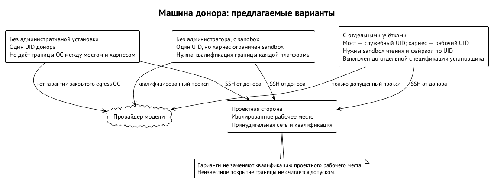
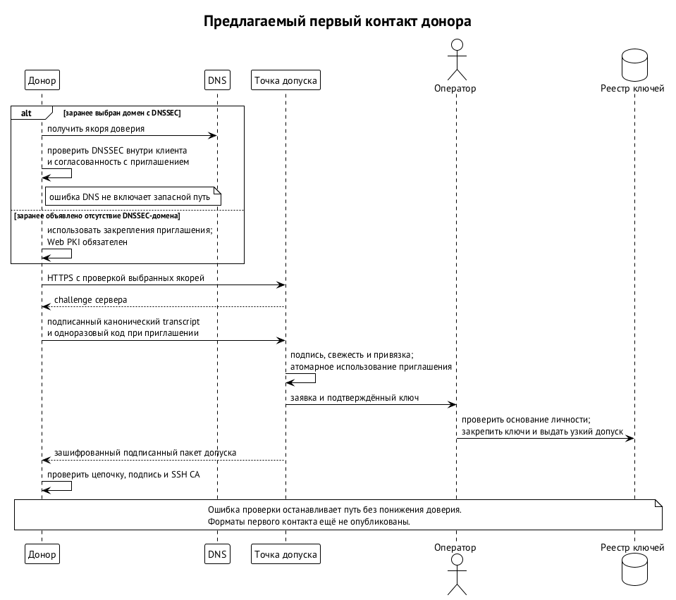
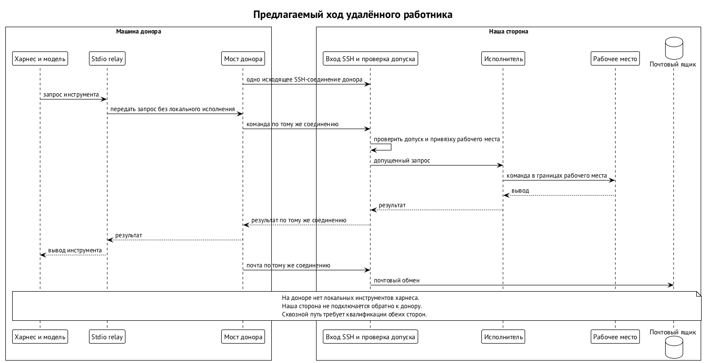
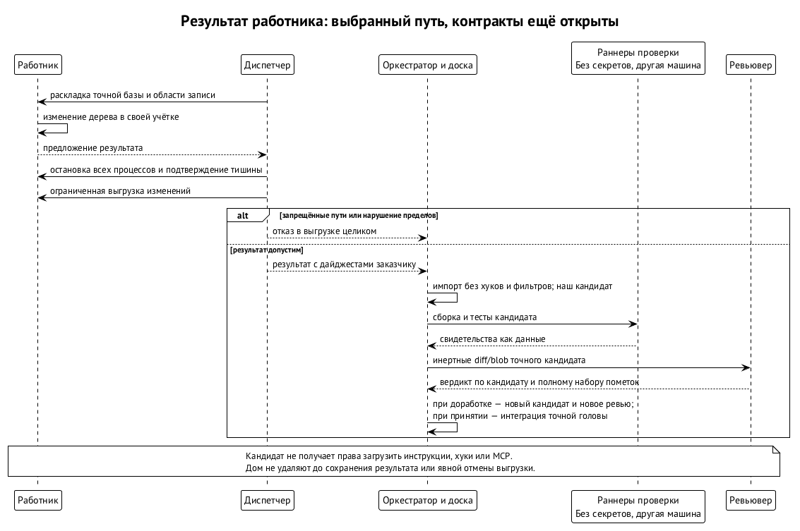

# Удалённое рабочее место

Удалённый работник — агент, чья модель работает на машине другого владельца, а инструменты исполняются в среде проекта. Владельца, который отдаёт квоту своей подписки, называем донором. Машину донора проект в управление не получает и логин его провайдера не хранит. Донор, в свою очередь, не получает доступа ко всей среде проекта. Так можно принять помощь человека со свободной подпиской, не перенося к нему репозиторий вместе с окружением сборки.

Доверять приходится в обе стороны. Проект ограничивает чужого агента, донор защищает свои файлы от задач проекта. Это разные границы: отдельный пользователь ОС в среде проекта защищает проект, но ничего не запрещает процессу на машине донора. Поэтому рабочее место, запуск модели у донора и канал между ними описаны отдельно. Дизайн решён, закрытые схемы обмена пишутся вместе с реализацией.

## Модель думает у донора, руки — у нас

Рабочее место — отдельный пользователь ОС на машине проекта: свой дом, свой файрвол, своя группа ресурсов и потолки этой машины. Модель работает по подписке донора. В среду проекта по одному SSH-соединению, которое открывает донор, приходят вызовы инструментов и почта. Обратных соединений проект не открывает и команд на машину донора не шлёт. На стороне проекта действуют граница пользователя ОС и файрвол из главы «Пользователь ОС на агента и сеть агента», а для рабочего места ещё и приватные пространства имён, пустые capabilities, `no_new_privs` и seccomp.

Пример. Проекту на iOS и Rust нужна одна подготовленная машина с окружением сборки. Несколько участников отдают ему свободную квоту, не воспроизводя окружения у себя. Каждый получает рабочее место, модели работают снаружи, а изменения собираются в общей среде. Вычислительной мощности это среде не добавляет: пропускная способность машины проекта остаётся ограничением. Вклад донора — ёмкость модели; вычислительной машиной общего назначения для проекта его компьютер не становится.

## Чем защищена машина донора

Харнес — программа, которая ведёт агентский цикл и предлагает модели инструменты. На машине донора он работает в запертом режиме `lockdown`: локальная оболочка, правка файлов и локальный веб-поиск модели не предлагаются. Доступен только путь через реле инструментов проекта. Само реле `swarma-remote-tools` ключей не держит и сети не имеет. Но отсутствие инструмента в интерфейсе модели и изоляция процесса средствами ОС — разные гарантии.

Вариантов установки три:

| Вариант | Права администратора | Граница у донора | Мост и ключи |
| --- | --- | --- | --- |
| A: запертый запуск | не нужны | проверенная сборка не предлагает локальных инструментов; своей границы ОС нет | пользовательская фоновая программа; Secure Enclave на macOS, файлы `0600` на Linux |
| B: две учётные записи | нужны при подготовке | недоверенный харнес и доверенный мост под разными UID; файрвол, граница чтения ядра, бинарники под root | системная служба моста; ключи в файлах `0600` его учётной записи, без Keychain |
| C: песочница | не нужны | харнес под пользователем донора, ограничен песочницей ОС | пользовательская служба; ключи как в A |

Вариант A — первый этап. Его предел существенен: если квалифицированная сборка всё-таки предложит локальный инструмент, модель сможет действовать от имени пользователя донора. Проверка сборки уменьшает риск, но границей ОС режим не делает.

В C харнес читает и пишет только свой каталог, обращается к реле и к локальному прокси провайдера, а к Keychain доступа не имеет. На macOS границу держит Seatbelt. На Linux граница C — приватное сетевое пространство имён без внешнего маршрута, с единственным опосредованным путём к провайдеру; файловую систему ограничивает Landlock, а мост живёт вне песочницы. Минимальные возможности ядра для C опубликованы. Где их нет, вариант C отклоняется и никогда молча не откатывается к A.

В B сеть разделена по UID: харнесу нужен прокси провайдера, мосту — SSH-хост проекта и точка присоединения. Для B нужен отдельный привилегированный компонент подготовки: создать учётные записи, поставить файрвол и песочницу, обеспечить удаление. Менеджер пользователей центральной среды для этого не расширяется. B включается вместе с этим компонентом.

После квалификации B и C установщик предлагает B, а при отказе от административных прав — C. Вариант A для новых доноров при этом закрывается: случай без прав администратора закрывает C, и граница у него сильнее. Существующих доноров A переводят на C.

Варианты A, B и C защищают донора. Проект защищает независимое ревью каждого кандидата перед продвижением основной ветки, поэтому вариант A тоже может писать в рабочее место. Политика проекта может ограничить запись вариантами B и C. Вариант закрепляется при регистрации и виден в статусе и баннере: проект выбирает допустимый риск, а донор видит условия, на которых отдаёт квоту. Первая целевая платформа — macOS, следующая — Linux; Windows в этот дизайн не входит.

## Запрет нельзя снять настройкой профиля

В Swarm Curator режим запуска — настройка машины. Значение `lockdown` закреплено замком, и нижние слои конфигурации ослабить его не могут. Профиль позу не задаёт, а лаунчер принимает сгенерированную политику и короткий белый список аргументов. Супервизор моста требует ещё и сочетания `lockdown` с `remote-auto`, а смена позы останавливает живую сессию. В `remote-auto` инструменты реле разрешены заранее, остальные запросы подтверждения отклоняются.

В B замок лежит в системной конфигурации под root, в A и C принадлежит донору. Свои файлы донор менять вправе, но при нарушении условий сессия не запустится. Изменение позы или прав увеличивает поколение политики, и оно проверяется при запуске и возобновлении. Новый профиль не вернёт незаметно локальную оболочку уже зарегистрированному работнику.

Допускается только точный квалифицированный набор: версия и дайджест бинарника, платформа, транспорт, модель, политика настроек и ревизия песочницы. Дайджест сверяется до запуска. Неизвестная новая версия получает отказ; режима «попробовать с предупреждением» нет. Откатиться можно только на другую квалифицированную сборку. Список приходит из центральной ленты квалификации.

Для Claude Code способ убрать инструменты измерен, для Codex измерен только путь через app-server; поддержки любой их версии это не обещает. Muse у доноров не поддерживается: его инструменты чтения не выключаются, а песочница как замена этой гарантии не принята. Pi и OpenCode допускаются после квалификации на целевых платформах — исследования исходников для этого мало. Донор видит позу, сборку и аудит вызовов: имя инструмента, хэш аргументов, размеры и время, без содержимого.

## Согласие донора

Подключение учётных данных провайдера донора к чужому проекту — решение самого донора. Проверка терминала при инициализации защищает от случайного запуска, но согласием не является. Прежде чем связка с учётными данными донора станет активной, нужно одно подтверждение от компонента под контролем донора и вне контроля инициирующего агента. Это ключ с присутствием человека: приложение на телефоне с ключом в Secure Enclave или StrongBox либо ключ FIDO2.

Подтверждение нужно одно на регистрацию и по одному на каждое расширение области. Без такого ключа донор не подключается; ослабленного режима нет.

## Первый контакт без ручной сверки отпечатка

До передачи задачи мост донора проверяет, что подключается именно к среде проекта. Основные якоря — HTTPS-сертификат точки присоединения и DNSSEC. В подписанных DNS-записях опубликованы отпечаток корня среды, ключ центра сертификации SSH-хостов и `TLSA` точки присоединения. Подписи от корневого ключа DNS клиент проверяет сам. Если сеть мешает получить записи напрямую, можно идти через DNS-over-HTTPS с той же самостоятельной проверкой подписей.

Приглашение может дополнительно нести отпечатки, но как запасной путь оно допустимо только для среды, заранее объявленной средой без домена с DNSSEC. Ошибка проверки DNSSEC не разрешает переключиться на приглашение: иначе атакующему хватило бы испортить DNS, чтобы ослабить проверку. В закрытом контуре якорь внутренней зоны приходит из конфигурации контура или из приглашения. Расхождение якорей означает отказ.

Инициализацию запускает человек — владелец машины донора. Нужен интерактивный терминал и набранное подтверждение сводки; нетерминальный ввод и признаки агентского окружения отклоняются. Так агент не установит работника по подсунутой инструкции. От решительного злоумышленника, уже действующего на машине донора, этот приём не защищает — для этого и нужно согласие ключом с присутствием человека.

Регистрация разделяет ключи по назначению: подпись, расшифровка пакета допуска и SSH. Владение доказывается подписью серверного challenge со сроком пять минут. Подписываемый транскрипт связывает версию, приглашение, проект, роль, ключи, challenge и срок. Приглашение потребляется атомарно: повтор с тем же ключом возвращает ту же регистрацию, с другим ключом — отклоняется. Оператор сверяет заявку и закрепляет ключи в реестре владельца; допуск подписывается на его стороне.

Точка присоединения — маленький HTTPS-сервис: выдать challenge, принять заявку, отдать пакет. Ключа подписи допуска у неё нет. Пакет шифруется на ключ расшифровки донора, подписывается сертификатом оператора и учётных данных носителя сообщений не содержит. Дальше работа идёт по SSH. Пределы для публичного входа:

- запрос — до 16 КиБ;
- приглашение — на 72 часа и не больше пяти вызовов;
- очередь — до 50 заявок;
- с одного адреса — до 10 запросов в минуту и 100 в сутки.

## Канал и исполнитель

У пользователя рабочего места нет пароля и интерактивного входа. Вход — по короткому SSH-сертификату примерно на сутки, который продлевает мост. Доверие к центру пользователей хранится под root вне дома работника. Принципал сертификата сопоставляется с конкретным поколением рабочего места через `AuthorizedPrincipalsCommand`, а таблица сопоставления лежит вне контроля работника. Запреты нужны с обеих сторон:

- опция `restrict` в сертификате ограничивает то, что разрешено самому сертификату;
- конфигурация сервера задаёт принудительную команду и запрет PTY, проброса портов, SSH-агента и файлов запуска.

Сертификат хоста мост проверяет при каждом соединении.

Проверяющие службы работают вне учётной записи работника. Оболочка входа пересылает канал на служебный Unix-сокет и пользовательских файлов запуска не читает. Служебный исполнитель держит политику инструментов, потолки, аудит и почтовый ящик и сверяет UID с активным поколением. Команды исполняются под пользователем рабочего места. Сетевой запрет, включая loopback, ставится вместе с активацией учётной записи; без принудительной сети место не создаётся. Спулы и сохранённые экспорты исполнителя подчиняются общему бюджету состояния служб.

Допуск определяет кортеж: личность работника, поколение учётки, назначение, раунд, дайджест плана и состояние отзыва. Каждая операция и каждая долговечная запись привязаны к кортежу и проверяются атомарно на границе исполнения. Перед любым изменением операция долговечно записывается: идентификатор в рамках поколения привязки и дайджест аргументов. Если ответ потерян, повтор возвращает сохранённый результат либо состояние «ещё идёт» или «неизвестно»; неизвестность повторного исполнения не разрешает. Тот же идентификатор с другими аргументами отклоняется. Закрытый формат протокола задаёт спецификация рабочего места.

Подписанное задание приходит через мост и адаптер ввода как следующий ход сессии. Мост донора сам проверяет адресата, срок и отзыв. Результат подписывается ключом, который остаётся у донора, и только после того, как мост получил то, что подписывает, целиком и проверил сам (раздел «Как забирается код»). При обрыве работа приостанавливается, инструменты получают повторяемую ошибку, затем сессия паркуется.

Закрытие поколения идёт строго по порядку:

1. заморозить поколение;
2. закрыть вход — принципалы закрытого поколения больше ни с чем не сопоставляются;
3. остановить через `cgroup.kill`;
4. выполнить экспорт;
5. заменить поколение.

Войти в закрытое поколение нельзя, поэтому переподключение донора не породит процесса под UID рабочего места во время остановки или экспорта. Единица отмены — остановка всего UID: она закрывает и полосу работы, и SSH-сессию.

## Как забирается код

Работник не пушит и не открывает Change Request на хостинге кода. Проект выдаёт точную базу, манифест файлов и область записи в отдельный репозиторий без remote, хуков и учётных данных. Свои коммиты работник вести может, но проект основанием доверия их не считает. В конце раунда процессы останавливаются с проверкой, что потомков нет, и вызовы инструментов в каталог закрываются.

Программа выгрузки работает с правами самого работника, по ссылкам не переходит, пропускает `.git` и отдаёт изменения относительно базы вместе с режимами файлов. Специальные файлы, подмодули, пути в `.git` и коллизии имён без учёта регистра отклоняют выгрузку целиком. Чтение от root или исправление прав через `chmod` — не обходной путь. Удалить дом нельзя, пока полный результат не сохранён вне области удаления или оператор отдельно не снял обязательство.

Донор подписывает канонический кортеж аттестации над измеренным экспортом: назначение, раунд, база, дайджест результата, дайджест плана и голова квитанций. Кортеж привязан к кандидату.

Слепой подписи нет. Мост донора получает сам экспорт целиком и кортеж в каноническом виде; готовых дайджестов ему не присылают. Подписывает он, только когда проверил всё сам:

- пересчитал дайджест результата по полученным байтам экспорта;
- сверил назначение, раунд, базу и дайджест плана со своим подписанным заданием;
- сверил голову квитанций с собственной цепочкой: каждый вызов инструмента и его результат прошли через мост;
- убедился, что все пути экспорта лежат в области записи задания.

Перед подписью агент видит итоговый диф последним ходом сессии и может отказаться. Подписанный экспорт донор хранит у себя. Если проект потом предъявит под его подписью другой результат, копия это опровергнет. Команды исполняет проект, поэтому подмену во время исполнения мост не предотвратит. Но подмена окажется в дифе, который донор видит до подписи, а подписывает он ровно этот диф.

Доска собирает из этих данных собственного подписанного кандидата. Выход за область записи и изменения самой доски запрещены.

Изменения в CI, хуках, инструкциях агентов, автозапуске, ссылках и управляющих файлах одобряются по детерминированному предикату доски. Предикат смотрит на текущий контракт, политику риска, точного кандидата и полное множество помеченных путей. Это множество вычисляется по накопленной дельте от базы до кандидата, включая все раунды, и для таких изменений действует привилегированный порог протокола. Порядок приёмки — в главе «Доска задач и процесс».

Ревьювер сначала получает инертные diff и blob вне корней автоматического обнаружения настроек. Подтверждение текста не активирует автоматически его инструкций, MCP или permissions. Обязательная проверка без верификатора даёт «не установлено».

При доработке каталог раскладывается из предыдущего кандидата, но полный результат по-прежнему сравнивается с доверенной интеграционной базой серии. Опасная правка не пропадает из отчёта только потому, что следующий раунд её не трогал. Новые подтверждения и вердикт привязываются к новой точной ревизии. Веб-содержимое без подтверждённого происхождения остаётся помеченным, пока доверенная сторона не приложит получение с дайджестом.

## Веб, проверки и ресурсы

По умолчанию веба нет: задача приносит проверенные ресурсы с дайджестами, доступные только для чтения. Дополнительный материал работник запрашивает письмом, а получает и проверяет доверенная сторона. Поиск включает оператор для конкретной личности доверенного круга; согласия донора для этого недостаточно. Пути поиска:

- поиск у провайдера без локальной загрузки;
- изолированный веб-инструмент у донора;
- служба платформы.

Каждый включается после квалификации, и ни один не даёт рабочему месту исходящей сети.

Компиляция, транспиляция и тестовые прогоны вынесены из учётной записи агента. Разрешённая проверка типов не значит, что разрешён произвольный интерпретатор: проверяется весь вызов, с читаемым кодом, конфигурацией и плагинами. Профиль выбирает сама машина — по классу задачи и дайджесту, и вызывающий на этот выбор не влияет. Кандидат собирается на эфемерных раннерах другой машины без секретов: зависимости загружаются отдельно и без исполнения кандидата, сама сборка идёт без сети.

Наблюдатель ресурсов останавливает и удерживает учётную запись и показывает статус. В первой версии его уведомление видно в статусе, маршрут на телефон — следующий шаг. Сетевая заморозка поколения идёт порядком из главы «Пользователь ОС на агента и сеть агента». Какие ограничения памяти и диска macOS обеспечивает жёстко, а какие требуют наблюдателя, определяет таблица возможностей конкретной машины; само наличие рабочего места этих свойств не доказывает.

Хостинга кода не достигает ни один агент. Публикацию, передачу артефактов раннерам, обновление базы и приземление выполняет исполнитель действий с репозиторием — отдельная служба под своей учёткой. Действует она по подписанному доской запросу на точного кандидата.

## Что именно защищают границы

Работник видит свой дом, снимок задачи и входящие сообщения с результатами проверки. Всей доски, чужих домов и процессов и прямого доступа к носителю у него нет. Это ограничение рабочего контекста, но не обещание скрыть любые платформенные метаданные других учётных записей: их видимость зависит от политики владельца. Изоляция файлов проекта не доказывает, что о соседях не известно ничего.

Максимальный набор удалённых инструментов — оболочка, чтение и запись файлов, патч и почта. Действующий набор — его пересечение с политикой рабочего места. У работника только для чтения инструмент записи в протоколе есть, но права вызвать его на этом месте нет. Серверные тайм-ауты и потолки вывода клиент может только уменьшить. Полномочия проверяются на стороне проекта, и корректный запрос моста донора их не расширяет.

Обязательство результата сохраняется отдельно. Детерминированный отказ выгрузки не выбрасывает работу автоматически, но и не держит раунд без выхода: работник исправляет ошибку в текущих полномочиях, либо оператор отдельным решением снимает обязательство. Ошибка доступа к созданному работником файлу отличается от инфраструктурного сбоя. Повышать права выгрузки ради удобства нельзя: тогда данные недоверенного работника управляли бы чтением привилегированной программы. Классы исхода и восстановления задаёт спецификация выгрузки.

## Остановка не равна отзыву

Четыре оси независимы:

- есть ли установка у донора;
- активен ли донор;
- допущено ли рабочее место;
- в каком состоянии ключ подписи.

Донор может снести установку без связи с проектом — это не отзывает автоматически грантов и ключа на другой стороне. Он может остановиться или уйти, сохранив личность. Проект отдельно закрывает каналы и сессии, останавливает задачи с потомками и освобождает учётную запись. Удаление SSH-ключа не закрывает уже установленного соединения, поэтому закрытие идёт порядком поколения.

Ключ донора отзывает оператор. Если канал недоступен, донор может удалить ключ у себя, и система честно покажет, что отзыв проектом не подтверждён. Ключи и гранты для всех машин владельца держит одна служба реестра с подписанными снимками. Биржа агентов ограничений рабочего места не меняет, а переносимые аттестации и репутация описаны в главе «Аттестации и переносимая репутация».

Контракты, которые пишутся вместе с реализацией: схема выгрузки и импорта, квалификация сборок и веб-инструментов, компонент подготовки B. Готовность отдельных частей не делает реализованным весь путь — это и отделяет решённую архитектуру от квалифицированной системы, которой можно доверить рабочее место.
