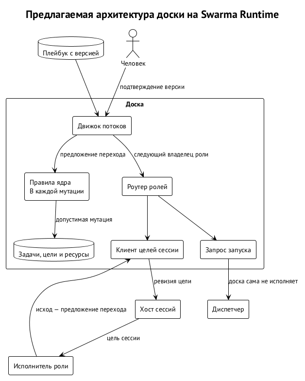
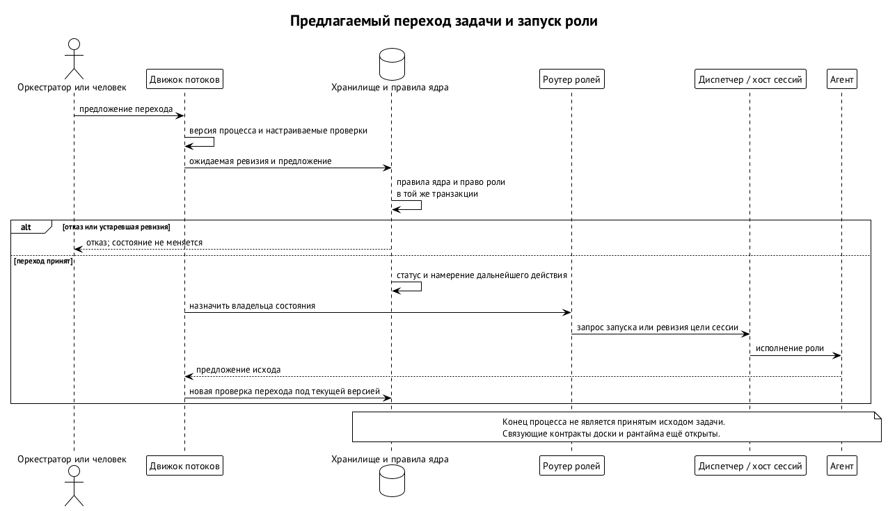

# Доска задач и процесс

Доска задач (`task-board`) хранит работу, её состояние и свидетельства приёмки. Она отвечает на вопросы, которых нет у хоста сессий: какую задачу сейчас выполняют, кто вправе принять результат, какая ревизия проверена и почему её можно интегрировать. Для разработки это замена устной договорённости между агентами на проверяемую историю. Программа с CLI на Go, хранилищем задач и механизмом запросов на изменения уже используется. ⟦работает сегодня⟧

В Swarm Runtime доска остаётся необязательным клиентом. Хост сессий держит сессию без неё, мост доставляет сообщения, слой доверия проверяет полномочия. Доска добавляет роли, процессы и запуск по переходам; платформенные модули от неё не зависят. Это позволяет использовать те же запуск, ключник и мост в проекте с другим управлением работой. Решение о таком разделении принято, но перенос сегодняшней доски на все новые границы ещё не означает их реализации. ⟦решено⟧

## Что уже хранится и проверяется

В существующей модели доска хранится вместе с проектом. Элементы образуют иерархию Epic → Story → Task или Bug, имеют описание, прогресс, статусы, ресурсы и историю активности. Агент обращается к ней через язык запросов и мутаций: `q` читает, `m` меняет, `grep` ищет; контракт можно узнать у самой программы. Для читателя существенно не устройство идентификатора, а то, что работу и её свидетельства можно прочитать независимо от памяти исполнявшего агента. ⟦работает сегодня⟧

Запуск дочернего агента — отдельный объект учёта с ролью, моделью, манифестом, событиями и транскриптом. Оркестратор может наблюдать его и передавать директивы. Подготовка аргументов и окружения зависит от харнеса и собирается модулем управления агентами. Сегодняшнее исполнение запуска находится в доске; в целевой архитектуре интерфейс доски обращается к диспетчеру, а процессы и сессии обслуживает платформа. ⟦решено⟧

Работающее хранилище не следует путать с границей авторизации. Сегодня часть сведений о действующем агенте передаётся соглашением через окружение; это само по себе не удостоверяет право на переход. Будущая схема связывает роль с грантом и проверяет его ядром. По той же причине выход процесса не может служить достаточным доказательством успеха задачи: процесс мог прекратиться до записи результата или вернуться без проверенной ревизии. ⟦решено⟧

## Продьюсер, ревьювер и Change Request

Продьюсер создаёт изменение. Ревьювер проверяет опубликованную ревизию, а оркестратор организует работу и интеграцию. Оркестратор не заменяет проверку своим желанием быстрее закрыть задачу. Один запуск не может принять собственную ревизию. Разделение фиксируется механизмом доски, а не только инструкцией модели «будь независимой». Такой цикл с отдельным рабочим деревом Story и неизменяемыми ревизиями Change Request уже действует. ⟦работает сегодня⟧

Change Request — запрос на изменения, публикующий конкретную неизменяемую ревизию для проверки. Вердикт относится к ней, а не к подвижному рабочему каталогу. Если продьюсер исправил файл после замечания, проверять нужно новую ревизию. Старый положительный вердикт не превращается в разрешение на любую последующую работу этого продьюсера. Доска сохраняет связь результата, ревизии и приёмки; оркестратор интегрирует Story после проверок, привязанных к дереву. ⟦работает сегодня⟧

Для недоверенного работника эта граница начинается ещё до публикации. Он отдаёт изменения как данные; доска строит собственный кандидат от точной базы. Работник не получает транспорт к хостингу кода. Принятый путь описан в главе «Удалённое рабочее место»: чужие коммиты не становятся доверенными только потому, что их принесли по подписанному каналу. Подпись результата отвечает за происхождение байтов, а ревью — за решение принять именно эти байты. ⟦решено⟧

Доверенный статус ревьювера также недостаточен без права роли. Для проверки требуется отдельный грант; класс доверия и размещение должны быть допущены, а ревьювер не должен совпадать с производящей личностью. Обязательность только локального ревьювера и запрет заказчику раунда проверять результат остаются отдельными вопросами. Их нельзя незаметно добавить как уже существующие гарантии независимости. ⟦решено⟧

## Почему интеграция сравнивает точную голову

Compare-and-set означает: обновить целевую голову только при совпадении с ожидаемым исходным состоянием. Если между проверкой и интеграцией другая работа продвинула ветку, предпосылка больше не выполнена. Нельзя молча применить прежний результат к новой базе. В работающем механизме интеграция Story использует compare-and-set и проверки, связанные с деревом. ⟦работает сегодня⟧

Целевое правило строже обычного «патч выглядит тем же»: интеграция и приземление — подписанная перемотка точной головы с доказательством стыка. Пусть ревьювер одобрил кандидат от одной базы, а затем основная ветка продвинулась. После обновления базы возникает другой кандидат, и вердикт не переносится по сходству diff. Иначе проверка будет говорить об одном объекте, а история примет другой. Если база ушла вперёд, требуется обычное обновление базы и повторное ревью. ⟦предложено⟧

При доработке различаются база раскладки и доверенная интеграционная база. Работнику удобно продолжать от последнего кандидата, однако чувствительные изменения должны проверяться по полному delta серии. Например, инструкция агенту, добавленная в первом непринятом кандидате, не исчезает из отчёта второго лишь потому, что второй меняет только текст ошибки. Полностью отменённая правка, наоборот, не должна оставаться помеченной только из-за истории. Подтверждения и новый вердикт привязываются к точному итоговому OID. ⟦решено⟧

Сначала доска выдаёт ревьюверу инертные diff и blob только для чтения, с дайджестами и вне корней обнаружения проектных настроек харнесом. Открыть само дерево кандидата допустимо лишь через квалифицированный адаптер строгого контекста либо эквивалентное исключение discovery. Инструкции, hooks, MCP, permissions и skills кандидата не подхватываются автоматически при запуске, вложенном чтении, reload, resume или входе дочернего агента. Подтверждение изменения не заменяет отдельного решения об активации управляющего контекста. ⟦решено⟧

Это не устраняет семантическую prompt injection в читаемом тексте. Ревьюверу всё ещё приходится оценивать недоверенное содержимое. Сборка и тесты должны идти в отдельной фазе на эфемерных раннерах без секретов, а не исполнять кандидат внутри процесса ревьювера или оркестратора. Ни роль владельца процесса, ни её грант не отвечают пока на другой вопрос: кто вне агентской учётной записи публикует кандидат, передаёт артефакт на проверку и выполняет landing. Граница этого внешнего исполнителя остаётся открытой. ⟦открыто⟧

## Процесс задаёт плейбук

Плейбук — описание типов работ, состояний, владельцев и разрешённых переходов с проверками. Вместо нового кода доски для каждого проекта предполагается конфигурация процесса. В потоке разработки разработчик владеет разработкой, ревьювер — ревью, оркестратор — интеграцией. В потоке дизайна владельцами будут другие роли. Смена процесса не должна менять значение уже полученного свидетельства или позволять обойти фиксированное правило ядра. ⟦предложено⟧

Проект разделяет три вопроса между файлами. `Skillfile.json` описывает установленное и читается Swarm Curator; `Playbook.json` описывает работу проекта; `task-board.config.json` задаёт окружение доски. Плейбук не должен превращаться в установщик с версиями и URL, а файл установки — в скрытую машину переходов. Они встречаются по именам скиллов. Существующие решения о таком разделении сохраняются, но возможность произвольно заменить зашитый процесс относится к будущему движку. ⟦решено⟧

Пакет процесса объединяет скилл оркестратора, скиллы ролей и поставщиков инструментов. Сам плейбук — данные, без исполняемых программ, скриптов и URL. Инструмент предоставляется установленным скиллом и запускается, только если проект его включил. Скиллы ролей попадают в запуски этих ролей, а не раскладываются в проект так, чтобы любая сессия обнаружила их автоматически. Иначе оркестратор мог бы начать действовать по инструкциям ревьювера. ⟦решено⟧

Композиция позволяет брать опубликованный процесс и описывать отличия либо соединять несколько процессов через слоты. Например, Scrum отвечает за выбор работы и сроки, а цикл разработки — за путь конкретного изменения. В iOS-проекте можно заменить скилл разработчика и вставить состояние QA, сохранив остальной шаблон. Такое повторное использование принято как направление; опубликованные части целевого плейбука предполагается закреплять хэшами. ⟦предложено⟧

## У состояния один владелец

В описании процесса роль — псевдоним, на который ссылаются состояния. Владельцем может быть агент со скиллом роли, человек из группы, инструмент или другой процесс. В каждый момент у элемента в состоянии ровно один владелец. Помощники работают на него: при оценке задачи фасилитатор собирает независимые ответы оценщиков, но ответственность за состояние не распадается между ними. ⟦решено⟧

Разные результаты требуют разных состояний. «Написал» и «проверил» нельзя объединить так, чтобы запись первого автоматически удостоверяла второе. Параллельная работа выражается дочерними элементами и проверкой их соединения на родителе. У каждого перехода указан вид актора; агент не выводит элемент из состояния человека и не записывает человеческое одобрение без делегированного права. Например, завершение дочернего анализа даёт материал владельцу, но не подпись человека за него. ⟦решено⟧

Данные процесса тоже могут влиять на маршрут. Заказ дороже 500 евро должен идти менеджеру; одобрение заказа на 620 евро не разрешает исполнить заказ на 6 200. Для этого поля, читаемые проверками перехода, не записываются произвольно запуском, а одобрение связывается с отпечатком полей. Здесь важно не конкретное число порога, а невозможность перенести согласие на изменившийся предмет. Это расширяет ту же идею точной ревизии на процессы вне разработки. ⟦решено⟧

## Переход — предложение, а не команда агенту

Переход может требовать оценку, назначенного исполнителя, отсутствие блокеров и свидетельство вердикта. Guard — проверяемое условие перехода. Имена guard, действий и событий приходят из модулей; неизвестное имя отклоняется валидатором. Некоторые переходы доступны лишь через определённую команду, другие выполняет ядро по событию или таймеру. Свидетельство должно быть свежим: вердикт учитывается после последнего входа элемента в исходное состояние. ⟦решено⟧

Например, задача вернулась из ревью в разработку и снова пришла на ревью. Старый вердикт «нужны изменения» не должен автоматически отправить её назад ещё раз; требуется свидетельство текущего прохода. Аналогично положительное решение предыдущего прохода не принимает новый кандидат. Свежесть события защищает последовательность процесса, а привязка к ревизии — его предмет; одна проверка не заменяет другую. ⟦решено⟧

Число кругов доработки настраивается проектом. Длинная петля не обязательно дефект: законная работа может требовать много итераций. Поэтому предусмотрен и осознанный вариант без ограничения, с предупреждением валидатора. Конкретная форма параметров шаблона для лимитов, счётчиков и длительностей остаётся предложением. Лимит должен выражать политику команды, а не скрытую универсальную догадку о том, сколько раз агенту разрешено ошибиться. ⟦предложено⟧

В целевой цепочке ядро проверяет правила и грант роли, записывает состояние и намерение. Маршрутизатор ролей превращает владельца нового состояния в запрос запуска: профиль Swarm Curator с точным закреплением, класс задачи, привязки ввода-вывода и нужный контекст. Для разового агента раннер обращается к диспетчеру; для постоянной сессии публикуется новая ревизия цели при наличии права на эту сессию. Ответ агента «готово» — предложение исхода, которое ещё проходит барьер доски. ⟦решено⟧

## Правила под всеми плейбуками

Настраиваемый процесс может сужать разрешённое, но не отменять предикаты ядра. Защищённое состояние определяется классом, а не названием: переименование интеграции не открывает обход. Фиксированный слой предлагается скомпилировать в бинарь доски. Ни автор плейбука, ни человек, подтвердивший его версию, не получают тем самым право отключить этот слой. Следующая таблица описывает предлагаемые гарантии, а не отчёт о полной реализации. ⟦предложено⟧

| Область | Неизменное условие |
| --- | --- |
| Запрос на изменения | задача с Change Request достигает интеграции и завершения только с принятым запросом |
| Рабочее дерево | работа идёт в дереве своей Story с контрольной точкой; устаревшее дерево не интегрируется |
| Продвижение истории | подписанная перемотка точной головы с доказательством стыка |
| Проверки | свидетельства получены из очереди проверок, лимиты не выше потолков машины |
| Ревью | терминальный исход требует свидетельства для этой ревизии |
| Цели | неизменные ревизии с compare-and-set; парковка и возобновление фиксируют ревизию |
| Аудит | мутация и запись аудита — одна транзакция; журнал только дописывается |
| Хранилище | уникальные идентификаторы, существующие родители, оптимистичная ревизия и допустимые имена ресурсов |

Из этой модели следует простой запрет: нельзя написать плейбук, в котором изменение считается принятым по одному завершению продьюсера. Дополнительные ревью, состояния QA или ручное согласование допустимы; удаление обязательного свидетельства — нет. Для модуля доставки также принято разделение: самоприёмка запрещена, принимается опубликованная ревизия, а выход из интеграции требует разрешённого отката. Эти правила должны сохраняться и у процессов, чьи состояния названы иначе. ⟦решено⟧

## Новая версия процесса не применяется наполовину

Голова основной ветки предлагает новую версию плейбука, а исполняется версия, вступившая в силу. Неподтверждённый рабочий каталог агента не становится политикой. Более новая архитектура требует проверки и человеческого подтверждения перед сменой версии; до этого целиком действует прежняя. Это консервативная граница: предложение обновления и право управлять текущими задачами не смешиваются. ⟦предложено⟧

Отчёт о полномочиях должен показать изменения по разделам и выделить те, что уводят работу мимо человека или проверки. Аналитик может объяснить последствия, но не одобрить их вместо уполномоченного человека. Если подтверждённой версии ещё нет, предполагается встроенный плейбук с сегодняшним поведением. Например, новая ветка процесса с обходом менеджера не начинает работать только потому, что её JSON синтаксически корректен. ⟦решено⟧

Политика процесса задаёт незавершённую работу, ёмкость планирования, цели и видимость представлений. Ограничение числа элементов в работе не должно задерживать эскалации к человеку. Наборы проверок делят ответственность: плейбук говорит, что должно пройти, конфигурация доски — где выполнять. Локальное воспроизведение при внешнем отказе CI фиксируется отдельно и не превращается в успешный hosted CI. Свидетельства должны сохранять ревизию и фактическую среду проверки. ⟦решено⟧

Инструмент запускает исполнитель ядра в очищенном окружении, а не процесс агента, запросившего переход. Иначе агент мог бы подложить собственную программу проверки через `PATH`. Внешние события должны приходить подписанным мостом, связанным с группой подписантов проекта, и храниться до подходящего перехода. Периодический вызов обеспечивает таймеры и расписания; управление обязательствами и пропавшими владельцами рассматривается отдельно в главе «Swarm Keeper». ⟦решено⟧

## Цель, ресурс и свидетельство — разные вещи

Ресурс задачи хранит материал работы: исходные сведения, результат или отчёт. Цель задаёт, какого состояния добиваются. Свидетельство подтверждает определённый переход для определённой ревизии. Нельзя заменить одно другим: приложенный файл сам по себе не является вердиктом, а формулировка цели не доказывает её достижение. В работающей доске цель имеет собственный реестр ревизий; целевая архитектура сохраняет эту связь при передаче работы постоянным сессиям. ⟦решено⟧

Например, разработчик приложил результат и сообщил об успехе, но ревьювер вернул изменения. Цель остаётся прежней, ресурс позволяет воспроизвести предмет проверки, а вердикт требует нового раунда. Если оркестратор уточнил цель, новая ревизия не должна незаметно подменить ту, с которой сессия была припаркована. Предлагаемое правило связывает парковку и возобновление с зафиксированной ревизией и compare-and-set. Так изменения намерения получают столь же явную историю, как изменения кода. ⟦предложено⟧

Аудит нужен именно на границе мутации. Записать статус, а потом когда-нибудь дописать объяснение недостаточно: сбой между этими действиями оставит изменение без следа. Поэтому предлагается одна транзакция состояния и строки аудита, а журнал только дописывается. Это фиксирует факт действия и его связь с переходом. Само по себе наличие строки не доказывает правильность суждения ревьювера или честность внешнего исполнителя; для них нужны собственные полномочия и свидетельства. ⟦предложено⟧

Разделение частей доски следует этим обязанностям. Хранилище держит элементы и историю; движок процесса — версию плейбука и допустимые предложения; маршрутизатор ролей — владельца следующего состояния; интерфейс запуска — обращение к платформе; привязка целей — связь с живой сессией. Слоты, потолки машины и очередь проверок являются сервисом платформы. Встраивание клиента брокера учётных данных в доску не требуется: запуск проходит общий путь диспетчера. ⟦решено⟧

Такое устройство позволяет заменить один процесс другим без создания второго механизма авторизации. Например, дизайн и разработка могут иметь разные состояния, но их владелец всё равно предлагает переход ядру, а не редактирует подтверждённый статус в обход проверки. Нельзя и обойти ёмкость машины собственным запуском из плейбука: роль, её потребность и факт доступности должны пройти общий маршрут. Для процесса это граница расширения, для оператора — возможность видеть одинаковый учёт работы разных команд. ⟦предложено⟧

## Проверяемый процесс и предел приёмки

Валидатор процесса должен проверять достижимость состояний, наличие владельцев, обходы guard, инварианты доставки и детерминизм. Отдельные машинные проверки отвечают за установленные скиллы и совместимость привязок моделей с потребностями ролей. Одного правильного графа недостаточно, если на машине нельзя исполнить его роль; установленный инструмент, наоборот, не исправляет обход ревью в графе. Экспорт свойств в формальные инструменты и проверка новых задач против решений запланированы, но их словари остаются открытыми. ⟦открыто⟧

Передача другому процессу тоже требует протокола: принимающий оркестратор создаёт свой элемент, по завершении возвращается событие с исходом. Для нескольких досок направление предполагает подписанные сообщения; результат удостоверяет ключ принимающего хоста, а не текст модели. Это не повод называть междосочную передачу уже работающей функцией только потому, что локальный элемент можно перевести в другое состояние. ⟦решено⟧

Приёмка кода не имеет общего безошибочного оракула. Доска строит процедуру из контракта задачи, независимого ревью и журнала решений, но положительный вердикт остаётся суждением. В Swarm Protocol случайный выбор ревьювера, независимый узел проверок и доверенная интеграция усиливают эту процедуру; их устройство вынесено в главу «Оркестратор по аренде и цикл задачи». Переносимая репутация также остаётся отдельным предложением, а не свойством локальной доски. ⟦предложено⟧

Условный расчёт показывает предел такого усиления. Если десять процентов агентов злонамеренны, а честный ревьювер обнаруживает подсаженную уязвимость в семидесяти процентах случаев, один ревьювер пропускает её с вероятностью 0,37. При независимом выборе и независимых ошибках два дают около 0,14, три — около 0,05. Это иллюстрация при заданных допущениях, не измерение качества Swarma. ⟦предложено⟧

| Число ревьюверов | Вероятность пропуска в условном примере |
| ---: | ---: |
| 1 | 0,37 |
| 2 | 0,14 |
| 3 | 0,05 |

Общая модель, инструменты и одинаковый контекст могут коррелировать ошибки. Тогда умножение вероятностей не описывает реальную систему, а добавление ревьюверов помогает меньше, чем обещала бы таблица. Поэтому качество и независимость проверки важнее одного счётчика одобрений. Ни подпись, ни запись аудита не исправляют неверное суждение; они лишь делают его предмет и происхождение проверяемыми. Измерять нужно обнаружение дефектов на подходящих задачах, а не объявлять достаточным любое нужное число положительных ответов. ⟦предложено⟧

Направление развития — сохранить хранилище, CLI, язык запросов и Change Request, а зашитые типы и статусы заменить плейбуком, запуск передать платформе, лимиты — сервису ёмкости. Публичные модули должны подключаться по выпущенным версиям, с операторским переключением. Выбрана и удалённая доска на продукт с проектами как разделами. Это целевая архитектура; её нельзя смешивать с ограничениями старого серверного режима, который поддерживал только планирование. ⟦решено⟧
