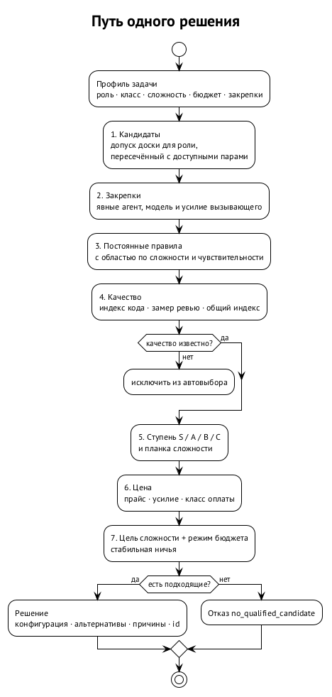
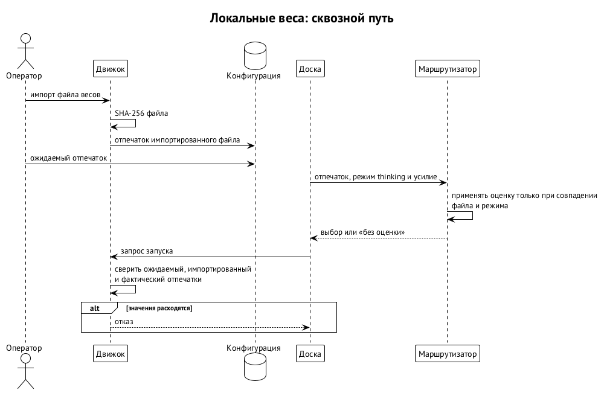

# Модели и деньги

Маршрутизатор моделей выбирает конфигурацию для конкретной работы: среду агента, модель и уровень рассуждений (effort). Он получает метки задачи и уже допущенных кандидатов, сопоставляет их с данными о качестве и ценой и возвращает выбор с объяснением. Маршрутизатор работает отдельным шагом подготовки запуска: сам он другими агентами не управляет и запросов к API провайдера не проксирует. Маршрутизатор состоит из библиотеки `curator-model-router` и CLI `cmr` версии v0.3.2.

Выбрать одно имя модели мало. Одна и та же модель с разным effort стоит и работает по-разному, а у локальных весов важны ещё конкретный файл, квантизация и режим мышления. Когда задач много, ручные правила копятся и теряют объяснение. Маршрутизатор превращает их в данные: что разрешено, какая нужна планка, откуда взята оценка и почему выбран этот кандидат.

## Четыре вопроса перед запуском

Высокая оценка пригодности отвечает только на один из четырёх вопросов, и у каждого вопроса свой владелец.

| Вопрос | Кто отвечает | Пример ограничения |
| --- | --- | --- |
| Разрешено? | доска по политике оператора | роль, допущенная пара, расписание, способ оплаты |
| Совместимо? | реестр моделей и каталог | инструменты, окно контекста, платформа, словарь effort |
| Подходит? | маршрутизатор | качество для класса и сложности задачи |
| Доступно сейчас? | предварительная проверка доски | установленная среда, квота и лимит провайдера |

Маршрутизатор ранжирует только внутри допущенного. Он ничего не запускает, ёмкости не резервирует, учётные записи и выход в сеть не переключает. Если лучшая по замеру модель запрещена проектом, оценка не вернёт её в список. Если подходящих кандидатов нет, маршрутизатор возвращает отказ. Факты держит модуль управления агентами, решение принимает маршрутизатор, исполняет доска; внутренних структур доски библиотека маршрутизатора не импортирует.

В переносимом процессе роль описывает потребности, и конкретные подписки оператора в её описание не входят. Жёсткое требование отсеивает, предпочтение задаёт порядок. Ревью может требовать другого издателя модели, чем у запуска, который произвёл работу. Независимость проверяется по записанному происхождению того запуска, и дополнительное ревью того же издателя уже нарушенного требования не восстанавливает.

Выбор ограничен пересечением политики проекта, допуска оператора, установленного на машине и потребностей роли. Личные привязки и окна доступности принадлежат оператору, и в общий проект как обещание одинакового оборудования у всех они не переносятся. Если требование не выполнено, возможны блокировка (по умолчанию), запасной путь, запрос человеку или осознанное ухудшение с дополнительным ревью. Ослабить независимость не позволяет ни один из этих путей.

## Как принимается одно решение

Текста задачи маршрутизатор не читает. Вызывающий передаёт роль, класс работы, сложность, деликатность, режим бюджета, явные закрепки и контекст правил. Сложность принимает одно из значений `trivial`, `routine`, `standard`, `hard`, `critical`; бюджет принимает `economy`, `balanced` или `burn`. Если трудную миграцию ошибочно пометить механической правкой, селектор её смысла не распознает: качество выбора ограничено качеством разметки.

Маршрутизатор проходит шаги в таком порядке:

1. собрать допущенный набор;
2. применить явные закрепки среды, модели и effort;
3. применить жёсткие правила оператора;
4. назначить оставшимся кандидатам качество по оси класса: код, ревью или общая оценка.

Явное значение вызывающего маршрутизатор не заменяет. Если основной оси нет, может использоваться замер Bug Hunt с явной отметкой. Если нет ни одного подходящего свидетельства, качество неизвестно и кандидат автоматически не выбирается.

Дальше маршрутизатор переводит качество в ступень, проверяет минимум сложности, оценивает стоимость и выбирает конфигурацию. При равенстве действует стабильный порядок. Результат содержит альтернативы, причины исключения, применённые и пропущенные правила и точные параметры запуска. Оператор видит, например, что дешёвый кандидат отпал по качеству, а более сильный отпал по допуску. Причины разные, и чинятся они по-разному.

Политика по умолчанию различает планку и цель. Планка запрещает слишком слабые конфигурации, цель выбирает среди прошедших. Таблица описывает поведение маршрутизатора.

| Сложность | Минимум | Цель в `balanced` |
| --- | --- | --- |
| `trivial` | C | дешевле |
| `routine` | B | дешевле |
| `standard` | B | дешевле; подъём до A, если цена не больше чем в 1,5 раза выше |
| `hard` | A | качество |
| `critical` | S | качество без приоритета цены |

Деликатная задача получает сильнейшую подходящую конфигурацию независимо от обычной сложности. Машинная закрепка ревьювера действует для обычной работы, а для трудной и критичной уступает планке и цели качества. Это правило политики, и его нужно отличать от явного флага вызывающего: флаг остаётся закрепкой. Конфликт закрепки с требованием не оправдывает выбора ниже планки.

`economy` выбирает самое дешёвое среди прошедших планку на любой сложности и подъёма для `standard` не делает. `balanced` следует таблице. `burn` предпочитает высшее качество, а внутри равного качества выбирает больший остаток сгорающей подписки. Во всех режимах сохраняются допуск и минимум сложности: экономный режим не опустит критичное ревью ниже S. Режим экономии включается только явным решением оператора. Автоматического выбора режима по квоте нет, значение `auto` отклоняется.

Для исследовательского параллельного поиска можно выбрать до трёх конфигураций разных семейств уровня A и выше, в `burn` до четырёх. Параллельный поиск расширяет набор независимых попыток, но правильности их общего ответа не доказывает. Сводку их результатов маршрутизатор не делает. Разные названия моделей сами по себе не гарантируют независимых ошибок.

## Что считается данными о качестве

Встроенный каталог содержит публичную базовую линию Bug Hunt Bench, закреплённую на определённой ревизии, и прайсовые цены. Часть внешних индексов перепубликовывать нельзя по условиям использования, поэтому они приходят через явно указанный локальный оверлей оператора. Маршрутизатор отклоняет неизвестную конфигурацию или неверный формат оверлея. Неявного поиска такого файла нет, а запись решения сохраняет его содержимое и канонический дайджест.

Замер относится к точной конфигурации: модели, effort и среде. Оценка на `max` не становится оценкой на `high` только из-за одинакового имени. Перенос оценки возможен как отдельно помеченный вид свидетельства, с неопределённостью и правилом переноса. Репутация семейства моделей даёт лишь предварительное мнение; конкретный запуск оценивают по его собственным замерам. Перепечатки одного результата независимыми подтверждениями не являются.

Собственные свидетельства дополняют каталог. Маршрутизатор импортирует Bug Hunt и прогоны `evalrun`, а человеческие заметки показывает отдельно и в оценку не включает. Наблюдение связывает конфигурацию, набор задач, протокол, метрику, число прогонов, неопределённость, происхождение и дату. Вид наблюдения и способ оценки различаются: результат LLM-судьи может быть замером, но результатом исполняемого теста не становится.

Отсутствие данных удобным числом не заполняется. Нет качества, значит качество неизвестно; ноля маршрутизатор не подставляет. Нет цены, значит цена неизвестна, и бесплатной конфигурация от этого не становится. Модель не становится допущенным кандидатом оттого, что её назвали в наблюдении. Оси с разными шкалами численно не смешиваются: основная ранжируется выше запасной. Слабому свидетельству не придать вид точного рейтинга.

У публичного Bug Hunt разброс между прогонами составляет примерно 3,3 пункта. Поэтому маршрутизатор пользуется ступенями S, A, B, C; внутри ступени выбор может решить цена. Публичных замеров для многих рабочих сочетаний effort нет. Ни небольшой отрыв, ни несколько удачных ревью не доказывают превосходства конфигурации: нужны собственные исходы и контрольный набор.

## Кто разрешает тратить деньги

Маршрутизатор различает три способа оплаты: подписку (`subscription`), локальный запуск (`local`) и оплату по токенам (`metered`). Автоматический выбор без личного разрешения оператора `metered` не берёт, а неизвестный способ оплаты считается `metered`. Проект может сужать способы оплаты, но не может дать согласие тратить деньги владельца вместо него. Расширение допуска требует подтверждения с присутствием человека, сужение применяется сразу.

Расширением допуска считаются и действия без токенов. Новая модель, новый runtime, более широкое временное окно или постоянный ответ на запрос исключения тоже расширяют допуск. Временное исключение человека относится к его запускам, ограничено поддеревом и сроком и видно на доске. Постоянный ответ применяется с учётом политики проекта, каждое применение наблюдаемо, и его регулярно подтверждают заново.

Маршрутизатор читает политику строго и целиком замораживает её. На неизвестное поле или неверное значение он отвечает отказом. Если неявного файла нет, действуют встроенные умолчания; если явно указанный файл не найден, маршрутизатор возвращает ошибку. Оператор, запросивший конкретную политику, не должен получить другую из-за опечатки в имени. Режим бюджета записывается вместе с решением и входит в его идентификатор.

Данные о квоте приходят через официальные интерфейсы сред и влияют на порядок; собственной системы резервирования у маршрутизатора нет. Неизвестный или устаревший остаток нейтрален: ни награды, ни штрафа. В `burn` свежий остаток может решить ничью по качеству в пользу подписки, которая иначе сгорит, но запрета оплаты или несовместимости модели он не отменит.

Цена одного запуска отличается от цены принятого изменения. Дешёвая модель может потребовать больше доработок и повторных ревью. Поэтому решения связываются с исходом задачи, числом раундов и расходом до приёмки. Допустимую потерю качества в режиме экономии задают данные пилота. Без этих данных экономия остаётся явным выбором оператора без обещания измеренного сокращения полной стоимости.

## Запись решения и воспроизведение

Запись сохраняет профиль задачи, закрепки, контекст правил, допущенный набор и его источник, действующий каталог, оверлей, политику, проекцию квот и результат с объяснением. Идентификатором служит SHA-256 канонического JSON. Материализованные умолчания и порядок ключей и коллекций определены канонизацией. Одинаковые замороженные входы дают тот же идентификатор; изменённый вход даёт уже другое решение.

Селектор является чистой функцией над этим снимком: без сети, чтения файлов, часов и вызовов моделей. Через месяц можно пересчитать, почему задача получила именно эту конфигурацию, даже если оверлей и квоты уже поменялись. Воспроизводится именно выбор: ответ модели при повторе может быть другим. Чтобы проверить изменение селектора, старые записи пересчитывают новой версией и смотрят на расхождения.

Отказ тоже является результатом. Маршрутизатор различает отсутствие подходящего кандидата, неверный профиль, допуск или политику, тайм-аут и сбой предварительной проверки. Ошибка не выдаётся за выбор, а старое умолчание вызывающего не выдаётся за решение маршрутизатора. Объяснение строится из структурированных причин, и его можно проверить по сохранённым входам.

## Обёртка `cmr spawn` и шов в доске

Обёртка `cmr spawn` подключает маршрутизатор вокруг обычного запуска доски:

- `select` заполняет недостающие среду, модель и effort.
- `recommend` печатает команду без запуска.
- `shadow` отдаёт доске исходные аргументы, а маршрутизатор рядом считает совет.

Все реальные запуски проходят допуск, лимиты и проверку пары доски. Обёртка передаёт вывод и код возврата доски.

Теневой режим запускает доску раньше, чем готов совет, и ограничивает время совета. Для честного сравнения он убирает пересланные закрепки вызывающего, иначе совпадение получалось бы по построению. Ошибка совета основной запуск не останавливает, записывается отдельно и согласием не считается. Если доска вернулась раньше, недосчитанный совет может завершиться отдельным ограниченным по времени процессом, без повторного запуска задачи.

Наблюдения отличают точное совпадение от другой модели, другого effort или другой среды. Если вызывающий не указал полной конфигурации и доска выбрала умолчание, сравнение не установлено. Отсутствие совета считается отдельным исходом. Теневой отчёт показывает все эти случаи, иначе высокий процент согласия мог бы скрывать ошибку измерения. Переключению на автоматический выбор предшествует неделя наблюдений; готовность обёртки пригодных данных не заменяет.

Шов встраивает маршрутизатор прямо в точку выбора `task-board spawn` и имеет три режима:

- `off` сохраняет прежнее поведение.
- `shadow` оставляет выбор прежнему механизму.
- `select` заменяет умолчания порядком маршрутизатора.

Явные флаги вызывающего обходят маршрутизатор. При ошибке возможен возврат к прежнему механизму с отметкой происхождения решения. Каждый кандидат всё равно проходит допуск и подтверждения.

Библиотечная граница позволяет подключать других вызывающих. Им нужны профиль задачи, допущенные кандидаты, применение результата и сохранённая связь решения с запуском. Swarma Curator разрешает окружение и закрепки, затем обращается к маршрутизатору и отдельно проверяет доступность. Пул удалённых работников добавляет к конфигурации предложение и совместимое размещение, а резервирует размещение координатор.

## Локальные модели: имя не удостоверяет веса

Оценка локальной модели привязана к SHA-256 файла весов, режиму мышления и точному effort. Один и тот же файл сохраняет отпечаток, где бы он ни лежал, а у Q4 и Q8 отпечатки разные. Первый контракт охватывает один неразбитый GGUF, включая токенизатор и встроенный шаблон чата. Для каждой локальной модели обязательна закрепка ожидаемого отпечатка.

Маршрутизатор применяет оценку только при совпадении файла и режима. Неоценённые веса автоматически не выбираются, но явная полная закрепка может вернуть их с пометкой "без оценки". Замер конкретного файла на той же оси и области задач важнее переноса с базовой модели. Перенос учитывает коэффициент квантизации и расширенную неопределённость, но собственного эксперимента коэффициент не заменяет.

Сквозной путь локальных весов устроен так: движок фиксирует отпечаток при импорте, пересчитывает его по открытому файлу перед запуском и сверяет ожидаемое, импортированное и фактическое значения. Тройку через доску передаёт движок. Маршрутизатор строго проверяет оценку, а движок и доска отвечают за свои сопряжённые части пути.

Пример. Оператор заменил файл под прежним именем модели, оставив оценку и закрепку старых весов. Маршрутизатор не перенесёт оценку на новый отпечаток, а движок обнаружит расхождение фактического файла до исполнения. Это две разные границы: первая защищает смысл оценки, вторая защищает соответствие запуска разрешённым весам.

Локальный профиль запуска не гарантирует доступности. Проект может назвать профиль, но сопоставляет его своему движку и временному окну конкретный оператор, и у другого оператора соответствия может не быть. Доступность движка делится на готовность сейчас и возможность подготовить его; ни то, ни другое подходящего качества не обещает. Маршрутизатор выбирает после разрешения этих ограничений, а поддержание движка и резервирование остаются обязанностями соседних компонентов.

## Почему выбор детерминирован

Маршрутизатор не вызывает LLM для выбора: одинаковые метки, кандидаты, данные и политика дают одинаковый результат. Токенов на ещё одного управляющего агента детерминированный выбор не требует, а аудит и сравнение версий становятся возможны. Текст задачи не уговорит селектор выбрать запрещённую модель, потому что селектор его не читает. Неверная разметка или слабые данные остаются слабым входом: детерминизм не делает их истинными.

Оценщик задачи читает текст и выдаёт типизированные требования. Бэкенд оценщика явно задаёт политика; это может быть модель решений Jev или небольшая LLM со строгой схемой. Ответ оценщика замораживается, а дальше работает прежний чистый селектор. Уверенность классификатора, покрытие свидетельствами и калибровка различаются; уверенность не равна вероятности успеха агента. Такая подготовка является явно платной операцией с раздельными кэшами и границами данных проектов.

Оценщик заполняет недостающие метки автоматически только после того, как накоплены исходы, его метки сравнены с метками оркестратора в тени и проверено, снижается ли стоимость приёмки. Явные метки сохраняют приоритет. Автоматический выбор по честным меткам работает без обучаемого маршрутизатора.
