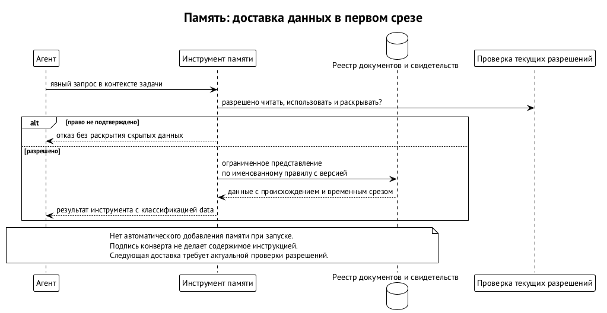

# Память агентов

Память агента должна переживать замену исполнителя: сохранять основания решений, историю их пересмотра и разрешённый опыт. Например, новый агент продолжает работу над архитектурой и находит старое правило «архивировать дом агента по умолчанию». Позже владелец заменил его правилом «при выводе агента из работы удалять дом»: отсутствие секретов в содержимом дома нельзя гарантировать. Обычный поиск может вернуть обе формулировки. От памяти требуется показать действующее решение, его источник и зарегистрированные документы, которые ещё опираются на прежнее правило. ⟦предложено⟧

Для этого предлагается **ограниченная доказательная память** — bounded evidence memory. Она хранит типизированные утверждения вместе с источниками, обоснованиями, оценками и ревизиями. Её вопрос: какие допущенные свидетельства поддерживают или опровергают конкретное утверждение, с чьей точки зрения и на какой момент? Память не устанавливает истину, не принимает решения за владельца и не выдаёт полномочия. Пустой ответ не доказывает ложность утверждения. ⟦предложено⟧

На октябрь 2026 года это устройство в проработке: реализации и измеренного выигрыша ещё нет. Выбран переносимый смысловой контракт и ядро, а первая реализация и проверка пользы должны пройти внутри Swarma. Первый сценарий — непрерывность архитектурных решений. Личная память, извлечение из журналов, консолидация и модели других агентов придут позже поверх ядра, без расширения его полномочий. ⟦решено⟧

## Что принадлежит памяти

Память ведёт историю собственных утверждений и ревизий. Внешние события она связывает с авторитетными журналами по точной ревизии, сохраняя различие между событием и утверждением о нём. Если агент написал «результат принят», это ещё не запись о приёмке: нужен источник от компонента, которому принадлежит такое решение. Собственного общего журнала вместо журналов остальных модулей у памяти нет. ⟦предложено⟧

Границы ответственности предлагаются такими: ⟦предложено⟧

| Сведения | Где остаётся авторитет | Что получает память |
| --- | --- | --- |
| Поколение учётки и её вывод из работы | Менеджер пользователей (`swarma-user-manager`) | Версионированное свидетельство, которое не заменяет текущую проверку |
| Учётные данные, гранты и отзывы | Брокер учётных данных (`swarma-credential-broker`) и владельцы политики | Ссылки без секретов и второго реестра прав |
| Размещение и исполнение | Диспетчер (`swarma-dispatcher`) | Ссылку на каноническую запись исполнения |
| Журнал и доставка в сессию | Хост сессий (`agent-session-host`) | Допущенный экспорт для чтения, без доступа ко вводу |
| Цель, состояние задачи и принятый кандидат | Доска задач | Точную ревизию, без права менять задачу или принимать результат |
| Обязательства и эскалация | Swarm Keeper в целевом устройстве | Свидетельства, без второго реестра обязательств |
| Профили, скиллы и инструкции | Swarm Curator | Сведения о конфигурации, без права её исправлять |

Так, воспоминание о вчерашнем гранте не разрешает сегодняшнее действие, а заметка «мы обычно пользуемся этим инструментом» не устанавливает инструмент и не меняет профиль запуска. Изменение основания может дать повод для ревью; открыть работу и принять её результат должен уполномоченный потребитель. Остановка, парковка, отзыв прав, восстановление и приёмка никогда не должны ждать обхода памяти или консолидации моделью. ⟦предложено⟧

## Пять видов записей

Ядро предлагается построить на пяти видах неизменяемых версий записей. Это смысловая модель, а не опубликованный формат обмена. ⟦предложено⟧

| Запись | Назначение | Пример и предел |
| --- | --- | --- |
| **Утверждение** — Assertion | Типизированное высказывание о субъекте, с точкой зрения и временем действия | «При выводе дом удаляется»; запись о решении требует квитанции решающего |
| **Ссылка на источник** — Source reference | Система-владелец, объект, точная ревизия или позиция, доступный дайджест, происхождение и доступность | Ссылка на версию документа; сама ссылка не даёт права прочитать документ |
| **Обоснование** — Justification | Поддержка или опровержение определённой версии утверждения: источники, посылки, правило с версией | Документ служит основанием; обычный абзац рассуждений не становится исполняемым правилом |
| **Оценка** — Assessment | Результат именованной проверки с привязкой к предмету, правилу, политике и окружению | Проверка подписи подтверждает происхождение, но не истинность сказанного |
| **Ревизия** — Revision | Отношение к точной прежней версии: замена, отзыв, исправление, оспаривание или изменение доступности | Новое правило заменяет старое; прежние байты не переписываются |

У оценок различаются проверка привязки к источнику, подпись, результат теста, формальный вывод и смысловое ревью. Оценка LLM остаётся смысловым суждением и не может выдать себя за детерминированную проверку. Цитата «владелец сказал X» подтверждает авторство высказывания; для более сильного вывода нужно отдельное основание. Единой галочки «проверено», скрывающей эти различия, недостаточно. ⟦предложено⟧

У каждой записи различаются **субъект** — о ком она, **издатель** — кто отвечает за содержание, **отправитель** — кто технически внёс запись, и **точка зрения** — чью картину мира она выражает. Отправителя устанавливает аутентифицированный приём. Если он действует от имени издателя, допуск проверяет ссылку на делегирование у владельца политики. Неудачная проверка означает отказ; превращать такую попытку в собственное наблюдение отправителя нельзя. ⟦предложено⟧

Например, агент передал решение владельца и агент предположил, какое решение владелец предпочёл бы, — разные записи даже при одинаковом тексте. Это различие должно пережить выжимку, индексирование и экспорт. Личности и области политики остаются внешними ссылками: ядро не создаёт для них параллельные реестры. ⟦предложено⟧

## Как получается текущее представление

**Представление**, View, — вычисляемый ограниченный ответ, а не шестой хранимый примитив. Для него задаётся именованное правило с версией: какие издатели и точки зрения учитываются, какой выбран момент, как разрешаются последовательности версий и оценивается свежесть. Предлагаются три семейства правил: текущее состояние от издателя, модель наблюдателя и разрешённая проекция для аудитории. Чужое мнение не должно незаметно становиться самоописанием или решением владельца. ⟦предложено⟧

Содержимое утверждения подчиняется названной версионированной предметной схеме. Она определяет типы и равенство, вид высказывания, кратность значений, условия несовместимости, свежесть и ограничения раскрытия. Два интереса могут сосуществовать. Старое и новое правила могут относиться к разным интервалам времени. Два предложения ещё не являются противоречащими принятыми решениями. Неизвестная схема отклоняется; схема содержит данные, а не произвольный исполняемый код. ⟦предложено⟧

Заменить, исправить или отозвать запись в последовательности может её издатель либо допущенный представитель. Другой участник может оспорить её или записать свою оценку в собственной последовательности. Более поздняя заметка агента об архивировании дома поэтому не заменяет решение владельца об удалении. Для решения текущая версия определяется порядком авторитетного реестра, например порядком коммитов прошедшего ревью реестра решений; время поступления в память этого порядка не меняет. ⟦предложено⟧

Три результата следует различать и в API, и при показе читателю: ⟦предложено⟧

| Ситуация | Результат | Чего из него не следует |
| --- | --- | --- |
| Два представителя меняют одну ожидаемую версию | Первая запись проходит, вторая получает `version_conflict`; ничего не фиксируется второй операцией | Что знания о субъекте противоречивы |
| У решения две авторитетные замены, между которыми нет установленного порядка | Представление возвращает `ambiguous_current` и обе версии | Что позднее полученная версия победила |
| Найдены допустимые основания за и против утверждения | Конфликт свидетельств; обе стороны сохраняются | Что запись одной стороны надо отклонить |

Время действия, момент последнего подтверждения и горизонт использования без обновления тоже различаются. По истечении последнего сведения становятся `stale`: требуют обновления, но не превращаются в ложь. Для архитектурного решения горизонт свежести обычно не нужен; для местонахождения, доступности и намерения он существенен. Отсутствие опровержения не делает старое местонахождение текущим. ⟦предложено⟧

## Свидетельство и полнота поиска

Для поддержки и опровержения ответ строится независимо. По каждой полярности различаются наличие найденного свидетеля — `present` или `not_found` — и завершённость оценки — `complete` или `incomplete`. Свидетель здесь означает допустимое основание соответствующей полярности, а не гарантию истины. Если основание за удаление дома найдено, но поиск возражений прервался, можно предъявить основание; нельзя сказать «возражений нет». ⟦предложено⟧

Сочетание `not_found` и `incomplete` означает неизвестность. Недоступный источник, отсутствующие байты, незавершённый приём и исчерпание бюджета не становятся опровержением. Если найдены основания обеих полярностей, конфликт уже установлен, даже когда перебор не закончен. Усечённый показ объяснений и усечённое вычисление различаются: первое может сопровождать полную оценку, второе обязано дать `incomplete`. ⟦предложено⟧

Полнота ограничена зарегистрированным разрешённым графом на выбранный момент. Проверка всех трёх зарегистрированных оснований не доказывает, что при подготовке реестра не пропустили четвёртое в исходном документе. Поэтому покрытие исходного корпуса учитывается отдельно и может оставаться неизвестным при полной оценке. Выдача лучших совпадений поиска сама по себе не является полной проверкой свидетельств. Аналогично пересмотр охватывает зарегистрированные зависимости, а не все неявные смысловые последствия текста. ⟦предложено⟧

В первом срезе достаточно явных источников, документальных оснований, замен и связей «пересмотреть при изменении». Документ, зарегистрировавший предположение об архивировании дома, возвращается как требующий проверки. Память не объявляет его автоматически неверным: возможно, пересмотру подлежит только часть документа. Само по себе прозаическое объяснение не даёт права вычислять логические следствия. ⟦предложено⟧

Следующий срез добавляет конечные ациклические правила: внутри набора посылок — И, между альтернативными правилами — ИЛИ. Если C поддерживается через A и B либо через D и E, отзыв B выключает только первый путь. Пока второй допустим, поддержка C сохраняется. Когда отпали все пути, отрицание C из этого не выводится. Полная система сопровождения альтернативных допущений, ATMS, отложена до измеренного сценария, которому действительно нужен перебор гипотетических окружений. ⟦предложено⟧

Конфликтная посылка не должна исчезать при сокращении ответа. Если A имеет основания за и против, допущенное правило A⁺ → B⁺ может дать B квалифицированную поддержку, но не автоматическое B⁻. Представление сохраняет различие: есть путь без конфликтных посылок; поддержка найдена только через них; вопрос проверен не полностью. Можно ли действовать на таком основании, решает потребитель. ⟦предложено⟧

## Сначала документальный реестр

Первым выбран документальный профиль: реестр явно допущенных нечувствительных записей в git, обычное ревью репозитория и адаптер только для чтения. Агенты готовят предложения, человек принимает записи. Внешние факты остаются на карантине до этого ревью. Принятие записи в память не даёт ревьюверу права объявить чужое решение принятым: для этого всё равно требуется квитанция того, кто решал. ⟦решено⟧

Рабочее правило допуска простое: если содержимое не положили бы в README репозитория, ему не место в реестре. Явно допущенные нечувствительные выдержки разрешены с отдельным основанием хранения; чувствительные пересказы в git не попадают. История git удобна для воспроизводимости обоснования в выбранных границах хранения, но не служит механизмом стирания частных данных. Реальные личные профили этот реестр не принимает. ⟦решено⟧

Автоматического приёма сырых журналов сессий в первой версии нет. Отдельный инструмент может предлагать записи из уже допущенных документов, но его выход проходит то же ревью. Автоматизация отдельных классов допуска рассматривается после пилота по измеренной стоимости сопровождения. ⟦решено⟧

Допуск предполагает явно названные классы источников и цель хранения. Корректная схема, хэш, подпись, влитый коммит или фильтр LLM не доказывают отсутствия секретов. Начальный корпус исключает личную память, сырые разговоры, учётные данные и произвольный вывод инструментов. ⟦предложено⟧

Защищённая служба нужна только по конкретной причине: допущены частные данные, требуется автономная запись без ревью каждого изменения или появилась измеренная нагрузка. Её строительство привязано к отдельному пользователю ОС и посреднику, а развёртывание требует собственного контракта допуска. Создавать службу ради архитектурной полноты не предполагается. ⟦решено⟧

Для такого профиля предложена одна непривилегированная служба с единственным писателем. Ей нужны закрытое состояние, единственный API записи, права на сокет, проверка UID собеседника и поколения учётки, удостоверенная личность сервера, явно допущенные роли клиентов, собственные правила выхода в сеть и проверка готовности. Одно имя служебной учётки этих гарантий не даёт. Прохождение смысловых тестов документального профиля также не доказывает изоляцию защищённой службы. ⟦предложено⟧

## Данные для агента, без веса инструкций

В первом срезе агент получает память только явным результатом инструмента. Автоматического добавления памяти при запуске нет. Пакет знаний отделяется от авторитетной текущей задачи и от пакета продолжения хоста сессий. У каждого элемента при пересказе, кэшировании и передаче должны сохраняться происхождение и классификация `data`. Подпись службы удостоверяет конверт, но не повышает полномочия вложенного текста. ⟦предложено⟧

Для более позднего снимка в начале сессии канал уже выбран: отдельный блок данных с происхождением каждого элемента и пометкой `data`. Память не включается в оверлей Swarm Curator, `AGENTS.md`, корень скилла или машинный базовый контекст. Низкий вес оверлея только меняет порядок инструкций и не превращает их в данные; у памяти веса инструкций нет вовсе. ⟦решено⟧

Снимок неизменяем как исторический артефакт своего временного среза. Если решение обновилось, старый снимок остаётся историей, а текущее состояние получают свежим запросом. Если же отозвано использование или раскрытие, перед следующей доставкой или внешним эффектом ответственный компонент применяет текущую политику: отказывает либо пересобирает допущенный контекст. Память сообщает изменение, но сама не перезапускает агента. Кэш промпта не продлевает разрешений. ⟦предложено⟧

Чтение, использование в задаче, хранение и дальнейшая передача требуют отдельных разрешений. Представление для одной задачи не разрешено автоматически другой задаче или восстановленному исполнению. Перед разрешением источника и новой доставкой права проверяются заново. В частности, право читать локально не разрешает отправить байты провайдеру LLM или эмбеддингов. ⟦предложено⟧

Пометка `data` не гарантирует, что модель не последует вредоносному тексту. Обещание здесь — сохранение происхождения и внешних проверок полномочий, а не безошибочность LLM. Скрытые записи не должны менять раскрытые статусы, счётчики, ранжирование, курсоры, покрытие и уведомления. Даже логический бюджет должен учитывать только разрешённую работу: иначе большое число скрытых узлов выдаст себя переходом к `incomplete`. Постоянного времени ответа и защиты от анализа трафика этот контракт не обещает. ⟦предложено⟧

## Происхождение содержимого и стирание

Логическая поддержка и происхождение содержимого — разные связи. Выжимка может пересказать частную запись, не используя её как посылку вывода. Поэтому отдельная линия происхождения и хранения должна охватывать выдержки, пересказы, эмбеддинги, индексы, кэши, контролируемые экспорты, очереди и диагностику. Производная запись наследует ограничения раскрытия всех входов; метка «публично» их не снимает. ⟦предложено⟧

Список цитат от агента не является полным происхождением. Если модель получила приватный вход и публичный документ, но сослалась только на документ, приватный вход не исчез. Интеграция учитывает контролируемые входы: для детерминированного преобразования — прочитанные данные, для вызова модели — переданные контекст, результаты инструментов и представления памяти. Неустановленное происхождение не считается публичным по умолчанию. Обещание ограничено отслеживанием конкретного профиля интеграции, а не всем, что модель когда-либо знала. ⟦предложено⟧

Раскрыть результат над закрытыми входами может разрешить владелец политики каждого ограниченного входа. Например, разрешение опубликовать город из приватных координат не разрешает сами координаты. Оценка фиксирует свидетельство этого решения с привязкой к входам, преобразованию, выходной схеме, аудитории и цели; она не создаёт полномочие и не заменяет проверку перед новым раскрытием. Мнение модели о безопасности пересказа только предлагает такое решение. ⟦предложено⟧

В защищённой службе чувствительное содержимое предполагается хранить в стираемых объектах отдельно от логической истории. Стирание сначала ограждает чтение и фиксацию производных затронутого поколения, чтобы поздний извлекатель не вернул удалённое. Исходы должны различать закрытый доступ, ожидающую очистку, очистку в названной границе и недоступность. Восстановление старой копии остаётся закрытым до сверки с актуальными обязательствами стирания у свидетеля вне восстановленного домена отказа. ⟦предложено⟧

Недоступный источник не изображается только что проверенным. Представление различает доступные сейчас байты, сохранившуюся прежнюю оценку и самостоятельную достаточную аттестацию. Нельзя заявить удаление у независимого владельца без его пути удаления и квитанции; уже доставленные внешней модели байты вернуть нельзя. Какие классы источников должны оставаться предъявимыми и как долго — ещё предстоит определить. ⟦открыто⟧

## Профили и память об участниках

В дизайн включён второй сценарий: типизированные представления о людях и автономных агентах. Он проверяет общность ядра, но не добавляет в него сущности человека, профиля, намерения или каталога. Профили и поиск полезных связей — предметный пакет и сервисы над ядром. Пилот остаётся на архитектурных решениях, а проверка профилей начинается с синтетического корпуса. ⟦решено⟧

Например, агент заметил интерес владельца к теме. Это его модель наблюдателя; переданное по полномочию самоописание владельца — другое утверждение. Заявленная компетенция отличается от опыта конкретных работ, ссылка на аккаунт — от проверенного контроля аккаунта, намерение — от обязательства. История успешного ревью хранится вместе с конфигурацией исполнения, но вывод «этому агенту можно доверить следующую работу» остаётся решением потребителя (глава «Аттестации и переносимая репутация»). ⟦предложено⟧

Память строит разрешённую проекцию для аудитории; отдельный издатель выпускает карточку, каталог хранит публикацию, чужая память импортирует её как внешний источник. Одна самодекларация, прошедшая через три каталога, остаётся одним корневым свидетельством. Без проверки текущей версии у издателя, известных замен и срока свежести импортёр знает лишь последнее полученное состояние. Публикация имеет собственные идентификаторы; связь профессионального и личного представлений тоже требует разрешения на раскрытие. ⟦предложено⟧

Изменить утверждение, отозвать дальнейшее раскрытие, снять публикацию и стереть содержимое — четыре разных действия. Владелец своей проекции может убрать из неё чужую аттестацию, не отзывая исходную запись её издателя. Контакты и знакомства остаются предметным слоем: по умолчанию нет точного публичного местонахождения, контакты раскрываются после взаимного согласия, романтический режим требует явного согласия взрослых участников и не выводится из статуса отношений. ⟦предложено⟧

## Что отложено и как проверять пользу

В первую версию не входят полный ATMS, общий Datalog, доказательство теорем, автоматические ревью, активация процедурной памяти, расписание снов, федерация, консенсус и якорение в Swarm Chain. Из прежней идеи лестницы выжимок сохраняется требование ссылаться на пересказываемое и соблюдать ограничения производных данных. Детерминированный дистиллятор журналов и извлечение моделью отложены до подтверждения пользы пилота. ⟦предложено⟧

«Сон» — предлагаемая репетиция процесса без реальных внешних эффектов — образует отдельный контекст свидетельств. Смоделированная приёмка или результат теста не удовлетворяют требованию реального исполнения. Выжимка такой репетиции подтверждает только репетицию и остаётся на карантине до ревью человеком. Сон не является способом автоматически пополнить принятую память. ⟦предложено⟧

Следующий шаг — единый пакет нормативного текста, закрытых схем и исполняемых векторов соответствия. Его форма выбрана; смысловые проверки ядра и проверки защищённого развёртывания должны отчитываться раздельно. Переносимость означает эквивалентный смысловой результат при одинаковых корпусе, версиях схем и правил, точке зрения, разрешённой проекции, моменте оценки и логическом бюджете. Случайные непрозрачные идентификаторы допускают оговорённую нормализацию. ⟦предложено⟧

Конкретные схемы, канонические байты и дайджесты, грамматика правил, словарь авторизации и машинно-читаемые проверочные примеры ещё не опубликованы как закрытый пакет. Предложенные правила требуют исполнения: поздно полученное старое решение не становится текущим, неполный поиск не объявляется полным, скрытые данные не меняют разрешённый ответ, отзыв раскрытия действует после создания снимка. Проверки должны также ловить потерю квалификации конфликтной посылки и подмену происхождения списком цитат. ⟦открыто⟧

Предлагаемый пилот охватывает 10–30 решений с точными ревизиями источников, включая замену архивирования дома удалением. Сравнение идёт с обычным поиском и типизированными версионированными документами при одинаковых правах и вопросах. Измеряются правильность текущего решения и источника, устаревшие ответы, точность свидетельств, пропущенные зарегистрированные зависимости, ложные призывы к пересмотру, время ответа и повторное чтение. Отказы и исчерпание бюджета остаются в знаменателе. ⟦предложено⟧

Отдельно учитываются стоимость подготовки и ревью корпуса, задержка актуализации и результат рабочей задачи: не вернул ли новый агент отменённое решение и заметил ли затронутые зависимости. Иначе улучшение от ручной уборки документов легко приписать движку. Автоматическое извлечение и более богатый вывод оправданы только измеренным улучшением без ослабления границ; численной победы у памяти пока нет. ⟦предложено⟧
