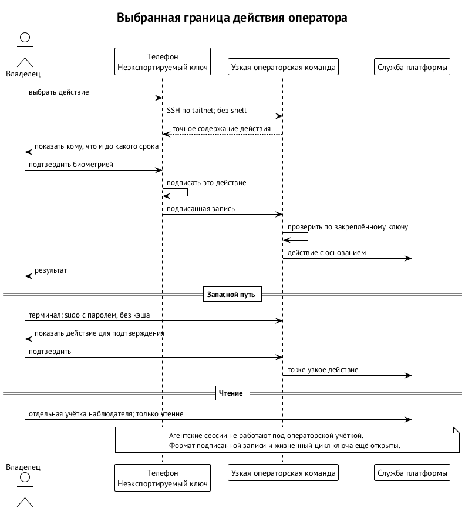

# Оператор и интерфейсы

**Оператор** — человек, который допускает работу платформы, выдаёт полномочия и вмешивается там, где агенту нельзя решать за владельца. Взаимодействовать ему нужно по-разному: посмотреть ход работы, поговорить с агентом, одобрить конкретное действие, выдать постоянное право, остановить систему. Эти действия остаются разными, нажал ли человек кнопку на телефоне или набрал команду в терминале.

Интерфейс проверку полномочий не заменяет. Чат удобен для обсуждения, терминал — для работы со средой, телефон с защищённым ключом — для подтверждения присутствующим человеком. Сообщение в комнате и подпись над точным действием значат разное. Иначе доступ к переписке превратился бы в право менять правила, по которым работает рой.

## Работающие входы

Сегодня основные инструменты — `task-board` и `curator`. Доска хранит задачи, цели и ресурсы, запускает дочерние исполнения, управляет доставкой изменений и даёт вход к сессиям. Swarma Curator ставит и проверяет окружение агента, управляет профилями и запускает среду через провайдер `curator-run`. Обёртки `anthropic-board` и `openai-board` ведут к сессиям доски.

| Инструмент | Что через него доступно сегодня |
| --- | --- |
| `task-board` | запросы и мутации данных `q`, `m`; поиск, дерево, план, ресурсы и цели |
| `task-board spawn` | дочерние исполнения |
| `task-board worktree`, `board commit`, `board publish` | рабочие деревья и доставка изменений |
| `task-board claude`, `task-board codex`, `session` | запуск, подключение и операции с сессиями |
| `curator` | `init`, `add`, `install`, `status`, профили и окружения, `audit`, `run` |

Таблица описывает входы, которые работают сейчас. `task-board session` не означает, что служба хоста сессий уже отделена от доски: вынос сначала сохраняет существующие команды и поведение. Изоляция пользователей и новый жизненный цикл сессии — в главе «Запуск агента и хост сессий».

## Куда идёт CLI

Аудитории разделены:

- Swarma Keeper — повседневный вход человека;
- `curator` — установка и настройка машины;
- `task-board` — ядро для агентов, таймера, мостов и самого кипера.

Незнакомое существительное у `curator` передаётся провайдеру `curator-<существительное>`: так к общему входу подключаются команды кипера, памяти, доверия, почты, парковки и стопа. Здесь описана форма этих команд, а точный синтаксис задают спецификации модулей.

Порядок — существительное, затем глагол. Один словарь различает просмотр (`list`, `show`, `status`), изменение настройки (`set`, `unset`), проверку и объяснение (`check`, `explain`). Особенно важно не смешивать три вида человеческого решения:

- подтвердить версию конфигурации — `confirm`;
- одобрить ожидающий пункт — `approve`, `reject`;
- выдать или отозвать постоянное право — `grant`, `revoke`.

Пример. Оператор один раз разрешил конкретный запрос среды. Это одобрение не становится бессрочным правом на все будущие запросы. А выданный грант действует до своих ограничений и отзыва, даже когда диалог давно закрыт. Точное различие полномочий задаёт контракт действия; интерфейс показывает его явно. Расширяющие действия требуют присутствующего подтверждения точного содержимого — это правило платформы.

У слова `profile` одно значение — профиль Swarma Curator, а агентская среда везде называется одинаково. Управление сессиями собирается в `curator session`, а кипер его оборачивает; перенос команд и судьба существующих обёрток согласуются с выносом хоста сессий. Для общего стопа предусмотрена ровно одна команда.

## Каналы для разговора и наблюдения

Первый интерфейс — терминал. Подключение показывает среду как она есть, а выход клиента оставляет сессию работать. Просмотр и управление различимы: наблюдение за выводом не даёт права печатать во ввод. Мессенджеры подключаются через провайдеры моста и позволяют спросить или ответить, но обычное сообщение в канале одобрением не становится.

Подписанный путь сообщения описан в главе «Путь сообщения и мост». Оператору важно, что учётка в Matrix и присутствие в комнате не дают автоматически `session.input`, `session.approve` или `session.control`. Подписывающее клиентское приложение передаёт соответствующее типизированное действие, а провайдер и хост сессий проверяют его независимо от того, как обычный клиент показал текст.

Пример. Человек с телефона просит агента проверить изменение. Подпись едет в метаданных, ворота проверяют ключ и грант, guard сверяет просьбу, хост сессий доставляет звонок, и агент читает текст и результат проверки из ящика. Неподписанный текст остаётся данными: имя человека, видимое в клиенте мессенджера, криптографического подтверждения не заменяет.

## Телефон оператора

Приложение-компаньон показывает точное действие и подписывает его ключом в защищённом чипе телефона, когда человек подтвердил присутствие. Первая платформа — iOS; работа над приложением ещё не начата. Настольный пульт и shell по SSH появятся позже, и смешивать их с ограниченным операторским входом для подписи действия нельзя.

Правило расширяющих действий действует с первого этапа платформы. Показа точного содержимого требуют:

- выдача гранта;
- подключение подписки;
- постоянная команда;
- вывод или пересоздание постоянного агента;
- полномочия на остановку для обслуживания;
- продление постоянных грантов.

Оператор подписывает телефоном либо подтверждает паролем в терминале. Изнутри сессии агента такое действие не принимается, а старое подтверждение будущих изменений не разрешает.

Телефонный путь — SSH через tailnet в учётку `swarma-operator`. Shell у неё нет, только операторская команда. Порядок такой:

1. Команда выдаёт каноническое содержимое действия.
2. Приложение показывает получателя, действия, аккаунты, профили и срок.
3. Человек подтверждает биометрией, и телефон подписывает именно эту запись.
4. Команда сверяет подпись с закреплённым ключом телефона и передаёт действие брокеру.

Подпись одного действия для другого не годится. Ключ телефона регистрируется QR-сопряжением, второе устройство — резервный ключ FIDO2 или второй телефон — обязательно; подробно — в главе «Ключи и ключник».

Пример. Новому оркестратору нужен грант на запуск агентов. Оператор видит, кому он выдаёт право и какими профилями и сроком оно ограничено, и после подписи запрос уходит брокеру. Вечером оператор отзывает грант отдельным действием, и брокер записывает отзыв на диск до ответа. Отзыв — одно касание с биометрией.

Без телефона работает терминальный вход: `sudo` в `swarma-operator` с паролем без кэша и тем же подтверждением содержимого. Для просмотра выданных прав и привязок есть учётка `swarma-observer`, без подтверждений. Агентских сессий нет ни в одной из этих учёток. Пока граница пользователей ОС цела, инъекция в агента подписи владельца из них не получит. От компрометации ядра или самого устройства подписи это не защищает.

Наблюдатель нужен, чтобы оператор сначала выяснил состояние и только потом решил, что менять. Действующий грант и привязку аккаунта можно увидеть, ничего не выдавая. А продление гранта уже требует присутствующего подтверждения: прочитанное состояние — не разрешение на изменение. Разделение одинаково при входе с телефона и из терминала, и удобный интерфейс не превращает наблюдение в неявную подпись.

Человек может делегировать свой шаг оркестратору с потолком и сроком — например, разрешить одобрять заказы в пределах суммы. Право менять сами правила так не передаётся. Телефон — независимая точка подтверждения там, где возможности системы действительно расширяются; для чтения и обычных сообщений он не нужен. Гранты и делегирование — в главе «Гранты и полномочия».

Если среда разлогинилась у провайдера, повторный вход ведёт брокер: хост паркует сессию, брокер шлёт владельцу аккаунта на телефон ссылку входа, после входа выдаёт новую аренду, и хост возобновляет сессию.

## Несколько машин и людей

Рост за пределы одной машины не создаёт второго главного оркестратора над той же доской. Направлений четыре, и в каждом место исполнения отделено от владельца полномочий:

| Направление | Как сохраняется координация |
| --- | --- |
| Один проект на нескольких машинах | одна доска и главный оркестратор на машине-владельце; другие машины исполняют подзадачи через подоркестраторов по аренде |
| Несколько проектов одного владельца | один Swarma Keeper координирует остальные через подписанные сообщения: получает отчёты и направляет запросы |
| Несколько операторов | каждый оператор — самостоятельный подписант; для чувствительных действий — подтверждения M из N |
| Агенты других владельцев | допуск по разрешённым ключам, подписям и аренде области работы |

Реализации у этих направлений пока нет.

Каждая машина сама проверяет подписанное подтверждение; заявления другой машины, что конфигурация одобрена, мало. Транспорт может быть tailnet, другой сетью или ретранслятором со сквозным шифрованием: он узнаёт машину, но не определяет, что ей можно. Смена сети не меняет корня доверия и права на действие.

Для оператора это одно действие подтверждения, которое каждая машина проверяет сама. В реестре проекта хранятся постоянный идентификатор и машина-владелец. Кипер говорит с оркестраторами подписанными сообщениями даже локально: при добавлении машины меняется только носитель. Координация нескольких киперов не делает ни одного из них неограниченным владельцем чужих полномочий.

Общему состоянию нужно общее хранилище аренд. Пока его нет, периодический `tick` общей доски выполняется на одной машине, а делегирование с бюджетом на доске нескольких машин запрещено. Вторая машина с доступом к репозиторию не получает права независимо распределять тот же бюджет. Способ перевозки сообщений не отменяет необходимости одного согласованного решения о таком расходе.

Запуск на другой своей машине — не нативное возобновление. Целевая машина получает запрос с профилем и пином, сама собирает план и отказывает при несовпадении пина. Контекст переносится пересборкой из пакета передачи; контракт удалённого запуска пишется. Удалённый работник другого владельца — другой путь, разобранный в главе «Удалённое рабочее место».

Публичный ключ участника и локальный допуск сами по себе ещё не переносимая репутация. Связь личности агента, аттестаций и Swarma Chain описана в главах «Идентичность агента» и «Аттестации и переносимая репутация». Даже накопленная история удачных работ не заменяет локального решения, какие права выдать пришедшему агенту.

## Конструктор процессов

Визуального конструктора процессов пока нет, но формат к нему готов: схема `Playbook.json` содержит блоки `ui`, читается и пишется без потерь, а после каждой правки проверяется `playbook validate`. Пульт не обходит проверку ядра ради удобства редактирования.
