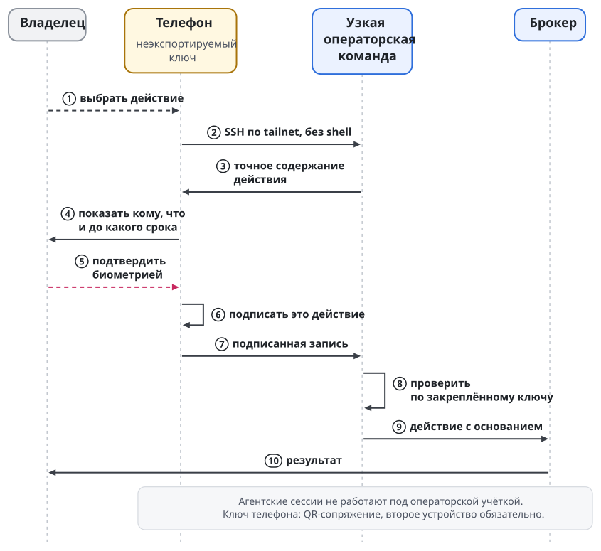
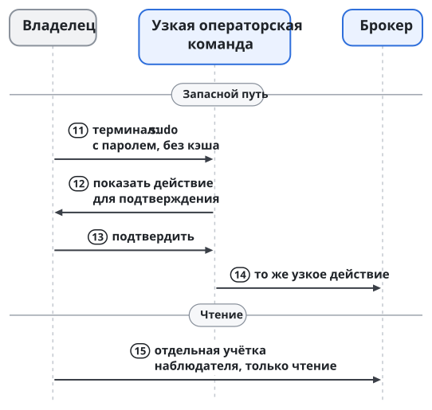

# Оператор и интерфейсы

**Оператором** называется человек, который допускает работу платформы, выдаёт полномочия и вмешивается там, где агенту нельзя решать за владельца. Взаимодействовать ему нужно по-разному: посмотреть ход работы, поговорить с агентом, одобрить конкретное действие, выдать постоянное право, остановить систему. Эти действия остаются разными, нажал ли человек кнопку на телефоне или набрал команду в терминале.

Интерфейс проверку полномочий не заменяет. Чат удобен для обсуждения, терминал удобен для работы со средой, телефон с защищённым ключом служит для подтверждения присутствующим человеком. Сообщение в комнате и подпись над точным действием значат разное. Иначе доступ к переписке превратился бы в право менять правила, по которым работает рой.

## Основные входы

Основные инструменты оператора и агентов называются `task-board` и `curator`. Доска хранит задачи, цели и ресурсы, запускает дочерние исполнения, управляет доставкой изменений и даёт вход к сессиям. Swarma Curator ставит и проверяет окружение агента, управляет профилями и запускает среду через провайдер `curator-run`. Обёртки `anthropic-board` и `openai-board` ведут к сессиям доски.

| Инструмент | Что через него доступно |
| --- | --- |
| `task-board` | запросы и мутации данных `q`, `m`; поиск, дерево, план, ресурсы и цели |
| `task-board spawn` | дочерние исполнения |
| `task-board worktree`, `board commit`, `board publish` | рабочие деревья и доставка изменений |
| `task-board claude`, `task-board codex`, `session` | запуск, подключение и операции с сессиями |
| `curator` | `init`, `add`, `install`, `status`, профили и окружения, `audit`, `run` |

Хост сессий работает отдельной службой, и доска обращается к нему как клиент. Изоляция пользователей и жизненный цикл сессии описаны в главе "Запуск агента и хост сессий".

## Устройство CLI

Три входа разделены по аудиториям:

- Swarma Keeper служит повседневным входом человека.
- `curator` служит для установки и настройки машины.
- `task-board` служит ядром для агентов, таймера, мостов и самого кипера.

Незнакомое существительное у `curator` передаётся провайдеру `curator-<существительное>`: так к общему входу подключаются команды кипера, памяти, доверия, почты, парковки и стопа. Точный синтаксис этих команд задают спецификации модулей.

Команда строится по порядку: существительное, затем глагол. Один словарь различает просмотр (`list`, `show`, `status`), изменение настройки (`set`, `unset`), проверку и объяснение (`check`, `explain`). Три вида человеческого решения не смешиваются, и у каждого свои глаголы:

- `confirm` подтверждает версию конфигурации.
- `approve` и `reject` одобряют или отклоняют ожидающий пункт.
- `grant` и `revoke` выдают и отзывают постоянное право.

Пример. Оператор один раз разрешил конкретный запрос среды. Это одобрение не становится бессрочным правом на все будущие запросы. Выданный грант, напротив, действует до своих ограничений и отзыва, даже когда диалог давно закрыт. Точное различие полномочий задаёт контракт действия; интерфейс показывает его явно. По правилу платформы расширяющие действия требуют присутствующего подтверждения точного содержимого.

У слова `profile` одно значение: профиль Swarma Curator. Агентская среда везде называется одинаково. Управление сессиями собрано в `curator session`, а кипер его оборачивает. Для общего стопа предусмотрена ровно одна команда.

## Каналы для разговора и наблюдения

Первым интерфейсом служит терминал. Подключение показывает среду как она есть, а выход клиента оставляет сессию работать. Просмотр и управление различимы: наблюдение за выводом не даёт права печатать во ввод. Носитель подключается через провайдер моста и позволяет спросить или ответить, но обычное сообщение в канале одобрением не становится.

Подписанный путь сообщения описан в главе "Путь сообщения и мост". Оператору важно, что учётка на носителе и присутствие в комнате не дают автоматически `session.input`, `session.approve` или `session.control`. Подписывающее клиентское приложение передаёт соответствующее типизированное действие, а провайдер и хост сессий проверяют его независимо от того, как обычный клиент показал текст.

Пример. Человек с телефона просит агента проверить изменение. Подпись едет в метаданных, ворота проверяют ключ и грант, входящий конвейер guard проверяет просьбу, хост сессий доставляет звонок, и агент читает текст и результат проверки из ящика. Неподписанный текст остаётся данными: имя человека, видимое в клиенте носителя, криптографического подтверждения не заменяет.

## Телефон оператора

Приложение-компаньон показывает точное действие и подписывает его ключом в защищённом чипе телефона, когда человек подтвердил присутствие. Первой платформой приложения служит iOS. Настольный пульт и shell по SSH отделены от ограниченного операторского входа для подписи действия, и смешивать их с ним нельзя.

Показа точного содержимого требуют выдача гранта, подключение подписки, постоянная команда, вывод или пересоздание постоянного агента, полномочия на остановку для обслуживания и продление постоянных грантов. Оператор подписывает такое действие телефоном либо подтверждает паролем в терминале. Изнутри сессии агента такое действие не принимается, а старое подтверждение будущих изменений не разрешает.

Телефонный путь идёт по SSH через tailnet в учётку `swarma-operator`. Shell у этой учётки нет, есть только операторская команда. Подпись проходит четыре шага:

1. Команда выдаёт каноническое содержимое действия.
2. Приложение показывает получателя, действия, аккаунты, профили и срок.
3. Человек подтверждает биометрией, и телефон подписывает именно эту запись.
4. Команда сверяет подпись с закреплённым ключом телефона и передаёт действие брокеру.

Подпись одного действия для другого не годится. Ключ телефона регистрируется QR-сопряжением. Второе устройство обязательно: резервный ключ FIDO2 или второй телефон (глава "Ключи и ключник").

{.tall}

Пример. Новому оркестратору нужен грант на запуск агентов. Оператор видит, кому он выдаёт право и какими профилями и сроком оно ограничено, и после подписи запрос уходит брокеру. Вечером оператор отзывает грант отдельным действием, и брокер записывает отзыв на диск до ответа. Отзыв занимает одно касание с биометрией. Наблюдатель показывает режим запуска (режим без секретов у агента или режим с читаемым токеном) и отдельно состояние сдерживания: отзыв у брокера, закрытие использований в шлюзе учётных данных и службе действий, блокировку аккаунта и судьбу токена у провайдера. Отзыв у брокера не означает, что токен недействителен у провайдера (глава "Учётные данные и логины").

Без телефона работает терминальный вход: `sudo` в `swarma-operator` с паролем без кэша и тем же подтверждением содержимого. Для просмотра выданных прав и привязок есть учётка `swarma-observer`, без подтверждений. Агентских сессий нет ни в одной из этих учёток. Если граница пользователей ОС цела, инъекция в агента подписи владельца из этих учёток не получит. От компрометации ядра или самого устройства подписи граница пользователей не защищает.

Наблюдатель нужен, чтобы оператор сначала выяснил состояние и только потом решил, что менять. Действующий грант и привязку аккаунта можно увидеть, ничего не выдавая. Продление гранта требует присутствующего подтверждения: прочитанное состояние изменения не разрешает. Разделение одинаково при входе с телефона и из терминала, и удобный интерфейс не превращает наблюдение в неявную подпись.

Человек может делегировать свой шаг оркестратору с потолком и сроком, например разрешить одобрять заказы в пределах суммы. Право менять сами правила так не передаётся. Телефон служит независимой точкой подтверждения там, где возможности системы действительно расширяются; для чтения и обычных сообщений он не нужен. Гранты и делегирование описаны в главе "Гранты и полномочия".

Если среда разлогинилась у провайдера, повторный вход ведёт брокер: хост паркует сессию, брокер шлёт владельцу аккаунта на телефон ссылку входа, после входа выдаёт новую аренду, и хост возобновляет сессию. Маршрут уведомления владельцу задаёт спецификация брокера, а парковку и возобновление выполняет хост сессий по своим правилам. Повторный вход блокировку аккаунта после растяжки утечки не снимает: её снимает только владелец.

## Несколько машин и людей

Рост за пределы одной машины не создаёт второго главного оркестратора над той же доской. Направлений четыре, и в каждом место исполнения отделено от владельца полномочий:

| Направление | Как сохраняется координация |
| --- | --- |
| Один проект на нескольких машинах | одна доска и главный оркестратор на машине-владельце; другие машины исполняют подзадачи через подоркестраторов по аренде |
| Несколько проектов одного владельца | один Swarma Keeper координирует остальные через подписанные сообщения: получает отчёты и направляет запросы |
| Несколько операторов | каждый оператор подписывает самостоятельно; чувствительные действия требуют подтверждений M из N |
| Агенты других владельцев | допуск по разрешённым ключам, подписям и аренде области работы |

Каждая машина сама проверяет подписанное подтверждение; заявления другой машины об одобрении конфигурации недостаточно. Транспортом может быть tailnet, другая сеть или ретранслятор со сквозным шифрованием. Транспорт узнаёт машину и не определяет, что ей можно. Смена сети не меняет корня доверия и права на действие.

Для оператора это одно действие подтверждения, которое каждая машина проверяет сама. В реестре проекта хранятся постоянный идентификатор и машина-владелец. Кипер говорит с оркестраторами подписанными сообщениями даже локально: при добавлении машины меняется только носитель. Координация нескольких киперов не делает ни одного из них неограниченным владельцем чужих полномочий.

Общему состоянию нужно общее хранилище аренд. Без него периодический `tick` общей доски выполняется на одной машине, а делегирование с бюджетом на доске нескольких машин запрещено. Вторая машина с доступом к репозиторию не получает права независимо распределять тот же бюджет. Способ перевозки сообщений не отменяет необходимости одного согласованного решения о таком расходе.

Запуск на другой своей машине отличается от нативного возобновления. Целевая машина получает запрос с профилем и пином, сама собирает план и отказывает при несовпадении пина. Контекст переносится пересборкой из пакета передачи по контракту удалённого запуска. Удалённый работник другого владельца идёт другим путём, разобранным в главе "Удалённое рабочее место".

Публичный ключ участника и локальный допуск сами по себе переносимой репутацией не являются. Связь личности агента, аттестаций и Swarma Chain описана в главах "Идентичность агента" и "Аттестации и переносимая репутация". Даже накопленная история удачных работ не заменяет локального решения, какие права выдать пришедшему агенту.

## Конструктор процессов

Визуальный конструктор процессов работает со схемой `Playbook.json`: схема содержит блоки `ui`, читается и пишется без потерь, а после каждой правки проверяется `playbook validate`. Пульт не обходит проверку ядра ради удобства редактирования.
