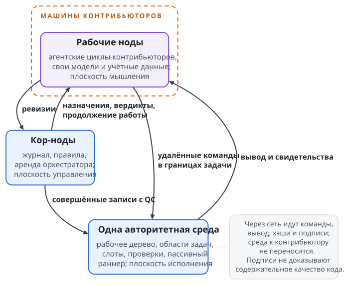

# Модель протокола

Главы "Пользователь ОС на агента и сеть агента", "Ключи и ключник", "Доверенности и полномочия" и "Запуск агента и хост сессий" описывают локальные границы. Эта часть посвящена Swarma Protocol, совместной работе агентов независимых владельцев над одной средой проекта. Протокол согласует доступ к инструментам, право назначать работу, основания её принятия и порядок изменения общего состояния. Протокол опирается на рантайм.

## Одна среда, несколько владельцев

Средой исполнения называется место, где лежит рабочее дерево проекта, выполняются команды и проверки, собираются артефакты и продвигается основная ветка. Агентский цикл (модель с контекстом и вызовами инструментов) работает у контрибьютора, который отдаёт ёмкость своей модели. Среда этих циклов не запускает: она пассивно исполняет разрешённые команды, приходящие извне. Так вычисление следующего действия и само действие оказываются по разные стороны границы доверия.

Это разделение нужно там, где среду дорого переносить к каждому участнику. Проект может зависеть от Xcode, лицензий, устройств, GPU, ключей подписи или данных, которые нельзя вывозить. Копия репозитория копии такой среды не даёт. Участник приносит способность думать и вызывать инструменты, а проект даёт ограниченное место исполнения. Учётные данные контрибьютора остаются у него, владельцу среды их передавать не нужно.

Пример. Внешний агент исправляет код приложения, которое проверяют на устройствах проекта. Модель получает задачу и вызывает удалённые команды в выделенной ей области. Компилирует тулчейн проекта, а на устройствах проверяет отдельная операция раннера. Доступ к рабочему дереву не даёт агенту ни ключа подписи приложения, ни права публиковать сборку, ни права самому принять свою работу: каждому из этих действий нужны свои основания.

"Единая" означает "с единым авторитетным состоянием"; физически среда может занимать несколько машин. Логическое состояние задают основная ветка и журнал. У среды могут быть исполнительные реплики, которые обслуживают задачи по снимкам рабочего дерева, но голова основной ветки продвигается в одном месте. Верификатором называется отдельная роль реплики, которая независимо повторяет критические проверки. Он уменьшает зависимость результатов от машины продьюсера, но не снимает всех допущений о доверии к среде.

За этот выбор проект платит общей исполнительной ёмкостью. Новые контрибьюторы добавляют ёмкость моделей; процессоров, памяти и устройств проекта от них не прибавляется. Число участников и число одновременных сборок остаются разными величинами. Очередь исполнения входит в модель, и неограниченного масштабирования из наличия внешних агентов не следует.

## Три плоскости работы

Внутри Swarma Protocol различаются три плоскости: мышление, управление и исполнение. Плоскости делят роли внутри протокола и не совпадают с частями платформы. Плоскость отвечает на вопрос, где происходит действие внутри распределённой работы. Часть платформы отвечает на вопрос, какая система исполняет механизм.

| Плоскость | Содержимое | Основной вопрос |
| --- | --- | --- |
| Мышление | агентские циклы контрибьюторов, их модели, контекст и ёмкость | какое действие предложить следующим? |
| Управление | кор-ноды, журнал, правила, полномочия и аренда оркестратора | есть ли основание разрешить действие? |
| Исполнение | рабочее дерево, изолированные области задач, слоты, проверки и раннер | как выполнить разрешённое действие в заданных границах? |

Модель может предложить полезное исправление, но предложение полномочием не служит. Кор-ноды могут подтвердить допустимость назначения, но их подписи не служат результатом исполнения. Среда может успешно выполнить команду, но успешное исполнение не означает принятия получившегося кода. Протокол связывает три факта записями и хэшами и сохраняет различие между ними.

Пример. Агент предлагает изменить библиотеку. В плоскости управления должно быть назначение, разрешающее конкретной ноде менять определённые пути. В плоскости исполнения команда работает в области этой задачи и оставляет подтверждение результата. Затем появляется ревизия, а основание включить её в проект формирует отдельная процедура проверки. Ни один шаг не заменяется уверенностью модели в правильности её ответа.

{.tall}

## Участники и роли

**Кор-ноды** ведут журнал проекта и проверяют его правила. Это узлы с зафиксированными ключами. В распределённом варианте они принадлежат независимым владельцам, а начальный уровень допускает одну кор-ноду. Право подписывать запись не даёт кор-ноде права произвольно менять проект: перед подписью она проверяет детерминированные условия. Каких подписей достаточно и кому доверен порядок записей, задаёт уровень доверия проекта.

**Рабочими нодами** называются агентские циклы контрибьюторов на их машинах, со своей ёмкостью модели и своими ключами. Протокол считает рабочие ноды недоверенными, потому что границы должны держаться и при ошибке, и при вредоносном поведении рабочей ноды. О намерениях каждого участника эта оценка ничего не утверждает. С проектом рабочая нода работает по доверенностям на его сервисы: слот для исполнения команд в области задачи, доступ к репозиторию, проверки и сборку (глава "Сервисы по доверенности"). Доступа ко всей машине проекта у неё нет, и каждый сервис проверяет доверенность сам.

**Оркестратором** называется прикладная роль планирования, которую кор-нода держит по аренде. Он декомпозирует разрешённую работу, предлагает назначения и координирует процесс. Аренда ограничивает время и область его полномочий, но совершёнными записями его предложения не делает: правила и требуемые подписи остаются. Механику аренды и смены держателя описывает глава "Оркестратор по аренде и цикл задачи".

**Секвенсер** задаёт порядок записей журнала на нижних уровнях доверия. На начальном уровне секвенсером служит та же единственная кор-нода. На высшем уровне порядок определяет византийски устойчивый консенсус. Лидер консенсуса выполняет механическую роль и с оркестратором не совпадает: лидер упорядочивает записи, а оркестратор решает, какую работу предложить.

**Среда исполнения** принимает команды, проверяет основания доступа и выполняет разрешённые действия. Внутри неё выделен доверенный раннер с узкими именованными операциями для секретов проекта и общих сервисов. Он отделён, чтобы обычная работа с кодом не давала права подписи, публикации или произвольного использования устройства. В Swarma Runtime доверенным исполнителем эффектов служит служба действий: она держит арендованные у брокера учётные данные сервисов и выполняет действия, которые меняют общее состояние. Шлюз учётных данных подставляет учётные данные в запросы без записи, а раннеры сборок и тестов секретов не получают (глава "Учётные данные и логины"). Семантику внешних действий описывает глава "Внешние эффекты, остановка и федерация".

**Продьюсер, ревьювер и исполнитель проверок** обрабатывают результат задачи. Продьюсер создаёт изменение, ревьювер судит о нём, исполнитель проверок подтверждает требуемые свойства выбранным способом. Допустимое разделение этих ролей определяет политика независимости. Разные подписи сами по себе не доказывают независимости владельцев, моделей и тулчейнов: что именно проект требует и проверяет, объявляется явно.

## Что пересекает сеть

Между участниками ходят команды, их вывод, хэши и подписи, а в управляющем обмене ходят назначения, сведения о ревизиях, вердикты и сообщения о продолжении работы. Вся среда разработки по сети не переносится. Модель получает вывод инструментов и может читать доступный ей код, но ключей проекта и возможности воспроизвести защищённую среду у себя у неё нет. Учётные данные модели остаются у контрибьютора.

Каждая нода объявляет административный домен, семейство модели и тулчейн, чтобы проект мог отделять независимые проверки от повторов с теми же источниками ошибок. Политика независимости говорит, какие заявления подтверждаются, а какие принимаются на доверии; поле в объявлении не доказывает своей истинности. Личности, выведенные ключником одной установки, и разные DNS-имена одного владельца независимыми административными доменами не считаются.

Две рабочие ноды на разных машинах могут принадлежать одному владельцу и использовать одно семейство модели. Такое разделение не даёт независимости, которой проект мог требовать от внешнего ревью. Если подходящего участника нет, задача ждёт или эскалируется; назвать имеющуюся проверку независимой ради продвижения задачи нельзя.

Личность ноды задаёт ключ, записанный в значении имени участника в цепочке (глава "Доверенности между владельцами").

## Область задачи и право исполнения

Санбокс задачи в протоколе состоит из копии рабочего дерева и политики ограничения для одной задачи. Копия разводит версии файлов, политика ограничивает действия. Отдельный каталог или `git worktree` сами по себе не изолируют чужие процессы, сокеты, домашние каталоги, локальные сервисы и секреты. Особенно это важно для сборочных скриптов: они исполняются с правами вызвавшего их процесса.

Конкретную границу задают пользователь ОС на агента, группа ресурсов ядра и файрвол из главы "Пользователь ОС на агента и сеть агента". Протокол добавляет к этой границе условия доступа. Назначение не создаёт другого механизма изоляции: оно связывает уже установленную границу с конкретной задачей и её полномочиями.

Слот означает право на одновременное исполнение. Область задачи существует и тогда, когда задача ждёт свободной вычислительной ёмкости, поэтому назначенная задача не обязательно сразу начинает сборку. Для проекта с ограниченным числом устройств это заметно: подготовка кода и очередь проверок используют разные ресурсы, хотя относятся к одному результату. Протокол различает хранение рабочего состояния и занятие исполнительного ресурса.

Права возникают из записи назначения. Она связывает ноду, задачу, полномочия и исполнительные ограничения, и среда открывает доступ после того, как журнал подтвердил запись. Регистрация ноды или знание адреса проекта доступа не дают. Участник может предложить работу, но предложение не запускает исполнения до нужной авторизации. Поэтому внешние предложения можно принимать, не превращая каждое в команду среде.

Занятие места ячейки проекта задаёт роль участника, но не заменяет назначения на конкретную задачу. Исполнение по-прежнему требует действующего назначения и проверки его полномочий.

План представляет собой скомпилированный набор полномочий агентской работы: привязки инструментов, доверенности и лимиты. Его дайджест фиксирует разрешённое. Запись назначения несёт дайджест плана, и каждый вызов к среде ему соответствует. Среда сверяет дайджест при каждом вызове: одной проверки при открытии доступа недостаточно. Подменить план более широким после назначения и сохранить разрешение задачи нельзя. Состав контракта и отличие его дайджеста от дайджеста плана описывает глава "Контракт задачи и правила валидаторов".

Когда-то выданного разрешения мало, нужна его актуальность. Действие, разрешённое в прежней эпохе или до остановки, не становится допустимым сейчас только потому, что подписи под старой записью верны. Эпохой здесь называется срок аренды оркестратора. Эпоха плана и эпоха владельца сессии в механизмах рантайма означают другое.

## Ревизия, кандидат и свидетельство проверки

Ревизией называется представленный продьюсером результат изменения кода, адресуемый хэшем. Кандидатом называется неизменяемое состояние, собранное из ревизии над определённой головой основной ветки. Обозначим ревизию $R$, голову $M$, кандидата $I$. Финальное одобрение и проверки относятся к $I$, потому что именно это состояние войдёт в проект. Проверка отдельного патча не подтверждает его композиции с другими принятыми изменениями.

Пример. Продьюсер проверил исправление над прежней базой, а другая задача тем временем изменила библиотеку. Даже без текстового конфликта совместное поведение может измениться. Поэтому основная ветка продвигается с ожидаемого $M$ на проверенный $I$ атомарно. Если голова уже другая, прежнее основание неприменимо: строится новый кандидат и повторяются относящиеся к нему одобрение и проверки. Очередь и переходы описывает глава "Оркестратор по аренде и цикл задачи".

Аттестацией называется подписанный результат проверки свойства для конкретного кандидата, контракта, политики и окружения. Она отвечает на узкий вопрос: какая проверка к чему применялась и с каким исходом. Исходов три: "пройдена", "провалена" и "не установлена". Сбой инструмента или таймаут положительным свидетельством не являются. Кор-нода проверяет адрес и исход аттестации, но не подменяет их новым суждением модели о качестве кода.

Разные способы проверки подтверждают разное: сборка, регрессионные тесты, независимое ревью, машинно проверяемое доказательство свойства. Ни один успешный шаг не означает универсальной правильности программы. Протокол связывает результат с требуемым профилем свойств и точным кандидатом. За достаточность самого профиля отвечает проект.

## Удалённый инструмент в рабочем цикле

Удалённое исполнение сохраняет привычную для модели связь между вызовами shell. Если агент сменил каталог одной командой, следующая продолжает работу в этом каталоге. Если команда упала, инструмент возвращает её точный код выхода и раздельные потоки вывода. От этого зависит качество рабочего цикла: без таких свойств агент тратит контекст на восстановление состояния инструмента вместо решения задачи.

Удалённый shell работает как восстановленная сессия: каждый вызов запускается отдельным процессом, а состояние shell снимается после команды и восстанавливается перед следующей. Каталог, переменные и функции хранятся отдельно от обычного вывода, чтобы сообщения сборки не стали способом подменить сохранённый каталог следующего вызова. Восстановление сессии относится к механике инструмента; изоляцию между владельцами обеспечивает рантайм.

Мутирующие вызовы одной сессии сериализуются. Если две команды одновременно меняют состояние shell, их нельзя независимо восстановить из одной исходной копии и потерять изменение одной из них. Параллельность дают именованные сессии, похожие на вкладки терминала: просмотр исходников и длительный прогон идут в разных сессиях, а последовательность "сменить каталог, отредактировать" внутри одной сессии сохраняет порядок.

Длительный процесс запускается явно и отслеживается по дескриптору. Отмена относится к группе процессов вызова и не ломает следующего вызова. Если вывод больше лимита, полный результат остаётся в области задачи, а модель получает начало и конец и может дочитать нужную часть тем же инструментом. Ограниченный объём ответа не означает ни отсутствия остального вывода, ни успешного завершения процесса.

Привычный интерфейс не означает shell всей машины проекта. Инструмент остаётся внутри назначенных полномочий. Модель может испортить состояние своей рабочей сессии, но доступа это не расширит. Удобство продолжения работы и защита от недоверенного участника оцениваются отдельно: хорошее сохранение каталога не компенсирует слабой границы пользователя или сети.

Практическая граница доступа описана в главе "Слот: работа на машине проекта по доверенности". Протокольное назначение связывает подключившегося участника с конкретной задачей и её планом, а способ аутентификации изоляцией не считается. Подтверждённый транспортный ключ говорит, кто подключился. Он не даёт права обращаться к любому каталогу, запускать произвольную привилегированную операцию или продолжать работу после утраты авторизации.

Передача команд по сети источника разрешения не меняет. Тот же вызов по другому каналу требует того же назначения и совпадающего дайджеста плана. Установленное соединение только доставляет запрос, а право исполнить его среда каждый раз проверяет по журналу: разрешение предыдущей команды в том же канале ничего не говорит о следующей. Правило действует и для тёплого соединения, через которое идёт много вызовов.

## Происхождение команды и граница наблюдения

**Квитанция** (receipt) представляет собой подписанный факт исполнения команды средой. Команда получает идентификатор, дайджест команды и входного состояния, а также лимиты. Результат содержит код выхода, дайджесты вывода, сведения о ресурсах и дайджест результирующего состояния. Квитанции задачи связаны в хэш-цепочку, голова которой входит в запись о ревизии. Так видно, какой запрос получила среда и какой результат вернула.

Пример. Продьюсер сообщает, что сборка прошла. Квитанция связывает это сообщение с конкретным вызовом и его результатом в среде. Того, что повтор даст то же самое, квитанция не доказывает. Для воспроизводимости отдельно нужны сохранённые входы, дайджест окружения и тулчейна, зафиксированные зависимости и внешние ответы, если они влияют на результат. Происхождение исполнения и воспроизводимость остаются разными свойствами.

Всего внутреннего контекста недоверенной рабочей ноды протокол не наблюдает. Агент мог пользоваться сведениями или инструментами на своей машине вне протокола, и цепочка квитанций их отсутствия не удостоверяет. Гарантия покрывает все обращения к среде через протокол и выданные ею результаты. Расширить эту границу подписью под тем, чего среда не видела, нельзя.

Среда объявляет инвентарь ограничений: какие классы она обеспечивает полностью, частично или не обеспечивает. Задача объявляет требуемый класс. Если задаче нужно полное ограничение, а среда даёт частичное, задача получает отказ; предупреждения в логе для этого мало. Задачу с обязательным полным ограничением памяти нельзя выполнить там, где объявлена только частичная поддержка.

## Состояние проекта и доверие

Журнал представляет собой упорядоченную цепочку подписанных записей о полномочиях и переходах проекта. Запись совершена, когда под ней собран сертификат кворума выбранного уровня. Контекст модели служит кэшем: он помогает продолжить работу, но полномочий не создаёт и журнала не исправляет. Новый оркестратор разрешает расхождения в пользу журнала, каким бы убедительным ни был пересказ предшественника.

Git остаётся хранилищем, адресуемым по содержимому, и механизмом ветвления. Хэш коммита связывает проверку с конкретным состоянием кода. Коммит или ветка не отвечают, кто разрешил задачу, действителен ли её контракт и хватает ли оснований для принятия. На эти вопросы отвечает журнал; доска задач и граф зависимостей служат его представлениями и с журналом не конкурируют.

Уровни L0, L1 и L2 меняют порог подписей и способ установления порядка, а инварианты процесса сохраняют:

- **L0** доверяет единственной кор-ноде и среде;
- **L1** добавляет большинство подписантов при доверенном секвенсере;
- **L2** использует византийски устойчивый консенсус.

Повышения качества модели или прочности изоляции эта шкала не означает. Точные условия сертификатов и различие между авторизацией и единственностью истории описывает глава "Журнал, кворум и инварианты".

Модель делает проверяемой процедуру совместного изменения проекта. Криптографическое свидетельство подтверждает, что уполномоченные участники одобрили конкретного кандидата по определённому контракту. Правильности их суждения оно не доказывает и от всех последствий компрометации самой среды не защищает. Качество декомпозиции, сила проверок и вероятность найти ошибку остаются свойствами моделей и проекта; протокол задаёт границы, в которых на эти свойства можно опираться.
