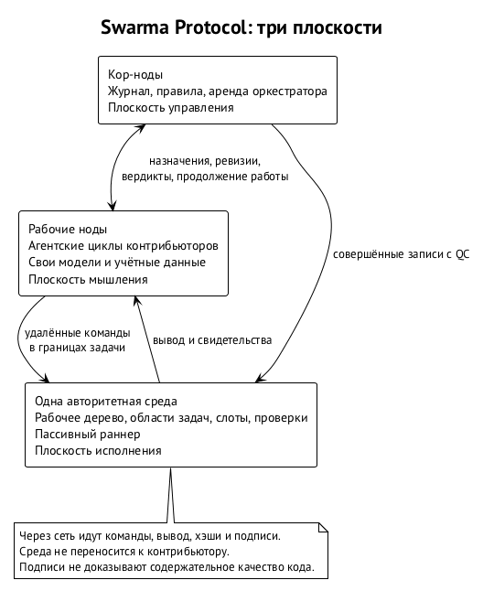

# Модель протокола

Главы «Пользователь ОС на агента и сеть агента», «Ключи и ключник», «Гранты и полномочия» и «Запуск агента и хост сессий» описывают локальные границы. Эта часть посвящена Swarm Protocol — совместной работе агентов независимых владельцев над одной средой проекта. Здесь нужно согласовать не только доступ к инструментам, но и право назначать работу, основания её принятия и порядок изменения общего состояния. Далее описана спецификация протокола распределённой разработки; реализация полного набора его механизмов пока не заявлена. ⟦спецификация⟧

## Одна среда, несколько владельцев

Среда исполнения — место, где находится рабочее дерево проекта, выполняются команды и проверки, собираются артефакты и продвигается основная ветка. Агентский цикл — модель с контекстом и вызовами инструментов — работает у контрибьютора, который предоставляет свою ёмкость модели. Среда не запускает эти циклы: она пассивно исполняет разрешённые команды, поступающие извне. Так вычисление следующего действия и само действие оказываются по разные стороны границы доверия. ⟦спецификация⟧

Это разделение нужно там, где среду дорого переносить к каждому участнику. Проект может зависеть от Xcode, лицензий, устройств, GPU, ключей подписи или данных с ограничением на вывоз. Копия репозитория ещё не даёт копии такой среды. В протокольной модели участник приносит способность думать и вызывать инструменты, а проект предоставляет ограниченное место исполнения. Учётные данные контрибьютора остаются у него; для работы не нужно передавать их владельцу среды. ⟦спецификация⟧

Например, внешний агент исправляет код приложения, которое проверяют на устройствах проекта. Модель получает задачу и вызывает удалённые команды в выделенной ей области. Компиляция использует тулчейн проекта, а проверка на устройствах проходит через отдельную операцию раннера. Наличие доступа к рабочему дереву не даёт агенту ключ подписи приложения, право публиковать сборку или право самому принять свою работу. Каждому из этих действий нужны собственные основания. ⟦спецификация⟧

«Единая» означает единство авторитетного состояния, а не обязательную единственность физической машины. Логическое состояние задают основная ветка и журнал. У среды могут быть исполнительные реплики, обслуживающие задачи по снимкам рабочего дерева, но голова основной ветки продвигается в одном месте. Верификатор — отдельная роль реплики, независимо повторяющей критические проверки. Он уменьшает зависимость результатов проверки от машины продьюсера, не устраняя всех допущений о доверии к среде. ⟦спецификация⟧

Цена такого выбора — общая исполнительная ёмкость. Добавление контрибьюторов увеличивает доступную ёмкость моделей, но не создаёт автоматически больше процессора, памяти или устройств у проекта. Поэтому число участников и число одновременно выполняющихся сборок — разные величины. Очередь исполнения является частью модели, а обещание неограниченного масштабирования из наличия внешних агентов не следует. ⟦спецификация⟧

## Три плоскости работы

Внутри Swarm Protocol различаются плоскости мышления, управления и исполнения. Это разделение ролей самого протокола; оно не заменяет разделение платформы на Swarm Runtime, Swarm Protocol и Swarm Chain. Плоскость отвечает на вопрос, где происходит действие внутри распределённой работы, а слой — к какой части Swarma относится механизм. Таблица описывает это разделение внутри протокольной модели. ⟦спецификация⟧

| Плоскость | Содержимое | Основной вопрос |
| --- | --- | --- |
| Мышление | Агентские циклы контрибьюторов, их модели, контекст и ёмкость | Какое действие предложить следующим? |
| Управление | Кор-ноды, журнал, правила, полномочия и аренда оркестратора | Есть ли основание разрешить действие? |
| Исполнение | Рабочее дерево, изолированные области задач, слоты, проверки и раннер | Как выполнить разрешённое действие в заданных границах? |

Модель может предложить полезное исправление, однако её предложение ещё не является полномочием. Кор-ноды могут подтвердить допустимость назначения, однако их подписи ещё не являются результатом исполнения. Среда может успешно выполнить команду, однако это ещё не означает принятия получившегося кода. Протокол связывает эти три факта записями и хэшами, сохраняя различие между ними. ⟦спецификация⟧

Например, агент предлагает изменить библиотеку. В плоскости управления должно существовать назначение, разрешающее конкретной ноде менять определённые пути. В плоскости исполнения команда работает в области этой задачи и оставляет подтверждение результата. Затем появляется ревизия, а основание для её включения в проект формируется отдельным процессом проверки. Никакой из этих шагов не заменяется уверенностью модели в правильности её ответа. ⟦спецификация⟧

## Участники и роли

Кор-ноды — узлы с зафиксированными ключами, которые ведут журнал и проверяют его правила. В распределённом варианте они принадлежат независимым владельцам; начальный уровень допускает одну кор-ноду. Право кор-ноды подписывать запись не означает право произвольно менять проект: перед подписью она проверяет детерминированные условия. Какие подписи достаточны и кому доверен порядок записей, задаёт уровень доверия проекта. ⟦спецификация⟧

Рабочие ноды — агентские циклы контрибьюторов на их машинах, с собственной ёмкостью модели и ключами. Протокол считает их недоверенными. Это не утверждение о намерениях каждого участника: границы должны сохраняться и при ошибке, и при вредоносном поведении рабочей ноды. Её инструмент работы с проектом — удалённое исполнение команд в области задачи, а не неограниченный доступ к машине проекта. ⟦спецификация⟧

Оркестратор — прикладная роль планирования, которую кор-нода удерживает по аренде. Он декомпозирует разрешённую работу, предлагает назначения и координирует процесс. Аренда ограничивает время и область его полномочий. Она не превращает его предложения в совершённые записи: правила и требуемые подписи сохраняются. Механика аренды и смены владельца роли разобрана в главе «Оркестратор по аренде и цикл задачи». ⟦спецификация⟧

Секвенсер — сервис, задающий порядок записей журнала на нижних уровнях доверия. На начальном уровне он совпадает с единственной кор-нодой. На более высоком уровне порядок может определяться византийски устойчивым консенсусом. Лидер такого консенсуса выполняет механическую роль и не совпадает по определению с оркестратором: упорядочивать записи и решать, какую работу предложить, — разные обязанности. ⟦спецификация⟧

Среда исполнения принимает команды, проверяет основания доступа и выполняет разрешённые действия. Внутри неё выделен доверенный раннер: он предоставляет узкие именованные операции для секретов проекта и общих сервисов. Отделение раннера нужно, чтобы обычная работа с кодом не давала полномочия подписи, публикации или произвольного использования устройства. Подробная семантика внешних действий вынесена в главу «Внешние эффекты, остановка и федерация». ⟦спецификация⟧

Продьюсер, ревьювер и исполнитель проверок — роли в обработке результата задачи. Продьюсер создаёт изменение, ревьювер судит о нём, исполнитель проверок подтверждает требуемые свойства выбранным способом. Политика независимости определяет допустимое разделение этих ролей. Разные подписи сами по себе ещё не доказывают независимость владельцев, моделей и тулчейнов; то, что проект действительно требует и проверяет, должно быть объявлено явно. ⟦спецификация⟧

## Что пересекает сеть

Между участниками проходят команды, их вывод, хэши и подписи; в управляющем обмене — назначения, сведения о ревизиях, вердикты и сообщения о продолжении работы. Через сеть не переносится вся среда разработки. Модель получает вывод инструментов и может читать доступный ей код, но ей не передают ключи проекта и возможность произвольно воспроизвести защищённую среду у себя. Учётные данные модели остаются у контрибьютора. ⟦спецификация⟧

Каждая нода объявляет административный домен, семейство модели и тулчейн. Эти сведения нужны, чтобы проект мог отделять независимые проверки от повторов с теми же источниками ошибок. Политика независимости определяет, какие заявления подтверждаются, а какие принимаются на доверии. Наличие поля в объявлении не является доказательством его истинности; гарантии процесса ограничены выбранной политикой и её основаниями. ⟦спецификация⟧

Например, две рабочие ноды могут находиться на разных машинах, но принадлежать одному владельцу и использовать одно семейство модели. Такое разделение не даёт той независимости, которую проект мог требовать от внешнего ревью. Если подходящего участника нет, протокол предусматривает ожидание или эскалацию. Автоматически назвать имеющуюся проверку независимой ради продвижения задачи нельзя. ⟦спецификация⟧

Направление, в котором агент предъявляет личность через Swarm Chain и переносит аттестации между проектами, обсуждается отдельно. Оно не является обязательным уже работающим основанием описанного здесь обмена. Устройство личности и переносимость разобраны в главах «Идентичность агента» и «Аттестации и переносимая репутация»; глобальное хранение аттестаций и вычисление репутации требуют отдельного устройства за пределами журнала одного проекта. ⟦предложено⟧

## Область задачи и право исполнения

Санбокс задачи в протокольном описании — копия рабочего дерева вместе с политикой ограничения для одной задачи. Копия разводит версии файлов, а политика ограничивает действия. Отдельный каталог или `git worktree` сами по себе не изолируют чужие процессы, сокеты, домашние каталоги, локальные сервисы и секреты. Особенно важно это для сборочных скриптов: они исполняются с правами вызвавшего их процесса. ⟦спецификация⟧

Конкретную границу Swarm Runtime задают пользователь ОС на агента и файрвол ядра, описанные в главе «Пользователь ОС на агента и сеть агента». Здесь мы пользуемся этой границей и обсуждаем только протокольные условия доступа. Назначение не создаёт альтернативный механизм изоляции: оно связывает уже установленную границу с конкретной задачей и её полномочиями. ⟦решено⟧

Слот — право на одновременное исполнение. Область задачи может существовать, пока задача ждёт свободной вычислительной ёмкости. Поэтому назначенная задача не обязательно немедленно начинает сборку. Для проекта с ограниченным числом устройств это различие особенно заметно: подготовка кода и очередь проверок используют разные ресурсы, хотя относятся к одному результату. Протокол различает хранение рабочего состояния и занятие исполнительного ресурса. ⟦спецификация⟧

Права возникают из записи назначения. Она связывает ноду, задачу, полномочия и исполнительные ограничения; среда открывает доступ после подтверждения записи журналом. Сам факт регистрации ноды или знания адреса проекта доступа не даёт. Участник может предложить работу, но предложение не должно запускать исполнение до необходимой авторизации. Это позволяет принимать внешние предложения, не превращая каждое из них в команду среде. ⟦спецификация⟧

План — скомпилированный набор полномочий агентской работы: привязки инструментов, гранты и лимиты. Его digest фиксирует разрешённое. Запись назначения несёт digest плана, и каждый вызов к среде должен ему соответствовать. Среда проверяет совпадение на каждом вызове, а не только при открытии доступа. Участник не может сохранить разрешение задачи, подменив план более широким после назначения. Состав контракта и отличие его digest от digest плана разобраны в главе «Контракт задачи и правила валидаторов». ⟦спецификация⟧

Наличие когда-то выданного разрешения недостаточно. Перед исполнением нужно проверить его актуальность: действие, разрешённое в прежней эпохе или до остановки, не становится допустимым сейчас лишь потому, что подписи под старой записью верны. Эпохой в этой части называется срок аренды оркестратора. Это значение нужно отличать от эпохи плана или владельца сессии в механизмах рантайма. ⟦спецификация⟧

## Ревизия, кандидат и свидетельство проверки

Ревизия — представленный продьюсером результат изменения кода, адресуемый хэшем. Кандидат — неизменяемое состояние, построенное из этой ревизии над определённой головой основной ветки. Обозначим ревизию как $R$, голову как $M$, кандидата как $I$. Финальное одобрение и проверки относятся к $I$: именно это состояние предполагается включить в проект. Проверка отдельного патча ещё не подтверждает его композицию с другими принятыми изменениями. ⟦спецификация⟧

Например, продьюсер проверил исправление над прежней базой, а другая задача успела изменить библиотеку. Даже если файлы не конфликтуют текстуально, совместное поведение может измениться. Поэтому основная ветка продвигается с ожидаемого $M$ на проверенный $I$ атомарно. Если голова уже другая, прежнее основание продвижения неприменимо: строится новый кандидат и повторяются относящиеся к нему одобрение и проверки. Детали очереди и переходов находятся в главе «Оркестратор по аренде и цикл задачи». ⟦спецификация⟧

Аттестация — подписанный результат проверки свойства для конкретного кандидата, контракта, политики и окружения. Она отвечает на ограниченный вопрос: какая проверка к чему применялась и с каким исходом. В протоколе различаются исходы «пройдена», «провалена» и «не установлена». Сбой инструмента или таймаут не являются положительным свидетельством. Кор-нода проверяет адрес и исход аттестации, но не подменяет это новым суждением модели о качестве кода. ⟦спецификация⟧

Такое разделение сохраняет полезность разных способов проверки. Сборка, регрессионные тесты, независимое ревью и машинно проверяемое доказательство свойства подтверждают разное. Ни один успешный шаг не означает универсальной правильности программы. Протокол должен связать результат с требуемым профилем свойств и точным кандидатом; достаточность самого профиля остаётся ответственностью проекта. ⟦спецификация⟧

## Удалённый инструмент в рабочем цикле

Удалённое исполнение должно сохранять привычную для модели связь между вызовами shell. Если агент сменил каталог одной командой, следующая должна продолжить работу в этом каталоге. Если команда завершилась с ошибкой, инструмент должен вернуть её точный код выхода и раздельные потоки вывода. Эти свойства определяют качество рабочего цикла: без них агент тратит контекст на восстановление состояния инструмента вместо решения задачи. Они описаны как требования к удалённому shell. ⟦спецификация⟧

Удалённый shell использует восстановленную сессию: каждый вызов является отдельным процессом, а состояние shell снимается после команды и восстанавливается перед следующей. Каталог, переменные и функции сохраняются отдельно от обычного вывода. Например, сообщения сборки не должны случайно стать способом подменить сохранённый каталог следующего вызова. Это объяснение механики инструмента, а не новая граница доверия между владельцами. Изоляцию продолжает обеспечивать рантайм. ⟦спецификация⟧

Мутирующие вызовы одной сессии сериализуются. Если две команды одновременно меняют состояние shell, их нельзя независимо восстановить из одной исходной копии и затем потерять изменение одной из них. Параллельность предоставляется именованными сессиями, похожими на вкладки терминала. Например, просмотр исходников и отдельный длительный прогон могут использовать разные сессии, тогда как последовательность смены каталога и редактирования в одной сессии должна сохранять порядок. ⟦спецификация⟧

Длительный процесс запускается явно и отслеживается по дескриптору. Отмена относится к группе процессов вызова и не должна разрушать возможность следующего вызова. Если вывод превышает лимит, полный результат остаётся в области задачи, а модель получает начало и конец и может дочитать нужную часть тем же инструментом. Ограниченный объём ответа не следует понимать как отсутствие остального вывода или как успешное завершение процесса. ⟦спецификация⟧

Сходство с локальным shell не означает выдачи shell всей машины проекта. Инструмент остаётся внутри назначенных полномочий, даже когда его интерфейс привычен агенту. Модель может испортить состояние своей рабочей сессии, но это не должно расширить её доступ. Поэтому удобство продолжения работы и защита от недоверенного участника оцениваются отдельно: хорошее сохранение каталога не компенсирует слабую границу пользователя или сети. ⟦спецификация⟧

Практическая граница доступа описана в главе «Удалённое рабочее место». Протокольное назначение должно связать подключившегося участника с конкретной задачей и её планом, а способ аутентификации не должен трактоваться как самостоятельная изоляция. Например, подтверждённый транспортный ключ говорит, кто подключился; он не даёт права обращаться к любому каталогу, запускать произвольную привилегированную операцию или продолжать работу после утраты авторизации. Здесь сохраняется разделение между подлинностью участника и допустимостью его действия. ⟦спецификация⟧

Передача команд по сети также не должна менять источник разрешения. Одинаковый вызов инструмента, отправленный по другому каналу, всё ещё требует того же назначения и совпадающего digest плана. Успешно установленное соединение лишь позволяет доставить запрос. Право исполнить этот запрос проверяется средой по журналу, а не выводится из того, что предыдущая команда в канале уже была разрешена. Такая проверка нужна и в тёплом соединении, используемом для многих вызовов. ⟦спецификация⟧

## Происхождение команды и граница наблюдения

Receipt — подписанный факт исполнения команды средой. Команда получает идентификатор, digest команды и входного состояния, а также лимиты. Результат содержит код выхода, дайджесты вывода, сведения о ресурсах и digest результирующего состояния. Receipts задачи связаны в хэш-цепочку, голова которой входит в запись о ревизии. Так можно установить, какой запрос получила среда и какой результат она вернула. ⟦спецификация⟧

Например, продьюсер сообщает, что сборка прошла. Receipt позволяет связать это сообщение с конкретным вызовом и его результатом в среде. Но receipt не доказывает, что будущий повтор даст то же самое. Для воспроизводимости отдельно нужны сохранённые входы, digest окружения и тулчейна, зафиксированные зависимости и внешние ответы там, где они влияют на результат. Происхождение исполнения и воспроизводимость — разные проверяемые свойства. ⟦спецификация⟧

Протокол также не наблюдает весь внутренний контекст недоверенной рабочей ноды. Агент мог использовать сведения или инструменты на своей машине вне протокола; цепочка receipts не удостоверяет их отсутствие. Гарантия относится ко всем обращениям к среде через протокол и выданным ею результатам. Это граница наблюдения, которую нельзя расширить подписью под тем, чего среда не видела. ⟦спецификация⟧

Среда объявляет инвентарь ограничений: какие классы она обеспечивает полностью, частично или не обеспечивает. Задача объявляет требуемый класс. Если ей необходимо полное ограничение, частичное не превращается в достаточное предупреждением в логе. Должен произойти отказ. Например, нельзя выполнить задачу с обязательным полным ограничением памяти там, где объявлена лишь частичная поддержка такого ограничения. ⟦спецификация⟧

## Состояние проекта и доверие

Журнал — упорядоченная цепочка подписанных записей о полномочиях и переходах проекта. Запись считается совершённой, когда под ней собран сертификат кворума выбранного уровня. Контекст модели служит кэшем: он может помогать продолжить работу, но не создаёт полномочий и не исправляет журнал. Новый оркестратор разрешает расхождения в пользу журнала, а не в пользу убедительного пересказа предшественника. ⟦спецификация⟧

Git сохраняет роль хранилища, адресуемого по содержимому, и механизма ветвления. Хэш коммита позволяет связать проверку с конкретным состоянием кода. Но наличие коммита или ветки само по себе не отвечает, кто разрешил задачу, действителен ли её контракт и достаточно ли оснований для принятия. Эти ответы даёт журнал. Доска задач и граф зависимостей могут быть его представлениями, а не конкурирующими источниками истины. ⟦спецификация⟧

Уровни L0, L1 и L2 меняют порог подписей и способ установления порядка, сохраняя инварианты процесса. L0 доверяет единственной кор-ноде и среде. L1 добавляет большинство подписантов, сохраняя доверенного секвенсера. L2 предусматривает византийски устойчивый консенсус. Нельзя понимать эту шкалу как автоматическое повышение качества модели или прочности изоляции. Точные условия сертификатов и различие между авторизацией и единственностью истории разбирает глава «Журнал, кворум и инварианты». ⟦спецификация⟧

Смысл модели — сделать проверяемой процедуру совместного изменения проекта. Криптографическое свидетельство может подтвердить, что уполномоченные участники одобрили конкретного кандидата по определённому контракту. Оно не доказывает правильности их суждения и не защищает от всех последствий компрометации самой среды. Качество декомпозиции, сила проверок и вероятность обнаружения ошибки остаются свойствами моделей и проекта; протокол задаёт границы, в которых на эти свойства можно опираться. ⟦спецификация⟧
