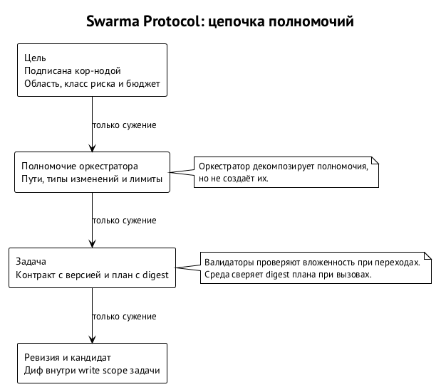

# Контракт задачи и правила валидаторов

Контракт задачи — версионируемое описание требуемого результата и правил его принятия. Он отделён от плана полномочий: доступный инструмент отвечает на вопрос «что можно сделать», а критерий приёмки — «что нужно получить». Если смешать эти вопросы, задача с правом редактировать код незаметно получит право переписать собственное определение успеха. В Swarma Protocol полномочия и условия приёмки фиксируются раздельно и связываются проверяемыми записями.

## Откуда берутся правила процесса

Конфигурация процесса задаёт типы элементов, их workflow, охранные условия переходов, наборы проверок и делегирование действий с потолками полномочий. Эти определения даёт спецификация конфигурации процесса (версия 4.8, черновик), а проект объявляет процесс в `Playbook.json`. Изменение вступает в силу после подтверждения человека или в пределах заранее выданных им прав. Ядро исполняет версию, которая вступила в силу, какая бы редакция файла ни лежала рядом.

Здесь разобрана протокольная форма этих правил: дайджест плана, версия контракта, адрес свидетельства проверки и предикаты перед подписью кор-ноды. Если объяснение расходится со спецификацией модуля, права спецификация. Особенно это касается полей конфигурации и конкретных охранных условий: собственного формата или автомата состояний вместо принадлежащего процессу книга не вводит.

Проект может заранее разрешить определённому участнику менять процесс в заданных пределах. Тогда каждое допустимое изменение не требует нового ручного решения, но предел делегирования сохраняется. То, что агент умеет редактировать файл конфигурации, не даёт ему права ввести эту редакцию в силу: авторизованная версия и доступная для записи копия — разные состояния.

## План разрешает, контракт требует

Дайджест плана фиксирует привязки инструментов, гранты и лимиты. План компилируется из области записи (write scope) — множества путей, которые задача вправе менять, — и класса задачи. Его дайджест входит в назначение и сверяется средой на каждом вызове. Так разрешение в журнале связывается с фактически используемыми полномочиями.

Дайджест контракта фиксирует условия результата и приёмки. Одинаковые наборы полномочий могут обслуживать задачи с разными критериями. Право менять библиотеку ещё не говорит, нужно ли сохранить совместимость её интерфейса или изменить его по новому требованию. Такое различие задают родительская цель и ожидаемый результат в контракте; список доступных команд о нём ничего не говорит.

Части контракта (имена полей и схему сериализации задаёт спецификация конфигурации процесса):

| Часть | Что фиксирует |
| --- | --- |
| Родительская цель | основание, из которого выделена задача |
| Область записи | пути, которые задача может менять |
| Входы и зависимости | версии входных артефактов и используемые результаты |
| Результаты и критерии приёмки | что требуется получить и на каком основании принять |
| Профиль подтверждаемых свойств | какие свойства, каким способом, для какого артефакта и при каких допущениях проверяются |
| Оценка | сложность задачи в принятых единицах |
| Класс риска | какой процесс требуется для соответствующих изменений и операций |
| Бюджеты | пределы расходования ресурсов задачи |

План и контракт согласуются, но совпадение одного не заменяет проверки другого. Агент может не выйти за разрешённые пути и всё равно получить неправильный результат. И наоборот, полезный результат можно получить с превышением прав. Содержательная польза не оправдывает неавторизованного исполнения, а соблюдение области записи не делает код принятым.

## Версия защищает условия приёмки

Изменение критериев или профиля подтверждаемых свойств создаёт новую версию контракта и требует авторизации того же уровня, что и создание задачи. Требования можно уточнять, не переписывая прошлых оснований принятия. Обычная задача не может незаметно ослабить свой критерий успеха: новая формулировка должна стать отдельным авторизованным фактом, а свидетельства — относиться к актуальной версии.

Пример. Задача должна сохранить совместимость, но продьюсер обнаруживает, что проще изменить интерфейс. Он может сообщить о проблеме и предложить уточнение. Удалить требование совместимости из описания и выдать прежнее ревью за подтверждение новой задачи он не может. Право декомпозировать работу не включает права менять смысл исходной цели, иначе любой неудобный критерий исчезал бы по ходу исполнения.

Версионирование полезно и без злого умысла. Ревьювер мог добросовестно проверить прежнюю формулировку, а владелец потом добавить требование. Положительное ревью задним числом не становится отрицательным, но основанием принятия по новому контракту оно уже не является. История помнит, относительно чего был сделан вывод, а текущая приёмка требует свидетельств с актуальным адресом.

## Профиль свойств и три исхода

Профиль подтверждаемых свойств задаёт, какое свойство подтвердить, каким способом, для какого артефакта и при каких допущениях. Одной задаче нужны сборка, регрессионные проверки и независимое ревью. Другой — машинно проверяемое доказательство конкретного свойства и ревью того, что формальная постановка соответствует исходной задаче. Универсальной лестницы способов нет: более формальная проверка одного свойства не подтверждает остальных.

Успешная компиляция не доказывает правильности авторизации, а доказательство отсутствия переполнения не устанавливает, что операция разрешена нужному пользователю. Проект называет требуемое свойство и достаточный способ его подтверждения. Валидатор проверяет наличие соответствующих оснований, но не может исправить неполный профиль дополнительной подписью или предположением, что «более сильная» проверка покрыла неназванное поведение.

У каждой проверки один из трёх исходов: «пройдена», «провалена», «не установлена». Таймаут и сбой инструмента дают «не установлена»: результата нет, и об отсутствии ошибки это ничего не говорит. Для принятия нужен положительный исход нужной проверки. Недоступный исполнитель тестов не позволяет продвинуть кандидата на том основании, что от него не пришло списка падений.

Различие сохраняется по всей цепочке, от инструмента до записи об интеграции, иначе неопределённый ответ на одном шаге превратится в положительный на другом. Аттестация подтверждает факт сообщения о результате, а её исход отдельно определяет, выполнено ли требование. Подписанный таймаут остаётся таймаутом: подлинная подпись не делает его достаточным свидетельством.

## Адрес одобрения и аттестации

Финальное одобрение и каждая аттестация адресованы сочетанию четырёх частей: версии контракта, интеграционного кандидата $I$, версии политики проверки и дайджеста окружения. Адрес связывает вывод с постановкой, точным состоянием кода и условиями проверки. Если устарела любая часть, свидетельство к текущему принятию неприменимо; совпадения одного хэша кандидата мало.

| Изменившаяся часть | Почему прежнее свидетельство неприменимо |
| --- | --- |
| Версия контракта | проверяли другие условия результата или приёмки |
| Кандидат | проверяли другое состояние кода |
| Версия политики | основания проверки относятся к другому правилу принятия |
| Дайджест окружения | проверка шла в других условиях исполнения |

Код остался тем же, но задача получила новый профиль проверок — прежнее одобрение относится к старому контракту. Контракт прежний, но кандидат перестроен над новой головой — хэш изменился, и свидетельство не переносится. Валидатор сравнивает все части сразу, и удобного подмножества совпадений ему недостаточно.

Это свидетельство для приёмки внутри проекта. Переносимая аттестация в Swarma Chain выводится из него: личность участника, роль, проект, хэш кандидата, версии контракта и политики, исход и время. Выдаёт её рантайм проекта, пачкой, с подписью ключами своей личности. Расчёт репутации — в главе «Аттестации и переносимая репутация».

## Цепочка полномочий

Цель создаёт и подписывает кор-нода. Цель задаёт область, класс риска и бюджет. Из неё оркестратору выдаётся полномочие (capability): допустимые пути, типы изменений и лимиты. Внутри полномочия создаётся задача с контрактом и планом. Ревизия допустима, если её дифф лежит внутри области записи задачи. На каждом уровне права только сужаются.

Оркестратор декомпозирует полномочия, но не создаёт их. Право изменить библиотеку не позволяет ему выдать задачу на публикацию приложения, если цель такого действия не разрешала. Дочерняя задача не получает доступа шире оттого, что названа вспомогательной. Валидаторы проверяют вложенность при переходах, а среда — дайджест плана при вызовах; это охрана разных границ одной цепочки.

Рабочая нода может предлагать новые цели, но исполняются они только после подписи кор-ноды. Предложение — полезный вход для планирования, но полномочий оно не создаёт. Обнаруженная потребность обновить зависимость может стать отдельной задачей после авторизации, но не позволяет текущему продьюсеру выйти за пределы назначенного изменения — даже когда предложение разумно.

## Класс риска и защищённые изменения

Класс риска определяется детерминированно — по путям, манифестам зависимостей и типам операций. Привилегированный класс включает:

- авторизацию и доступ;
- зависимости;
- конфигурацию сборки и CI;
- проверки;
- правила и манифест;
- инструкции агентов и хуки;
- подпись, публикацию, секреты и миграции.

Такие задачи требуют двух независимых ревью или одобрения человека из кор-команды, а соответствующие пути доступны для записи только из области задачи этого класса.

Множество помеченных путей вычисляется по накопленной дельте от базы до кандидата, включая все раунды правок. Одобрение такого изменения — детерминированный предикат над текущим контрактом, политикой риска, точным кандидатом и полным множеством помеченных путей. Обязательная проверка, для которой нет верификатора, даёт «не установлено».

Продьюсер не может сделать падающий тест зелёным, удалив сам тест, если задача разрешает менять только реализацию. Изменение проверок допустимо как отдельная авторизованная работа соответствующего класса. То же с ослаблением конфигурации CI или правил приёмки: это изменения механизма, который судит о результате, и спрятать их в обычном исправлении нельзя.

Классификация не распознаёт любой вредный смысл: изменение внутри разрешённой области обычного класса может быть семантически вредным. Остаточный риск ограничивают область, бюджет, независимое ревью кандидата, отложенное закрепление начислений и остановка. Детерминированный класс выбирает процесс по наблюдаемым признакам изменения и операции; анализом безопасности программы он не является.

## Область записи и зависимости

Задачи с пересекающимися областями записи одновременно не исполняются. Область удерживается от назначения до интеграции или отмены задачи, включая ожидание принятия ревизии; иначе следующая задача начала бы менять те же пути, пока предыдущая ждёт решения. Поэтому декомпозиция либо разводит области, либо ставит такие задачи последовательно. Освободить область сразу после окончания работы продьюсера мало.

Непересекающиеся области исключают конкурирующую запись в одни пути, но не семантические конфликты. Одна задача меняет интерфейс библиотеки, другая добавляет вызов в другом файле. По отдельности обе допустимы, а вместе несовместимы. Для композиции и нужна проверка кандидата над текущей головой: ни отсутствие текстового конфликта, ни соблюдение области записи её не заменяют.

Задача может пользоваться принятыми артефактами других задач. Запись о зависимости говорит, какие результаты используются и какие предоставляются. Агент получает происхождение, контракт, зависимости и основания принятия результата. Найти подходящий артефакт и решить, применим ли он, — разные действия: индекс помогает найти, а записи и текущий контракт определяют, на что можно опереться. Представления журнала — в главе «Журнал, кворум и инварианты».

## Предикаты перед подписью

Кор-нода подписывает запись после детерминированных проверок. Условия переходов принадлежат конфигурации процесса; ниже — предикаты Swarma Protocol. Каждый проверяет определённое основание; общая правдоподобность сообщения значения не имеет. Невыполненное требование — подписи нет.

1. Переход состояния задачи допустим по процессу. Наличие ожидаемого результата не позволяет перескочить обязательный переход или проверку.
2. Область записи вложена в полномочие, полномочие — в цель; дайджест плана соответствует области и классу; указанная версия контракта — текущая.
3. Продьюсер, ревьювер и исполнитель проверок различны согласно политике независимости. Если политику выполнить нельзя, фиксируется ожидание или эскалация; автоматически политика не ослабляется.
4. Множество кандидатов в ревьюверы заморожено до появления хэша кандидата $I$, случайность получена после него; выбор вычисляется из идентификатора задачи, хэша $I$ и случайности.
5. Интеграция содержит базу $M$, кандидата $I$, финальное одобрение и требуемые аттестации с исходом «пройдена». Их адреса совпадают с $I$, текущим контрактом, политикой и окружением, а текущая голова равна $M$.
6. Назначение выдано действующей арендой с валидным fencing-токеном, в пределах лимитов полномочия и без пересечения с удерживаемыми областями записи.
7. Каждый хэш тела сопровождается сертификатом доступности: подписанная ссылка не заменяет подтверждения хранения объекта.
8. Соблюдены класс риска и требуемый им процесс. Малый размер привилегированного изменения исключения не даёт.
9. Цель создана кор-нодой. Предложение рабочей ноды не исполняется до нужной подписи.
10. У операции раннера есть идентификатор и ключ идемпотентности; повтор ссылается на тот же идентификатор.

Порядок в правиле о случайности один везде: заморозка множества, затем хэш кандидата, затем случайность. Предмет финального одобрения — тот же интеграционный кандидат. Выбор участника и адрес его заключения — разные проверки: пересчёт выбора не позволяет принять одобрение, адресованное другому состоянию кода.

## Пример проверки интеграции

Пусть запись предлагает заменить голову $M$ кандидатом $I$. Валидатор читает голову и сравнивает её с $M$, проверяет подписи одобрения и аттестаций, сопоставляет их адреса с кандидатом и актуальными версиями, затем проверяет положительный исход каждого требуемого свойства. Обращения к модели здесь нет: только сравнение известных значений и проверка установленных процессом оснований.

Если одна обязательная проверка дала «не установлена», основания для интеграции нет. Если все проверки положительны, но относятся к прежнему контракту, — тоже нет. Если всё совпало, но голова успела продвинуться, атомарная замена с ожидаемого $M$ не пройдёт. Положительные сведения не компенсируют несовпадения другой обязательной части: для нового состояния строится кандидат и собираются его свидетельства.

Проверка головы валидатором не заменяет атомарной проверки средой при продвижении, потому что между чтением и исполнением состояние может измениться. Поэтому запись об интеграции задаёт ожидаемую базу, а исполнитель действий с репозиторием выполняет compare-and-swap. Так доказанные до подписи условия соединяются с фактическим изменением общей ссылки. Цикл подготовки кандидата и повторных проверок — в главе «Оркестратор по аренде и цикл задачи».

Идентификатор операции и ключ идемпотентности связывают повтор с тем же внешним действием. Повторный запрос публикации не выглядит новой операцией оттого, что сообщение доставили ещё раз. Но тот же идентификатор не подтверждает успешного исхода публикации: для исхода есть отдельная запись результата, и наличием авторизации свидетельство о выполнении не заменить. Повторы и неопределённый исход — в главе «Внешние эффекты, остановка и федерация».

## Чего подпись не обещает

Валидатор устанавливает, что нужные ревью и проверки были, относились к точному состоянию и контракту, выполнялись допустимыми участниками и дали требуемые исходы. Он не устанавливает, что ревьювер был прав или что выбранные тесты нашли все дефекты. Подпись удостоверяет процедуру, а качества результата не гарантирует. Именно разделение этих обязанностей позволяет правилам оставаться детерминированными.

Содержательная работа остаётся за проектом: правильно поставить цель, выбрать профиль свойств и обеспечить достаточную проверку. Протокол делает её основания явными и не даёт незаметно подменить их после получения результата. Ошибочное суждение всё ещё возможно, но можно установить, кто что проверял, по каким условиям, в каком окружении и на каком основании результат попал в общую ветку.
