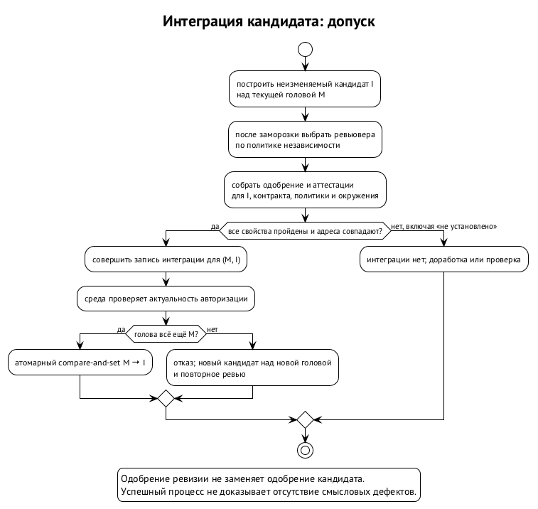

# Оркестратор по аренде и цикл задачи

Оркестратор — роль планирования в Swarm Protocol. Он превращает цель проекта в задачи с контрактами, назначает продьюсеров, инициирует ревью и интеграцию. Кор-нода удерживает эту роль по аренде; сама роль не даёт ни прямого доступа к среде, ни права единолично принимать результат. Полномочия оркестратора ограничены выданной областью и лимитами, а каждое действие становится записью, которую проверяют валидаторы.

Это продолжение глав «Модель протокола», «Журнал, кворум и инварианты» и «Контракт задачи и правила валидаторов». Здесь важно время: кто вправе планировать сейчас, как заменить его после сбоя и какое состояние в итоге попадёт в основную ветку. Локальная изоляция и запуск остаются обязанностями Swarm Runtime (главы «Пользователь ОС на агента и сеть агента» и «Запуск агента и хост сессий»): протокольная аренда не заменяет пользовательских и сетевых границ рантайма.

## Планирование без прямого исполнения

Разделение ролей нужно потому, что хорошая декомпозиция не делает её автора доверенным исполнителем. Оркестратор может предложить полезную задачу или семантически вредную задачу в пределах своей области. Правила протокола проверяют полномочия и основания принятия, но не превращают смысл предложения в детерминированный факт. Поэтому оркестратор действует через журнал, а команды в среде выполняют назначенные рабочие ноды.

Например, цель состоит в переносе модуля синхронизации. Оркестратор выделяет транспортную часть, задаёт её область записи и ожидаемый результат. Он не получает от этого права менять систему авторизации или публиковать выпуск. Если перенос требует изменения защищённых путей, нужна задача соответствующего класса и соответствующий процесс принятия. Декомпозиция только сужает уже выданные полномочия.

Инициировать интеграцию тоже не значит исполнить её. Оркестратор предлагает запись, валидаторы проверяют её основания, а среда применяет совершённую запись с сертификатом кворума. Ревьювер вычисляется по правилу выбора, и вкус оркестратора на этот выбор не влияет. Право экстренной остановки проходит отдельно: удержание роли планировщика не даёт права запрещать паузу.

## Аренда, эпоха и fencing-токен

Аренда — запись о временном владении ролью. Она связывает ноду, эпоху, случайный fencing-токен, предшествующую аренду, причину смены, чекпоинт как базу передачи и область полномочий. Причина — создание, плановая передача, принудительный захват или восстановление. Формат записи задаёт спецификация журнала.

Эпоха здесь означает срок аренды оркестратора. С временем жизни плана агентской сессии и с арендой владельца сессии у хоста сессий её путать не стоит: право писать в сессию и право планировать работу проекта проверяются на разных границах. Механизм хоста сессий описан в главе «Запуск агента и хост сессий».

Fencing-токен позволяет отсечь прежнего держателя после смены роли. Аренда продлевается heartbeat — сообщениями о том, что держатель продолжает работу. Каждая запись оркестратора несёт эпоху и токен. Валидаторы отвергают запись с устаревшей арендой, сохраняя её как расхождение для аудита. Сохранённое расхождение не получает силы принятой команды.

Представим, что машина оркестратора уснула. Heartbeat перестал приходить, аренда истекла, следующая кор-нода получила роль с новой эпохой и токеном. После пробуждения прежний оркестратор отправляет накопленное назначение. Его подпись может быть подлинной, но аренда уже не действует: валидаторы не подписывают назначение. Подлинность отправителя и актуальность его полномочий — разные условия.

Проверка не заканчивается у валидаторов. Среда требует сертификат кворума и проверяет актуальность эпохи на границе исполнения. Иначе задержанная команда могла бы пройти проверку в старой эпохе и исполниться после передачи роли. Операции с внешними эффектами требуют той же дисциплины; их сбои и повторения разобраны в главе «Внешние эффекты, остановка и федерация».

## Как сменяется держатель роли

Смена эпохи происходит при таймауте heartbeat, исчерпании ёмкости оркестратора, решении кворума или обнаружении нарушения правил. Преемник определяется детерминированной ротацией. Византийская нода не становится незаменимой: следующая смена позволяет её пропустить. Через заданное число эпох предусмотрена холодная смена независимо от текущей причины. Конкретные интервалы не составляют универсального обещания протокола.

Плановая передача допускает перенос сессии, но требует доказательства покоя. Ввод заблокирован, незавершённых вызовов, дочерних процессов и операций исполнителя нет, дайджест хранилища стабилен. Только после этого сессию передают преемнику и фиксируют хэш снимка в журнале. При необходимости форматы агентских сессий преобразуются, однако преобразование может потерять часть контекста.

Принудительный захват — самостоятельное действие. Он не маскируется под неудавшуюся плановую передачу: предшественника отсекают токеном, сессию не передают, преемник начинает по журналу. Это важно именно при подозрении на злонамеренного оркестратора. Если передать его отравленный контекст следующему держателю, компрометация сможет путешествовать вместе с ролью, хотя ключ ноды формально сменился.

Даже планово полученная сессия считается недоверенной. При расхождении с журналом прав журнал. Если в сессии написано, что транспортная задача принята, а журнал содержит только представленную ревизию, преемник не должен считать задачу интегрированной. Переданный контекст помогает восстановить ход мысли; сертификаты, контракты и результаты проверок он не заменяет.

| Способ смены | Что можно перенести | Откуда берётся авторитетное состояние |
| --- | --- | --- |
| Плановая передача после доказательства покоя | снимок сессии с зафиксированным хэшем; содержимое недоверенно | журнал и доступные тела записей |
| Принудительный захват | сессия предшественника не передаётся | журнал |
| Восстановление с чекпоинта | доступный снимок как вспомогательный контекст | журнал, включая записи после чекпоинта |

## Журнал вместо незаменимой памяти

План, контракты, назначения и результаты должны находиться в журнале. Сессия модели — только кэш, и решение не должно жить в ней одной. Оркестратор записывает решения и обоснования структурно по ходу работы. Иначе после потери сессии останутся файлы и отдельные результаты, но исчезнет объяснение того, какие из них приняты и почему следующая задача имеет право их использовать.

Чекпоинт связывает запись журнала с хэшем снимка сессии. Снимок помещается в хранилище с сертификатом доступности. После сбоя преемник может загрузить его и применить последующие записи журнала. Хэш позволяет связать полученный снимок с записью, а сертификат доступности нужен, чтобы ссылка не вела к телу, которое никто не способен предоставить. Ни то ни другое не делает мысли из сессии доверенными.

Проверка этого свойства намеренно жёсткая: остановить оркестратора, удалить его сессию и проверить продолжение по журналу и доступным артефактам. Успешная загрузка сохранённого чата проверяла бы другой путь. Этот эксперимент входит в программу проверки, и результат ограниченной модели интеграции его не заменяет; границы проверки — в главе «Что проверено и как проверить остальное».

## Области и один принимающий писатель

Одновременно могут действовать аренды с непересекающимися областями. Если задача затрагивает их пересечение, она принадлежит аренде, покрывающей объединение, либо создаётся кор-нодой напрямую. Само наличие нескольких держателей не разрешает каждому распоряжаться общей областью. Например, задачи транспорта и другого модуля могут планироваться отдельно, но общее изменение их границы требует соответствующего охвата полномочий.

Для совместной работы нескольких операторов над одной доской задач решено направление: доска процесса остаётся одна, а записи принимает один писатель с fencing по эпохе. Типизированная операция связывает актора, доску, версию конфигурации, область и эпоху аренды, ожидаемую ревизию и идентификатор операции. Эпоха проверяется при запуске агента, записи результата и интеграции. Потерявший полномочия писатель приостанавливает новые записи.

Этот писатель не делает остальные ноды источниками второй авторитетной доски. У одного процесса один корневой оркестратор, а оркестраторы других узлов работают с арендованными поддеревьями. Принимающий писатель назначается по владению процессом: его держит кор-нода, у которой аренда корневого оркестратора, и при смене аренды он ротируется вместе с ней.

## От цели к ревизии

Цикл начинается с авторизованной цели и задачи с контрактом. Контракт фиксирует ожидаемый результат, область записи, зависимости и профиль свойств, которые предстоит подтвердить. Оркестратор назначает продьюсера с учётом доступной ёмкости, свободного слота и уже удерживаемых областей. Среда открывает санбокс по совершённой записи назначения. Механика полномочий определена в главе «Контракт задачи и правила валидаторов».

В примере с переносом транспорта продьюсер получает именно транспортную часть. Ограничение параллельной записи удерживается от назначения до интеграции или отмены, поэтому ожидание ревью не освобождает область для конкурирующего изменения. Непересекающиеся пути позволяют параллелизм, но не доказывают смысловую совместимость результатов: модуль может зависеть от интерфейса, который меняет соседняя задача.

Продьюсер работает в санбоксе и представляет ревизию — хэш коммита `R` над базой `B`. Подпись ставится на машине продьюсера; ключ ноды на среду не передаётся. В запись входит голова цепочки квитанций — подписанных свидетельств исполнения команд. Подробности локального хранения ключей относятся к главе «Ключи и ключник», а здесь важна граница: автор результата подписывает его со своей стороны.

Ревьювер может дать раннюю обратную связь по `R`: указать пропущенную обработку ошибки или несоответствие контракту. Продьюсер исправляет ревизию и представляет её снова. Но такая обратная связь не становится финальным одобрением. Она помогает производству результата, тогда как принятие требует проверки конкретного состояния, которое действительно собираются интегрировать. Это разные переходы процесса.

## Почему нужен интеграционный кандидат

Интеграционный кандидат `I` — неизменяемое состояние, построенное средой из ревизии продьюсера над текущей головой основной ветки `M`. Журнал фиксирует пару `(M, I)`: от какого состояния предполагается продвинуть голову и к какому. База задачи `B` могла остаться в прошлом, пока другие задачи проходили интеграцию. Поэтому ревизия `R` и кандидат `I` выполняют разные роли, даже если изменение выглядит одинаково.

Предположим, транспортная задача добавляет вызов функции. Пока она проходит ревью, другая задача меняет контракт этой функции. Патч добавления вызова может остаться тем же, однако его смысл на новой базе изменился. Совпадение `patch-id` не доказывает, что прежнее одобрение относится к новому состоянию. Базовая гарантия требует одобрения именно `I`, а проверки всегда выполняются на `I`.

Это правило связывает проверку с объектом принятия. Одобрение исходной ревизии говорит о ревизии; зелёная сборка старой базы говорит о старой базе. Ни одно из этих свидетельств само по себе не разрешает продвинуть другую голову к другому кандидату. В модели интеграции перенос аттестации между базами действительно даёт контрпример при отключённой привязке к кандидату.

Перенос одобрения рассматривается только как расширение вне базовой гарантии и при детерминированном условии: дельта `B..M` не пересекается ни с областью записи задачи, ни с путями, которые продьюсер читал по квитанциям. Даже в таком расширении проверки на `I` повторяются. Переносить ревью после любого rebase это расширение не разрешает, и одинаковые патчи одинаковыми проверенными состояниями от него не становятся.

## Кто проверяет кандидата

Множество допустимых ревьюверов замораживается до появления хэша `I`. Затем получают случайность, и источник у неё только хэшевый: «луковица хэшей» кор-нод и, после запуска Swarm Chain, хэш её блока. Каждая кор-нода заранее публикует вершину своей цепочки хэшей и в каждом раунде раскрывает следующий прообраз. Случайность — хэш раскрытий, к которым позже добавляется хэш блока цепочки, вышедшего после фиксации `I`. VRF и пороговые подписи BLS не используются: они держатся на эллиптических кривых и пейрингах, а Swarma строит общий слой на одних хэшах (глава «Цепочка: устройство»). Ревьювер вычисляется из идентификатора задачи, хэша `I` и случайности, и валидатор может пересчитать результат. Такой порядок не оставляет оркестратору выбора удобного проверяющего после того, как кандидат известен.

Допустимость ревьювера задаёт политика независимости. Она различает административный домен, семейство модели и тулчейн; подробности оснований идентичности разобраны в главе «Идентичность агента». Если подходящего участника нет, задача ждёт, эскалируется либо получает отдельно авторизованное изменение условий с записью в журнале. Недостаток участников не означает автоматического разрешения проверить собственную работу.

Финальный ревьювер получает диф `M..I`. Его одобрение адресовано кандидату, текущей версии контракта, версии политики проверки и дайджесту окружения. Адрес нужен целиком: согласие на прежний контракт не становится согласием на ослабленные критерии, а результат в другом окружении не заменяет требуемый результат. Это правило применяется и к аттестациям исполнения проверок.

Проверки профиля инициирует нода, третья по отношению к продьюсеру и ревьюверу. Критические наборы обязательно повторяет верификатор на другой машине. Разделение ролей ещё не даёт независимости среды: если другая нода лишь запустила тесты на той же машине проекта, честности этой машины она не доказала. Это ограничение важно для главы «Модель угроз».

Аттестация имеет исход «пройдена», «провалена» или «не установлена». Для принятия каждое свойство профиля должно иметь исход «пройдена». Сбой инструмента или таймаут не превращается в зелёную проверку. Если сборка не запустилась, контракт не выполнен доказательно; если кандидат отклонён, находки возвращаются продьюсеру, и цикл продолжается с ревизии. Наличие подписи на неизвестном исходе не меняет его смысла.

Область защищённых изменений требует отдельного внимания. К привилегированному классу относятся авторизация и доступ, зависимости, конфигурация сборки и CI, проверки, правила и манифест, подпись, публикация, секреты и миграции. Для этого класса требуются два независимых ревью либо одобрение человека из кор-команды; соответствующие пути доступны для записи только из санбокса задачи такого класса. Обычная транспортная задача не получает этот режим по собственному заявлению об удобстве исправления.

Например, продьюсер обнаружил, что для переноса проще ослабить регрессионную проверку. Такое изменение затрагивает уже не только реализацию транспорта, но и сами основания принятия. Успешный запуск ослабленной проверки не закрывает прежний контракт. Нужна авторизация изменения условий на положенном уровне и новая версия контракта; прежние подтверждения не становятся автоматически подтверждениями нового профиля. Граница защищает процесс от ситуации, когда исполнитель одновременно определяет, что ему считать успехом.

Валидатор при этом не оценивает, хорош ли предложенный новый тест. Его задача — проверить класс изменения, полномочия, текущую версию и соблюдение требуемого процесса. Содержательное ревью проверяет соответствие изменения замыслу. Эти обязанности дополняют друг друга: правильная классификация не доказывает качество, а убедительное объяснение качества не разрешает обойти классификацию. Для интеграции нужны оба вида оснований в пределах контракта.

## Атомарное продвижение головы

Когда основания собраны, оркестратор предлагает интеграцию пары `(M, I)`. Валидаторы проверяют адреса одобрения и аттестаций, текущий контракт и остальные предикаты. Получив сертификат кворума, исполнитель действий с репозиторием атомарно заменяет голову с `M` на `I`, только если текущая голова всё ещё равна `M`. Это compare-and-set: сравнение ожидаемого состояния и запись нового образуют одну операцию.

Если впереди прошла другая задача, голова уже отличается от `M`, и сертификат неприменим к такому состоянию. Кандидат перестраивается над новой головой, ревью и проверки повторяются. Очередь определяет порядок интеграции, но не отменяет сравнение базы. Проверка у валидатора сама по себе недостаточна: между подписью и доставкой состояние могло измениться, поэтому окончательное сравнение выполняет среда.

Продьюсер транспортной задачи может видеть в этом повторную работу без изменения собственного патча. Но предмет гарантии — состояние всего проекта после объединения. Проверить только патч дешевле, но это уже другая гарантия. В эксперименте стоимость повторной работы после смены головы учитывается отдельно, чтобы цена этой дисциплины не растворилась в общей стоимости inference.

## Ограниченные раунды и замена продьюсера

Число оплачиваемых раундов обратной связи ограничено параметром `N`. После превышения оркестратор обязан выбрать из фиксированного меню: передекомпозировать задачу, сменить продьюсера, сменить ревьювера или эскалировать человеку. Выбор записывается. Универсального значения `N` нет: важны само ограничение цикла и явное решение о следующем шаге.

Например, если транспортная задача снова возвращается с тем же несоответствием контракту, нельзя бесконечно оплачивать очередное обещание исправить. Передекомпозиция меняет размер работы, смена продьюсера меняет исполнителя, эскалация передаёт решение человеку. Смена ревьювера входит в меню, но выбрать лояльного участника в обход политики независимости и правила вычисляемого выбора она не позволяет.

Замена продьюсера возможна также при потере ноды или исчерпании её ёмкости. Преемник получает сессию предшественника с тем же правилом недоверия: полезный контекст разрешено использовать, неподтверждённый рассказ об успехе не заменяет журнал. Результат, для которого нет действующих оснований принятия, остаётся результатом в работе независимо от того, насколько уверенно его описывает переданная сессия.

Начисление закрепляется, когда интегрированный `I` прожил заданное число эпох без отката; это вестинг. Он отделяет непосредственное принятие от устойчивости результата во времени. Оплату работы задаёт политика проекта, а репутация с деньгами в первой версии не связана; аттестации в Swarm Chain — в главе «Аттестации и переносимая репутация».

## Что проверяет следующая сторона

Цикл полезно читать не только вперёд, но и от границы принятия назад. Среда должна знать ожидаемую голову и точного кандидата. Валидатор должен видеть, что одобрение и проверки относятся к этому кандидату и действующим условиям. Ревьювер должен получить именно тот диф, который станет предметом интеграции. Продьюсер должен знать контракт, а оркестратор — предел делегированного полномочия. Если на одном переходе вместо такой связи остаётся только свободный рассказ об успехе, следующий участник не получает требуемого основания.

Например, сообщение «транспорт перенесён, тесты зелёные» само по себе не определяет, какие тесты, в каком окружении и для какой версии контракта прошли. Даже добросовестный автор мог описывать прежнюю ревизию. Формальная привязка нужна потому, что параллельная работа постоянно меняет состояние вокруг каждого участника, даже когда никто не лжёт. Поздняя доставка честного сообщения может оказаться столь же неприменимой, как намеренная подмена основания.

Сертификат кворума отвечает на вопрос о совершении записи по правилам уровня доверия. Он не превращает недостающую аттестацию в имеющуюся и не заменяет неизвестный исход успешным. Поэтому наличие сертификата рассматривается вместе с содержанием записи и актуальностью её адреса. Детали того, от каких противников защищает сертификат на каждом уровне, остаются в главе «Журнал, кворум и инварианты»; цикл задачи не расширяет эти гарантии.

## Доступность результата и его применимость

Хэш кандидата фиксирует объект, но для ревью нужен сам объект. Тела записей хранятся адресуемо по содержимому, и включение хэша связано с сертификатом доступности от независимых реплик. Код адресуется хэшами коммитов и хранится в git. Для цикла это означает, что проверяющий должен суметь получить данные, которые обозначает короткое имя результата. Иначе воспроизводимая проверка останавливается на ссылке.

Доступность и применимость — разные свойства. Прежний принятый артефакт может оставаться доступным, но не удовлетворять текущему контракту транспортной задачи. Журнал зависимостей связывает использованные принятые артефакты с задачей; поисковый индекс помогает найти результат, но не определяет его статус. Ни хорошее совпадение в поиске, ни наличие файла в хранилище не дают права пропустить проверку оснований переиспользования.

Та же граница действует при восстановлении оркестратора. Преемник может найти сохранённый снимок и получить все его байты, но это ещё не делает изложенные в нём выводы действующими. Для транспортной задачи нужно сопоставить контекст с журналом: какой контракт текущий, какая ревизия представлена, есть ли кандидат и применимые подтверждения. Чекпоинт ускоряет восстановление, и второй системы принятия решений рядом с журналом он не создаёт.

## Где ожидание является правильным исходом

Если область удерживается другой задачей, назначение ждёт. Если нет подходящего независимого ревьювера, цикл не понижает требования сам. Если обязательная проверка не установила свойство, интеграция не получает основания. Эти ожидания выглядят похоже снаружи, но возникают на разных границах: конкурирующая запись, независимость суждения и недостаток свидетельства. Их нельзя устранить одним общим решением «считать задачу успешной после таймаута».

Например, транспортная задача уже имеет ревизию, но третья нода не смогла запустить регрессионные проверки. От продьюсера может не требоваться новой правки: дефекта в коде никто не нашёл, просто свойство пока не установлено. И наоборот, если ревьювер нашёл несоответствие контракту, простое повторение сборки не закрывает находку. Раздельные основания принятия позволяют сохранить это различие, не превращая любую задержку в отрицательный содержательный вердикт.

Цена ожидания видна в эксперименте: отдельно учитываются слоты, блокировки областей и повторная работа после смены головы. Нельзя объявить протокол эффективным, посчитав только время генерации кода, или неэффективным, записав каждую задержку как ошибку модели. Проверяемый вопрос — стоимость одинакового принятого внешнего результата при сопоставимых ограничениях. До измерения полезность координации остаётся гипотезой.

## Одна задача от назначения до принятия

Вместо списка разрозненных «успешных шагов» полезно проследить основания каждого следующего действия. Для переноса модуля синхронизации протокольный цикл выглядит так.

| Шаг | Что появляется | Чего ещё недостаточно |
| --- | --- | --- |
| Авторизована цель и выдано полномочие | Граница работы и лимиты оркестратора | Права самостоятельно расширить область |
| Создан контракт транспортной задачи | Ожидаемый результат и профиль свойств | Свидетельства, что результат получен |
| Совершено назначение | Продьюсер, действующая аренда и план | Права менять удерживаемые чужими задачами пути |
| Представлена ревизия | Подписанный `R` над `B`, связь с квитанциями | Финального одобрения будущего `I` |
| Получена обратная связь | Находки для следующей ревизии | Разрешения интегрировать |
| Построен кандидат | Неизменяемый `I` над `M` | Ревью и проверок этого кандидата |
| Собраны одобрение и аттестации | Подтверждения требуемых свойств по действующему адресу | Права применить их к другой базе |
| Совершена запись интеграции | Сертификат для `(M, I)` | Разрешения игнорировать изменившуюся голову |
| Среда выполнила compare-and-set | Голова стала ровно `I` | Гарантии отсутствия смыслового дефекта |

Каждый переход закрывает свой вопрос: полномочие, производство, суждение, проверку или изменение состояния. Детерминированная часть позволяет установить, что основания относятся к принимаемому объекту. Содержательное качество задачи и способность ревьювера заметить дефект остаются отдельными предпосылками. Проверенный фрагмент этой композиции и эксперименты для остальных частей рассматриваются далее.
