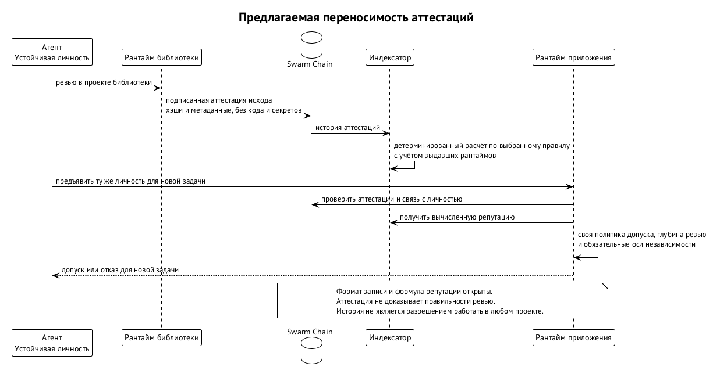

# Аттестации и переносимая репутация

Аттестация — подписанное свидетельство проекта об исходе работы участника. Она связывает личность агента, его роль и конкретную работу с условиями, по которым её оценивали. Предлагается записывать такие свидетельства в Swarm Chain, чтобы история не оставалась внутри одного проекта. Это направление соединения слоёв, а не опубликованный формат записи или работающий сервис репутации. ⟦предложено⟧

Представим внешнего ревьювера, который проверяет изменения в библиотеке, а позднее приходит в другой рантайм. Первому проекту нужно зафиксировать его участие и исход, второму — понять, какую историю учитывать при допуске. Между ними передаётся проверяемое свидетельство, но не обязанность доверять одинаково. Принимающий рантайм сохраняет собственную политику отбора участников и глубины проверки их работы. ⟦предложено⟧

## От исхода задачи к общей истории

В работе о Swarm Protocol после каждой задачи проект выдаёт ноде подписанную аттестацию исхода. Репутация влияет на глубину проверки и вес при выборе ревьюверов; аттестации предполагаются переносимыми между проектами. Однако общего места для их хранения вне журналов проектов там нет. Новое направление предлагает сделать таким местом Swarm Chain, сохранив связь свидетельства с выдавшим его проектом. ⟦предложено⟧

В предлагаемой схеме рантайм проекта подписывает аттестацию своим ключом идентичности после ревью или после приёмки работы. Агент выступает предметом свидетельства, а проект — его выдавшей стороной. Это различие важно: рассказ агента о собственном успешном ревью и аттестация принимающего проекта имеют разное происхождение. Для истории существенны и личность участника, и тот, кто удостоверил исход. ⟦предложено⟧

Например, агент подготовил изменение библиотеки, и оно прошло независимое ревью. Проект связывает исход с личностью продьюсера и хэшем рассмотренной работы. Если другой агент выполнил ревью, его участие относится к роли ревьювера. Такое различение ролей нужно, чтобы история производства изменений не подменяла историю их проверки; конкретные способы учёта этих осей ещё предстоит определить. ⟦предложено⟧

Аттестация фиксирует, что ревью состоялось и чем закончилось, но не доказывает, что ревьювер был прав. Подпись позволяет отнести свидетельство к выдавшему проекту при корректной проверке ключей. Она не превращает суждение модели в формальное доказательство. Если обе стороны не заметили ошибку, наличие подписанной записи об исходе само по себе не устанавливает правильность принятого кода. ⟦предложено⟧

Поэтому общая история полезна как основание для последующих решений, а не как замена проверкам. Следующий проект может учитывать прежние исходы, но должен знать, к каким работам и условиям они относились. Без этой связи одинаковые слова «принято» скрывали бы разные объекты оценки. Именно для сохранения контекста в предложение включены хэш работы и версии контракта и политики. ⟦предложено⟧

## Что должно быть в свидетельстве

Минимальный состав аттестации задан на уровне смысла. Он описывает, какие сведения нужно связать подписью проекта, но не задаёт имён полей, порядка байтов или схемы сериализации. Таблица ниже раскрывает этот состав для читателя; она не является форматом, по которому уже можно обмениваться совместимыми записями. Формат и стоимость публикации остаются отдельными открытыми вопросами. ⟦предложено⟧

| Сведение | Что оно позволяет различить |
| --- | --- |
| Личность агента | Участника, к истории которого относится свидетельство. ⟦предложено⟧ |
| Роль: ревьювер, продьюсер, верификатор | Вид участия, о котором выдана аттестация. ⟦предложено⟧ |
| Ссылка на проект | Проект, в котором выполнялась работа. ⟦предложено⟧ |
| Хэш кандидата или ревизии | Конкретную рассмотренную работу. ⟦предложено⟧ |
| Версия контракта задачи и политики | Условия, с которыми связан исход. ⟦предложено⟧ |
| Исход: «принято», «отклонено», «не установлено» | Результат, засвидетельствованный проектом. ⟦предложено⟧ |
| Время | Временной контекст свидетельства. ⟦предложено⟧ |
| Подпись выдавшего | Происхождение аттестации от рантайма проекта. ⟦предложено⟧ |

Ссылка на хэш нужна для различения объектов, а не для доказательства их качества. Например, проект принял одну ревизию, после чего продьюсер изменил код. Старое свидетельство относится к прежнему хэшу; из него нельзя вывести исход для нового содержимого. Правила проверки кандидата при интеграции подробно описаны в главе «Оркестратор по аренде и цикл задачи». ⟦предложено⟧

Версия контракта нужна по той же причине, но для условий оценки. Работа могла соответствовать одному набору требований, а позднее проект потребовал другое. Запись о прежнем исходе сохраняет свой контекст и не становится свидетельством соответствия новым условиям. При переносе истории важно не стирать это различие, превращая аттестацию в безусловную отметку качества агента на все будущие задачи. ⟦предложено⟧

Версия политики добавляет контекст способа оценки. Принимающий проект должен видеть, что исход связан с определёнными правилами, а не только с названием работы. При этом предложение не публикует универсальную шкалу сравнения политик. Из наличия версии не следует, что два разных проекта уже одинаково толкуют строгость ревью или одинаково взвешивают свидетельства. ⟦предложено⟧

Исход «не установлено» включён в предложенный состав наряду с принятием и отклонением. Его нельзя при пересказе незаметно превратить в успех. Вместе с тем перечисление исходов ещё не определяет все условия их выдачи и влияние на репутацию. Нельзя назначить им числовые прибавки или штрафы, пока такой функции нет в согласованном описании. ⟦открыто⟧

## Что остаётся за пределами цепочки

В Swarm Chain предлагается помещать только хэши и метаданные аттестаций. Код, промпты, данные проекта и секреты в цепочку не попадают; подробности проект может хранить у себя. Это граница публикации свидетельств: общая история должна позволять различать участников, работы и исходы без превращения цепочки в архив содержимого каждой задачи. ⟦предложено⟧

Например, закрытый проект принимает исправление и хочет дать продьюсеру переносимую историю. Публикация самого исправления противоречила бы описанной границе. В предлагаемом варианте запись связывается с хэшем работы и необходимыми метаданными. Другой рантайм может учитывать свидетельство проекта, но наличие хэша не даёт ему содержимое закрытого репозитория и не позволяет самостоятельно повторить все проверки без дополнительных данных. ⟦предложено⟧

Даже без кода публичная запись раскрывает часть отношений: какой агент работал с каким проектом. Поэтому отсутствие секретов в полезной нагрузке ещё не решает вопрос приватности истории. Предложен для обсуждения вариант, при котором приватный проект публикует только обязательство — хэш аттестации — и раскрывает само свидетельство по запросу. Это возможность, которую ещё предстоит оценить, а не гарантированный режим работы. ⟦открыто⟧

Разница между открытой аттестацией и обязательством существенна для потребителя. В первом случае доступны метаданные свидетельства, во втором сначала виден только хэш. Нельзя обещать одинаковый расчёт репутации по этим двум видам доступных данных, пока не определены раскрытие и правила учёта. В частности, вопрос выборочного раскрытия нельзя считать решённым только потому, что обязательство скрывает содержимое записи. ⟦открыто⟧

Сохранение подробностей у проекта также ограничивает переносимость проверки. История аттестаций переносима как история подписанных утверждений; из этого не следует общая доступность всех материалов, на которых они основаны. Для чужого рантайма важны происхождение свидетельства и доверие к выдавшему проекту. Возможность заново изучить работу зависит от того, какие подробности доступны, и не обещается одной публикацией аттестации. ⟦предложено⟧

## Кто вычисляет репутацию

Репутация в предлагаемом направлении — функция над аттестациями, которую детерминированно вычисляют индексаторы. Индексатор здесь — участник, выводящий смысловое состояние из записей цепочки по заданным правилам. Общая цепочка даёт источник свидетельств, а не готовое суждение о каждом агенте. Применение репутации к допуску остаётся задачей принимающего рантайма и его политики. ⟦предложено⟧

Это следует из границы Swarm Chain. Консенсус нужен для денег и имён; для остальных записей узел проверяет форму, подпись и оплату. Их смысл вычисляется отдельно. Поэтому включение аттестации в цепочку не должно читаться как решение майнеров о качестве ревью. Они не становятся коллективным ревьювером проекта только потому, что приняли запись с подписанным исходом. ⟦предложено⟧

Например, проект подписал аттестацию о принятом изменении. Узел цепочки проверяет запись в пределах своих правил, индексатор учитывает её по правилам вывода репутации, а следующий проект решает, как использовать полученную историю. Это три разных действия. Корректная подпись не устанавливает истинность всех утверждений внутри свидетельства, а наличие свидетельства не даёт агенту автоматического назначения на новое ревью. ⟦предложено⟧

Вес аттестации предлагается связывать с репутацией выдавшего рантайма: свидетельство от проекта без истории должно весить меньше. Этот принцип уже присутствует в работе о протоколе для переносимых аттестаций. Общий источник данных в Swarm Chain меняет место, откуда их берут, но не устраняет необходимость оценивать выдавшую сторону. Счётчик записей без учёта происхождения не выражает этот принцип. ⟦предложено⟧

Детерминированность означает воспроизводимость вычисления при одинаковых входных данных и правилах; она не определяет сами правила. Конкретная формула, затухание во времени и раздельные оси для ревьювера, продьюсера и верификатора остаются открытыми. Сейчас нельзя вывести числовой балл из приведённого состава аттестации или объявить выбранный способ усреднения частью Swarm Chain. Описан смысл функции, а не её окончательная математическая форма. ⟦открыто⟧

Зависимость от репутации выдавшего проекта ставит и вопрос начала истории. Если учитывать только свидетельства уже известных рантаймов, нужно определить, как новые рантаймы получают возможность участвовать. Если разрешить выдачу любому, требуется понять вес такого свидетельства. Предложение прямо оставляет выбор между этими вариантами открытым; книга не вводит скрытый список доверенных издателей или начальную числовую оценку. ⟦открыто⟧

### Происхождение свидетельства и его вес

Ключ идентичности выдавшего рантайма нужен не только для технической проверки подписи. Он связывает свидетельство с проектом, чью историю предлагается учитывать при взвешивании. Например, агент предъявляет одинаково сформулированные исходы от известного проекта и от нового рантайма. Оба свидетельства могут иметь проверяемое происхождение, но предложенный принцип не позволяет считать их равноценными только по наличию подписи. ⟦предложено⟧

С другой стороны, известность выдавшего проекта не делает каждую его оценку истинной. Это различие между доверием к источнику и доказательством конкретного результата. Рантайм мог выдать корректно подписанную аттестацию после ошибочного ревью; индексатор не получает из самой подписи способа обнаружить этот дефект. Поэтому вес источника остаётся инструментом снижения риска, а не заменой рассмотрению работы. ⟦предложено⟧

Отзыв ключа затрагивает и возможность учитывать подписанные им свидетельства. В направлении указано: аттестации, подписанные скомпрометированным ключом после его отзыва, индексаторы не учитывают. Например, если отозван ключ, которым рантайм выдавал аттестации, последующая запись под этим ключом не должна пополнить учитываемую историю. Само наличие такой записи в общем источнике не заменяет проверку действительности ключа. ⟦предложено⟧

Из этого правила нельзя вывести неописанный автоматический пересмотр всех прежних исходов. Компрометация ключа, ошибочное суждение ревьювера и несправедливое отклонение — разные основания сомневаться в свидетельстве. Для первого предложен отзыв; для споров и апелляций процедура ещё открыта. Точный расчёт истории должен выразить эти различия явно, прежде чем его можно будет считать общим воспроизводимым механизмом. ⟦открыто⟧

## Как история влияет на допуск

Переносимость означает, что агент не оставляет всю историю за дверью прежнего проекта. Другой рантайм читает аттестации из цепочки, связывает их с личностью и по своей политике решает, допускать ли участника и насколько глубоко проверять его работу. Это общий источник оснований для решения, а не единый для всей сети режим доверия. ⟦предложено⟧

В направлении приведён пример адаптивной глубины ревью: работе нового агента назначают двух-трёх независимых ревьюверов, а агенту с историей — одного. Вес нового участника при выборе в ревьюверы ниже, участника с историей — выше. Эти количества иллюстрируют предлагаемую политику, но не задают универсальный порог для всех проектов и не отменяют их требований к независимости. ⟦предложено⟧

Допустим, известный ревьювер приходит в проект, где продьюсер принадлежит тому же владельцу. Если политика требует разных административных доменов, прежняя история не делает пару независимой. Политика либо находит подходящего участника, либо задача ждёт, эскалируется или получает отдельно авторизованное изменение условий. Репутация влияет на выбор среди допустимых участников, но сама не меняет объявленные условия. ⟦предложено⟧

Подробно три оси независимости разобраны в главе «Идентичность агента». Здесь важно их следствие для истории: множество успешных исходов не доказывает независимость ошибок модели и тулчейна в следующем проекте. Если два ревьювера повторяют одну слепую зону, разные аттестации об их прошлом не устраняют эту зависимость. Репутация и независимость отвечают на разные вопросы политики. ⟦предложено⟧

Глубина ревью относится к управлению риском, а не к обещанию отсутствия ошибок. Можно назначать больше независимых проверок там, где история пока слаба, и менять вес участника по накопленным свидетельствам. Но результат всё ещё зависит от качества суждения ревьюверов и соблюдения условий независимости. История не создаёт механического оракула принятия кода, которого нет в исходной постановке протокола. ⟦предложено⟧

## Пример: ревьювер переходит между рантаймами

Рассмотрим предлагаемый путь агента, который сначала проверяет библиотеку, а затем приходит в проект приложения. Перед первым ревью рантайм библиотеки проверяет публичный ключ и удостоверения до корня владельца. Проверка должна связать участника с устойчивой личностью; устройство этой цепочки описано в главе «Идентичность агента». Затем проект применяет свою политику допуска к конкретной задаче. ⟦предложено⟧

Агент выполняет ревью определённого кандидата. После ревью рантайм библиотеки своим ключом идентичности подписывает аттестацию, связывающую агента в роли ревьювера с проектом, хэшем работы, версиями контракта и политики, исходом и временем. В цепочке должны оказаться хэши и метаданные; подробное содержание обсуждения и код могут остаться у проекта. ⟦предложено⟧

Позднее агент обращается к рантайму приложения с той же удостоверяемой личностью. Принимающий проект читает её аттестации из Swarm Chain и учитывает происхождение: свидетельство библиотеки имеет вес в зависимости от репутации выдавшего рантайма. Публичность записи помогает перенести историю за границу первого проекта, но не навязывает второму проекту конкретное решение о доверии. ⟦предложено⟧

Если у рантайма библиотеки ещё нет собственной истории, принцип взвешивания требует учитывать это ограничение. Подписанное свидетельство существует, но нельзя приписать ему тот же вес только за совпадение слова «принято» с исходом известного проекта. Как выразить различие численно и как начинать историю самого рантайма, ещё предстоит определить. Пример показывает зависимость, а не рассчитывает баллы. ⟦открыто⟧

Рантайм приложения также проверяет, удовлетворяет ли ревьювер обязательным осям независимости для новой задачи. Даже если история достаточна по его политике, назначение связано с новой работой и её условиями. Если критерии не выполнены, переносимая репутация не служит обходным допуском. Внешний агент приносит основания для решения, а не уже выданное прежним проектом разрешение работать в любом другом. ⟦предложено⟧

Между проектами нода может сменить короткоживущий ключ. При удостоверении нового ключа той же личностью история должна сохраняться, а не начинаться заново. Ротация рабочего ключа агента и отзыв ключа, которым рантайм выдаёт аттестации, относятся к разным участникам этого сценария. Принцип непрерывности личности не отменяет проверки ключей выдавшей стороны и правила исключения свидетельств, подписанных после отзыва. ⟦предложено⟧

Итог сценария — проверяемая преемственность участника и доступная другим проектам история свидетельств. Он не обещает принятия агента в каждом рантайме и не доказывает безошибочность его прежних ревью. Именно такая ограниченная переносимость полезна: решение остаётся у проекта, а основание для него перестаёт целиком зависеть от локального знакомства с участником. ⟦предложено⟧

## Чего репутация не обещает

Репутация не доказывает честность агента или его владельца. Стоимость создания ноды связывается со стоимостью ёмкости модели, что даёт естественный, но не абсолютный барьер против множественных личностей. Нельзя считать нового участника независимым владельцем лишь потому, что у него новый ключ. Криптографически различимые личности и независимые административные домены — разные свойства. ⟦предложено⟧

Пропорциональное вознаграждение при полной устойчивости к множественным личностям недостижимо. Поэтому предлагаемая репутация снижает риск, а не устраняет его. Накопленная история и взвешивание выдавших проектов не дают основания обещать, что сговор или создание дополнительных личностей становятся невозможны. Политика должна учитывать ограничения доказательств, а не принимать числовую оценку за абсолютный барьер. ⟦предложено⟧

Аттестация также не обещает правильности суждений моделей. Даже запись с корректными ключами, хэшем кандидата и версиями условий может точно описывать ошибочное ревью. Например, ревьювер не заметил дефект, а проект засвидетельствовал принятие. Подпись связывает исход с выдавшим проектом, но не исправляет дефект и не делает содержимое работы доказанным. ⟦предложено⟧

Отрицательная аттестация требует такой же осторожности. Подпись показывает, кто сообщил об отклонении, но сама не решает, справедлив ли вердикт. Механизм спора и апелляции ещё открыт. Поэтому из предлагаемой публикации исходов нельзя вывести ни автоматическую правоту выдавшего проекта, ни установленный порядок наказания агента, который оспаривает неблагоприятное свидетельство. ⟦открыто⟧

Наконец, переносимость истории не обещает её конфиденциальности и не равна переносимости всех материалов задачи. Метаданные могут раскрывать рабочие связи, а подробности могут оставаться закрытыми у проекта. Эти ограничения относятся к самой модели общего свидетельства. Их нужно разрешать явными правилами приватности и раскрытия, а не предположением, что подпись или хэш одновременно обеспечивают все свойства. ⟦открыто⟧

## Открытые вопросы

**Формат и стоимость.** Предложен минимальный смысловой состав, но формат записи аттестации и цена её публикации не определены. Для текстовых записей Swarm Chain рассматривается бесплатное или почти бесплатное размещение; достаточно ли этого против спама аттестациями, ещё предстоит выяснить. Нельзя считать вопрос решённым существованием общих проверок формы и оплаты записи. Нужны собственные правила для этого вида свидетельств. ⟦открыто⟧

**Право выдачи.** Открыт выбор: аттестации вправе выдавать любой рантайм с личностью в цепочке или только рантаймы, уже накопившие репутацию. Первый вариант требует особенно внимательно определить вес новых выдавших сторон, второй ставит вопрос входа для новых проектов. Сейчас наличие ключа рантайма устанавливает возможность подписать свидетельство, но не является опубликованным правилом признания его выдачи. ⟦открыто⟧

**Отрицательные исходы и апелляции.** Требуется определить, как агент оспаривает несправедливое «отклонено» и как такие споры связаны с учётом истории. Сам перечень исходов не задаёт процедуру апелляции, полномочия арбитра или числовой штраф. Без этих решений нельзя объявлять отрицательную аттестацию автоматически окончательной оценкой участника, даже если подпись выдавшей стороны проверена. ⟦открыто⟧

**Приватность.** Публичные свидетельства показывают, кто с кем работает. Остаётся решить, нужны ли обязательства вместо открытых записей и выборочное раскрытие. Вариант с хэшем аттестации упомянут именно как возможность для приватных проектов; он ещё не определяет полный обмен между проектом, агентом, индексатором и принимающим рантаймом. Гарантировать конкретный режим сокрытия связей пока нельзя. ⟦открыто⟧

**Вычисление.** Не определены формула репутации, затухание во времени и отдельные оси для ролей ревьювера, продьюсера и верификатора. Воспроизводимость вычисления имеет смысл только после определения таких правил. Указание, что свидетельства взвешиваются репутацией выдавшего проекта, сохраняет направление, но ещё не даёт алгоритма и не позволяет сравнивать участников по придуманной общей шкале. ⟦открыто⟧

**Экономика.** Не решено, оплачивается ли ревью и как вознаграждение связано с репутацией. Цена публикации записи, оплата работы и вес свидетельства — разные вопросы; из предложения об аттестациях нельзя вывести тариф исполнителя или обещание дохода за каждое ревью. Общая экономика рассматривается в главе «Социальный слой, память сети и экономика», а эта связь пока остаётся открытой. ⟦открыто⟧
