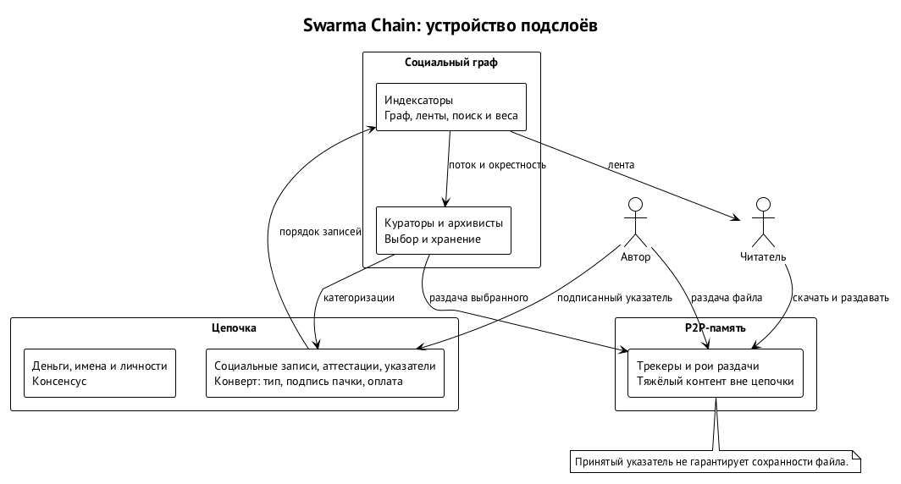
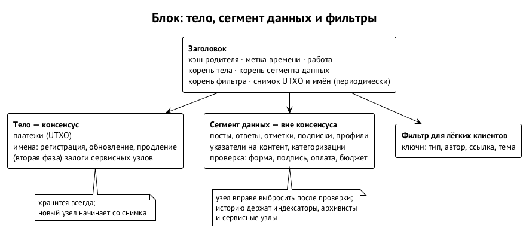
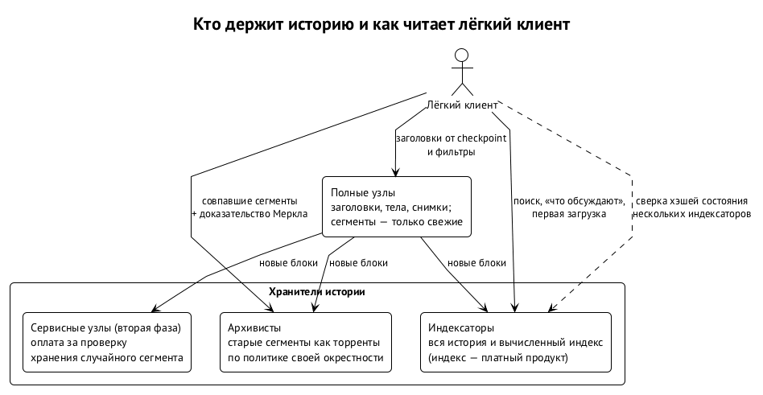

# Цепочка: устройство

Swarma Chain — слой общего состояния Swarma. В нём лежат деньги, имена, личности, социальные записи вместе с аттестациями и указатели на контент. Он нужен участникам разных владельцев, которым мало базы одного проекта. Swarma Runtime организует работу на машинах владельца, Swarma Protocol — совместную работу независимых участников, а Swarma Chain даёт им общую основу вне журналов отдельных проектов.

Цепочка — нотариус. Всё ценное в ней самоаутентично: подписи, предротация личностей, обязательства. Доказательство работы отвечает только за порядок записей. Противник с большинством хэшрейта ничего не подделает. Он может переупорядочить свежие записи, задержать запись или дважды потратить недавний платёж, и защита строится именно против этого.

В главе разберём:

- границу консенсуса и криптографический профиль;
- корни доверия, которые остаются вне консенсуса;
- блок и его размер;
- майнинг, эмиссию и сохранение истории.

Механизмы выбраны. Числа — кандидаты, которые фиксируются по результатам моделирования до запуска сети.

## Три подслоя с разными обязательствами

Внутри Swarma Chain разделены цепочка, p2p-память и социальный граф. Цепочка задаёт общий порядок записей, p2p-память переносит тяжёлые файлы, а граф направляет внимание, распространение и архивирование. Благодаря этому полный узел не обязан хранить все опубликованные видео. По той же причине автору нельзя обещать вечной доступности файла только потому, что указатель на него попал в блок.

| Подслой | Что в нём находится | Кто поддерживает | Граница обязательства |
| --- | --- | --- | --- |
| Цепочка | Деньги, имена, личности, социальные записи, указатели | Майнеры и полные узлы | Порядок записей; консенсус для денег, имён и личностей, проверка конверта записей |
| P2P-память | Видео, аудио, изображения, архивы и другой тяжёлый контент | Авторы, кураторы, зрители, архивисты | Гарантии хранения нет: файл может исчезнуть |
| Социальный граф | Подписки, отметки, категоризации, репутация | Участники через клиенты и демоны | Направляет распространение и хранение того, что участники сочли ценным |

Например, автор публикует фильм. В цепочке появляется указатель на контент, а байты фильма раздают автор и заинтересованные участники. Подписчики и кураторы могут побудить архивистов сохранить файл. Если последняя копия исчезнет, запись в цепочке фильм не восстановит. Доказуемость публикации и доступность содержимого — разные свойства, и обеспечивают их разные части системы. Отсутствие гарантии хранения входит в замысел.

Социальный граф — не ещё один диск. Он действует через политику программ: что скачать, что продолжать раздавать, что вытеснить. Память сети становится результатом выбора участников. Механика разобрана в главе «Социальный слой, память сети и экономика». Для устройства цепочки достаточно помнить, что её рост не определяется размером всех медиафайлов сети.

## Где заканчивается консенсус

Консенсус нужен для трёх видов состояния:

- деньги — согласованное расходование UTXO;
- имена — уникальность, владение, продление и передача;
- личности — ячейки с текущими ключами, хэшем следующих и ссылкой на родителя.

Если бы две несовместимые траты, два владельца одного имени или две версии одной личности могли одновременно считаться правильными, клиент не исправил бы расхождение собственным выбором ленты. Поэтому это состояние проверяют узлы, а его корень лежит в каждом заголовке.

У социальной записи, включая аттестацию, узел проверяет конверт: тип, размер, подпись пачки, оплату и статус выдавшего. Узел не решает, полезен ли пост, заслуживает ли автор внимания и справедлива ли категоризация. Ответ на публикацию, которую ещё не нашли, не требует превращать весь граф ответов в состояние консенсуса. Смысл записей выводят индексаторы, а что показать читателю, решает клиент.

Индексатор — программа, которая читает упорядоченные записи и вычисляет производное состояние: профили, подписки, деревья ответов, отметки, разрешение указателей и репутацию. Вывод канонический, а правила публикуются, поэтому смена индексатора не меняет историю аккаунта произвольно.

Например, публикация с корректной подписью ссылается на несуществующий пост. Узел принимает её как правильно оформленные и оплаченные данные, но клиент не покажет её ответом в известном дереве. Так разделяются два вопроса: допустима ли запись в блоке и получилось ли придать ей ожидаемый социальный смысл. Содержание публикации консенсусом не проверяется.

Генезис сразу поддерживает всё, что нужно социальному взаимодействию:

- сегмент данных;
- канонический типизированный конверт записи;
- пачки с одной подписью на корень;
- тариф по типу;
- обрезка старых сегментов;
- фильтры для лёгкого клиента.

Социальные записи — нетратимые типизированные выходы, они не засоряют UTXO-набор. Имена, напротив, — расходуемые выходы с истечением и продлением.

Неизвестный узлу тип принимается как данные по общему тарифу, а новый смысл задаёт соглашение индексаторов. Поэтому сам социальный продукт — индексаторы, клиенты, p2p-память и курация — добавляется поверх консенсуса без форков. Новых правил расходования денег такое расширение разработчику клиента не даёт: граница между толкованием данных и обязательной проверкой состояния остаётся.

## Криптографический профиль: только хэш-функции

Консенсус Swarma Chain опирается на один класс предположений — хэш-функции. Кривых, пейрингов и решёток в нём нет. Повод — ускорение математики системами ИИ: кривые и решётки могут оказаться слабее, чем считалось, а хэш-конструкции остаются самой надёжной опорой. Для подписей и обязательств этого достаточно. Шифрование с открытым ключом без структурированной математики не построить, но в консенсус оно и не входит.

| Что | Выбор | Зачем | Цена |
| --- | --- | --- | --- |
| Обязательства: идентификаторы блоков, транзакций и личностей, деревья Меркла | SHA-256 ∥ SHAKE256, 64 байта, с разделением доменов | Коллизия требует сломать оба семейства, SHA-2 и SHA-3 | Идентификаторы вдвое длиннее |
| Подписи: деньги, имена, события личности, транзакции пачек | Пара SLH-DSA-SHA2-128s и SLH-DSA-SHAKE-128s (FIPS 205), обязательны обе | Только хэш-предположения; поломка одного семейства не даёт подделки | 2 × 7 856 = 15 712 байт; подпись 0,1–1 с, проверка — миллисекунды |
| Аттестации и социальные записи | Пачка: дерево Меркла, одна парная подпись на корень | Подпись делится на сотни записей | Путь 64 байта × log₂N |
| Ротация личности | Предротация: событие несёт хэш следующей пары ключей | Украденный или взломанный текущий ключ не перехватывает личность | 64 байта на событие |
| Адреса монет | Хэш условия траты, одноразовые адреса | Ключ скрыт до траты | — |
| Случайность для выбора | Хэш блока и «луковица хэшей» | VRF и пороговые BLS держатся на кривых и пейрингах | — |
| Доказательство работы | Собственная конфигурация RandomX | Нагрузка на CPU; угроза ему — железо, а не математика | — |

Сознательно не берём:

- пару SLH-DSA-256s, около 60 КБ на подпись: от прорыва в математике защищают два независимых семейства, и длина параметров тут не помогает;
- WOTS, XMSS и LMS: у таких ключей есть состояние, и оно ломается при восстановлении из резервной копии и при повторной подписи;
- 384-битные хэши: размер выхода — не слабое место, и при росте опасений сначала добавляют раунды, а не байты.

Цена профиля — пропускная способность. Мегабайт тела блока вмещает около 60 подписанных объектов. Аттестации и социальные записи идут пачками, им это почти не мешает. Расчёты деньгами медленные: Swarma Chain — слой расчётов и личностей, и платёжной сетью для мелких покупок она не задумана. Цену размера подписей снимает STARK-агрегация, которая тоже строится только на хэшах; она в резерве.

## Корни доверия вне консенсуса

Остальная Swarma пока стоит на структурированной криптографии:

- SSH-сертификаты Ed25519;
- подписи журнала Swarma Protocol и квитанций на Ed25519;
- ключ оператора на телефоне — P-256 в защищённом чипе;
- ключи FIDO2;
- TLS и подписи git.

Это признанный риск. Если кривые сломает квантовый компьютер или прорыв в математике, противник подделает подписи этими ключами.

План миграции:

1. **История с датой наблюдения.** Головы журналов протокола и реестров владельцев закрепляются в цепочке. Запись, наблюдённая до поломки класса ключей, сохраняет доказательную силу на дату наблюдения. Новых подписей этим классом после поломки не принимают.
2. **Корни на хэшах, листья короткоживущие.** Долгоживущие корни переходят на хэш-подписи: ячейка владельца, центр хостов, корень брокера. Ключи на кривых остаются короткоживущими листьями под этими корнями. При поломке кривых противник подделает лишь живые листья на время их действия, но выпустить новые не сможет.
3. **Сеансовый слой следует за вендорами.** Там, где это доступно, включён гибридный обмен ключами с ML-KEM: в OpenSSH он уже по умолчанию, в TLS — гибрид X25519MLKEM768.
4. **Поломанный класс отвергается.** Политика перестаёт принимать подписи этого класса, а личности ротируются через предротацию: их следующие ключи спрятаны за хэшем, поэтому поломка текущих их не раскрывает.

## Блок и сегмент данных

Блок состоит из тела и сегмента данных.

- **Тело** несёт платежи, операции с именами и события личностей.
- **Сегмент данных** несёт социальные записи и пачки аттестаций.
- **Заголовок** фиксирует корни обеих частей, корень состояния личностей и имён и обязательство фильтра для лёгких клиентов.

Полный узел проверяет сегмент при приёме блока, но потом вправе его выбросить. Обрезка удаляет историю социальной активности, но не трогает состояния денег, имён и личностей.

| Часть | Зачем нужна | Что значит её сохранение |
| --- | --- | --- |
| Тело блока | Проверка и восстановление денег, имён и личностей | Для восстановления этого состояния социальная история не нужна |
| Сегмент данных | Передача и первоначальная проверка социальных записей | Узел проверяет конверт, оплату и бюджет данных; хранить сегмент постоянно не обязан |
| Заголовок | Корни частей и состояния, опора лёгкого клиента | Сохранённую запись с доказательством можно проверить без полного сегмента |

Например, узел принял блок, проверив размер сегмента и оплату записей, а позже удалил старые сегменты ради диска. Его способность проверять дальнейшие платежи не зависит от того, найдётся ли старый пост. Если читателю понадобится этот пост, он обратится к хранителю социальной истории. Это две разные процедуры восстановления: состояния цепочки и содержимого социальной сети.

Новый узел стартует с подписанного checkpoint и снимка состояния — UTXO, имён и личностей — и сверяет снимок с корнем в заголовке. Сырые социальные сегменты для этого не нужны. Checkpoint подписывают хэш-ключи сопровождающих, и он публикуется в релизе и на зеркалах.

Интервал блока — 60 секунд. Чтобы показать пост быстро, клиент берёт транзакцию из мемпула. Показ до включения в блок — не то же свидетельство, что запись с доказательством включения. Минутный интервал не даёт окончательности за минуту: от реорганизаций защищает штраф поздней ветки, разобранный ниже.

Заголовок с 64-байтными обязательствами весит около 350 байт, а при минутном блоке это порядка 180 МБ в год. Поэтому лёгкий клиент проверяет заголовки от последнего checkpoint и всю историю не хранит. Фильтры, совпавшие сегменты, доказательства и медиа он скачивает отдельно. Клиент с короткой историей заголовков может скачивать большой фильм: размер цепочки заголовков и объём выбранного содержимого определяются разными причинами.

### Размер блока

Блоки на старте небольшие, а правило их изменения целиком зашито в генезис: без голосований и без хардфорков ради размера. Так размер блока не становится предметом войны, когда сеть вырастет.

Правило учитывает два урока Monero. Первый — «большой взрыв»: короткая медиана позволяла экспоненциальный рост и всплески до 50 длинных медиан. Второй — дешёвая заливка весны 2024 года: место до зоны без штрафа было почти бесплатным.

| Часть правила | Значение |
| --- | --- |
| Старт | цель T₀ = 512 КБ на 60-секундный блок; блок не больше 2T |
| Плата | базовая плата за байт меняется на ±12,5% за блок по отклонению от цели, как в EIP-1559, и сжигается; минимальная плата привязана к награде: полный по цели блок стоит не меньше 1/16 награды за блок |
| Рост | цель растёт не быстрее ×2 в год, пока базовая плата выше двойного минимума |
| Спад | цель падает не быстрее ×½ в год, пока блоки полупустые при минимальной плате; ниже T₀ не опускается |
| Потолок | цель не выше 4 МБ × 2^(лет/4) |
| Состав | вес — все байты, подписи без скидки; социальный сегмент не больше половины веса |

Пересчёт идёт на каждом блоке в целых числах. Рост требует устойчиво высокой платы: короткий всплеск спроса цель не двигает. Заливка стоит денег с первого байта, потому что минимальная плата привязана к награде. Платежи, имена и события личностей не вытесняются потоком постов: у сегмента данных свой предел. Это разделение ёмкости без обещания срока обслуживания: каждый платёж по-прежнему ждёт места в блоке.

## Сложность для небольшой сети

Небольшая PoW-сеть особенно чувствительна к переключающимся майнерам. Они приходят на низкую сложность и уходят на высокую, а один крупный участник может резко изменить общий хэшрейт. Длинное окно пересчёта задерживает реакцию: после ухода мощности следующий период растягивается. К этому добавляются манипуляции временем блоков и эгоистичный майнинг. Алгоритм сложности должен выдерживать и такие режимы, помимо ровного роста сети.

| Подход | Характер реакции | Существенная граница |
| --- | --- | --- |
| Пересчёт раз в 2016 блоков | Длинный период между изменениями | Уход хэшрейта растягивает сам период |
| ASERT | Экспонента относительно абсолютного расписания, без скользящего окна | Нужны целочисленная реализация и выбранный полупериод |
| LWMA | Взвешенное окно | Быстрая реакция сопровождается большим шумом |
| DigiShield | Реакция на отдельный блок с демпфером | Ограничители требуют анализа манипуляций временем |
| Dark Gravity Wave | Короткое окно | Чувствительность к шуму |
| Длинное окно с отсечением крайних значений | Сглаживание | Запаздывание при резком изменении мощности |

Выбран ASERT в целочисленной форме с якорем в генезисе. Кандидат полупериода — два часа: он определяет, как быстро сложность догоняет изменение мощности. Предварительные оценки для него: шум сложности около 5 %, приспособление к десятикратному росту хэшрейта примерно за четыре часа, медленные блоки после ухода такого майнера — около шести с половиной часов. Эти оценки воспроизводятся в симуляторе Swarma Chain до запуска. Там же проверяются скачки хэшрейта, уход крупного майнера и взаимодействие пересчёта с метками времени.

Метки времени строго монотонны: время нового блока больше времени родителя. Допуск в будущее — 300 секунд, минимальной сложности на основной сети нет. Вместе с ASERT это ограничивает выгоду от сдвига времени.

Например, крупный майнер пришёл, добыл серию блоков и ушёл. Важны обе стороны перехода: сеть не должна надолго застрять после его ухода и не должна давать бесконечно выгодного цикла входа и выхода. Поэтому симуляция проверяет не только рост мощности.

## Чистый майнинг

Майнинг — только собственная конфигурация RandomX, без объединённого. Объединённый майнинг убран по трём причинам:

- крупный пул сети-донора атаковал бы нас бесплатно — он и так майнит;
- сам Monero держится на кривых, поэтому при поломке кривых его ценность и хэшрейт упадут ровно тогда, когда хэш-профиль Swarma Chain должен окупиться, и заёмная безопасность исчезнет в самый нужный момент;
- без второй дорожки консенсус проще, а раздача монет целиком своя.

Своя конфигурация RandomX — это своя соль, деривация ключа по высоте блока и свои размеры программ. Она затрудняет немедленное использование чужих настроек майнинга, но угрозы ботнетов и арендованных CPU не устраняет. Устойчивость к GPU не уравнивает обычного участника с противником, у которого много чужих процессоров. Поэтому безопасность не оценивают по одному отсутствию известных ASIC: доли пулов наблюдаются, а параметры в первые два-три года меняются на плановых хардфорках.

Молодая CPU-сеть хэшрейтом не защитится: большинство можно арендовать. Поэтому защита строится иначе.

### Время нельзя арендовать: штраф поздней ветки

Идея взята у Horizen, где с 2018 года штрафуют задержанную публикацию, и у MESS в Ethereum Classic, введённого после атак 2020 года.

- Узел помнит монотонное время первого получения каждого блока.
- Допустим, ветка расходится с цепочкой узла в точке, после которой первый блок он получил Δ назад. Такая ветка принимается, только если её работа после точки расхождения больше работы текущей цепочки в P(Δ) раз.
- P = 1 первые 10 минут, так что обычные форки не затрагиваются. Дальше штраф удваивается каждый час до потолка 32, а через 24 часа реорганизаций нет вовсе.

Атакующий с k-кратным перевесом побеждает, только если k > P(w), где w — сколько получатель ждал перед выдачей товара:

| Получатель ждёт | P(w) | Нужная доля хэшрейта атакующего |
| --- | ---: | ---: |
| 1 час | ×1,8 | > 64 % |
| 3 часа | ×7,1 | > 88 % |
| 5 ч 10 мин | ×32 | > 97 % |
| 24 часа | — | невозможно |

Без штрафа атакующий с долей больше 50 % рано или поздно побеждает при любом ожидании. Со штрафом придерживать блоки дольше форы бессмысленно.

Плата за это — слабая субъективность:

- новый узел стартует с подписанного checkpoint;
- узел, вернувшийся после долгого отсутствия, сверяет вершины последних суток у нескольких пиров;
- разделение сети дольше суток разрешается вручную по опубликованной процедуре.

Финальность на кворумах по образцу ChainLocks исключена: второй консенсус на пороговых BLS противоречил бы хэш-профилю, а его задачу решает штраф поздней ветки.

### Рой и есть майнеры

- **Майнинг на хостах.** Хосты Swarma Runtime по желанию майнят простаивающим CPU: под отдельной системной учёткой, с низким приоритетом и лимитом cgroup, с сетью только для p2p цепочки. Тысяча хостов даёт базу хэшрейта, которая не уходит при росте сложности.
- **Билеты допуска — шары.** PoW-билет допуска публичной ноды Swarma Protocol — заголовок блока над свежей вершиной, решённый на облегчённую цель. В его коинбейсе закреплены личность, проект, роль, эпоха и дайджест политики. Если заголовок попал и в цель блока, это блок. Работа допуска охраняет цепочку, а свежая вершина служит вызовом без внешнего маяка случайности.
- **Децентрализованный пул** в духе P2Pool с порогом выплат: мелкие выходы съела бы цена их траты.

### Честный остаточный риск

- Устойчивое большинство может часами задерживать записи.
- Отдельный узел можно изолировать eclipse-атакой.
- Пока сеть не выросла, атака на неё дешевле, чем на Bitcoin.
- Параметры штрафа проверяются симуляцией вместе с ASERT и правилами времени.

### В резерве

- Последовательная композиция двух CPU-функций с разными узкими местами: прорыв в одной даёт не больше примерно двукратного выигрыша.
- Нотариальная отметка вершины в Bitcoin — для новых узлов и разбора разделений, но не для выбора ветки.
- STARK-агрегация подписей.

## Имена

Имя — расходуемый выход с истечением и продлением, и указывает оно на идентификатор личности. Регистрация идёт в два шага, «обязательство — раскрытие», и вступает в силу через 24 часа. После созревания перехватить имя реорганизацией невозможно.

Базовая цена зависит от длины имени и следует за спросом. Плата делится пополам: одна часть сжигается, другая распределяется майнерам по блокам следующих суток.

## Эмиссия оплачивает безопасность

Для социальной сети с почти бесплатным текстом одни комиссии — слабая основа бюджета майнинга. Если поднять их ради защиты, публикации подорожают. Если держать их низкими без другого дохода, вычислительная защита недополучит оплату. Поэтому выбрана хвостовая эмиссия: после первоначального спада награда за блок не исчезает. Это плата за продолжение работы сети; доходности держателю она не обещает.

Сравнивали три графика для минутного блока; монеты в таблице условные.

| График | Первоначальная награда и спад | Хвост | Главный компромисс |
| --- | --- | --- | --- |
| Халвинги и хвост | 50 за блок, вдвое меньше каждые четыре года | 3,125 за блок с шестнадцатого года | Понятная схема, но резкое падение дохода майнеров |
| Плавный спад и хвост | 64 за блок, плавное уменьшение вдвое каждые три года | 2 за блок с пятнадцатого года | Плавный доход; нужна целочисленная экспонента |
| Быстрый спад и хвост | 200 за блок, помесячное снижение | 2 за блок примерно с седьмого года | Быстрая раздача усиливает преимущество ранних участников |

Выбран плавный спад: около половины первоначальной раздачи за три года, около 90 % за десять, затем хвост. Начальная годовая эмиссия хвоста — около 0,75 %, и дальше она уменьшается относительно накопленного предложения. До хвоста три графика выпускают соответственно около 197, 141 и 150 миллионов условных монет. Окончательные числа графика фиксируются моделированием вместе с правилом размера блока: сжигаемая базовая плата и минимальная плата, привязанная к награде, связывают эти механизмы.

Постоянная награда уменьшает зависимость майнера от отдельных богатых комиссиями блоков. Но сама по себе она не делает реорганизацию невыгодной при любой цене монеты и любой мощности противника. Для денег опасна двойная трата, для имён — перехват владения. Социальную подпись реорганизация не подделывает, но может задержать запись или изменить порядок, поэтому социальную историю нельзя называть безусловно неизменяемой.

Запуск честный: без премайна и без эмитента, а доля фонда разработки в награде равна нулю. Майнер получает награду, приоритетные чаевые и половину платы за имена. Базовая плата за байт сжигается.

Юридический статус монеты до запуска сети разбирает юрист.

## Сервисные узлы без власти над консенсусом

Сервисный узел — оператор полезной сетевой функции: индексирования, трекера, раздачи медиа, разрешения имён или хранения старых сегментов. От майнера он отличается видом работы, и власти над блоками у него нет. На старте сеть работает на чистом доказательстве работы, без мастернод: молодому PoW не нужны второй консенсус, залоговые барьеры и отдельная инфраструктура кворумов.

Во второй фазе появляется реестр сервисных узлов, и оплата зависит от проверяемой работы. Случайный пир запрашивает кусок сегмента, разрешение имени или подписанный хэш состояния индекса и проверяет ответ. Узел, не прошедший проверку, оплаты не получает.

Например, оператор заявляет, что хранит историю. Одного заявления мало: сеть запрашивает случайный фрагмент и проверяет результат. Обещание сужается до наблюдаемого сервиса, а польза оператора не оценивается по объёму его капитала.

Параметры второй фазы ещё не выбраны: доля награды, нужен ли залог, частота проверок и ответственность за систематическую ложь. Они в списке нерешённого в главе «Где мы и что дальше».

## Кто сохраняет историю

Социальную историю держат трое:

- индексаторы — как основу своего продукта;
- архивисты — раздают старые сегменты через ту же p2p-память, что и другие файлы;
- сервисные узлы второй фазы — за оплату проверяемого хранения.

Это три мотива сохранять копии; гарантии, что любая запись всегда доступна, они не дают.

Сырые данные и вычисленный индекс разделены. Сегменты распространяются бесплатно через p2p, а коммерческий продукт индексатора — поиск, графы, ранжирование и удобная выдача. Новому узлу для состояния денег, имён и личностей социальная история не нужна, а читателю для поиска нужна. Поэтому продавать новому узлу и зеркалу одинаковые сырые сегменты незачем.

Например, новый индексатор собирает старые сегменты, проверяет их по корням заголовков и вычисляет собственное представление истории. Его издержки — получить доступные данные, вычислить индекс и обслуживать запросы; покупать право читать закрытую базу прежнего оператора не нужно. Если часть сегментов больше никто не раздаёт, открытость формата пробела не восполнит. Свободный доступ к имеющимся копиям и наличие всех нужных копий — разные условия.

Если у участника сохранились запись и путь Меркла до корня в заголовке, он подтвердит включение даже после того, как полные узлы удалили сегмент. Но корень не восстанавливает потерянных данных, а доказательство включения не доказывает полноты поисковой выдачи. Сохранённый пост можно проверить, однако отсутствие ответа в выдаче не значит, что ответа никогда не было.

## Лёгкое чтение и проверяемый индекс

Лёгкий клиент читает компактные фильтры блоков по образцу BIP 157/158; обязательство фильтра лежит в заголовке. Клиент проверяет фильтры локально и скачивает совпавшие данные. Ключи фильтра для социальных записей — тип записи, автор, ссылка на запись и тема. Так можно искать посты выбранного автора или ответы на известный пост, не отдавая индексатору полный список подписок. На iOS клиент работает в тонком режиме, без архивирования.

Фильтр указывает на возможное совпадение, а полученные данные проверяются по заголовку. Ненадёжный сервер от этого не становится источником полной истории: проверить предъявленную запись и найти все интересующие записи — разные задачи. Для самостоятельного чтения нужны доступные фильтры и сегменты, а потеря сегментов остаётся потерей истории. Восстановить поиск из одних заголовков нельзя.

Поиск, ранжирование и открытие новых тем относятся к индексаторам. Индексатор отдаёт данные через GraphQL с подписками и публикует хэш своего состояния на заданной высоте. Клиент может сравнить ответы нескольких индексаторов. Это проверяет согласованность канонического вывода, но совпадение серверов не доказывает правильности произвольной рекомендации.

Выдача индексатора включает:

- ленты по личности и по имени;
- прямой и обратный граф подписок;
- деревья ответов, суммы отметок и чаевых;
- индекс тегов и веса категоризаций;
- репутацию по опубликованной формуле;
- разрешение указателей в трекеры и зеркала;
- подписки на изменения и доказательства включения.

Точная схема — в спецификации индексатора.

Сравнивать хэши имеет смысл при одинаковой высоте и одинаковых правилах вывода. Иначе за различием могут стоять просто разные входные данные. Клиент, сменивший индексатор, сначала сравнивает одну и ту же производную историю и только потом делает вывод о расхождении. Персональная сортировка ленты — отдельная политика, и её отличие не означает несовпадения канонического состояния.

