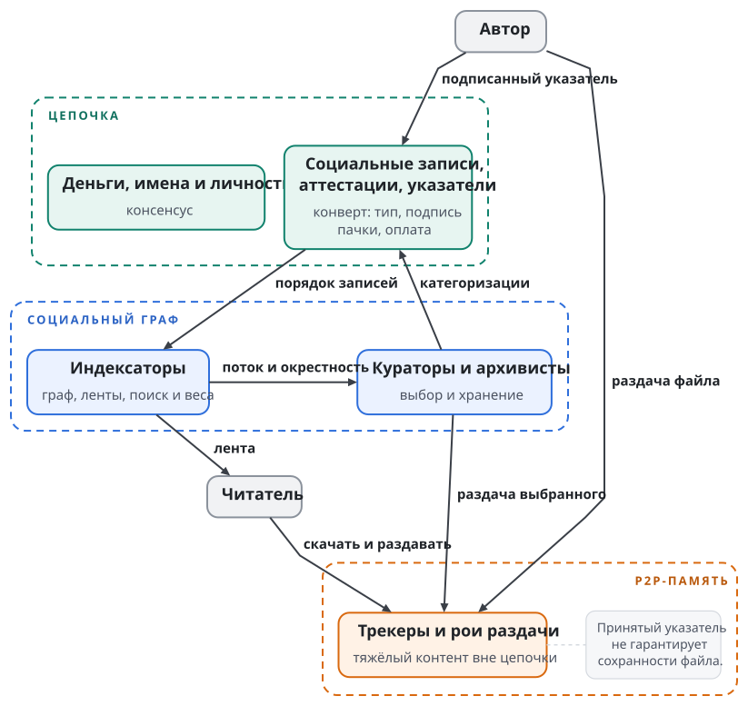
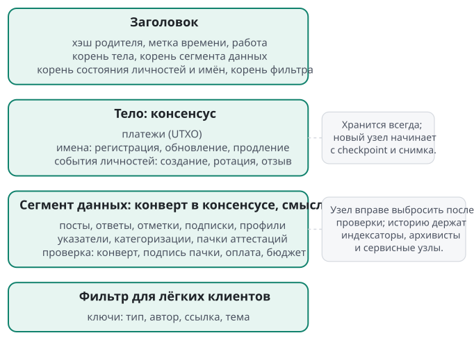
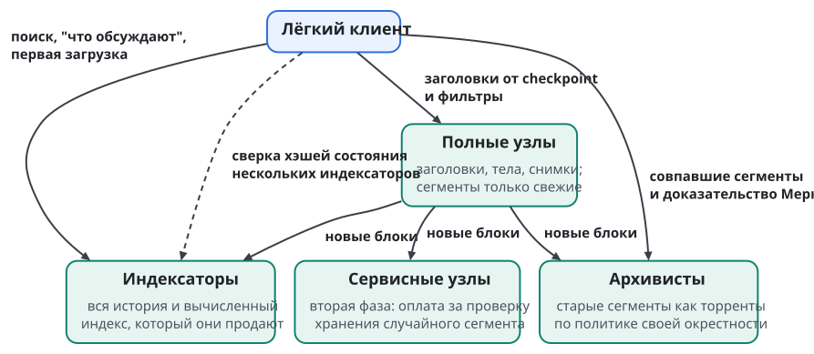

# Цепочка: устройство

Swarma Chain хранит общее состояние Swarma: деньги, имена, личности, социальные записи вместе с аттестациями и указатели на контент. Это состояние нужно участникам разных владельцев, которым мало базы одного проекта. Swarma Runtime организует работу на машинах владельца, Swarma Protocol организует совместную работу независимых участников, а Swarma Chain даёт им общую основу вне журналов отдельных проектов.

Цепочка заверяет записи, как нотариус. Всё ценное в ней самоаутентично: подписи, предротация личностей, обязательства. Доказательство работы отвечает только за порядок записей. Противник с большинством хэшрейта ничего не подделает. Он может переупорядочить свежие записи, задержать запись или дважды потратить недавний платёж, и защита строится именно против этого.

## Что цепочка даёт федерации владельцев

Федерация владельцев работает и без цепочки, через попарное доверенное сотрудничество (глава "Внешние эффекты, остановка и федерация", раздел "Путь к федерации через доверенное сотрудничество"). В этом пути каждый владелец ведёт свой реестр, а партнёры закрепляют корни друг друга по приглашению. Swarma Chain обобщает этот путь на участников, которые друг с другом не знакомы. Она даёт федерации владельцев пять вещей.

**Одно состояние личностей.** Реестр одного владельца не защищает от раздвоения журнала, которое устраивает сам владелец (глава "Идентичность агента", раздел "До запуска цепочки"). В цепочке у ячейки личности одно состояние у всех честных узлов, корень этого состояния лежит в каждом заголовке, и после 24 часов его не меняет реорганизация по работе. Исключение составляет сведение разделённой сети: там одна версия держится на подписантах checkpoint (раздел "Время нельзя арендовать: штраф поздней ветки"). Раздвоенный журнал при публикации оставляет след: любой, у кого есть две подписанные записи с одним номером, публикует доказательство раздвоения, и цепочка отмечает личность (глава "Идентичность агента").

**Имена и контакты без попарного закрепления.** В попарном пути проект узнаёт чужую личность только после обмена приглашениями и закрепления корня. Имя в цепочке указывает на идентификатор личности, и проверяющий разрешает его по корню состояния, без предварительного знакомства. Третьей компании не нужен отдельный обмен с каждым партнёром: её ячейка владельца и ячейки её агентов видны всем на одной высоте. Решение о допуске при этом остаётся у проекта.

**Аттестации и переносимая репутация.** Проект с попарным доверием берёт работу только у знакомых. Аттестации выносят подписанную историю работы за границы журналов отдельных проектов, и проект может принять работу человека или агента, которого раньше не видел: он читает его историю, проверяет, что ячейка каждого выдавшего была жива на высоте записи, и применяет свою политику (глава "Аттестации и переносимая репутация"). Репутация влияет на глубину проверки и полномочий сама не выдаёт.

**Роль нотариуса.** Свидетель и хранитель владельца отвечают на вопрос, какая запись его реестра последняя, но их держит тот же владелец или нанятый им хранитель. Головы журналов Swarma Protocol и реестров владельцев закрепляются в цепочке, и запись под закреплённой головой сохраняет доказательную силу на дату наблюдения, даже если класс ключей на кривых позже сломают (раздел "Корни доверия вне консенсуса"). Это свидетельство касается только закреплённых голов: между закреплениями владелец по-прежнему может показать разным проверяющим разные истории, и частные свидетели остаются нужны.

**Путь лёгкого клиента.** Проверяющему не нужен полный узел. Лёгкий клиент проверяет заголовки от последнего подписанного checkpoint, выбирает ветку наибольшей работы с выборкой заголовков и сверяется с несколькими полными узлами, а затем по корню состояния проверяет нужную ячейку (раздел "Лёгкое чтение и проверяемый индекс"). Его гарантия слабее гарантии полного узла: она держится на выборке и на том, что опрошенные полные узлы не сговорились с противником и не изолируют клиента. Зато ему не нужен канал к реестру каждого владельца.

| Вопрос | Попарное доверенное сотрудничество | Swarma Chain |
| --- | --- | --- |
| Откуда известен ключ чужой личности | корень закреплён по приглашению | ячейка в состоянии цепочки |
| Кто ведёт историю личности | реестр её владельца | консенсус цепочки; реестр владельца публикует журнал в неё |
| Что ловит раздвоение истории | свидетель владельца в пределах контрольных точек | одно состояние ячейки у честных узлов, кроме сведения разделённой сети, и доказательство раздвоения |
| Как найти участника | обмен приглашениями с каждым партнёром | имя, которое указывает на личность |
| Чья работа принимается | работа знакомых партнёров | работа участников с проверяемой историей аттестаций |
| Что нужно проверяющему | свежий снимок реестра отправителя и его свидетель | заголовки от checkpoint и доказательство по корню состояния |

Переход не ломает попарного пути. Идентификатор личности, выданный реестром владельца, при публикации в цепочку не меняется, поэтому ссылки на личность, накопленные до цепочки, остаются действительными. Цепочка не делает участника честным и не снимает с проекта решения о допуске. Она убирает предел, при котором каждый проверяющий видит только ту историю, которую ему показал владелец.

## Три подслоя с разными обязательствами

Внутри Swarma Chain разделены цепочка, p2p-память и социальный граф. Цепочка задаёт общий порядок записей, p2p-память переносит тяжёлые файлы, а граф направляет внимание, распространение и архивирование. Благодаря этому полный узел не обязан хранить все опубликованные видео. По той же причине автору нельзя обещать вечной доступности файла только потому, что указатель на него попал в блок.

| Подслой | Что в нём находится | Кто поддерживает | Граница обязательства |
| --- | --- | --- | --- |
| Цепочка | Деньги, имена, личности, социальные записи, указатели | Майнеры и полные узлы | Порядок записей; консенсус для денег, имён и личностей, проверка конверта записей |
| P2P-память | Видео, аудио, изображения, архивы и другой тяжёлый контент | Авторы, кураторы, зрители, архивисты | Гарантии хранения нет: файл может исчезнуть |
| Социальный граф | Подписки, отметки, категоризации, репутация | Участники через клиенты и демоны | Направляет распространение и хранение того, что участники сочли ценным |

Например, автор публикует фильм. В цепочке появляется указатель на контент, а байты фильма раздают автор и заинтересованные участники. Подписчики и кураторы могут побудить архивистов сохранить файл. Если последняя копия исчезнет, запись в цепочке фильм не восстановит. Цепочка доказывает публикацию, а доступность содержимого держится на p2p-памяти и социальном графе. Отсутствие гарантии хранения входит в замысел.

Социальный граф не хранит файлов. Он действует через политику программ: что скачать, что продолжать раздавать, что вытеснить. Память сети становится результатом выбора участников. Механика разобрана в главе "Социальный слой, память сети и экономика". Для устройства цепочки достаточно помнить, что её рост не определяется размером всех медиафайлов сети.

{.tall}

## Где заканчивается консенсус

Консенсус нужен для трёх видов состояния. Для денег он согласует расходование UTXO. Для имён он обеспечивает уникальность, владение, продление и передачу. Для личностей он держит ячейки с текущими ключами, хэшем следующих и ссылкой на родителя.

Если бы две несовместимые траты, два владельца одного имени или две версии одной личности могли одновременно считаться правильными, клиент не исправил бы расхождение собственным выбором ленты. Поэтому это состояние проверяют узлы, а его корень лежит в каждом заголовке.

У социальной записи, включая аттестацию, узел проверяет конверт: тип, размер, подпись пачки, оплату и статус выдавшего. Узел не решает, полезен ли пост, заслуживает ли автор внимания и справедлива ли категоризация. Ответ на ненайденную публикацию не требует превращать весь граф ответов в состояние консенсуса. Смысл записей выводят индексаторы, а что показать читателю, решает клиент.

Индексатор читает упорядоченные записи и вычисляет производное состояние: профили, подписки, деревья ответов, отметки, разрешение указателей и репутацию. Вывод канонический, а правила публикуются, поэтому смена индексатора не меняет историю аккаунта произвольно.

Например, публикация с корректной подписью ссылается на несуществующий пост. Узел принимает её как правильно оформленные и оплаченные данные, но клиент не покажет её ответом в известном дереве. Так разделяются два вопроса: допустима ли запись в блоке и получилось ли придать ей ожидаемый социальный смысл. Содержание публикации консенсусом не проверяется.

Генезис сразу поддерживает всё, что нужно социальному взаимодействию: сегмент данных, канонический типизированный конверт записи, пачки с одной подписью на корень, тариф по типу, обрезку старых сегментов и фильтры для лёгкого клиента.

Цепочка хранит социальные записи как нетратимые типизированные выходы, и они не засоряют UTXO-набор. Имена, напротив, она хранит как расходуемые выходы с истечением и продлением.

Неизвестный узлу тип принимается как данные по общему тарифу, а новый смысл задаёт соглашение индексаторов. Поэтому сам социальный продукт (индексаторы, клиенты, p2p-память и курация) добавляется поверх консенсуса без форков. Новых правил расходования денег такое расширение разработчику клиента не даёт: граница между толкованием данных и обязательной проверкой состояния остаётся.

## Криптографический профиль: только хэш-функции

Консенсус Swarma Chain опирается на один класс предположений: хэш-функции. Кривых, пейрингов и решёток в нём нет. Повод в том, что системы ИИ ускоряют математику: кривые и решётки могут оказаться слабее, чем считалось, а хэш-конструкции остаются самой надёжной опорой. Для подписей и обязательств этого достаточно. Шифрование с открытым ключом без структурированной математики не построить, но в консенсус оно и не входит.

| Что | Выбор | Зачем | Цена |
| --- | --- | --- | --- |
| Обязательства: идентификаторы блоков, транзакций и личностей, деревья Меркла | SHA-256 ∥ SHAKE256, 64 байта, с разделением доменов | Коллизия требует сломать оба семейства, SHA-2 и SHA-3 | Идентификаторы вдвое длиннее |
| Подписи: деньги, имена, события личности, транзакции пачек | Пара SLH-DSA-SHA2-128s и SLH-DSA-SHAKE-128s (FIPS 205), обязательны обе | Только хэш-предположения; поломка одного семейства не даёт подделки | 2 × 7 856 = 15 712 байт; подпись 0,1-1 с, проверка занимает миллисекунды |
| Аттестации и социальные записи | Пачка: дерево Меркла, одна парная подпись на корень | Подпись делится на сотни записей | Путь 64 байта × log₂N у субъекта, если в цепочке только корень |
| Ротация личности | Предротация: событие несёт хэш следующей пары ключей | Украденный или взломанный текущий ключ не перехватывает личность | 64 байта на событие |
| Адреса монет | Хэш условия траты, одноразовые адреса | Ключ скрыт до траты | нет |
| Случайность для выбора | Хэш блока и "луковица хэшей" | VRF и пороговые BLS держатся на кривых и пейрингах | нет |
| Доказательство работы | Собственная конфигурация RandomX | Нагрузка на CPU; ему угрожает железо, прорыв в математике его не ломает | нет |

Три варианта мы сознательно не берём. Пара SLH-DSA-256s весит около 60 КБ на подпись, а от прорыва в математике защищают два независимых семейства, и длина параметров тут не помогает. У ключей WOTS, XMSS и LMS есть состояние, и оно ломается при восстановлении из резервной копии и при повторной подписи. 384-битные хэши не нужны, потому что слабое место не в размере выхода: при росте опасений сначала добавляют раунды, а длину выхода оставляют.

Цена профиля выражается в пропускной способности. Мегабайт тела блока вмещает около 60 подписанных объектов. Аттестации и социальные записи идут пачками, им это почти не мешает. Расчёты деньгами медленные: Swarma Chain работает как слой расчётов и личностей, и для мелких покупок она не предназначена. Цену размера подписей снимает STARK-агрегация, которая тоже строится только на хэшах; она в резерве.

## Корни доверия вне консенсуса

Остальная Swarma стоит на структурированной криптографии: SSH-сертификаты Ed25519, подписи журнала Swarma Protocol и квитанций на Ed25519, ключ оператора на телефоне (P-256 в защищённом чипе), ключи FIDO2, TLS и подписи git.

Это признанный риск. Если кривые сломает квантовый компьютер или прорыв в математике, противник подделает подписи этими ключами. План миграции состоит из четырёх шагов.

**История с датой наблюдения.** Головы журналов протокола и реестров владельцев закрепляются в цепочке. Запись, наблюдённая до поломки класса ключей, сохраняет доказательную силу на дату наблюдения. Новых подписей этим классом после поломки не принимают.

**Корни на хэшах, листья короткоживущие.** Долгоживущие корни переходят на хэш-подписи: ячейка владельца, центр хостов, корень брокера. Ключи на кривых остаются короткоживущими листьями под этими корнями. При поломке кривых противник подделает лишь живые листья на время их действия, но выпустить новые не сможет.

**Сеансовый слой следует за вендорами.** Там, где это доступно, включён гибридный обмен ключами с ML-KEM. В OpenSSH он уже включён по умолчанию, в TLS используется гибрид X25519MLKEM768.

**Поломанный класс отвергается.** Политика перестаёт принимать подписи этого класса, а личности ротируются через предротацию. Их следующие ключи спрятаны за хэшем, поэтому поломка текущих их не раскрывает.

## Блок и сегмент данных

Блок состоит из тела и сегмента данных.

- **Тело** несёт платежи, операции с именами и события личностей.
- **Сегмент данных** несёт социальные записи и пачки аттестаций.
- **Заголовок** фиксирует корни обеих частей, корень состояния и обязательство фильтра для лёгких клиентов. Корнем состояния называется корень хэш-дерева над набором UTXO, именами и личностями. С генезиса каждый заголовок фиксирует ещё корень MMR (Merkle Mountain Range) над всеми предыдущими заголовками; по нему лёгкий клиент проверяет заголовки, выбранные выборкой FlyClient.

Полный узел проверяет сегмент при приёме блока, но потом вправе его выбросить. Обрезка удаляет историю социальной активности и оставляет состояния денег, имён и личностей нетронутыми.

Набор UTXO входит в корень состояния с генезиса через хэш-аккумулятор: лес Utreexo или разреженное дерево Меркла. Мультипликативный хэш MuHash для этого не подходит, потому что держится на дискретном логарифме, а консенсус опирается только на хэш-функции.

Пачка аттестаций бывает в двух форматах. В первом листья лежат в сегменте данных, и путей Меркла там нет: дерево по листьям перестраивает любой. Во втором в цепочку попадает только корень, а запись и путь до корня держит субъект. В обоих случаях субъект хранит свой путь сам, потому что узлы вправе выбросить сегмент.

| Часть | Зачем нужна | Что значит её сохранение |
| --- | --- | --- |
| Тело блока | Проверка и восстановление денег, имён и личностей | Для восстановления этого состояния социальная история не нужна |
| Сегмент данных | Передача и первоначальная проверка социальных записей | Узел проверяет конверт, оплату и бюджет данных; хранить сегмент постоянно не обязан |
| Заголовок | Корни частей и состояния, корень MMR предыдущих заголовков, опора лёгкого клиента | Сохранённую запись с доказательством можно проверить без полного сегмента |

Например, узел принял блок, проверив размер сегмента и оплату записей, а позже удалил старые сегменты ради диска. Его способность проверять дальнейшие платежи не зависит от того, найдётся ли старый пост. Если читателю понадобится этот пост, он обратится к хранителю социальной истории. Состояние цепочки и содержимое социальной сети восстанавливаются разными процедурами.

Новый узел стартует с подписанного checkpoint и снимка состояния (UTXO, имён и личностей) и сверяет весь снимок, включая набор UTXO, с корнем состояния в заголовке. Сырые социальные сегменты для этого не нужны. Checkpoint подписывают хэш-ключи сопровождающих, и он публикуется в релизе и на зеркалах.

Интервал блока равен 60 секундам. Чтобы показать пост быстро, клиент берёт транзакцию из мемпула. Показ до включения в блок слабее записи с доказательством включения и включения не доказывает. Минутный интервал не даёт окончательности за минуту: от реорганизаций защищает штраф поздней ветки, разобранный ниже.

Без корня MMR заголовок с 64-байтными обязательствами весит около 350 байт; корень MMR добавляет ещё одно обязательство в 64 байта, и заголовок весит около 414 байт. При минутном блоке это 525 600 заголовков, порядка 218 МБ в год. Поэтому лёгкий клиент проверяет заголовки от последнего checkpoint и всю историю не хранит. После checkpoint он выбирает ветку наибольшей работы и проверяет её доказательство работы выборкой заголовков по схеме FlyClient. Каждый выбранный заголовок клиент проверяет путём до корня MMR в заголовке вершины, поэтому выбранные заголовки принадлежат проверяемой ветке. ASERT меняет цель с каждым блоком, поэтому каждый узел MMR фиксирует ещё суммарную работу своего поддерева, и FlyClient выбирает заголовки по доле накопленной работы, как требует его вариант для переменной сложности; в заголовке остаётся один корень MMR. Штраф поздней ветки клиенту недоступен: клиент часто офлайн и не знает времени первого получения блоков. Поэтому он спрашивает k независимых полных узлов о предке своей вершины на глубине d и принимает ветку, только если все они называют один блок. Если ответы расходятся, проверка на клиенте даёт исход "не установлено". Гарантия лёгкого клиента слабее гарантии полного узла: она держится на выборке и на том, что опрошенные узлы не сговорились с противником. Фильтры, совпавшие сегменты, доказательства и медиа он скачивает отдельно. Клиент с короткой историей заголовков может скачивать большой фильм: размер цепочки заголовков и объём выбранного содержимого определяются разными причинами.

### Размер блока

Блоки на старте небольшие, а правило их изменения целиком зашито в генезис: без голосований и без хардфорков ради размера. Так размер блока не становится предметом войны, когда сеть вырастет.

Правило учитывает два урока Monero. Первый урок касается "большого взрыва": короткая медиана позволяла экспоненциальный рост и всплески до 50 длинных медиан. Второй урок касается дешёвой заливки весны 2024 года: место до зоны без штрафа было почти бесплатным.

| Часть правила | Значение |
| --- | --- |
| Старт | цель T₀ = 512 КБ на 60-секундный блок; блок не больше 2T |
| Плата | базовая плата за байт меняется на ±12,5% за блок по отклонению от цели, как в EIP-1559, и сжигается; минимальная плата привязана к награде: полный по цели блок стоит не меньше 1/16 награды за блок |
| Рост | цель растёт, только когда базовая плата выше двойного минимума, и не быстрее ×2 в год |
| Спад | цель падает, только когда блоки полупустые при минимальной плате, и не быстрее ×½ в год; ниже T₀ не опускается |
| Потолок | цель не выше 4 МБ × 2^(лет/4) |
| Состав | вес включает все байты, подписи без скидки; социальный сегмент не больше половины веса |

Узлы пересчитывают цель на каждом блоке в целых числах. Рост требует устойчиво высокой платы: короткий всплеск спроса цель не двигает. Заливка стоит денег с первого байта, потому что минимальная плата привязана к награде. Платежи, имена и события личностей не вытесняются потоком постов: у сегмента данных свой предел. Правило разделяет ёмкость, но срока обслуживания не обещает: каждый платёж по-прежнему ждёт места в блоке.

## Сложность для небольшой сети

Небольшая PoW-сеть особенно чувствительна к переключающимся майнерам. Они приходят на низкую сложность и уходят на высокую, а один крупный участник может резко изменить общий хэшрейт. Длинное окно пересчёта задерживает реакцию: после ухода хэшрейта следующий период растягивается. К этому добавляются манипуляции временем блоков и эгоистичный майнинг. Алгоритм сложности должен выдерживать и такие режимы, помимо ровного роста сети.

| Подход | Характер реакции | Существенная граница |
| --- | --- | --- |
| Пересчёт раз в 2016 блоков | Длинный период между изменениями | Уход хэшрейта растягивает сам период |
| ASERT | Экспонента относительно абсолютного расписания, без скользящего окна | Нужны целочисленная реализация и выбранный полупериод |
| LWMA | Взвешенное окно | Быстрая реакция сопровождается большим шумом |
| DigiShield | Реакция на отдельный блок с демпфером | Ограничители требуют анализа манипуляций временем |
| Dark Gravity Wave | Короткое окно | Чувствительность к шуму |
| Длинное окно с отсечением крайних значений | Сглаживание | Запаздывание при резком изменении хэшрейта |

Выбран ASERT в целочисленной форме с якорем в генезисе. Кандидат полупериода равен двум часам: полупериод определяет, как быстро сложность догоняет изменение хэшрейта. Предварительные оценки для этого кандидата дают шум сложности около 5 %, приспособление к десятикратному росту хэшрейта примерно за четыре часа и медленные блоки около шести с половиной часов после ухода такого майнера. Симулятор Swarma Chain воспроизводит эти оценки до запуска. Он же проверяет скачки хэшрейта, уход крупного майнера и взаимодействие пересчёта с метками времени.

Метки времени строго монотонны: время нового блока больше времени родителя. Допуск в будущее равен 300 секундам, минимальной сложности на основной сети нет. Вместе с ASERT это ограничивает выгоду от сдвига времени.

Например, крупный майнер пришёл, добыл серию блоков и ушёл. Важны обе стороны перехода: сеть не должна надолго застрять после его ухода и не должна давать бесконечно выгодного цикла входа и выхода. Поэтому симуляция проверяет и приход хэшрейта, и его уход.

## Чистый майнинг

Майнеры работают только на собственной конфигурации RandomX, без объединённого майнинга. Объединённый майнинг убран по трём причинам. Крупный пул сети-донора атаковал бы нас бесплатно, потому что он и так майнит. Сам Monero держится на кривых, поэтому при поломке кривых его ценность и хэшрейт упадут ровно тогда, когда хэш-профиль Swarma Chain должен окупиться, и заёмная безопасность исчезнет в самый нужный момент. Без второй дорожки консенсус проще, а раздача монет целиком своя.

Своя конфигурация RandomX задаёт свою соль, деривацию ключа по высоте блока и свои размеры программ. Она затрудняет немедленное использование чужих настроек майнинга, но угрозы ботнетов и арендованных CPU не устраняет. Устойчивость к GPU не уравнивает обычного участника с противником, у которого много чужих процессоров. Поэтому безопасность не оценивают по одному отсутствию известных ASIC: доли пулов наблюдаются, а параметры в первые два-три года меняются на плановых хардфорках.

Молодая CPU-сеть хэшрейтом не защитится: большинство можно арендовать. Поэтому защита строится иначе.

### Время нельзя арендовать: штраф поздней ветки

Идея взята у Horizen, где с 2018 года штрафуют задержанную публикацию, и у MESS в Ethereum Classic, введённого после атак 2020 года.

Узел помнит монотонное время первого получения каждого блока. Допустим, ветка расходится с цепочкой узла в точке, после которой первый блок он получил Δ назад. Такая ветка принимается, только если её работа после точки расхождения больше работы текущей цепочки в P(Δ) раз. P = 1 первые 10 минут, так что обычные форки не затрагиваются. Дальше штраф удваивается каждый час до потолка 32, а через 24 часа реорганизаций нет вовсе.

Атакующий с перевесом хэшрейта в ρ раз побеждает, только если ρ > P(w), где w показывает, сколько получатель ждал перед выдачей товара:

| Получатель ждёт | P(w) | Нужная доля хэшрейта атакующего |
| --- | ---: | ---: |
| 1 час | ×1,8 | > 64 % |
| 3 часа | ×7,1 | > 88 % |
| 5 ч 10 мин | ×32 | > 97 % |
| 24 часа | реорганизаций нет | невозможно |

Без штрафа атакующий с долей больше 50 % рано или поздно побеждает при любом ожидании. Со штрафом придерживать блоки дольше форы бессмысленно.

Плата за это называется слабой субъективностью. Новый узел стартует с подписанного checkpoint. Узел, вернувшийся после долгого отсутствия, сверяет вершины последних суток у нескольких пиров.

Тот же штраф мешает сойтись разделённой сети. Если две части с близким хэшрейтом держат разные ветки дольше 10 минут, ни одна не набирает перевеса в P(Δ) раз. Это предел дизайна. Узел, получивший позднюю ветку, работа которой после точки расхождения сравнима с работой его цепочки, поднимает тревогу и не считает окончательными записи после точки расхождения. Разделение сводит следующий подписанный checkpoint: узлы части, ветка которой в него не вошла, переходят на его ветку. Если разделение длилось дольше суток, этот переход идёт через отсечку, где реорганизаций по работе нет, то есть только по подписи сопровождающих. Поэтому при сведении разделения подписанты checkpoint служат опорой доверия и для работающих узлов: они выбирают, какая часть сети сохраняет свою историю, и противник с ключами сопровождающих вместе с поздней веткой сравнимой работы решает исход разделения. Задержку окончательности ограничивает интервал между подписанными checkpoint: если checkpoint выходят только с релизами, записи после точки расхождения ждут следующего релиза.

Финальность на кворумах по образцу ChainLocks исключена: второй консенсус на пороговых BLS противоречил бы хэш-профилю, а его задачу решает штраф поздней ветки.

### Рой и есть майнеры

- **Майнинг на хостах.** Хосты Swarma Runtime по желанию майнят простаивающим CPU: под отдельной системной учёткой, с низким приоритетом и лимитом cgroup, с сетью только для p2p цепочки. Тысяча хостов даёт базу хэшрейта, которая не уходит при росте сложности.
- **Билеты допуска работают как шары.** Нода решает заголовок блока над свежей вершиной на облегчённую цель и предъявляет его как PoW-билет допуска публичной ноды Swarma Protocol. В его коинбейсе закреплены личность, проект, роль, эпоха и дайджест политики. Если заголовок попал и в цель блока, это блок. Работа допуска охраняет цепочку, а свежая вершина служит вызовом без внешнего маяка случайности.
- **Децентрализованный пул** в духе P2Pool платит с порогом выплат: мелкие выходы съела бы цена их траты.

### Честный остаточный риск

- Устойчивое большинство может часами задерживать записи.
- Отдельный узел можно изолировать eclipse-атакой.
- Атака на небольшую сеть дешевле, чем на Bitcoin.
- Параметры штрафа проверяются симуляцией вместе с ASERT и правилами времени.

### В резерве

- Последовательная композиция двух CPU-функций с разными узкими местами ограничивает выигрыш от прорыва в одной из них примерно двукратным.
- Нотариальная отметка вершины в Bitcoin помогает новым узлам и разбору разделений; выбор ветки от неё не зависит.
- STARK-агрегация подписей снимает цену размера подписей.

## Имена

Цепочка хранит имя как расходуемый выход с истечением и продлением, и имя указывает на идентификатор личности. Регистрация идёт в два шага, обязательство и раскрытие, и имя вступает в силу через 1440 блоков после включения раскрытия. Созревание считает правило консенсуса, поэтому его мерой служит высота блока: её все узлы видят одинаково, а часы узлов расходятся. При минутном блоке это около суток. После резкого роста хэшрейта ASERT догоняет его не сразу, блоки в это время идут чаще, и 1440 блоков выходят быстрее: после десятикратного роста примерно за 17 часов. К этому времени штраф поздней ветки давно достиг потолка, и перехват имени реорганизацией требует 32-кратного перевеса работы, то есть по средним около 97 % хэшрейта (строка 5 ч 10 мин в таблице выше), а вероятности успеха 1 % атакующий достигает уже при 94 % (табл. 6 работы о Swarma Chain).

Базовая цена зависит от длины имени и следует за спросом. Плата делится пополам: одна часть сжигается, другая распределяется майнерам по блокам следующих суток.

## Эмиссия оплачивает безопасность

Для социальной сети с почти бесплатным текстом одни комиссии дают слабую основу бюджета майнинга. Если поднять их ради защиты, публикации подорожают. Если держать их низкими без другого дохода, вычислительная защита недополучит оплату. Поэтому выбрана хвостовая эмиссия: после первоначального спада награда за блок не исчезает. Эмиссия оплачивает продолжение работы сети; доходности держателю она не обещает.

Мы сравнили три графика для минутного блока; монеты в таблице условные.

| График | Первоначальная награда и спад | Хвост | Главный компромисс |
| --- | --- | --- | --- |
| Халвинги и хвост | 50 за блок, вдвое меньше каждые четыре года | 3,125 за блок с шестнадцатого года | Понятная схема, но резкое падение дохода майнеров |
| Плавный спад и хвост | 64 за блок, плавное уменьшение вдвое каждые три года | 2 за блок с пятнадцатого года | Плавный доход; нужна целочисленная экспонента |
| Быстрый спад и хвост | 200 за блок, помесячное снижение | 2 за блок примерно с седьмого года | Быстрая раздача усиливает преимущество ранних участников |

Выбран плавный спад: около половины первоначальной раздачи за три года, около 90 % за десять, затем хвост. Начальная годовая эмиссия хвоста составляет около 0,75 %, и дальше она уменьшается относительно накопленного предложения. До хвоста три графика выпускают соответственно около 197, 141 и 150 миллионов условных монет. Окончательные числа графика фиксируются моделированием вместе с правилом размера блока: сжигаемая базовая плата и минимальная плата, привязанная к награде, связывают эти механизмы.

Постоянная награда уменьшает зависимость майнера от отдельных богатых комиссиями блоков. Но сама по себе она не делает реорганизацию невыгодной при любой цене монеты и любом хэшрейте противника. Для денег опасна двойная трата, для имён опасен перехват владения. Социальную подпись реорганизация не подделывает, но может задержать запись или изменить порядок, поэтому социальную историю нельзя называть безусловно неизменяемой.

Запуск честный: без премайна и без эмитента, а доля фонда разработки в награде равна нулю. Майнер получает награду, приоритетные чаевые и половину платы за имена. Базовая плата за байт сжигается.

## Сервисные узлы без власти над консенсусом

Сервисным узлом называется оператор полезной сетевой функции: индексирования, трекера, раздачи медиа, разрешения имён или хранения старых сегментов. От майнера он отличается видом работы, и власти над блоками у него нет. На старте сеть работает на чистом доказательстве работы, без мастернод: молодому PoW не нужны второй консенсус, залоговые барьеры и отдельная инфраструктура кворумов.

Во второй фазе появляется реестр сервисных узлов, и оплата зависит от проверяемой работы. Случайный пир запрашивает кусок сегмента, разрешение имени или подписанный хэш состояния индекса и проверяет ответ. Узел, не прошедший проверку, оплаты не получает.

Например, оператор заявляет, что хранит историю. Одного заявления мало: сеть запрашивает случайный фрагмент и проверяет результат. Обещание сужается до наблюдаемого сервиса, а польза оператора не оценивается по объёму его капитала.

Вторую фазу определяют четыре параметра: доля награды, наличие залога, частота проверок и ответственность за систематическую ложь.

## Кто сохраняет историю

Социальную историю держат трое. Индексаторы держат её как основу своего продукта. Архивисты раздают старые сегменты через ту же p2p-память, что и другие файлы. Сервисные узлы второй фазы хранят её за оплату проверяемого хранения.

Это три мотива сохранять копии; гарантии, что любая запись всегда доступна, они не дают.

Сырые данные и вычисленный индекс разделены. Сегменты распространяются бесплатно через p2p. Индексатор продаёт поиск, графы, ранжирование и удобную выдачу. Новому узлу для состояния денег, имён и личностей социальная история не нужна, а читателю для поиска нужна. Поэтому продавать новому узлу и зеркалу одинаковые сырые сегменты незачем.

Например, новый индексатор собирает старые сегменты, проверяет их по корням заголовков и вычисляет собственное представление истории. Его издержки складываются из получения доступных данных, вычисления индекса и обслуживания запросов; покупать право читать закрытую базу прежнего оператора не нужно. Если часть сегментов больше никто не раздаёт, открытость формата пробела не восполнит. Свободный доступ к имеющимся копиям не гарантирует, что все нужные копии существуют.

Если у участника сохранились запись и путь Меркла до корня в заголовке, он подтвердит включение даже после того, как полные узлы удалили сегмент. Но корень не восстанавливает потерянных данных, а доказательство включения не доказывает полноты поисковой выдачи. Сохранённый пост можно проверить, однако отсутствие ответа в выдаче не значит, что ответа никогда не было.

## Лёгкое чтение и проверяемый индекс

Лёгкий клиент читает компактные фильтры блоков по образцу BIP 157/158; обязательство фильтра лежит в заголовке. Клиент проверяет фильтры локально и скачивает совпавшие данные. Фильтр для социальных записей строится по четырём ключам: тип записи, автор, ссылка на запись и тема. Так можно искать посты выбранного автора или ответы на известный пост, не отдавая индексатору полный список подписок. На iOS клиент работает в тонком режиме, без архивирования.

Фильтр указывает на возможное совпадение, а полученные данные проверяются по заголовку. Ненадёжный сервер от этого не становится источником полной истории: клиент проверяет предъявленную запись, но так не находит все интересующие его записи. Для самостоятельного чтения нужны доступные фильтры и сегменты, а потеря сегментов остаётся потерей истории. Восстановить поиск из одних заголовков нельзя.

Поиск, ранжирование и открытие новых тем относятся к индексаторам. Индексатор отдаёт данные через GraphQL с подписками и публикует хэш своего состояния на заданной высоте. Клиент может сравнить ответы нескольких индексаторов. Это проверяет согласованность канонического вывода, но совпадение серверов не доказывает правильности произвольной рекомендации.

Выдача индексатора включает ленты по личности и по имени, прямой и обратный граф подписок, деревья ответов, суммы отметок и чаевых, индекс тегов и веса категоризаций. В неё же входят репутация по опубликованной формуле, разрешение указателей в трекеры и зеркала, подписки на изменения и доказательства включения. Точную схему задаёт спецификация индексатора.

Сравнивать хэши имеет смысл при одинаковой высоте и одинаковых правилах вывода. Иначе за различием могут стоять просто разные входные данные. Клиент, сменивший индексатор, сначала сравнивает одну и ту же производную историю и только потом делает вывод о расхождении. Персональную сортировку ленты задаёт отдельная политика, и отличие сортировки не означает несовпадения канонического состояния.

