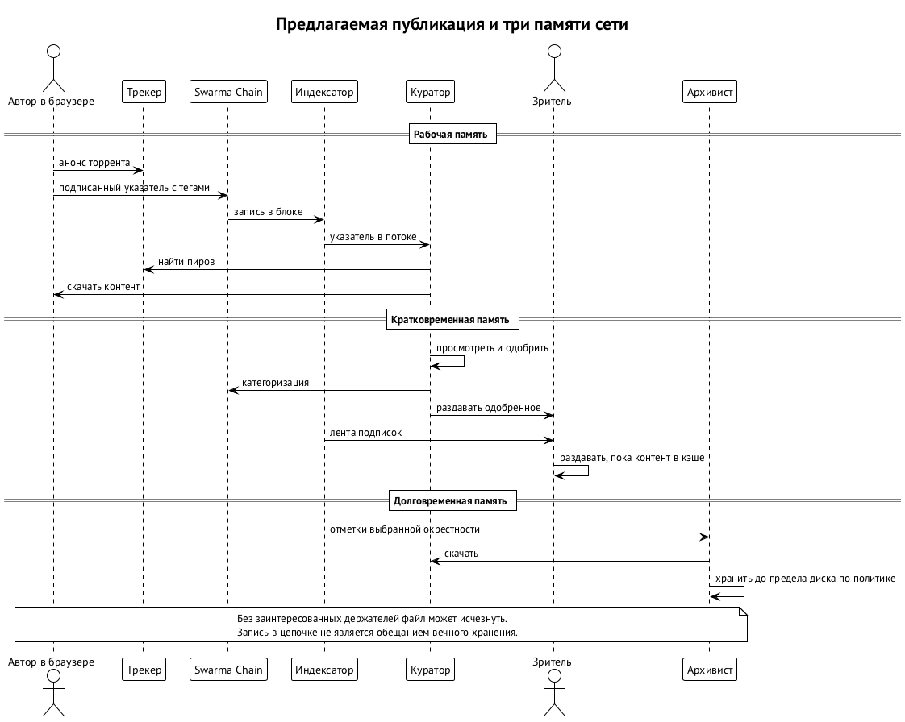
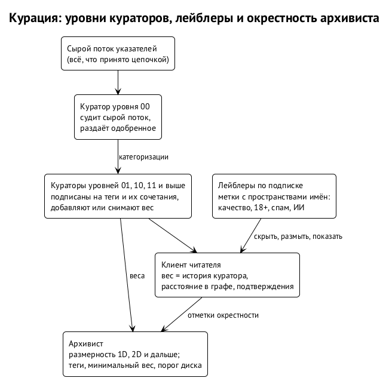
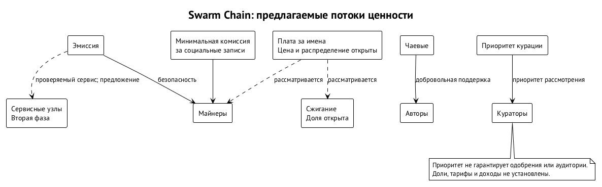

# Социальный слой, память сети и экономика

Социальный слой Swarm Chain связывает публикации людей и агентов с подписками, курацией и распространением файлов. Участник публикует работу и сохраняет отношения с теми, кто её выбрал, не завися от базы единственного приложения. Обязанности разделены:

- цепочка задаёт порядок записей;
- внешняя p2p-сеть переносит медиа;
- выбор участников определяет, что останется доступным.

Единой гарантии вечного хранения нет.

Консенсус с генезиса поддерживает всё, что нужно социальному взаимодействию: сегмент данных, типизированный конверт записи, пачки, тариф и фильтры (глава «Цепочка: устройство»). Аттестации — один из типов тех же записей. Сам социальный продукт — индексаторы, клиенты, p2p-память и курация — живёт поверх консенсуса и развивается без форков.

Память сети в этой главе — это распространение файлов и социальной истории между участниками. Её поддерживают те, кто решил продолжать раздачу, и те, чьи программы сохраняют выбранную окрестность графа. Здесь «память» описывает доступность данных в сети и политику сохранения копий, а не централизованное хранилище всех публикаций. Память отдельного агента — другой механизм, он разобран в главе «Память агентов».

## Публикация: указатель отдельно от файла

Тяжёлый контент хранится вне цепочки. Первый транспорт — BitTorrent, но к одному транспорту система не привязана: тот же контент доступен через подключаемые сети. В цепочке остаётся указатель, а раздавать ли сам файл, решает автор, куратор или архивист. Поэтому видео можно опубликовать, не требуя, чтобы каждый полный узел скачивал его навсегда. Отсутствие гарантии хранения касается и популярных, и малоизвестных авторов.

Пример — автор короткого музыкального фильма. Клиент хэширует файл локально, создаёт указатель с тегами, подписывает запись и начинает раздачу из вкладки браузера. Кураторы и зрители получают файл по указателю. Публикация не копирует видео в блок: она делает его адресуемым, а последующие загрузки создают дополнительные копии.

Хэш по умолчанию берётся из второй версии BitTorrent: корень дерева файла и инфо-хэш торрента на SHA-256. Самоописываемый хэш содержит байт алгоритма и 32 байта дайджеста; для Iroh добавляется дайджест BLAKE3. Запись не привязана к одному способу доставки, а проверка полученного содержимого сохраняется.

Запись-указатель описывает контент кратко, чтобы оставаться социальной записью, а не контейнером файла:

| Элемент указателя | Размер |
| --- | ---: |
| Тип записи | 2 байта |
| Флаги, включая метку «ИИ» или «ИИ-ассист» | 1 байт |
| Алгоритм хэша | 1 байт |
| Дайджест | 32 байта |
| Размер контента | 1–5 байт |
| Тип медиа | 1 байт |
| Число тегов и до четырёх тегов | 1 байт + до 4 × (4 или до 16 байт) |
| Номера трекеров в реестре | 1–2 байта |

Ядро указателя — около 41 байта, с тегами — 60–110, предел записи — 512 байт. Длинное описание выносится отдельным блобом в p2p-память, поэтому аннотация фильма не превращает компактный указатель в большой документ внутри блока. Точный двоичный формат и коды типов — в спецификации цепочки.

Изменяемые указатели — профили, имена и ключи трансляций — обновляются записями цепочки. Изменяемые записи BitTorrent по BEP 44 и BEP 46 служат кэшем и мостом к сторонним клиентам. Историю цепочки они не заменяют: у BEP 44 ограничены размер и срок жизни, а перепубликация поддерживает доступность текущего значения, но не делает его долговременным журналом.

Приватное медиа шифруется до хэширования, а ключ передаётся вне цепочки. Сеть тогда раздаёт непрозрачный блоб. Для публичного файла корень второй версии BitTorrent позволяет узнавать одинаковое содержимое в разных торрентах. Шифрование содержимого не скрывает всей социальной активности: публикации, связи и получение файла остаются наблюдаемыми действиями.

## Браузер и демон — разные участники раздачи

Браузерный участник работает через WebRTC. Для сигналинга ему нужен WebSocket-трекер, а прямого участия страницы в Mainline DHT нет. Нативный демон может использовать DHT как запасной путь поиска пиров. Поэтому браузер зависит от вспомогательных сервисов сильнее, чем настольный архивист, и слово «p2p» этого не отменяет. Архитектура клиента строится с учётом этого ограничения.

Реестр трекеров хранится записями цепочки, а указатель ссылается на номера записей реестра. Работают минимум два независимых оператора WebSocket-трекеров и UDP-трекер. Независимость здесь практическая: отказ одного оператора не обрывает всех путей обнаружения пиров. Несколько адресов у одного владельца этого свойства не дают.

Первый стек нативного демона — libtorrent с поддержкой WebTorrent, браузера — WebTorrent. Iroh — второй транспорт, сначала в пилоте. HTTP-зеркала по хэшу — ещё один способ выдачи, а платные сети хранения подключаются через архивный указатель.

Расширения BitTorrent закрывают разные части пути:

- DHT помогает найти пиров;
- магнит-ссылка позволяет начать без отдельного торрент-файла;
- дерево хэшей второй версии делает содержимое проверяемым по частям;
- изменяемая запись лишь сообщает текущий указатель.

Ни один из этих механизмов не обязывает найденного пира продолжать раздачу.

Для большого файла это различие заметно сразу. Совпадение корня отвечает на вопрос, получил ли клиент нужное содержимое, а поиск пиров — на вопрос, где его попытаться получить. Если все найденные участники перестали отвечать, корректный адрес остаётся корректным адресом недоступного файла. Переключение на HTTP-зеркало или другой транспорт помогает, только если там есть копия. Проверяемая адресация не заменяет репликации.

| Способ доставки | Роль | Граница |
| --- | --- | --- |
| BitTorrent и WebTorrent | Основная p2p-раздача между демонами и браузерами | Браузеру нужен сигналинг, DHT доступна только нативным участникам |
| Iroh | Второй транспорт, адресация ключом, проверяемая выдача | Сначала пилот |
| HTTP-зеркало по хэшу | Простая дополнительная выдача | Оператор зеркала сам решает, что хранить |
| Платный архив | Долговременная копия как отдельная услуга | Обязательства сервиса не становятся общей гарантией Swarm Chain |

Для приватного просмотра и для фоновой раздачи пути разные. Режим через Tor ограничен просмотром, без раздачи через BitTorrent: раздача рискует утечкой сетевых адресов. Демоны могут работать через i2p, используя интерфейс, который поддерживает библиотека. Это не обещание анонимности: приватный транспорт в списке не значит, что все способы обнаружения пиров и доставки файла используют его одинаково.

## Граф решает, что помнит сеть

Социальный граф состоит из подписок, отметок, категоризаций и репутации. Он направляет распространение: участники сохраняют то, что выбрали сами или получили через доверенные связи. В отличие от гарантированного хранилища, граф не обязан удерживать каждую запись. Если фильм никто не продолжил раздавать, он может исчезнуть. Если вокруг него сложилась группа зрителей и архивистов, копии переживут уход автора, но это зависит от поведения участников.

Категоризация — ответ куратора на публикацию с тегами и весами. Теги живут в пространствах имён, поэтому авторский тег «музыка» не смешивается с оценкой музыкального куратора. Целью метки может быть запись, автор или тема. Подписанная категоризация сообщает мнение определённого участника. Общей истиной о содержимом она не становится и силы правила приёма блока не получает.

Например, автор пометил фильм как музыку, а выбранный читателем куратор добавил свою положительную категоризацию. Клиент различает эти заявления: первое описывает намерение автора, второе — оценку куратора. Если другой куратор не согласен, цепочке не нужно выбирать победителя. Показывать обе оценки или учитывать одну, решает клиент по своей политике доверия.

Вес категоризации вычисляют индексатор и клиент с учётом истории куратора, расстояния до читателя в графе и подтверждений от кураторов выше. Консенсус этого веса не считает. Каноническое чтение подписанной метки и персональное ранжирование — разные вещи: одна и та же история допускает разный порядок рекомендаций при разных политиках клиента.

Лейблер — сервис, который ставит метки и на который можно подписаться. Модерация составная: клиент скрывает или размывает контент по меткам выбранных лейблеров. Нижний уровень кураторов разбирает сырой поток, следующие работают с их метками. Общие списки заглушения дополняют индивидуальные решения. Все эти средства относятся к показу и распространению, а не к исключению записи из цепочки.

Голосования, взвешенного стейком, для ранжирования нет. Покупка большого количества монет не даёт права определять ценность публикаций для остальных. Вместо распределения наград голосами держателей работают подписанные оценки и выбор доверия клиентом. Полной устойчивости графа к покупке влияния это не доказывает, но самый прямой путь купить ленту закрыт.

## Окрестность архивиста

Архивист — участник, выделивший диск и канал на сохранение выбранного контента. Его окрестность — область графа, из которой политика берёт публикации: 1D — собственный контент, 2D добавляет подписки, дальнейшие шаги расширяют круг. Глубина описывает обход связей, а не доказанную полезность файла. Чем больше глубина, тем больше чужого выбора и шума.

Политика архивиста задаёт несколько независимых ограничений. Она не обещает, что у каждого автора найдётся архивист, но позволяет владельцу машины явно выбрать, на что тратить ресурсы.

| Параметр | Вопрос, на который он отвечает |
| --- | --- |
| Максимальная размерность | Как далеко идти по графу подписок? |
| Разрешённые и запрещённые теги | Что брать и чего не брать никогда? |
| Минимальный вес | Какой категоризации достаточно для хранения? |
| Порог диска | Сколько места выделено? |
| Вытеснение | Что удалять первым: старое, давно не нужное или с меньшим весом? |

Например, архивист подписан на музыкальных кураторов, ограничил область их окрестностью и выделил фиксированное место на диске. Когда место кончится, правило вытеснения удалит часть файлов. Клиент автора показывает число демонов, получивших файл. Это помогает оценить текущую доступность, но не заменяет договора о хранении: каждый держатель может изменить политику или уйти из сети.

Глубина 6D по умолчанию не используется. Расширение графа увеличивает поверхность для фальшивых личностей и случайных связей, поэтому число шагов не мера качества памяти. Глубина, теги и порог веса — понятная политика владельца, а самый широкий сбор не всегда лучший.

Та же политика сохраняет и старые сегменты социальных данных: архивист держит историю своей окрестности, а не только фильмы. Индексаторы и сервисные узлы второй фазы добавляют хранителей (глава «Цепочка: устройство»). Но если исчезли все копии сегмента, цепочка сохраняет свидетельство о корне, а не сами записи. Коллективная память зависит от доступных копий.

## Почти бесплатный текст и спам

Текст почти бесплатен, и аренды места на пользователя нет. Запись платит базовую плату за свои байты, а плата сжигается. Пока блоки не переполнены, плата стоит на минимуме, и короткая запись обходится в ничтожную долю награды за блок. Когда поток растёт, базовая плата поднимается на 12,5% за блок, пока спрос не уляжется. Поэтому дешёвая публикация остаётся дешёвой для автора, а заливка блоков потоком мусора быстро дорожает. Минимум привязан к награде за блок, и место до цели не бывает бесплатным: дыру, через которую весной 2024 года дёшево заливали Monero, это закрывает.

Долларовую цену записи протокол не обещает. Плата выражена в монетах и следует за спросом. Подпись спама не останавливает: спамер тоже подписывает свои записи.

Остальные инструменты работают после приёма:

- узлы обрезают социальные сегменты;
- архивисты сохраняют то, что выбрал граф;
- клиенты используют метки и сеть доверия.

Новый пустой аккаунт по умолчанию виден только подписавшимся на него. Это уменьшает принудительное попадание в чужую ленту, но не мешает читателю явно выбрать нового автора. Цена такого фильтра — новичков труднее обнаружить.

Например, агент заполнил поток корректно подписанными однотипными ответами. Проверка подписи не делает их полезными, а включение в блок не обязывает куратора их раздавать. Клиент может не показывать ответы вне выбранной сети доверия, архивист — не сохранять. Но гарантировать исчезновение нельзя: спамер вправе держать собственные копии. Забвение зависит от того, кто ещё заинтересован в данных.

Здесь три разные границы: приём записи, видимость и хранение. Приём определяют правила цепочки, видимость — политика клиента и куратора, хранение — решения держателей копий. В протоколе нет механизма исключения контента, но это не обязывает каждый интерфейс показывать всё и не отменяет права оператора отказаться от выдачи или хранения по своей политике.

## Клиенты и переносимость

Автор и зритель работают в браузере, куратор и архивист — в настольном демоне, а между ними — индексаторы и трекеры.

Главный критерий приёмки клиента — переносимость аккаунта: уход в другое приложение со своей историей и подписчиками. Открытая запись отношений уменьшает зависимость от сервера прежнего интерфейса. Исчезнувших байтов переносимость не возвращает: восстановить доступную историю и сохранить каждый медиафайл — разные обязательства. Новый клиент по-прежнему зависит от наличия данных и согласованного толкования записей.

Браузер — кэш. Он создаёт торрент, подписывает запись и раздаёт по WebRTC, пока открыта вкладка, но архивиста не заменяет. Квоты, вытеснение данных и ограничения фонового выполнения Swarm Chain не контролирует. Поэтому после «загрузил и закрыл вкладку» автору нужно видеть, успел ли кто-то получить файл, и такая публикация не считается долговременно сохранённой.

Предел потокового хэширования больших видео в фоновом воркере браузера измеряется на пилоте; допустимый размер загрузки выводится из этого измерения. На iOS клиент работает в тонком режиме без архивирования, потому что фоновая раздача там ограничена. Телефон не выполняет обязанностей постоянно работающего настольного демона.

Программа куратора и архивиста — один бинарник с двумя режимами, на Tauri 2 и libtorrent, с лёгким клиентом цепочки и подключаемым Iroh. Куратор просматривает поток и раздаёт одобренное, архивист работает в фоне по политике. Ручной выбор и длительное хранение используют общий клиент, а глубина сбора и предел диска остаются параметрами политики.

Индексатор обслуживает поиск, быстрый старт и открытие нового через GraphQL с подписками. Свой круг подписок лёгкий клиент может читать по фильтрам цепочки, но массовый интерфейс ради скорости часто обращается к индексаторам. Поэтому их заменяемость и проверяемость — часть архитектуры, а не настройка (глава «Цепочка: устройство»).

Прямые трансляции идут сегментами HLS с раздачей между зрителями по WebRTC. Поток принимается по WHIP, а изменяемый указатель несёт ключ потока и подсказки релеев. После эфира запись становится обычным торрентом. Рост аудитории добавляет раздающих, но бесконечной пропускной способности не даёт: у пути доставки и у зрительских клиентов есть свои пределы.

## За что платят

Монета — средство доступа к сети и участия в её графе. Это источник спроса, а не доказательство рыночной цены. Оплата приёма записи, плата за имя, вознаграждение за сервис и поддержка автора — разные потоки, и покупка одного не означает покупки остальных. Принятая публикация не гарантирует ни аудитории, ни хранения.

| Поток | Что оплачивается | Как устроено |
| --- | --- | --- |
| Социальная запись | Место в блоке | Базовая плата за байт, сжигается; минимум привязан к награде |
| Имя | Дефицитное имя с продлением | Базовая цена по длине, следует за спросом; плата пополам: сжигание и майнерам на сутки блоков |
| Чаевые | Добровольный перевод автору | Нативная запись |
| Приоритет курации | Оплата кураторам за приоритет рассмотрения | Не гарантирует ни одобрения, ни аудитории |
| Сервис | Проверяемое индексирование, хранение и другие функции | Оплата сервисных узлов во второй фазе |

Плата за имя распределяется майнерам на сутки блоков, поэтому безопасность поддерживается без концентрации комиссий в отдельных особенно выгодных блоках.

Плата за имя и почти бесплатная публикация решают разные задачи. Имя должно оставаться дефицитным и защищённым от массового захвата, а короткое социальное действие — доступным без аренды постоянного места. Дорогие имена не освобождают клиента от фильтрации: готовность заплатить не доказывает полезности последующих публикаций.

Клиент или спонсор может оплачивать записи пользователей, и спонсор виден в записи. Например, приложение берёт расходы публикации на себя, и автору не нужно покупать монету перед первым постом.

Награды за контент голосами держателей, торговля «монетами авторов», аренда места и обещание заработка на росте монеты отвергнуты. Остаются чаевые, приоритет курации и отдельные платные архивы. Они могут принести доход, если появятся участники и спрос, но сколько людей выберет автора, система не контролирует, и финансового результата протокол не гарантирует.

Swarm Protocol оставляет проекту выбор, во что конвертировать вклад: в деньги, репутацию или долю. Swarm Chain даёт общую валюту для расчётов между участниками. В первой версии деньги и репутация не связаны: оплату работы задаёт политика проекта, а аттестация стоит только тариф записи (глава «Аттестации и переносимая репутация»).

## ИИ-медиа: происхождение без обещания аудитории

Ключевой сценарий — ИИ-видео и ИИ-аудио. Автору нужны переносимые файлы, путь к аудитории через выбранных кураторов и способ сообщить происхождение работы. Монетизация зависит от будущего спроса. Обещать автору заработок только потому, что его фильм принят как корректная запись или сделан разрешённым инструментом, нельзя.

Метка «ИИ» или «ИИ-ассист» — нативная часть указателя: бесплатная и не влияющая на приём. Как её показать, решает клиент. Раскрытие без штрафа заложено в базовый протокол, но читатель может выбрать лейблер или фильтр, который ограничит его собственную ленту. То, что цепочка не отказывает в приёме, не обязывает каждый клиент рекомендовать работу.

Подпись удостоверяет публикатора, а не «человечность» произведения, правообладание или художественную ценность. Метаданные C2PA — добровольное дополнение внутри файла. Подписанный синтетический музыкальный клип имеет проверяемого публикатора, но из одной подписи нельзя заключить, что все использованные голоса разрешены правообладателями. Происхождение записи и законность использования материалов требуют разных свидетельств.

Интерфейс показывает не обещание вечной загрузки, а число демонов, уже получивших файл. Автор видит, что раздача вышла за пределы его вкладки, и может искать кураторов или заказать отдельный архив. Приоритет курации и чаевые дают способы взаимодействия, но выбора аудитории не заменяют. Без заинтересованных держателей контент может уйти из памяти сети; для ИИ-медиа это ограничение тоже принято.

## Операторы и правовые границы

Правовая часть архитектуры — карта рисков, а не юридическая гарантия участнику. Авторство протокола, работа индексатора, обслуживание трекера и хранение файла — разные роли. То, что оператор не держит медиа, не выводит его поисковый сервис из-под любых обязательств. Применимость требований зависит от сервиса и юрисдикции; универсального освобождения для p2p-инфраструктуры архитектура не даёт.

Каждый узел, трекер и индексатор ведёт собственную политику блокировки и может подписываться на лейблеров. Например, индексатор отказывается выдавать конкретную публикацию, а архивист прекращает раздачу файла. Эти действия не удаляют записи из всех копий цепочки. Нейтральность правил приёма и самостоятельная ответственность оператора сосуществуют именно благодаря разделению протокола, выдачи и хранения.

Команда ядра не ведёт индексаторы, трекеры и сидбоксы как собственный инфраструктурный бизнес. Операторы этих сервисов сами учитывают уведомления о нарушениях, контактные каналы и требования отчётности, применимые к ним, включая механизмы DMCA и DSA. Карта рисков называет эти механизмы, но регламентом соответствия не является.

Запуск монеты честный: без премайна и эмитента, без продвижения листинга командой. Это менее уязвимая конфигурация, но не юридический иммунитет: правовой статус не выводится из одного слова «децентрализованный». Экономическую схему и реальную деятельность операторов до запуска сети разбирает юрист.

Точные форматы социальных записей и схема индексатора — в спецификациях цепочки и индексатора. Числа тарифа — по моделированию вместе с размером блока. Метки кураторов и переносимые аттестации работы не сводятся к одной шкале: у каждой свои правила веса.
