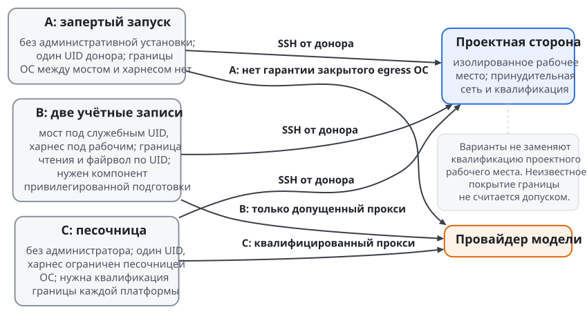
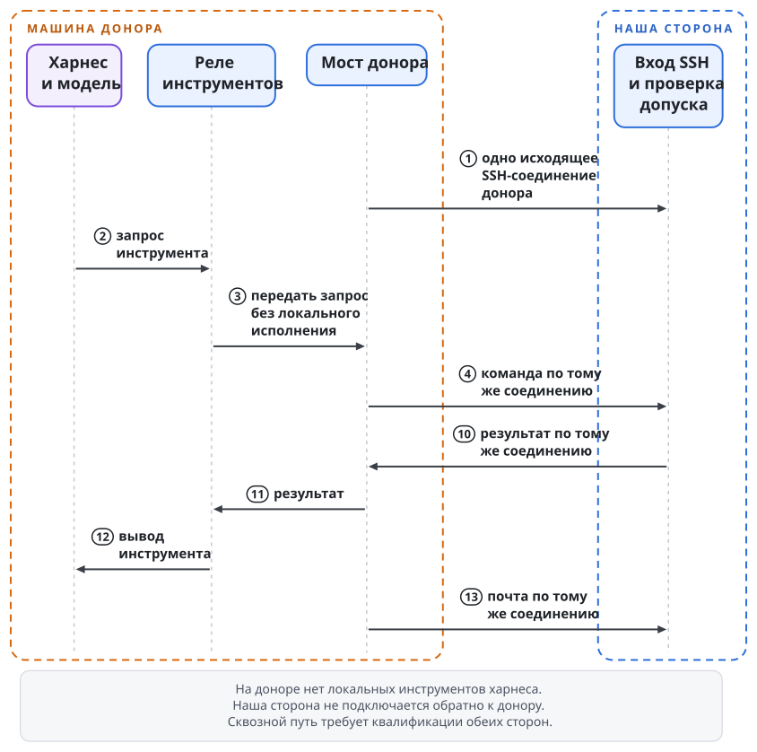
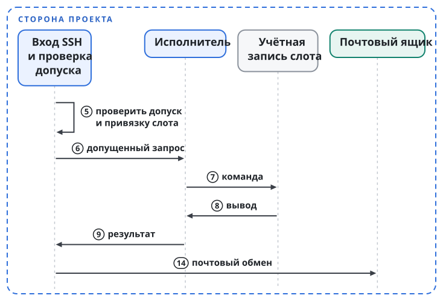
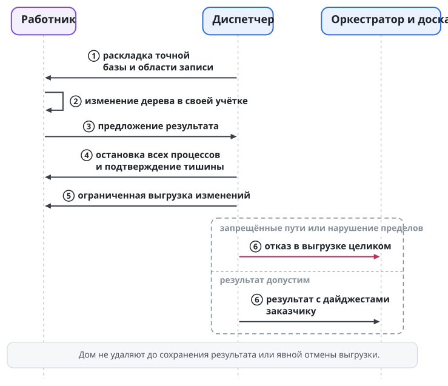
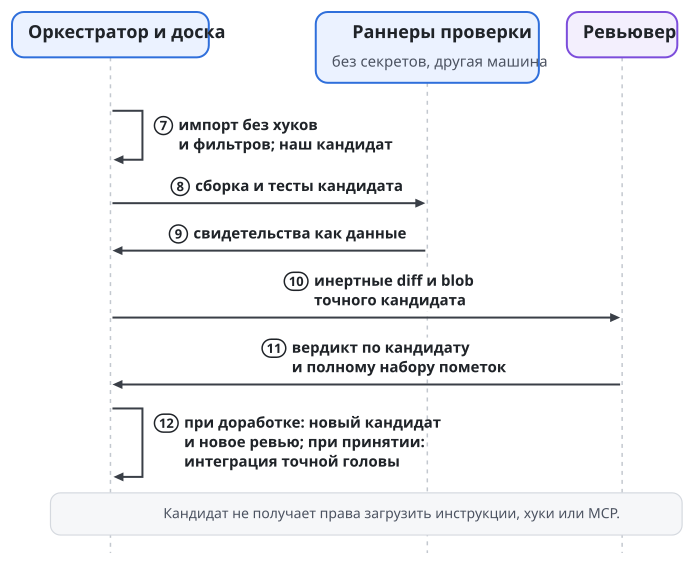

# Слот: работа на машине проекта по доверенности

Проекту на iOS и Rust нужна одна подготовленная машина с окружением сборки. Несколько участников готовы отдать ему свободную квоту своих моделей и не хотят воспроизводить окружение у себя. Проект не хочет ни хранить логины их провайдеров, ни пускать их агентов в свою среду целиком. Обе задачи решает слот: проект выдаёт агенту участника доверенность на свой сервис слотов, и команды агента исполняются на машине проекта в отдельной учётке, в пределах и до срока доверенности. Глава описывает, что остаётся у участника, что даёт проект и какая граница защищает каждую сторону.

Владельца, который отдаёт ёмкость своей модели, называем донором. Слот это место для работы одного агента другого владельца на машине проекта, выделенное по одной доверенности. У слота есть учётная запись слота: отдельный пользователь ОС на машине проекта со своим домом, своими сетевыми фильтрами, своей группой ресурсов и сроком. Сервис слотов это сервис по доверенности из главы "Сервисы по доверенности": он исполняет команды под учётной записью слота и перед каждым действием сам проверяет доверенность.

## Модель думает у донора, команды исполняет слот

Агент донора, его харнес и модель остаются на машине донора. Харнес означает программу, которая ведёт агентский цикл и предлагает модели инструменты. Учётные данные провайдера модели машину донора не покидают: проект их не хранит и не видит. На машину проекта приходят только вызовы инструментов и почта, по одному исходящему SSH-соединению, которое открывает донор. Обратных соединений проект не открывает и команд на машину донора не шлёт.

| Что | У кого остаётся | Что получает другая сторона |
| --- | --- | --- |
| Модель, харнес, логин провайдера | У донора | Проект получает вызовы инструментов и результаты работы |
| Ключ агента | У донора; запросы и результаты подписывает его сторона | Проект знает открытый ключ: на него выдана доверенность |
| Репозиторий, окружение сборки, секреты проекта | У проекта | Агент донора видит дом слота и снимок задачи |
| Право исполнять команды на машине проекта | У проекта; он выдаёт и отзывает доверенность | Агент донора исполняет команды в слоте в пределах доверенности |

Доверять приходится в обе стороны, и границы разные. Слот защищает проект и ничего не запрещает процессу на машине донора. Запертый харнес защищает донора и ничего не запрещает слоту. Поэтому слот, запуск модели у донора и соединение между ними описаны отдельно.

Вычислительных ресурсов проекту слот не добавляет: пропускная способность машины проекта остаётся ограничением. Донор вкладывает ёмкость модели; вычислительной машиной общего назначения для проекта его компьютер не становится.

## Доверенность на слот

Доверенность на слот выдаёт проект. Она называет получателя ключом агента донора, исполнителя именем и ключом сервиса слотов, окно, пределы ресурсов машины и печать. Пределы аренды записаны в доверенности; потолки машины держит политика привилегированной службы, которой владеет администратор машины, и ни агент, ни донор на неё не влияют.

Сервис слотов проверяет доверенность на собственной ноде цепочки перед каждым действием. Слот заканчивается, когда наступил конец окна или проект отозвал доверенность тратой печати: сервис останавливает процессы слота и уничтожает учётную запись слота. Отзыв действует на будущее; команда, которая уже исполнилась, остаётся исполненной.

Стороны узнают друг друга по именам в цепочке. Сервис слотов объявляет о себе в значении своего имени: тип, действия, ключ квитанций и адрес. Донор заранее закрепляет имя сервиса слотов и политику владения этим именем, и мост донора принимает ключ сервиса только под закреплённым именем. Адрес из объявления доверия не даёт. Так определяет доверие к объявлению предложение LIP-0007 спецификации Swarma Link (раздел "Discovery and trust"). Проект читает ключ агента донора из значения имени донора на своей ноде. Приглашения в среду проекта и регистрации в его реестре для этого не нужно.

Доверенность на слот не даёт права изменить проект. Результат работы в слоте становится кандидатом и проходит независимое ревью (раздел "Как забирается код").

## Граница слота на машине проекта

На стороне проекта действуют граница пользователя ОС и сетевые правила из главы "Пользователь ОС на агента и сеть агента", а для слота ещё и приватные пространства имён, пустые capabilities, `no_new_privs` и seccomp. Исходящую сеть слота ограничивают два фильтра одновременно: фильтр адресов менеджера служб на юните слота и пакетный фильтр ядра по учётной записи слота. Второй закрывает обход первого процессом той же учётной записи вне юнита. Без принудительной сети учётная запись слота не создаётся.

Слот задаёт границу исполнения на машине проекта. Место ячейки проекта задаёт долгоживущую роль, которую агент занимает по аренде (глава "Запуск агента и хост сессий"). Эти понятия описывают разные стороны работы внешнего агента.

## Чем защищена машина донора

Харнес означает программу, которая ведёт агентский цикл и предлагает модели инструменты. На машине донора харнес работает в запертом режиме `lockdown`: локальную оболочку, правку файлов и локальный веб-поиск он модели не предлагает. Доступен только путь через реле инструментов проекта. Само реле `swarma-remote-tools` ключей не держит и сети не имеет. Отсутствие инструмента в интерфейсе модели и изоляция процесса средствами ОС дают разные гарантии.

Установка бывает трёх вариантов:

| Вариант | Права администратора | Граница у донора | Мост и ключи |
| --- | --- | --- | --- |
| A: запертый запуск | не нужны | проверенная сборка не предлагает локальных инструментов; своей границы ОС нет | пользовательская фоновая программа; Secure Enclave на macOS, файлы `0600` на Linux |
| B: две учётные записи | нужны при подготовке | недоверенный харнес и доверенный мост под разными UID; файрвол, граница чтения ядра, бинарники под root | системная служба моста; ключи в файлах `0600` его учётной записи, без Keychain |
| C: песочница | не нужны | харнес под пользователем донора, ограничен песочницей ОС | пользовательская служба; ключи как в A |

У варианта A существенный предел: если квалифицированная сборка всё-таки предложит локальный инструмент, модель сможет действовать от имени пользователя донора. Проверка сборки уменьшает риск, но границей ОС режим не делает.

В варианте C харнес читает и пишет только свой каталог, обращается к реле и к локальному прокси провайдера и к Keychain доступа не имеет. На macOS границу держит Seatbelt. На Linux границей C служит приватное сетевое пространство имён без внешнего маршрута, с единственным опосредованным путём к провайдеру; файловую систему ограничивает Landlock, а мост живёт вне песочницы. Минимальные возможности ядра для C заданы явно. Где их нет, установщик отклоняет вариант C и никогда молча не откатывается к A.

В варианте B сеть разделена по UID: харнесу нужен прокси провайдера, мосту нужен адрес сервиса слотов проекта. Для B нужен отдельный привилегированный компонент подготовки, который создаёт учётные записи, ставит файрвол и песочницу и обеспечивает удаление. Менеджер пользователей центральной среды для этого не расширяется. B включается вместе с этим компонентом.

После квалификации B и C установщик предлагает B, а при отказе от административных прав предлагает C. Вариант A для новых доноров при этом закрывается: случай без прав администратора закрывает C, и граница у него сильнее. Существующих доноров A переводят на C.

В режиме без секретов у агента (глава "Учётные данные и логины") варианты различаются по силе границы. Вариант B даёт харнесу и держателю учётных данных разные UID, и гарантия режима опирается на эту границу после её квалификации. В варианте C харнес работает под UID донора, поэтому C нужна собственная квалифицированная граница песочницы, хранилища и IPC: харнес не должен достигать хранилища держателя, его приватных каналов и заглушки чужого запуска. Вариант A границы ОС не имеет и остаётся вне гарантии режима. Ядро машины проекта процесс донора опознать не может, поэтому учётные данные донора, их держатель и согласие остаются у донора, а размещение держателя у донора проходит отдельную публикацию и квалификацию. Локальный прокси провайдера в вариантах B и C задаёт только маршрут: в режиме с читаемым токеном харнес по-прежнему получает токен донора.

Варианты A, B и C защищают донора. Проект защищает независимое ревью каждого кандидата перед продвижением основной ветки, поэтому вариант A тоже может писать в слот. Политика проекта может ограничить запись вариантами B и C. Вариант закрепляется при регистрации и виден в статусе и баннере: проект выбирает допустимый риск, а донор видит условия, на которых отдаёт квоту. Целевые платформы дизайна: macOS и Linux; Windows в этот дизайн не входит.

## Запрет нельзя снять настройкой профиля

В Swarma Curator режим запуска задаёт настройка машины. Значение `lockdown` закреплено замком, и нижние слои конфигурации ослабить его не могут. Профиль позу не задаёт, а лаунчер принимает сгенерированную политику и короткий белый список аргументов. Супервизор моста требует ещё и сочетания `lockdown` с `remote-auto`, а смена позы останавливает живую сессию. В `remote-auto` инструменты реле разрешены заранее, остальные запросы подтверждения отклоняются.

В варианте B замок лежит в системной конфигурации под root, в A и C замок принадлежит донору. Свои файлы донор менять вправе, но при нарушении условий сессия не запустится. Изменение позы или прав увеличивает поколение политики, и поколение проверяется при запуске и возобновлении. Новый профиль не вернёт незаметно локальную оболочку агенту донора, который уже работает.

Допускается только точный квалифицированный набор: версия и дайджест бинарника, платформа, транспорт, модель, политика настроек и ревизия песочницы. В режиме без секретов у агента в набор входят ещё режим учётных данных и шлюз учётных данных с его адаптером провайдера. Дайджест сверяется до запуска. Неизвестная новая версия получает отказ; режима "попробовать с предупреждением" нет. Откатиться можно только на другую квалифицированную сборку. Список приходит из центральной ленты квалификации.

Для Claude Code способ убрать инструменты измерен, для Codex измерен только путь через app-server; поддержка любой их версии из этого не следует. Muse у доноров не поддерживается: его инструменты чтения не выключаются, а песочница как замена этой гарантии не принята. Pi и OpenCode допускаются после квалификации на целевых платформах; исследования исходников для этого мало. Донор видит позу, сборку и аудит вызовов: имя инструмента, хэш аргументов, размеры и время, без содержимого.

## Согласие донора

Подключить учётные данные своего провайдера к чужому проекту решает сам донор. Проверка терминала при инициализации защищает от случайного запуска, но согласием не является. Прежде чем связка с учётными данными донора станет активной, нужно одно подтверждение от компонента под контролем донора и вне контроля инициирующего агента. Таким компонентом служит ключ с присутствием человека: приложение на телефоне с ключом в Secure Enclave или StrongBox либо ключ FIDO2.

Подтверждение нужно одно на регистрацию и по одному на каждое расширение области. Одобренная донором область называет и режим, в котором тратятся его учётные данные. Без такого ключа донор не подключается; ослабленного режима нет.

## Канал и исполнитель

У учётной записи слота нет пароля и интерактивного входа. Каналом служит одно исходящее SSH-соединение, которое открывает мост донора; соединение привязано к поколению слота. Конфигурация сервера SSH задаёт принудительную команду и запрещает PTY, проброс портов, SSH-агент и файлы запуска, поэтому соединение попадает только в служебный исполнитель.

Основанием допуска служит доверенность на слот. В прежней редакции дизайна основанием был короткий SSH-сертификат на поколение; из дизайна он ушёл. Как вход SSH на стороне проекта проверяет доверенность, не определено; вопрос записан в главе "Где мы и что дальше". Сертификат хоста мост донора проверяет при каждом соединении через центр хостов из главы "Ключи и ключник".

Проверяющие службы работают вне учётной записи слота. Вход пересылает канал на служебный Unix-сокет и пользовательских файлов запуска не читает. Служебный исполнитель держит политику инструментов, потолки, аудит и почтовый ящик и сверяет UID с активным поколением слота. Команды исполняются под учётной записью слота. Сетевой запрет, включая loopback, ставится вместе с активацией учётной записи. Спулы и сохранённые экспорты исполнителя подчиняются общему бюджету состояния служб.

Допуск определяют доверенность и назначение вместе: ключ получателя, окно и печать доверенности, поколение слота, назначение, раунд и дайджест плана. Каждая операция и каждая долговечная запись привязаны к этому набору и проверяются атомарно на границе исполнения. Перед любым изменением исполнитель долговечно записывает операцию: идентификатор в рамках поколения привязки и дайджест аргументов. Если ответ потерян, повтор возвращает сохранённый результат либо состояние "ещё идёт" или "неизвестно"; неизвестность повторного исполнения не разрешает. Тот же идентификатор с другими аргументами отклоняется. Закрытый набор действий и формат запросов задаёт профиль типа слота.

Подписанное задание приходит через мост и адаптер ввода как следующий ход сессии. Мост донора сам проверяет адресата, срок и отзыв. Результат подписывается ключом, который остаётся у донора, и только после того, как мост получил подписываемое целиком и проверил его сам (раздел "Как забирается код"). При обрыве работа приостанавливается, инструменты получают повторяемую ошибку, затем сессия паркуется.

Закрытие поколения идёт строго по порядку:

1. заморозить поколение;
2. закрыть вход, после чего соединения закрытого поколения больше ни с чем не сопоставляются;
3. остановить через `cgroup.kill`;
4. выполнить экспорт;
5. заменить поколение.

Войти в закрытое поколение нельзя, поэтому переподключение донора не породит процесса под UID слота во время остановки или экспорта. Единицей отмены служит остановка всего UID: она закрывает и полосу работы, и соединение.

Удалённый ход показан с двух сторон границы: модель работает у донора, а команды и почта идут по одному SSH-соединению к исполнителю на стороне проекта. Вход SSH есть на обоих рисунках, номера шагов сквозные.

{.tall}

{.tall}

## Как забирается код

Агент донора не пушит и не открывает Change Request на хостинге кода. Проект выдаёт точную базу, манифест файлов и область записи в отдельный репозиторий без remote, хуков и учётных данных. Свои коммиты агент вести может, но проект основанием доверия их не считает. В конце раунда процессы останавливаются с проверкой, что потомков нет, и вызовы инструментов в каталог закрываются.

Программа выгрузки работает с правами учётной записи слота, по ссылкам не переходит, пропускает `.git` и отдаёт изменения относительно базы вместе с режимами файлов. Специальные файлы, подмодули, пути в `.git` и коллизии имён без учёта регистра отклоняют выгрузку целиком. Чтение от root или исправление прав через `chmod` обходным путём не служат. Дом нельзя удалить до того, как полный результат сохранён вне области удаления или оператор отдельно снял обязательство.

Донор подписывает канонический кортеж аттестации над измеренным экспортом: назначение, раунд, база, дайджест результата, дайджест плана и голова квитанций. Кортеж привязан к кандидату.

Слепой подписи нет. Мост донора получает сам экспорт целиком и кортеж в каноническом виде; готовых дайджестов ему не присылают. Мост подписывает, только когда проверил всё сам:

- пересчитал дайджест результата по полученным байтам экспорта;
- сверил назначение, раунд, базу и дайджест плана со своим подписанным заданием;
- сверил голову квитанций с собственной цепочкой: каждый вызов инструмента и его результат прошли через мост;
- убедился, что все пути экспорта лежат в области записи задания.

Перед подписью агент видит итоговый диф последним ходом сессии и может отказаться. Подписанный экспорт донор хранит у себя. Если проект потом предъявит под его подписью другой результат, копия это опровергнет. Команды исполняет проект, поэтому подмену во время исполнения мост не предотвратит. Подмена окажется в дифе, который донор видит до подписи, а подписывает он ровно этот диф.

Доска собирает из этих данных собственного подписанного кандидата. Выход за область записи и изменения самой доски запрещены.

Изменения в CI, хуках, инструкциях агентов, автозапуске, ссылках и управляющих файлах одобряются по детерминированному предикату доски. Предикат смотрит на текущий контракт, политику риска, точного кандидата и полное множество помеченных путей. Доска вычисляет это множество по накопленной дельте от базы до кандидата, включая все раунды, и для таких изменений действует привилегированный порог протокола. Порядок приёмки описан в главе "Доска задач и процесс".

Ревьювер сначала получает инертные diff и blob вне корней автоматического обнаружения настроек. Подтверждение текста не активирует автоматически его инструкций, MCP или permissions. Обязательная проверка без верификатора даёт "не установлено".

При доработке каталог раскладывается из предыдущего кандидата, но полный результат по-прежнему сравнивается с доверенной интеграционной базой серии. Опасная правка не пропадает из отчёта только потому, что следующий раунд её не трогал. Новые подтверждения и вердикт привязываются к новой точной ревизии. Веб-содержимое без подтверждённого происхождения остаётся помеченным до момента, когда доверенная сторона приложит получение с дайджестом.

Путь кода из слота делится на выгрузку и работу с кандидатом; доска есть на обоих рисунках, номера шагов сквозные.

{.tall}

{.tall}

## Веб, проверки и ресурсы

По умолчанию веба нет: задача приносит проверенные ресурсы с дайджестами, доступные только для чтения. Дополнительный материал агент запрашивает письмом, а получает и проверяет доверенная сторона. Поиск включает оператор для конкретной личности доверенного круга; согласия донора для этого недостаточно. Пути поиска:

- поиск у провайдера без локальной загрузки;
- изолированный веб-инструмент у донора;
- служба платформы.

Каждый путь включается после квалификации, и ни один не даёт слоту исходящей сети.

Компиляция, транспиляция и тестовые прогоны вынесены из учётной записи агента. Разрешённая проверка типов не разрешает произвольный интерпретатор: проверяется весь вызов, с читаемым кодом, конфигурацией и плагинами. Профиль выбирает сама машина по классу задачи и дайджесту, и вызывающий на этот выбор не влияет. Кандидат собирается на эфемерных раннерах другой машины без секретов: зависимости загружаются отдельно и без исполнения кандидата, сама сборка идёт без сети.

Наблюдатель ресурсов останавливает и удерживает учётную запись и показывает статус. Его уведомление видно в статусе. Сетевая заморозка поколения идёт порядком из главы "Пользователь ОС на агента и сеть агента". Какие ограничения памяти и диска macOS обеспечивает жёстко, а какие требуют наблюдателя, определяет таблица возможностей конкретной машины; само наличие слота этих свойств не доказывает.

Слот хостинга кода не достигает, и шлюза учётных данных у него нет. Публикацию, передачу артефактов раннерам, обновление базы и приземление выполняет исполнитель действий с репозиторием, отдельная служба под своей учёткой и частный случай службы действий. Исполнитель действий с репозиторием действует по подписанному доской запросу на точного кандидата. Адаптеры других сервисов у службы действий этих ограничений не ослабляют: веб остаётся выключенным, проверки идут на раннерах без секретов, а приёмка доской точного кандидата остаётся обязательной.

## Что именно защищают границы

Агент донора видит дом слота, снимок задачи и входящие сообщения с результатами проверки. Всей доски, чужих домов и процессов и прямого доступа к носителю у него нет. Так ограничен рабочий контекст. Скрыть любые платформенные метаданные других учётных записей это ограничение не обещает: их видимость зависит от политики владельца. Изоляция файлов проекта не доказывает, что о соседях не известно ничего.

Максимальный набор удалённых инструментов состоит из оболочки, чтения и записи файлов, патча и почты. Действующий набор равен его пересечению с политикой слота. У агента с правом только на чтение инструмент записи в протоколе есть, но права вызвать его в этом слоте нет. Серверные тайм-ауты и потолки вывода клиент может только уменьшить. Полномочия проверяются на стороне проекта, и корректный запрос моста донора их не расширяет.

Обязательство результата сохраняется отдельно. Детерминированный отказ выгрузки не выбрасывает работу автоматически и не держит раунд без выхода: агент исправляет ошибку в текущих полномочиях, либо оператор отдельным решением снимает обязательство. Ошибка доступа к файлу, созданному агентом, отличается от инфраструктурного сбоя. Повышать права выгрузки ради удобства нельзя: тогда данные недоверенного агента управляли бы чтением привилегированной программы. Классы исхода и восстановления задаёт спецификация выгрузки.

## Остановка не равна отзыву

Четыре оси независимы:

- есть ли установка у донора;
- активен ли донор;
- действует ли доверенность на слот;
- в каком состоянии ключ подписи.

Донор может снести установку без связи с проектом, и доверенность на стороне проекта от этого автоматически не отзывается. Он может остановиться или уйти, сохранив личность. Проект отдельно закрывает каналы и сессии, останавливает задачи с потомками и освобождает учётную запись. Трата печати и удаление ключа сами не закрывают уже установленного соединения, поэтому сервис слотов закрывает слот порядком поколения.

Доверенность на слот отзывает проект, тратой печати. Донор отозвать её не может, но может прекратить работу сам: остановить мост или удалить ключ агента у себя. Проект при этом видит только то, что запросы прекратились; доверенность остаётся в силе до конца окна или до траты печати.
