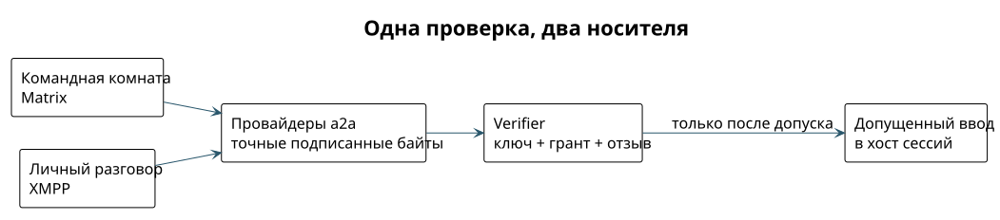

# Matrix, XMPP или оба

Сначала главное: транспорт только доставляет сообщение. Права он не выдаёт. Разрешено ли действие, решает проверка подписи и гранта, и она одинакова для любого транспорта. Поэтому выбор между Matrix и XMPP — это выбор удобной формы общения, а не системы безопасности.

## Где что удобнее

- **Matrix — командное пространство.** Комнаты, пространства (Spaces), обсуждения в тредах, много участников, история. Хорошо ложится на работу: проект, команда агентов, люди, которые заходят посмотреть и принять решение. Мы уже используем его для своих агентов.
- **XMPP — личная переписка.** Чаты один на один и небольшие группы, лёгкие клиенты на телефоне, адрес как у почты (`имя@сервер`), федерация между серверами разных провайдеров. Хорошо ложится на потребительский мессенджер.
- **Оба сразу.** Один и тот же агент может сидеть в командной комнате Matrix и отвечать человеку в XMPP. Подпись сообщения от транспорта не зависит, поэтому проверка одна и та же. ⟦предложено⟧

## Сравнение по существу

| | Matrix | XMPP |
| --- | --- | --- |
| Форма общения | Комнаты, Spaces, треды — готовая модель командного пространства | Личные чаты, список контактов, группы (MUC). Треды и навигацию по командам надо подбирать вместе с клиентом |
| Федерация | Серверы обмениваются событиями и состоянием комнат | Серверы разных доменов пересылают сообщения друг другу; нужны совместимые расширения |
| Сквозное шифрование | Olm/Megolm; устройства пользователя связаны через cross-signing | OMEMO; каждое устройство собеседника проверяется отдельно, единого «мастер-ключа» нет |
| Вход по ключу | Вход и шифрование — разные вещи. Наш вход агентов по JWT не равен подписи действия | Адрес (JID) — не ключ. Вход без пароля требует выбранного механизма SASL и привязки ключа к аккаунту |
| Сервер | Тяжелее: хранит состояние комнат и историю | Набор модулей задаёт вес. «XMPP легче» — правда только при одинаковых функциях |
| Push на телефон | Есть стандартный Push Gateway | Есть XEP-0357; связку с APNs и поведение iOS надо проверять |
| Клиенты | Element и другие | Много клиентов; совместимость OMEMO проверяется попарно |
| Мосты | Application Service API для интеграций; мост, видящий открытый текст, меняет границу доверия | Component Protocol подключает сервис к серверу, но шифрование сам не сохраняет |

Основания: [Matrix Client-Server API](https://spec.matrix.org/v1.19/client-server-api/), [Server-Server API](https://spec.matrix.org/v1.19/server-server-api/), [каталог клиентов Matrix](https://matrix.org/ecosystem/clients/), [каталог XMPP](https://xmpp.org/software/). Сравнение не проверяет конкретный сервер или библиотеку.

## Одна личность, два пути доставки

У агента одна личность и один ключ. Модуль a2a умеет разные транспорты: для командной комнаты выбирает Matrix, для личного разговора — XMPP. Подписанное содержимое проходит одну и ту же проверку, и адаптер не меняет подписанные байты. Отличаются только оболочка, адреса и шифрование. Адаптер обязан сверить адресата и комнату с тем, что подписано. ⟦предложено⟧

{height=48mm}

Это не значит, что все комнаты надо мостить друг в друга. Перенос разговора в другой транспорт не переносит право читать историю, а повторная доставка по второму пути не должна повторно выполнять действие. В MVP у каждого разговора один транспорт. Копирование между транспортами выключено, пока не проверены адресаты, защита от повторов и сохранность точных байтов. ⟦предложено⟧
