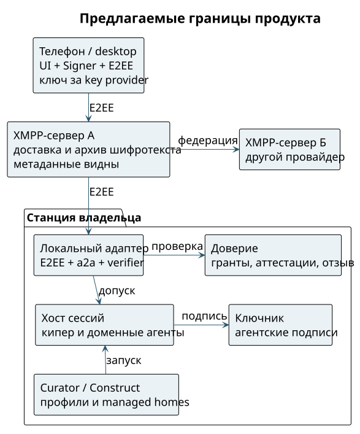

# Из чего собирается мессенджер

Клиент — окно разговоров и решений. Станция — место, где работают агенты и проверяются права на инструменты. Сервер — доставка и хранение шифротекста. Ключник — отдельная служба подписей; кипер — корневой агент, который координирует помощников. Эти две роли не смешиваются.

{height=105mm}

В целевой схеме телефон и локальный XMPP-адаптер являются E2EE-концами. Агент получает plaintext после допуска; его модельный провайдер тоже может его получить. Обещание шифрования относится к транспортным серверам, а не к сокрытию данных от исполняющего агента или его модели. ⟦предложено⟧

## Готовые примитивы и отсутствующие стыки

Состояние модулей ниже дано на октябрь 2026 года. Квалификация отдельного модуля не означает готовность их потребительской сборки.

| Часть | Что даёт платформа | Чего нет в готовом продукте; допущение хакатона |
| --- | --- | --- |
| Клиент iOS/desktop | Проект Swarm Signer предусматривает core правил и key provider; P-256 устройства в Secure Enclave | Встраиваемый XMPP-клиент и весь UI ещё собираются. Начать с iOS и desktop-панели на станции; общий core — явная зависимость, не готовая библиотека |
| Ключник | Агентские ключи, namespace `swarma-msg` с purpose 4, аттестации purpose 5; multi-UID квалифицирован | Проверить точный вызов из нового bridge. В демо заранее зарегистрировать тестовые личности; не отдавать секрет модели |
| Регистратор | JWT-вход агентов на homeserver | Это не готовый XMPP SASL. Временно ручной provisioning; пользовательский вход на ключе квалифицировать отдельно |
| Брокер учётных данных | Один владелец логинов подписок моделей и временная политика выдачи | Не путать с аккаунтом мессенджера. Демо использует подготовленный доступ к модели без копирования логинов в клиент |
| Менеджер пользователей | Станции, отдельная учётка ОС на агента | Provisioning с телефона ещё надо связать. В демо учётки подготовлены вручную, запуск использует их явно |
| Curator, curator-run, Construct | Профили, управляемые дома и запуск | Разрешённые профили заранее подготовлены. Не обещать готовую кнопку самообслуживания для любого нового помощника |
| Хост сессий | Нативный мост сессий | Проверить ввод, вывод и восстановление конкретного harness через XMPP; начать с одного агента и одного адаптера |
| a2a | Абстракция транспорта, сегодня Matrix | XMPP-провайдер и сопоставление аудитории ещё нужны; демо сохраняет ту же границу verifier перед доставкой |
| Слой доверия | Контракт подписанных сообщений задаёт `swarm-envelope/2`, `grant/1`, `operator-act/1`, `attestation/1`, `revocation/1` | Не считать план совместимости уже встроенным enforcement. Если общего verifier нет, эффект блокируется или показывается как симуляция |
| XMPP-сервис | Стандартный федеративный протокол и расширения | Выбрать сервер и библиотеки. Сначала свой закрытый сервер; два домена — отдельный проверяемый этап |

Signer core отделяется от UI, хранения E2EE-секретов и аппаратной подписи. Исследовательская рекомендация Rust/UniFFI с Matrix Rust SDK не утверждает язык ядра и не выбирает библиотеку OMEMO. Для XMPP требуется отдельная квалификация. На хакатоне можно сократить число платформ, но нельзя скрыть отсутствие проверяющего ядра красивым Face ID-экраном. ⟦предложено⟧
