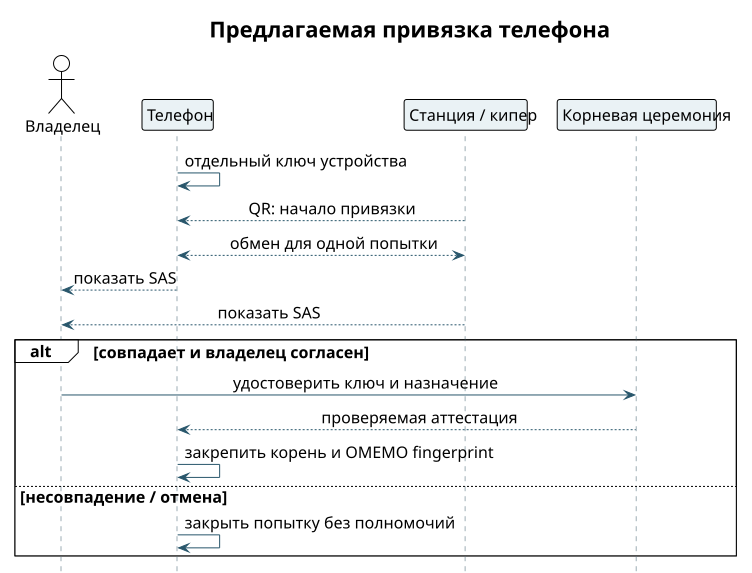

# Первый запуск и привязка телефона

Задача не в том, чтобы войти на сервер. Задача — связать телефон со своим корнем доверия, то есть со своей станцией и её главным агентом. QR-код запускает привязку, а сверка эмодзи (SAS) ловит подмену канала. Ни QR, ни совпавшие эмодзи сами никаких прав не выдают. Точный протокол привязки, срок жизни приглашения и доказательство владения ключом ещё предстоит закрепить. ⟦предложено⟧

1. На станции уже работают Keymaker и главный агент с аккаунтом `keeper@example.test`. Установщик показывает, какую станцию человек сейчас связывает с телефоном.
2. Телефон создаёт свой ключ устройства. На iPhone это P-256 в Secure Enclave: закрытый ключ никогда не покидает чип и не передаётся даже ядру приложения.
3. Владелец сканирует QR со своей станции. Телефон и станция показывают одинаковый набор эмодзи для этой попытки, и человек сверяет их глазами.
4. Эмодзи не совпали или человек отменил — попытка закрывается, ничего не удостоверено. Совпали — владелец отдельно удостоверяет ключ телефона и его назначение через церемонию корня.
5. Телефон запоминает доверенный корень. Для OMEMO каждый отпечаток устройства проверяется и удостоверяется отдельно: аналога cross-signing из Matrix здесь нет.
6. Приложение показывает главного агента и выданные ему права. Первый разговор начинается только после проверки цепочки и готовности шифрования.

{height=70mm}

Первое сообщение — «Покажи моих помощников». Правильный исход: ответ своего кипера с проверенным происхождением. Отказ, который тоже должен работать: QR подменили или эмодзи разные. Тогда чат не становится привязанным, и никаких прав и ключей чужой стороне не добавляется.

**Упрощение для хакатона.** Один телефон и одна заранее подготовленная станция; подпись корнем делаем вручную. Если сверка эмодзи ещё не готова, сверяем полный отпечаток ключа вручную и так это и называем. Нельзя показывать слайд с эмодзи как работающую защиту, если она не работает. ⟦предложено⟧
