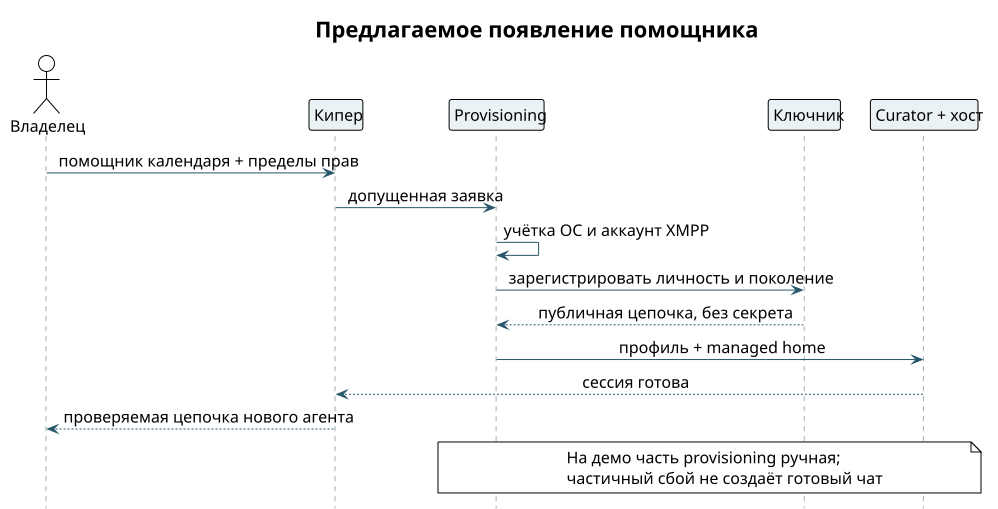

# Новый помощник без общего секрета

Человек просит: «Добавь помощника календаря». Кипер координирует создание, но не выдаёт себе право создавать произвольные аккаунты. Получается отдельная личность `calendar@example.test`, отдельная учётка ОС и ограниченный набор инструментов. ⟦предложено⟧

1. Клиент показывает профиль помощника и запрашиваемые права: например, читать только демонстрационный календарь. Расширение прав требует отдельного подтверждения владельца.
2. Кипер передаёт допущенную заявку компонентам provisioning. Для демо учётка ОС и профиль могут быть подготовлены заранее.
3. Ключник регистрирует личность с привязкой к учётке и поколению; использует отдельный производный агентский ключ. Мастер-секрет и закрытый ключ не попадают в промпт.
4. Регистратор или ручной шаг создаёт адрес XMPP; локальный адаптер получает свой E2EE-контекст. Адрес и ключ личности связываются проверяемой записью, а не совпадением имён.
5. Curator запускает агента с выбранным профилем и managed home; хост сессий привязывает ввод и вывод к bridge.
6. Телефон получает проверяемую цепочку нового агента через уже доверенный канал и проверяет её. Чат появляется только после допуска, а не по любому входящему сообщению с именем «Календарь».

{height=67mm}

Деривация упрощает выпуск ключей у ключника, но не заменяет аттестацию и грант. Она также не является настройкой OMEMO: для шифрования нужны собственные устройства, bundles и сессии. Формулу деривации, численные пределы и новый формат цепочки здесь не вводим.

**Контроль отказа.** Повтор заявки не создаёт второго помощника; неподтверждённый профиль или чужая учётка не получают ключ. При частичном provisioning клиент показывает «не готов», а не доступный чат. Порядок компенсации и идентификатор идемпотентности должны быть закреплены контрактом; на хакатоне незавершённый экземпляр отключают вручную. ⟦предложено⟧
