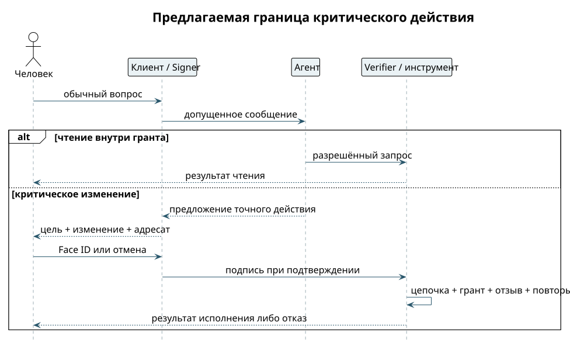

# Разговор и действие с подтверждением

Реплика «Какие у меня встречи?» и команда «Удали встречу» выглядят в чате похоже, но проходят разные правила. Обычное сообщение может вызвать только разрешённое чтение. Изменение появляется как карточка точного действия: что меняется, у кого и на какой цели. Модель не выбирает себе уровень полномочий. ⟦предложено⟧

1. Человек отправляет обычную реплику. Клиент защищает её E2EE, а bridge проверяет происхождение и право на общение.
2. Агент читает данные через ограниченный инструмент. Для запроса «покажи свободное время» не требуется подписывать весь будущий разговор с Face ID.
3. Если нужен критический эффект, агент предлагает действие, но не исполняет его. Signer показывает человеку точный объект и изменение.
4. Человек подтверждает через Face ID. Key provider подписывает подготовленные байты ключом устройства; отказ или отмена ничего не отправляет к исполнению.
5. Verifier проверяет подпись, назначение ключа, цепочку, грант, свежесть, отзыв, адресата и повторы. Исполнитель повторяет необходимую проверку непосредственно перед эффектом.
6. В чат приходит отдельный результат исполнения. «Доставлено» означает доставку, а не успешное удаление или запись в календарь.

{height=69mm}

Secure Enclave в этом пути использует P-256/ECDSA; агентские подписи — Ed25519. Обычная подпись P-256 сама не доказывает удалённому проверяющему факт Face ID. Проверяемая связь присутствия с точным действием требует контракта и векторов. При отсутствии нужного доказательства расширяющий или критический эффект закрыт.

**Контроль отказа.** Отмена Face ID, изменение цели после показа, повтор подтверждения или отсутствие гранта не меняют календарь. Рядом проверяется положительный путь ровно того же действия с допустимыми условиями. На демо можно использовать локальный тестовый календарь; кнопка с имитацией Face ID должна быть явно подписана как симуляция. ⟦предложено⟧
