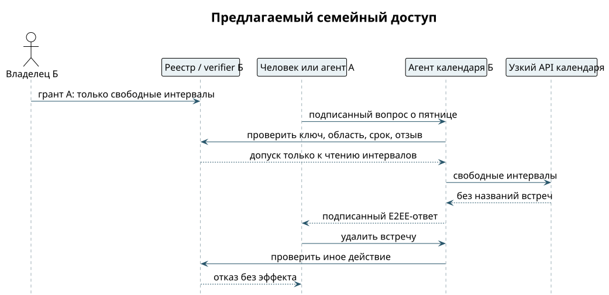

# Доступ к календарю близкого человека

У двух владельцев разные корни доверия. Семейная связь не делает их агентские среды общей учёткой. Человек А спрашивает агента календаря человека Б: «Есть ли свободное время в пятницу?» Ответ может содержать свободные интервалы, но не названия встреч. ⟦предложено⟧

1. Владельцы устанавливают контакт и сверяют ключи. Адрес `calendar-b@example.test` остаётся адресом; право выводится из проверенного ключа и цепочки.
2. Человек Б открывает карточку гранта: получатель, календарь, чтение свободных интервалов, срок. Создание событий и дальнейшая передача права не включены.
3. Подтверждённый грант публикуется в реестре. На телефоне появляется понятное разрешение «может узнавать свободное время», а не «полный доступ к агенту».
4. Человек А или его допущенный агент подписывает запрос своим ключом. Если спрашивает агент А, грант должен разрешать именно ему или допустимую цепочку делегирования; родство этого не заменяет.
5. На стороне Б детерминированная проверка устанавливает область и срок. Ограниченный адаптер календаря возвращает только свободные интервалы.
6. Ответ подписывается, шифруется для допущенных получателей и возвращается в тот же разговор. Другой чат не получает историю или детали календаря.

{height=66mm}

Узкий адаптер важен: если модель сначала увидела весь календарь, обещание «названия встреч не раскрываются» уже слабее. Для MVP нужен отдельный вызов только свободных интервалов, а не инструкция модели скрыть лишнее. ⟦предложено⟧

**Контроль отказа.** Тот же собеседник просит название встречи или её удаление — отказ без выдачи деталей и без записи. Просроченный или отозванный грант также закрывает чтение. Положительный контроль — разрешённый вопрос о свободном интервале. Семейная комната и приглашение в MUC сами по себе календарь не открывают.
