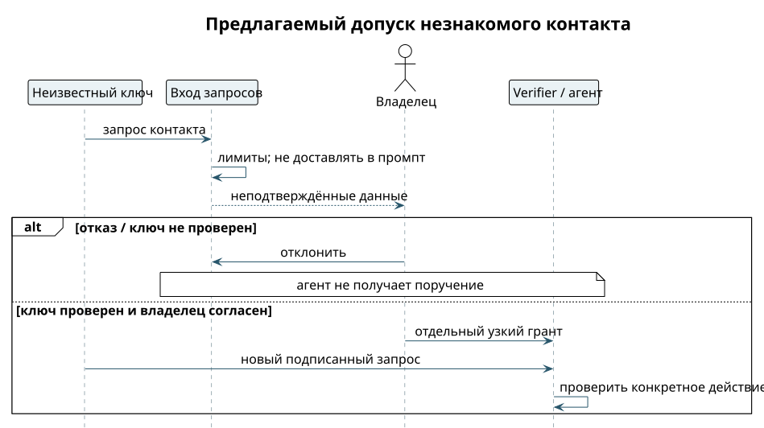

# Незнакомец сначала просит контакт

Whitelist действует до попадания сообщения в рабочую сессию агента. От неизвестного ключа не принимаются ни поручения, ни произвольные файлы, ни просьбы модели «самой решить, можно ли ответить». Однако запрос контакта нужен продукту: для него предлагается отдельный ограниченный канал, который не является разговором с агентом. ⟦предложено⟧

1. `visitor@example.test` отправляет запрос контакта: представиться и попросить конкретный вид взаимодействия. Он ещё ничего не может спросить у календаря.
2. Входной компонент ограничивает частоту и размер запросов. Тело не попадает в промпт и не запускает инструменты; клиент показывает его как неподтверждённые данные.
3. Владелец отвергает запрос или сверяет ключ доверенным способом. Display name, домен сервера и фраза «меня одобрил ваш партнёр» не устанавливают личность.
4. При согласии владелец выдаёт отдельный узкий грант: например, только запросить свободные интервалы на выбранный срок. Разрешение на общение и доступ к данным показываются раздельно.
5. Следующий подписанный запрос проходит обычные проверки. Без гранта на конкретное действие агент не получает его как поручение.

{height=65mm}

Это предложение продуктовой границы, а не уже существующий формат запроса. На хакатоне отдельный inbox запросов можно заменить ручным добавлением fingerprint, но нельзя открыть агенту все входящие и назвать это whitelist. ⟦предложено⟧

**Контроль отказа.** Неизвестный отправитель повторяет запрос, меняет имя на имя близкого человека или присылает чужую цитату разрешения. Агент не запускается, календарь не читается, очередь не растёт без границ. После явного узкого гранта разрешённый запрос работает. Снятие whitelist ради успешного демо не является fallback.
