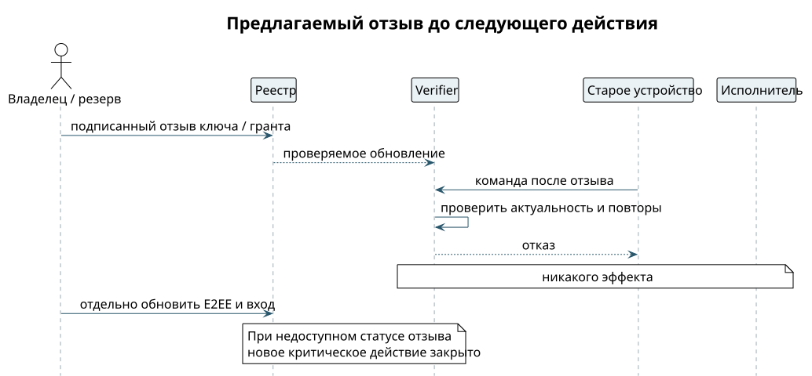

# Отозвать доступ и потерять телефон

Отзыв закрывает доступ на будущее. Уже прочитанное он не стирает и сохранённую у собеседника историю не забирает. Закрыть чат, выйти из аккаунта и отозвать ключ — три разные операции.

1. Обычный отзыв: владелец выбирает разрешение в списке, например «близкий человек может спрашивать свободное время». Подписанный отзыв публикуется в реестре.
2. Проверка обновляет своё состояние и перед следующим чтением или действием проверяет права заново. Если проверить отзыв не удалось, грант не считается действующим.
3. Телефон потерян: владелец берёт оставшееся доверенное устройство и корневой FIDO-ключ или заранее подготовленный резерв. Отзывает ключ потерянного телефона и доверие к его отпечатку OMEMO.
4. Отдельно закрываются сессии входа на сервер и обновляется список устройств шифрования. Отзыв ключа подписи и удаление устройства OMEMO — разные действия, их надо согласовать.
5. Новый телефон проходит новую привязку и аттестацию. Старые разрешения не восстанавливаются ни по имени аккаунта, ни по просьбе в чате.

{height=65mm}

**Проверка на отказ.** Старый телефон после отзыва присылает ранее подписанную команду — ничего не происходит. Рядом проверяем: разрешённое действие с оставшегося устройства при действующем гранте проходит. Если реестр недоступен, важные действия закрыты, а приложение честно пишет «проверка не завершена» вместо зелёной галочки.

**Как быстро действует отзыв.** В версии v0 отзыв срабатывает не позже чем через 60 секунд плюс возраст снимка реестра у проверяющего. «Мгновенно» мы не обещаем. Что именно считать моментом «отзыв завершён», решает владелец платформы — это открытый вопрос.

Если потеряны и телефон, и единственный корневой ключ, а резерва не было, восстановление пока не определено. Сброс пароля у провайдера не должен молча создавать новый доверенный корень. На хакатоне показываем заранее подготовленную процедуру, а не восстановление на все случаи. ⟦открыто⟧
