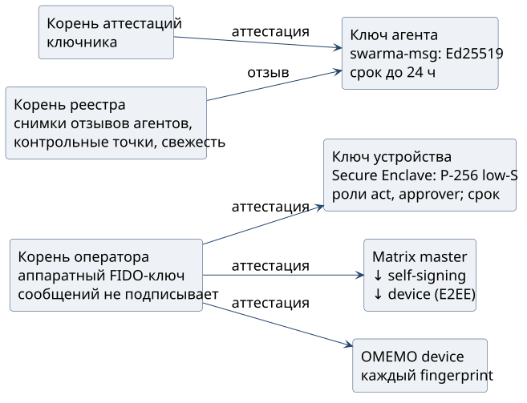

# Кто держит ключи

**Аттестация** связывает публичный ключ с владельцем, классом, назначением и сроком. Её подписывает закреплённый корень нужной роли, а сам корень закрепляют доверенным способом вне чата. Корень аттестаций ключника, корень реестра, корень оператора и корень грантов попарно различны, и совпадение ролей отклоняется до проверки подписи. Корнем оператора владелец аттестует свои устройства и аккаунты носителя.

| Ключ | Где и у кого | Что подписывает | Как прекращается доверие |
| --- | --- | --- | --- |
| Корень оператора | у владельца; в схеме Signer аппаратный FIDO-ключ | аттестации устройств и аккаунтов, снимки отзывов своего домена | заменяет и отзывает его только средство восстановления |
| Ключ устройства | Secure Enclave iPhone или Mac; **P-256 с low-S** | действия оператора, одобрения, делегированные гранты | отзыв корнем оператора, истечение аттестации |
| Корень аттестаций ключника | ключник | только аттестации агентов сроком до 24 часов | смена корня с перевыпуском аттестаций |
| Ключ агента | ключник, **Ed25519**; у агента секрета нет | сообщения агента `swarma-msg` | отзыв привязки, истечение аттестации |
| Корень и сервис грантов | у владельца; сервис (Ed25519) у отдельной службы | гранты; сервис только под родительским грантом | снимок отзывов домена грантов |
| Ключ реестра | изолированный процесс подписи на узле доверия | снимки отзывов агентов, контрольные точки, записи свежести | смена закрепления с сохранением непрерывности |
| Matrix master, self-signing, device; OMEMO device | E2EE-клиент | цепочку cross-signing и обмен E2EE | отзыв аттестации master или fingerprint |

{height=40mm}

Компрометация ключа ограничена его ролью. Украв ключ реестра, нападающий может задержать или скрыть публикацию, но гранта или аттестации не выпустит. Отзыв верхнего звена закрывает доверие ко всей зависимой ветке. Корень оператора заменяет или отзывает только отдельно хранимое, заранее аттестованное средство восстановления, а следующая форма средства требует согласия двух хранителей из трёх.
