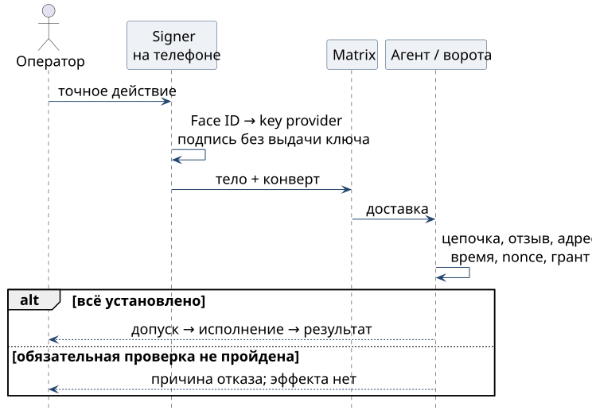

# Критическая команда с телефона

1. Swarm Signer показывает **действие, конкретную цель и адресата**. Содержание готовится целиком: человек не подтверждает неизвестный хэш.
2. Ядро готовит конверт и обращается к key provider платформы. Face ID подтверждает присутствие; ключ **P-256/ECDSA** остаётся в Secure Enclave. Альтернатива — касание FIDO-ключа.
3. Провайдер возвращает подпись. Ядро помещает конверт в содержимое события Matrix, не меняя подписанные данные после подтверждения.
4. Принимающий мост сохраняет событие. Ядро проверки устанавливает подпись, цепочку до закреплённого корня, назначение ключа, срок и отзыв; сверяет тело, комнату, адресата, время и nonce.
5. Ворота доверия Seraph проверяют грант: действие, цель, условия и требуемую уверенность. Никакая подпись не расширяет грант. Исполнитель проверяет основание перед эффектом.
6. Только после допуска действие может исполниться. Иначе — отказ с причиной и аудитом, без эффекта. Квитанция доставки не подтверждает исполнения.

{height=82mm}

Расширяющее действие требует **A3** — телефонного подтверждения точного действия. Критичность задаёт грант: корневые операции, release tags, выдача грантов, удаление. Корневую аттестацию или отзыв подписывает FIDO-корень; телефон не получает его секрет.

**Граница.** Наличие поля `sig` не доказывает Face ID. Допуск требует проверяемого свидетельства присутствия, связанного с точными байтами действия; это связывание проверяют по контракту key provider и векторам. При отсутствии требуемого свидетельства критическую команду не допускают.
