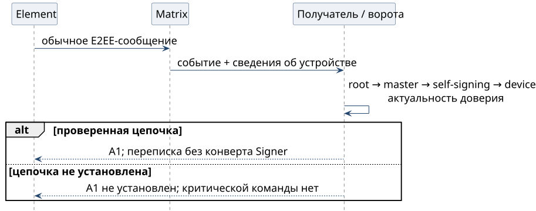

# Обычное сообщение из Element

1. Оператор пишет в Element с проверенного устройства в E2EE-комнате. Отдельного конверта Signer у сообщения нет.
2. Получатель проверяет E2EE-устройство и цепочку **device ← self-signing ← master**. Master аккаунта должен иметь действующую аттестацию корня оператора; знакомого display name недостаточно.
3. Проверяются актуальность доверия и привязка полной учётной записи отправителя. При выполненных условиях адаптер сообщает **A1**.
4. Сообщение можно использовать как переписку. Оно не подтверждает критическую команду и не выдаёт новый грант. Для такой команды оператор переходит в Signer.

## Почему не подписывать каждую реплику

Для обсуждения достаточно установить проверенное устройство собеседника. Нативная цепочка E2EE позволяет не запрашивать биометрию на каждое сообщение. Сервер не может добавить **доверенное** устройство без требуемой цепочки, пока закреплённые ключи и проверяющий клиент не скомпрометированы.

Непроверенное устройство не получает A1 только потому, что аккаунт знаком. Отсутствие проверяемой цепочки не разрешает молча принять критическую команду как A0.

## Где заканчивается переходный режим

В переходном режиме команды A0/A1 допускаются только от заранее названных людей в их записанных зонах. Оператор задаёт зоны вне области записи агента; из чата их не узнают. При переходе человеческих команд на A2 зоны заменяются грантами, A0 остаётся данными.

Канал владельца тоже привязывают при подъёме станции: допуск к носителю → провайдер моста → личная комната. Владельца не назначает первый написавший. Привязка комнаты и приглашение не заменяют криптографической проверки и гранта.
