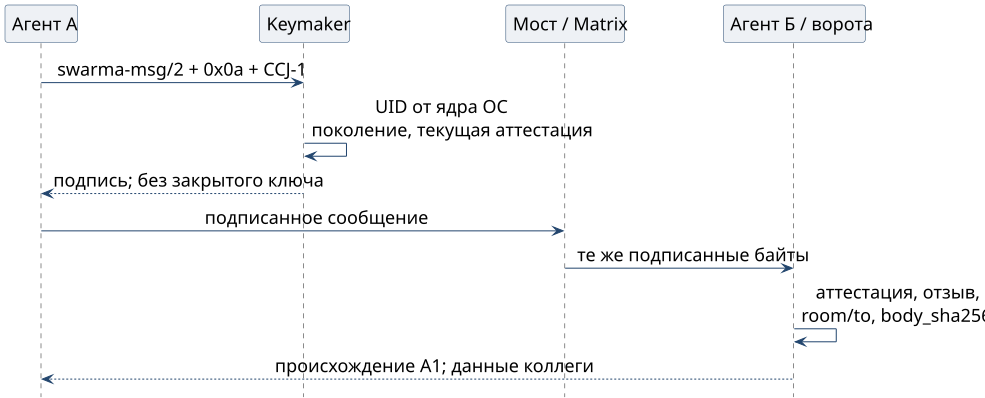

# Агент подписывает агенту

Агент готовит тело `message/1` и подписываемое представление: метка `swarma-msg/2`, байт `0x0a` и CCJ-1 подписанной записи. Ключник узнаёт UID вызывающего от ядра ОС и находит его активную привязку и текущую аттестацию; имя в запросе личность не выбирает. Перед подписью ключник сверяет ровно три пути: `key` и `body.author` равны ключу агента, `body.author_attestation` равна идентификатору текущей аттестации. Затем он подписывает исходные байты ключом **Ed25519** и возвращает подпись, а закрытый ключ агенту и мосту не передаётся.

{height=62mm}

**Аттестация агента** (`attestation/1`, класс `agent`, назначение `swarma-msg`) подписана корнем аттестаций ключника. Её привязка точно повторяет `uid`, `generation`, `registration_number`, `master_epoch`, `owner` и `path` активного поколения. Срок не больше 86 400 секунд (24 часа), и предел проверяют обе стороны.

Ключник обновляет аттестацию сам, до истечения прежней. Новая аттестация становится текущей только вместе с **доказательством публикации**: записью в журнале реестра, покрывающей подписанной контрольной точкой и подтверждением свидетеля отката, сохранёнными в одной транзакции. С начала обновления и до сохранения доказательства ключник подписи не выдаёт (`key_not_enrolled`) и к прежней аттестации не возвращается. Истёкшая аттестация закрывает подпись.

Получатель берёт аттестацию по идентификатору `author_attestation` из подписанного тела и проверяет подпись корня, текущую привязку, срок и снимок отзывов, затем совпадение ключа с `author`. Дальше идут `room` и `to`, хэш текста `body_sha256`, окно `iat` и `exp` не больше 120 секунд и журнал идентификаторов. Ссылка на точную аттестацию не даёт подставить ключ из другого поколения.

Подтверждённое происхождение даёт **A1**: получатель видит данные коллеги, и подпись не одобряет сессию. Подписанный отчёт связывается с конкретным агентом и проверяемо неизменен, а приписка "оператор разрешил удалить данные" остаётся утверждением автора. Для разрешения нужно собственное проверяемое основание оператора.
