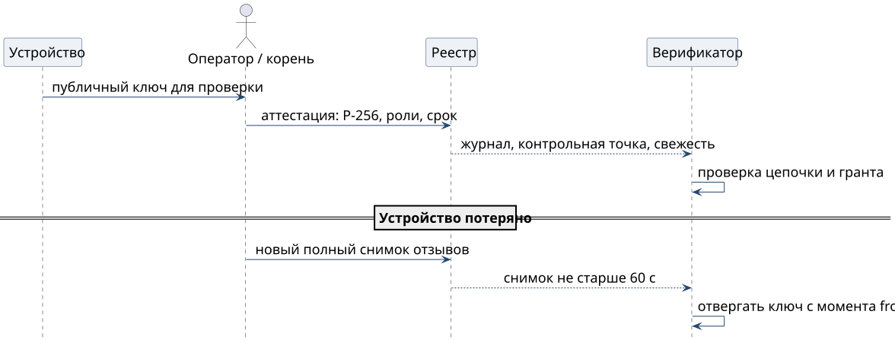

# Новое и потерянное устройство

**Включить новое устройство**

1. Оператор создаёт ключ **P-256** в Secure Enclave нового iPhone или Mac. Секрет остаётся за провайдером ключа платформы, ядро получает только публичный ключ.
2. Оператор сверяет публичный ключ доверенным способом. Корень оператора подписывает аттестацию: класс `operator-device`, роли `act` и `approver`, действия `act.sign`, `grant.sign` и `message.approve`, привязку к владельцу и обязательный срок.
3. Реестр владельца записывает аттестацию в журнал и публикует новую голову. Подпись корня остаётся исходной: реестр хранит и упорядочивает записи, но содержимое не переподписывает.
4. Устройство подписывает действия только после того, как проверяющий установил цепочку до корня, текущий статус ключа и грант на конкретное действие. Вход в приложение аттестацией не считается.

Для Matrix корень оператора аттестует master аккаунта, а устройства проверяются через self-signing. Для XMPP без cross-signing корень аттестует каждый OMEMO fingerprint отдельно. Первое закрепление корня проходит доверенную церемонию с доказательством владения новым ключом.

{height=50mm}

**Потерять и отозвать**

1. Оператор подписывает корнем оператора новый полный снимок отзывов `revocation/1`. В нём остаются все прежние записи и появляется запись `{kind, id, from}` об утраченном ключе.
2. Реестр публикует снимок. Пусть S означает время выпуска первого снимка с этой записью, а A означает максимальный возраст снимка, не больше 60 секунд. Каждый проверяющий отвергает ключ не позже S + A. При будущем `from` ключ отвергается не раньше `from` и не позже большего из S + A и `from`.
3. Оператор доводит отзыв до завершения. Отзыв завершён, когда названный набор потребителей подтвердил его через надёжные барьеры или когда истекли все ранее допущенные полномочия. После завершения окна допуска для отозванного права не остаётся.

Снимки накопительные: запись нельзя убрать, сдвинуть её `from` позже или выпустить очищающий снимок. Старое заявленное `iat` действующий отзыв не обходит. Критическое действие, выбранное политикой потребителя, дополнительно спрашивает владельца полномочия онлайн прямо перед эффектом, и недоступная проверка отклоняет действие.
