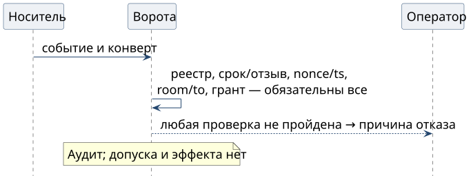

# Когда проверка отказывает

Fail closed: обязательное свидетельство не установлено — нового разрешения и эффекта нет. Ниже — причины для оператора и аудита, **не коды протокола или готовый UI**.

| Условие | Что видит оператор | Что проверить перед повтором |
| --- | --- | --- |
| Реестр нельзя проверить | «Актуальный статус ключа и отзывов не установлен» | доступность, подписанную ревизию и свежесть; не обходить проверку старым снимком |
| Аттестация истекла или ключ отозван | «Ключ не допущен на требуемое время» | новую аттестацию либо другое разрешённое устройство |
| Повтор nonce или `ts` вне окна | «Повтор или недопустимое время сообщения» | доставку, часы, журнал повторов; не исполнять повторно автоматически |
| Другая комната или адресат | «Подписанное назначение не совпадает с доставкой» | полные ID; пересылка не переназначает команду |
| Грант не покрывает действие | «Нет полномочия на это действие и цель» | цепочку, условия и необходимый уровень; подпись прав не добавляет |

1. Ворота фиксируют отказ. Неизвестный ключ, неверная подпись и несовпадение хэша тела тоже закрывают допуск.
2. Неверную подпись не обходят доставкой тела как пользовательской команды. Неподписанная переписка остаётся данными, не заменой критической команды.
3. Частичного действия ради проверки нет. Квитанция очереди не подтверждает исполнения.
4. После устранения причины проверяются все условия. При неясном исходе сначала выясняют результат прежнего эффекта: новый nonce не предотвращает повтор внешнего действия.

Fail closed для новых полномочий не отменяет отдельного пути экстренной остановки: в книге остановка не зависит от доступности снимка реестра.
