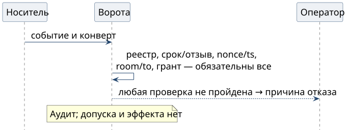

# Когда проверка отказывает

Проверка работает по правилу fail closed: если обязательное свидетельство не установлено, нового разрешения и эффекта нет. Ворота доверия проходят проверки в фиксированном порядке и возвращают код первой неудачи с пустым планом. Оператор видит причину, а аудит сохраняет отказ.

| Условие | Код отказа | Что проверить перед повтором |
| --- | --- | --- |
| Снимок отзывов недоступен, устарел или откатился | `revocation_unavailable`; у сообщения `key_binding_unavailable` | доступность реестра, запись свежести и голову свидетеля; старый снимок проверку не обходит |
| Ключ или аттестация отозваны | `revoked` | новую аттестацию или другое разрешённое устройство |
| Срок записи истёк или не начался | `expired`, `not_yet_valid` | часы и время подписи; повтор требует новой подписи |
| Другая комната или адресат | `message_room_mismatch`, `message_recipient_mismatch` | полные ID комнаты и адресата; пересылка команду не переназначает |
| Тот же `id` с другими байтами | `envelope_conflict` | исходную отправку; повтор отправляет те же байты |
| Подтверждение действия уже использовано | `act_replay` | результат прежнего эффекта в журнале исполнителя |
| Грант не покрывает действие и цель | `grant_not_authorized` | цепочку грантов и требуемый уровень; подпись прав не добавляет |
| Расширение без квалифицированного провайдера A3 | `act_a3_inactive` | квалификацию провайдера; сужающие действия проходят |

{height=36mm}

Неизвестный ключ, неверная подпись и несовпадение хэша доставленного текста тоже закрывают допуск. Неверную подпись нельзя обойти, доставив тело как пользовательскую команду: неподписанная переписка остаётся данными. Частичного действия ради проверки нет.

После устранения причины ворота проверяют все условия заново. При неясном исходе исполнитель сначала выясняет результат прежнего эффекта по своему журналу: новое подтверждение с новым `action_id` не защищает от повторного внешнего действия.

Экстренная остановка не зависит от доступности реестра и свежих снимков. Перезапуск после остановки требует отдельного текущего полномочия.
