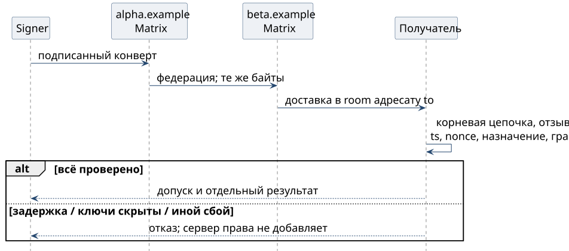

# Команда через два сервера

1. Signer подписывает назначение и тело на стороне отправителя. Matrix-сервер `alpha.example` передаёт событие серверу `beta.example` в разрешённую комнату. Это вымышленные имена для примера.
2. Получатель проверяет конверт по закреплённой корневой цепочке, независимо от сервера доставки. Подмена содержимого или назначения не проходит проверку; сервер всё ещё может задержать, скрыть или повторить событие.
3. Затем проверяются актуальный реестр, окно времени, nonce и грант. Сама федерация полномочий не даёт. До прохождения проверок эффекта нет.

**A0 удалённого сервера.** Это утверждение чужого homeserver об отправителе, слабее доверия к своему серверу. В целевом режиме A0 — данные и не основание критической команды. Переходное доверие к своему серверу автоматически на чужой не распространяется; исключения потребовали бы явной политики оператора, а не приглашения в комнату.

**Ключи носителя.** Matrix cross-signing и OMEMO device lists приходят через федерацию. Root-аттестация не даёт чужому серверу добавить доверенное устройство. Он может не выдать ключи: цепочку тогда не установить, и допуск закрыт. Это потеря доступности. Сохранность закрытых ключей и корректность клиента остаются допущениями.

**Часы и повторы.** `ts` проверяется относительно окна; nonce хранится каждым верификатором. Задержка федерации окно не расширяет. Размер окна, допустимый сдвиг часов, срок хранения nonce и восстановление после потери журнала ещё открыты. Разные проверяющие не образуют общего хранилища повторов; однократный внешний эффект требует собственного контракта.

**Привязка и правки.** Используются полные `signer` и `to`, ID комнаты. В XMPP полные адреса также нельзя подменять короткими именами; отображение адресов и комнат должен закрепить адаптер. Правка текста требует новой подписи. Redaction может убрать доступные байты, но не даёт нового разрешения; без них проверка невозможна. XMPP — следующий носитель, сроки ещё не определены.
