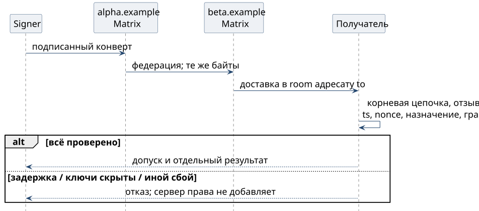

# Команда через два сервера и два владельца

Signer подписывает назначение и тело на стороне отправителя. Matrix-сервер `alpha.example` передаёт событие серверу `beta.example` в разрешённую комнату; оба имени вымышлены для примера. Получатель проверяет конверт по закреплённому корню владельца отправителя, независимо от сервера доставки. Подмена содержимого или назначения проверку не проходит, но сервер может задержать, скрыть или повторить событие.

{height=48mm}

## Доверие к другому владельцу

Корни и реестр другого владельца получатель закрепляет вне полосы, в защищённой конфигурации: владелец, ключи корней, роли и область. Аттестации другого владельца проверяются только против этого закрепления. Совпадение домена, приглашение в комнату и знакомое имя доверия не дают, а корень, пришедший в самом сообщении, ничего не закрепляет.

Устройство другого владельца в Matrix проходит ту же цепочку **device ← self-signing ← master ← аттестация корня оператора**, только корень берётся из закрепления этого владельца. Отзывы его ключей получатель принимает только подписанными закреплёнными корнями этого владельца, с теми же требованиями к возрасту и непрерывности, что и для своих снимков. Своих прав чужой корень не получает: полномочие на действие по-прежнему даёт только грант в домене владельца ресурса.

**A0 удалённого сервера** слабее доверия к своему серверу. При проверке по грантам A0 остаётся данными и критическую команду не обосновывает. Переходное доверие к своему серверу на чужой не распространяется без явной политики оператора.

**Ключи носителя.** Matrix cross-signing и списки устройств OMEMO приходят через федерацию. Аттестация корня не даёт чужому серверу добавить доверенное устройство. Сервер может не выдать ключи: тогда цепочку установить нельзя, и допуск закрыт. Сохранность закрытых ключей и корректность клиента остаются допущениями.

**Время и повторы.** Окно `iat` и `exp` сообщения и действия оператора не больше 120 секунд, и задержка федерации его не расширяет. Каждый проверяющий хранит свой журнал идентификаторов, а исполнитель хранит использованные `action_id`. Разные проверяющие общего хранилища повторов не образуют, поэтому однократный внешний эффект обеспечивает журнал исполнителя. Правка текста меняет `body_sha256` и требует новой подписи, а событие больше бюджета носителя отклоняется без усечения.
