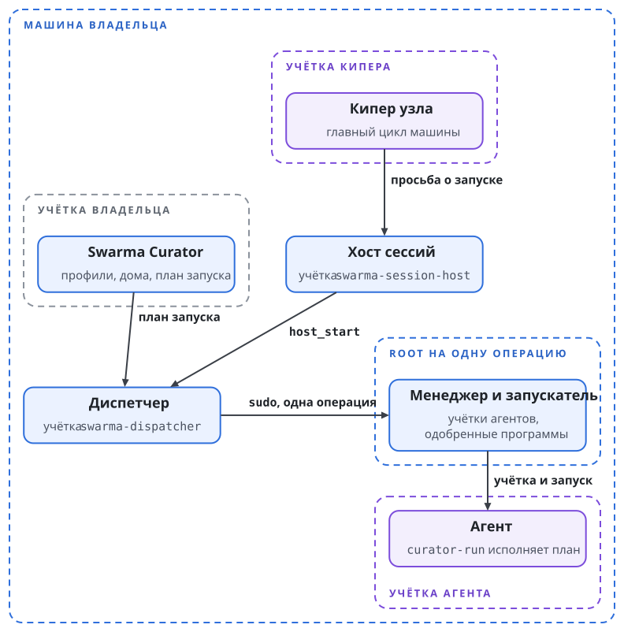
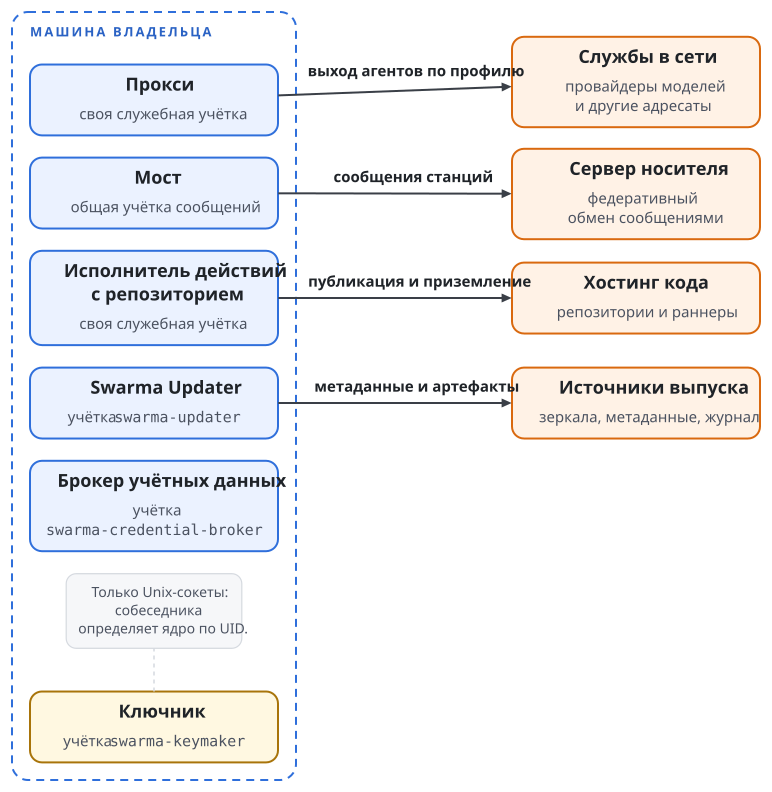

# Что ставится и зачем

Swarma Runtime на машине состоит из нескольких программ, и каждая работает под своей учёткой ОС. Разделение нужно потому, что захват одного процесса не должен давать всего: служба ключей не видит подписок, диспетчер не держит ключей, а агент не может сам создать учётку или поднять себе права (книга Swarma, глава "Пользователь ОС на агента и сеть агента").

## Две установки

Установщик знает две установки. **Установка Curator** ставит Curator и лаунчер `curator-run` под учёткой владельца. Прав администратора она не требует и ничего не меняет за пределами учётки владельца. **Полная установка** ставит ещё корень платформы, службы хоста и кипера. Её системная часть работает под root, а пользовательская часть под учёткой владельца.

После установки Curator владелец ставит профили командой `curator profile install` и запускает агента с профилем командой `curator run`. Такой запуск называется прямым. Агент работает под учёткой владельца, без отдельного пользователя ОС, диспетчера и брокера учётных данных, поэтому граница пользователя ОС его не ограничивает. Прямой запуск удобен на машине, где владелец работает с агентом сам и не держит постоянной команды.

Полная установка нужна, когда агенты работают без присмотра: каждый под своей учёткой, с арендой подписки, которую выдаёт брокер, и с сетью, которую закрывает ядро. Токен аренды агентская среда на время запуска видит (книга Swarma, глава "Учётные данные и логины"). Остальные главы книги описывают полную установку.

## Части и их учётки

Таблица называет каждую часть полной установки, её репозиторий, учётку ОС и выход в сеть. Номера учёток названы в разделе "Корень платформы".

| Часть | Репозиторий | Учётка ОС и привилегии | Сеть |
| --- | --- | --- | --- |
| установщик и манифест выпуска | `swarma` | владелец; root только для шагов одобренного плана | загрузка по манифесту |
| Curator и `curator-run` | `curator`, `curator-agent-launcher` | владелец; копия `curator-run` исполняет план под учёткой агента | как у учётки |
| менеджер пользователей и запускатель | `swarma-user-manager` | root на одну операцию через `sudo`, без аргументов и без setuid | слушателя нет |
| ключник (Swarma Keyholder) | `swarma-keymaker` | `swarma-keymaker`, без capabilities | только Unix-сокеты |
| брокер учётных данных | `swarma-credential-broker` | `swarma-credential-broker`, без привилегий | слушателя нет; выход к провайдерам только через свой профиль прокси |
| прокси и сетевые профили | `swarma-egress-proxy` | своя служебная | по обслуживаемой политике |
| диспетчер | `swarma-dispatcher` | `swarma-dispatcher`; `sudo` только к менеджеру и запускателю | выход закрыт, включая loopback |
| хост сессий и раннер | `swarma-session-host` | `swarma-session-host`; раннер под учёткой агента | выход закрыт, включая loopback |
| мост и клиент носителя | `swarma-bridge` | одна общая служебная учётка сообщений | только к серверу носителя |
| исполнитель действий с репозиторием | `swarma-repo-actions` | своя служебная | только к хостингу кода и раннерам |
| кипер узла | `swarma-keeper` | своя, постоянный участник | через прокси и мост |
| оператор и наблюдатель | ставит установщик | `swarma-operator` подписывает, `swarma-observer` читает | вход по SSH с принудительной командой |

{.tall}

**Менеджер пользователей и запускатель** составляют два узких привилегированных входа. Менеджер создаёт и выводит учётки агентов, запускатель стартует под учёткой агента одобренную программу. Оба получают root на одну операцию через `sudo`. Аргументов от вызывающего они не принимают, а одобренные программы и их дайджесты читают из политики root. Остальные службы root не получают.

**Ключник** держит мастер-секрет установки и подписывает за агентов (книга Swarma, глава "Ключи и ключник"). Собеседника он определяет по UID на другом конце Unix-сокета, поэтому сети ему не нужно. Работает он под своей служебной учёткой `swarma-keymaker`.

**Брокер учётных данных** хранит подписки провайдеров моделей и выдаёт аренды токенов на отдельные запуски (книга Swarma, глава "Учётные данные и логины"). **Прокси** выпускает агента в сеть только по сетевому профилю его поколения. **Диспетчер** ведёт учёт учёток и запусков и обращается к менеджеру и запускателю через `sudo`; другого пути к root у него нет. **Хост сессий** держит долгие сессии агентов, а раннер каждой сессии работает под учёткой её агента (книга Swarma, глава "Запуск агента и хост сессий").

**Мост** связывает агентов машины с носителем: одна служебная учётка сообщений, по экземпляру моста и клиенту носителя на каждую личность станции (книга Swarma, глава "Путь сообщения и мост"). **Исполнитель действий с репозиторием** публикует кандидатов, обновляет базу и приземляет изменения, когда у агентов закрыт выход в сеть. **Кипер узла** работает под своей учёткой как постоянный участник и выходит в сеть только через прокси и мост.

Учётка `swarma-operator` подписывает действия оператора, учётка `swarma-observer` только читает состояние. Обе принимают вход по SSH с принудительной командой, поэтому интерактивной оболочки ни одна из них не даёт.

## Корень платформы

Корень платформы находится в `/opt/swarma`. Вне корня лежит только то, чему место назначает сама ОС: записи пользователей, `sudoers`, описания служб и правила файрвола. Отключать SIP на macOS не нужно.

Служебные учётки получают номера из диапазона 900-999 на Linux и 450-499 на macOS, агентские учётки из диапазона 30000-59999. Раскладку каталогов под корнем, дома агентов и порядок их вывода описывает книга Swarma (глава "Пользователь ОС на агента и сеть агента", раздел "Дома и результаты").

## Что нужно вне машины

Часть установки живёт вне машины, и установщик её не ставит. Владелец готовит её заранее и вписывает адреса и ключи в план.

Сервер носителя с регистратором выдаёт агентам учётки носителя по ключу машины (книга Swarma, глава "Допуск к носителю"). Узел доверия с реестром владельца и свидетелем отката работает на отдельной машине владельца у независимого провайдера (книга Swarma, глава "Ключи и ключник", раздел "Реестр владельца на узле доверия"). Приложение оператора на телефоне держит ключ оператора и подтверждает расширяющие действия. Второе устройство, резервный ключ FIDO2 или второй телефон, страхует от потери единственного телефона.

Хостинг кода установщик не выбирает. Им может быть GitHub, GitLab или любой другой сервис, и шаги установки от этого выбора не зависят.

## Кому верит установка

Установка опирается на три корня, и владелец проверяет каждый сам. Ключ выпуска `swarma` владелец один раз сверяет по отпечатку через независимый канал. Подписантов каждой части установщик показывает в первом плане и после одобрения закрепляет. Ключ оператора рождается на телефоне владельца при регистрации оператора. Как эти три корня проверяются и чего их проверка не доказывает, описывает глава "Доверие: подписи, манифест, нотаризация, каналы пакетов".
