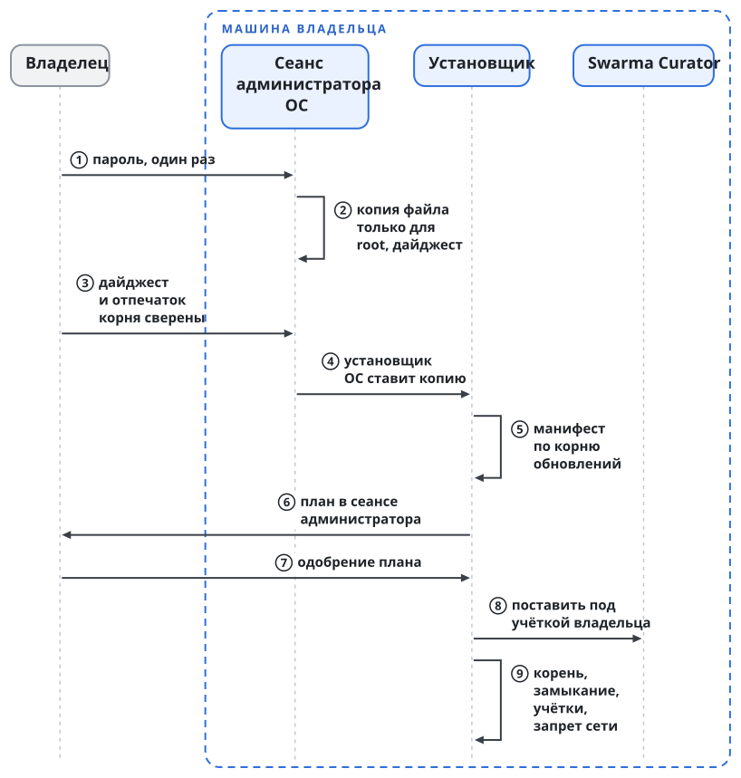
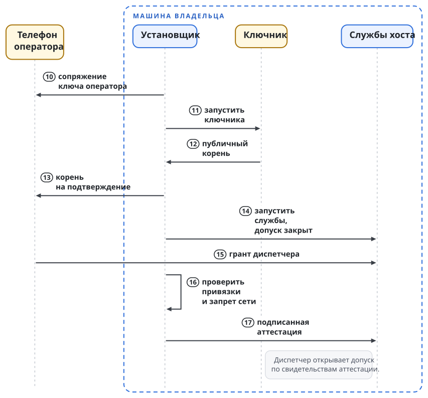
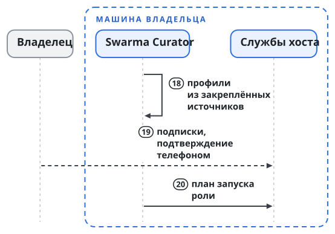
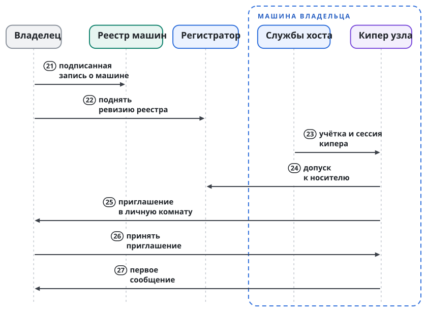

# Шаги и результат каждого шага

Установка начинается с проверки файла первой установки и дальше идёт десятью шагами. Шаг без подтверждённого результата следующий не открывает, и ни один шаг не пользуется частью, которую ставит более поздний шаг. Поэтому после каждого шага машина находится в известном состоянии: что на ней работает и чего на ней нет.

{.tall}

## До шага 1. Файл первой установки

Установка начинается в сеансе администратора, который запускает ОС и на который учётка владельца не влияет. Владелец один раз вводит в нём пароль администратора. Системный инструмент под root копирует скачанный файл первой установки в новый каталог, доступный только root, и считает его дайджест. Владелец сравнивает дайджест с метаданными выпуска, подписанными цепочкой корня обновлений, а отпечаток корня сверяет по независимому каналу. Только после совпадения установщик ОС получает путь к этой копии и ставит её как локальный файл, без кода, который исполняется при установке пакета (глава "Как обновляется Swarma", раздел "Первая установка и каналы пакетов").

Результат: на машине проверенный файл первой установки: установщик, корень обновлений, пины подписантов частей и ключ журнала. Корня платформы, учёток и служб нет. При несовпадении дайджеста установщик ОС файла не получает, и на машине ничего не ставится.

## Шаг 1. Манифест выпуска

**Манифест выпуска** называет точный набор частей полной установки, версию каждой части и дайджест каждого артефакта. Манифест служит версией метаданных `targets`, и его подписывают офлайновые ключи роли `targets` порогом под корнем обновлений (глава "Как обновляется Swarma", раздел "Роли метаданных и их ключи"). `swarma install` проверяет манифест по корню обновлений из проверенного файла первой установки и отказывает при любом расхождении. Подписантов частей манифест не задаёт: их пины приносит проверенный файл первой установки (глава "Доверие: подписи, манифест, нотаризация, каналы пакетов").

Результат: проверенный установщик проверил манифест. Корня платформы, учёток и служб нет.

## Шаг 2. Обзор и план

Проверенный установщик без привилегий описывает машину и собирает план с полной дельтой изменений (глава "Одна команда", раздел "План на языке системы"). План, который связывает установку, он показывает в сеансе администратора и одобрение принимает только там. Обзор и план соответствуют первым фазам самоквалификации машины: обзору без привилегий, сборке набора и ревью владельцем (книга Swarma, глава "Пользователь ОС на агента и сеть агента", раздел "Самоквалификация машины").

Владелец одобряет план в сеансе администратора. Без одобрения установка на этом шаге останавливается.

Результат: у владельца есть одобренный план, и установщик выполняет его системную часть под root. Корень платформы не создан, учёток и служб нет.

## Шаг 3. Swarma Curator и curator-run

Установщик ставит под учёткой владельца выпуск Curator из манифеста: один архив с `curator` и `curator-run`, собранным из подписанного тега своего репозитория. `curator-run` ложится в каталог установки Curator. В этом каталоге `curator run` ищет лаунчер первым, поэтому отдельная регистрация лаунчера не нужна. Установщик проверяет, что в PATH владельца этот каталог стоит раньше любой другой копии `curator-run`. Уже стоящие версии, которые не совпали с манифестом, он без решения владельца не заменяет.

Результат: под учёткой владельца работает Curator. Владелец может ставить профили и запускать агента прямым запуском `curator run` под своей учёткой. Служб хоста и кипера нет, носитель не подключён.

## Шаг 4. Корень платформы и учётки

Под root установщик создаёт `/opt/swarma` и кладёт туда менеджер пользователей и запускатель. Туда же он кладёт доверенное замыкание обновлений и закладывает начальное состояние доверия: корень обновлений, пины подписантов частей и ключ журнала из проверенного файла первой установки. Он пишет политику root: роли вызывающих, квоты, диапазоны номеров и одобренные программы с дайджестами, среди них защищённую копию `curator-run`. Он ставит правила `sudoers` и, до первой агентской учётки, статический запрет сети для всего агентского диапазона. Через менеджер пользователей он создаёт служебные учётки, `swarma-operator` и `swarma-observer`.

Результат: служебные учётки есть, служб и агентских учёток нет. Root на одну операцию получают только менеджер пользователей, запускатель и защищённые программы обновления.

{.tall}

## Шаг 5. Оператор, ключник и корень доверия

Сначала установщик регистрирует оператора. Ключ на телефоне владельца сопрягается с машиной по QR-коду с подтверждением на терминале и на телефоне. Без второго устройства регистрация не завершается: потеря единственного телефона означала бы потерю управления машиной.

Затем установщик ставит и запускает ключника под учёткой `swarma-keymaker`. Пустое состояние ключник сам не принимает, и начальное состояние подтверждает оператор. Ключник создаёт мастер-секрет установки, по возможности в аппаратном хранилище, и публикует публичный корень. Владелец подтверждает корень в приложении оператора. Публичный корень оператора, корень ключника и ключи реестра владельца на узле доверия установщик закрепляет в конфигурации root.

Результат: работает одна служба платформы, ключник. Оператор может подписать одно точное действие. Допуск агентских запусков закрыт.

## Шаг 6. Службы хоста

Установщик ставит и запускает остальные службы в порядке их зависимостей: брокер, прокси и сетевые профили, диспетчер, хост сессий, мост, исполнитель действий с репозиторием, Swarma Updater. Каждой службе он пишет описание systemd или launchd с её учёткой и сетевой строкой из таблицы главы "Что ставится и зачем".

Диспетчеру установщик создаёт ключ и регистрирует его в политике менеджера и в конфигурации брокера; грант диспетчера оператор подтверждает телефоном. Хост сессий установщик явно регистрирует у диспетчера: запросы `host_start` и `host_stop` диспетчер принимает только от настроенной учётки хоста сессий. Службы с журналом принимают начальное состояние только после сверки оператором.

Результат: службы работают, каждая под своей учёткой. Допуск закрыт: агентских учёток нет, и диспетчер никого не запускает. Владелец читает состояние через `swarma-observer` или командой `swarma status`.

## Шаг 7. Квалификация машины

Установщик проверяет все привязки: учётки, сетевые строки, сокеты, службы и их состояние. С тестовой учётки агентского диапазона установщик проверяет, что статический запрет сети не обходит ни одно правило файрвола, включая loopback, и что учётке доступны только объявленные сокеты. На время проверки допуск остаётся закрытым.

Результат проверки установщик записывает как аттестацию, подписанную **ключом аттестации машины**. Этот ключ подписывает только записи своей машины и ни для чего другого не служит; ключи машины для допуска к носителю от него отдельны. Проваленная проверка останавливает установку с закрытым допуском, а сама установка при этом ничего не откатывает: откат остаётся отдельным действием владельца (глава "Как обновляется Swarma", раздел "Откат и восстановление").

Результат: аттестация подписана, и диспетчер открывает допуск по её свидетельствам. Допуск принадлежит диспетчеру, а установщик только передаёт ему свидетельства. С этого шага на машине можно запустить первого агента под отдельной учёткой. Дрейф защищённых входов, смена класса машины или проваленная повторная проверка сразу закрывают новые запуски (книга Swarma, глава "Пользователь ОС на агента и сеть агента", раздел "Отзыв квалификации").



## Шаг 8. Передача управления Curator

Curator под учёткой владельца ставит базовый профиль Swarma `swarma-core` и профили ролей из репозитория профилей Swarma `swarma-profiles`. Профили приходят из закреплённых источников, и Curator проверяет каждый по подписантам источника. Профиль требует скиллы вместе с их командами. Curator собирает команды из проверенного исходника на ревизии из lock-файла в корень команд этого профиля. План запуска ставит этот корень первым в PATH агента, а системный PATH, профили оболочки и общие каталоги команд Curator не меняет.

Затем владелец подключает подписки провайдеров моделей к брокеру расширяющим действием оператора с подтверждением на телефоне. Из сессии агента подключение не проходит.

Результат: Curator под учёткой владельца собирает для роли план запуска (профиль с пином, дом, инструкции, скиллы, MCP, сетевой профиль, режим учётных данных) и передаёт его диспетчеру. Диспетчер запускает агента под отдельной учёткой с арендой подписки, и `curator-run` под этой учёткой исполняет готовый план (книга Swarma, глава "Запуск агента и хост сессий", раздел "План собирает вызывающий"). Владелец может так запустить разовое исполнение. Долгоживущего агента на машине нет, носитель не подключён.

{.tall}

## Шаг 9. Запись машины в реестре машин

Установщик готовит запись `enrollment/1`: публичные ключи машины, разрешённые имена с меткой машины и соответствие UID именам. Владелец подписывает запись офлайновым ключом издателя регистраций. Запись входит в реестр машин через ревью, после чего оператор поднимает закреплённую ревизию реестра у регистратора и у ключника. Самостоятельной регистрации машины нет: машину вносит в реестр только владелец.

Результат: машина может получать учётки носителя для имён вида `<машина>_<проект>_<роль>`. Пропуск регистратора действует 120 секунд, токен сервера носителя сутки, и общего секрета регистрации на машине нет (книга Swarma, глава "Допуск к носителю").

## Шаг 10. Кипер и канал владельца

**Постоянной командой** называются агенты, которые живут на машине без срока; их объявляет описание, подписанное оператором (книга Swarma, глава "Пользователь ОС на агента и сеть агента", раздел "Дома и результаты"). Оператор подписывает описание постоянной команды с кипером. Для кипера заводится своя учётка, Curator под учёткой владельца собирает план кипера с профилем `swarma-keeper` из репозитория `swarma-profiles`, и хост сессий запускает сессию кипера. Профиль `swarma-keeper` расширяет базовый профиль `swarma-core`, а манифест выпуска закрепляет его точную подписанную версию.

**Каналом владельца** называется личная комната на носителе между станцией и её владельцем (книга Swarma, глава "Путь сообщения и мост", раздел "Канал владельца"). При подъёме станции кипера канал появляется в таком порядке: допуск к носителю через регистратор, привязка моста к личности станции, привязка личной комнаты с владельцем.

Владельца станции установщик записывает в конфигурацию хоста из одобренного плана, вне области записи станции. Из сообщений носителя владельца не узнают и через носитель не меняют. Комнату создаёт кипер: только по приглашению, без шифрования, и единственным приглашённым в ней служит закреплённый владелец. Открытая комната соответствует уровню уверенности A0, на котором отправителя удостоверяет сервер носителя; шифрованная комната требует уровня A1, на котором отправителя удостоверяет подпись его устройства (книга Swarma, глава "Путь сообщения и мост", разделы "Уровни уверенности для сообщений людей" и "Канал владельца"). Владельцу остаётся одно действие, принять приглашение. Его вход в комнату служит действием согласия и включает привязку.

Если кипер комнату не создал, владелец создаёт её с терминала машины командой `a2a`, программы модуля обмена сообщениями агентов (книга "a2a"), от имени личности кипера:

```text
a2a --as <личность кипера> owner-dm ensure --tag --mirror
```

Команда действует как привязка, которую запросил бы владелец. Если приглашение в прежнюю комнату ждёт ответа, команда отказывает: владельцу остаётся принять это приглашение или дождаться его истечения через 24 часа. Новую личную комнату с одним приглашённым владельцем команда создаёт, только если привязки не было никогда или она неактивна. При активной привязке команда меняет только флаги, а чужую личную комнату не ищет и не перенимает. Флаг `--mirror` включает зеркало ответов кипера в комнату (книга "a2a", глава "Пробуждение", раздел "Зеркало канала владельца"), флаг `--tag` включает метку входящих сообщений владельца. Команда требует терминала и повторного ввода идентификатора владельца. Эти проверки затрудняют случайный запуск, но согласия владельца не подтверждают: процесс под той же учёткой может выделить себе терминал.

Установщик регистрирует `keeper up` при загрузке машины под учёткой кипера. Эта идемпотентная команда поднимает хост сессий, кипера и корневых оркестраторов по реестру процессов (книга Swarma, глава "Swarma Keeper").

Результат: кипер пишет владельцу в личную комнату первое сообщение. Владелец просит кипера поднять оркестратора, станцию или разовое исполнение, и кипер делает это через хост сессий и диспетчер. Расширяющие действия кипер передаёт владельцу на подтверждение телефоном. После перезагрузки `keeper up` поднимает хост, кипера и корневых оркестраторов, а остановленное человеком остаётся остановленным.
