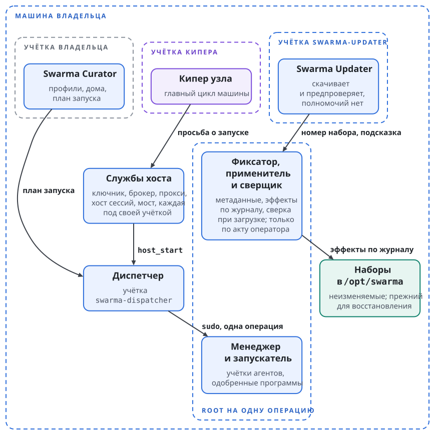
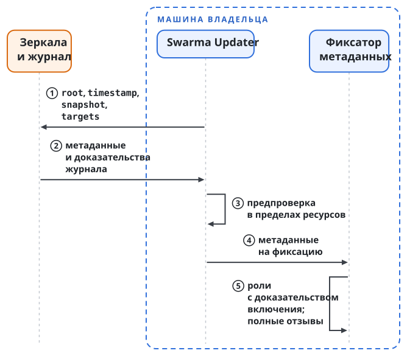
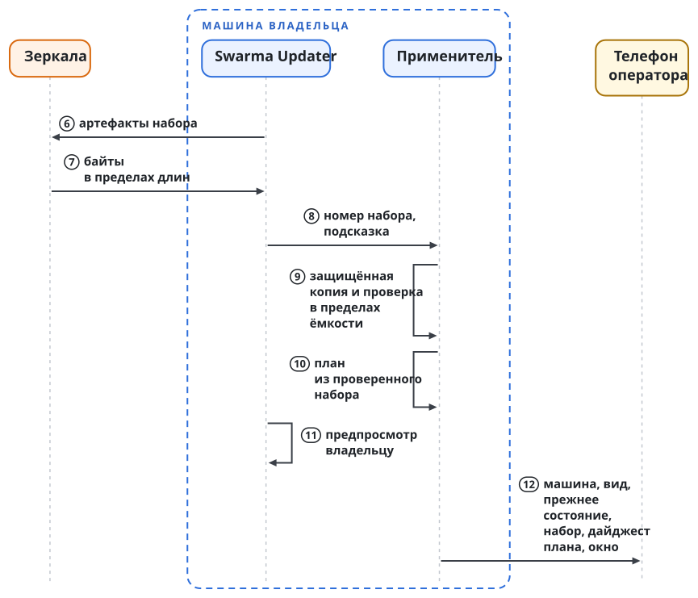
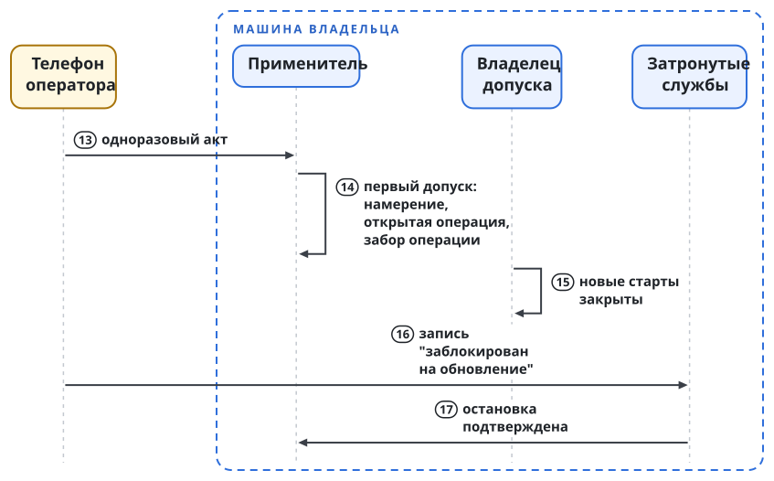
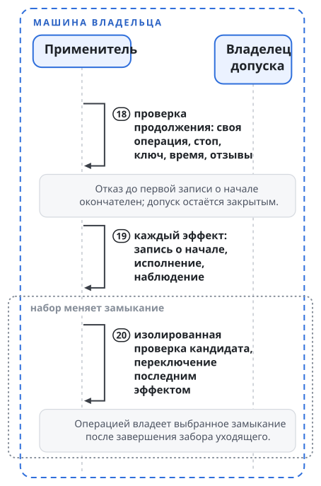
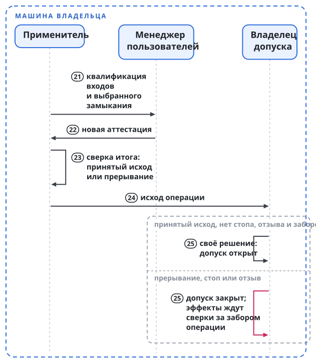

# Как обновляется Swarma

**Swarma Updater** (дальше Updater) обновляет установленную машину: ставит новые версии частей, применяет отзывы и восстанавливает машину после неудачного обновления. Обновление меняет программы, которые работают под root и держат ключи владельца, поэтому Updater ставит только то, что подтверждает проверенное знание о выпуске: его наборе, частях, подписантах и дайджестах. Адрес загрузки ничего не удостоверяет. Через какой бы канал ни пришла первая установка, дальше у машины одно состояние доверия, и все пути доставки проверяются по нему.

Обновление идёт тем же путём, что и установка: проверенный манифест, план с дельтой, одобрение, окно обслуживания и квалификация перед открытием допуска.

## Что защищает обновление

Обновление держится на восьми требованиях. Ставится только то, что следует из проверенного знания о выпуске. У всех путей доставки одно состояние доверия. Каждый эффект на машине разрешает владелец актом оператора с явным содержанием, и ни сессия агента, ни кипер, ни Updater, ни учётка владельца в ОС за владельца не одобряют. При сбое Updater отказывает, сохраняет уже проверенное знание и обхода не имеет; отказ называет шаг, отклоняет только неудачный вход и оставляет прежний набор активным, а неизвестный исход ставит машину за забор (раздел "Прерывание и забор операции"). Понижение версии, заморозка на старых метаданных и смешение наборов не проходят молча: ниже верхней отметки машина опускается только по исключению восстановления, набор, которого не называет одна версия `targets`, не активируется, а заморозку до истечения срока метаданных замечает тревога заморозки. Потерю ключа машина переживает без переустановки, если кворум ключей корня сохранился. Стоп действует без участия Updater, и снять его может только подпись оператора. Время, память и защищённое хранилище каждой проверки ограничены.

Таблица называет, кто может напасть на обновление и чего он сделать не может:

| Кто нападает | Что у него есть | Чего он не может |
| --- | --- | --- |
| хостинг кода и CI | сборка, теги, перечни подписантов, токены CI; ключей выпуска нет | ничего поставить; личность CI и перечень подписантов в репозитории полномочий не дают |
| ключ одной части | подпись этой части | поставить часть без набора, подписать задним числом, пережить недоверие своему ключу |
| ключи `targets` или `snapshot` ниже порога | подписи ниже порога | поставить что-либо, добавить подписанта, сдвинуть верхние отметки |
| ключ `timestamp` | свежие метки времени | указать на неподписанные метаданные или выбрать канал; заморозить машину он может до истечения срока метаданных |
| зеркало, CDN, посредник в сети | доставка байтов | большего, чем отказ в обслуживании и повтор старых метаданных в пределах срока их действия |
| подписант архива пакетов, tap или `.pkg` | доставка первого файла | исполнить свой код под root |
| учётка Updater | запись во временную зону, запросы на подготовку; может отказать и солгать | изменить установленные байты, зафиксировать метаданные, сдвинуть политику, создать или перенаправить одобрение, заполнить защищённое хранилище |
| учётка владельца в ОС | `swarma update`, Homebrew, Curator под учёткой владельца | одобрить обновление, подменить проверенный файл первой установки, писать в корень платформы |
| агенты и кипер | закрытая сеть; у кипера доверенность на стоп | дойти до защищённых программ или одобрить |

Root машины, ядро и часы в модель нападающих не входят, и обновление до них не дотягивается. Доверенной базой служат ОС, ядро и системные инструменты в сеансе первой установки, менеджер служб и каждый владелец делегированной работы с его заборами, пакеты дистрибутива, доверенное замыкание, ключ телефона оператора, держатели офлайновых ключей в пределах порога и надёжные часы. Три случая модель сама не закрывает. Согласованный откат всего состояния машины к старому образу закрывает только опора против отката, раздвоение журнала прозрачности для изолированной машины закрывает только власть журнала (раздел "Условия развёртывания"). Вредный исходник, честно подписанный законным ключом, обновление не распознаёт.

## Роли метаданных и их ключи

Метаданные выпуска следуют ролям The Update Framework (TUF) версии 1.0.37. Роль `root` задаёт **корень обновлений**: она называет ключи всех ролей, их пороги и своего преемника; её ключи офлайновые и аппаратные, и держат их разные люди. Роль `targets` подписывает одну версию на каждый набор выпуска канала вместе с полным состоянием его отзывов; её ключи офлайновые, работают порогом и отделены от ключей частей. Роль `snapshot` называет текущие версии `targets`; её ключи рекомендуется держать офлайн. Роль `timestamp` называет текущий `snapshot` и живёт недолго; её подписывает узкий онлайновый подписант.

**Набором выпуска** называется точный состав частей, который машина ставит целиком. Манифест выпуска (глава "Шаги и результат каждого шага", шаг 1) и есть версия метаданных `targets` для одного набора. Запись части в наборе несёт длину, хэши и данные части: имя, версию, платформу, назначение, ожидаемого подписанта по ссылке, размер после распаковки, объявленные эффекты, совместимость с состоянием служб, кодировки защищённых записей, которые часть читает и пишет, и сертификат Developer ID на macOS. Состав этих данных задаёт спецификация выпусков платформы. Набор выбирает подписанта среди закреплённых и никогда не вводит нового.

Сверх TUF метаданные выпуска соблюдают четыре правила. Набор ставится только целиком. У каждого артефакта есть подпись части. Каждая версия `targets` перечисляет все запреты и недоверия, когда-либо опубликованные для канала, иначе версия считается испорченной. Каждая версия `root`, `snapshot` и `targets` имеет доказательство включения в журнал прозрачности, и машина проверяет его до фиксации и хранит вместе с ней. Счётчики версий подчиняются только правилам TUF. **Публикацией восстановления** называется версия `targets`, помеченная как цель восстановления (раздел "Откат и восстановление").

Канал у машины один. Другие каналы, если они понадобятся, вводят делегированные роли, которые выбирает защищённая политика машины.

**Состояние политики** хранит то, что машина узнала и решила: пины подписантов, ключи под недоверием, запрещённые дайджесты, верхние отметки частей, исключения восстановления, активный, прежний и восстановительный наборы с их происхождением, выбранное и сохранённые замыкания. **Верхняя отметка** части равна самой высокой версии этой части с подписью части, которую машина когда-либо активировала. Ротация ключей состояние политики не сбрасывает. Каждый переход пишет новую версию состояния политики.

## Подпись части и пины подписантов

Метаданные ролей отвечают только на вопрос, входит ли артефакт в текущий набор. На вопрос, являются ли эти байты этой частью, отвечает только подписант части, которому машина доверяет сейчас. Его **подпись части** связывает дайджест с именем части, версией, платформой и назначением. Поэтому общий ключ не может поручиться за чужую часть, а подписанный тег не связан ни с одним загруженным бинарником.

Пины подписантов приходят только из проверенного файла первой установки (раздел "Первая установка и каналы пакетов"). Перечень подписантов в репозитории части служит документацией и пинов не меняет. Плановая смена подписанта требует двух подписей: заявления о преемнике, подписанного старым ключом, и акта оператора, который называет отпечаток нового ключа в своём плане; владелец сверяет этот отпечаток по независимому каналу. После компрометации ключа части новый ключ закрепляется только актом владельца вне полосы, с независимо сверенным отпечатком.

Отзыв бывает двух видов. **Недоверие ключу** лишает силы все подписи этого ключа, какое бы время подписи они ни заявляли. **Запрет артефакта** лишает силы дайджест под любым ключом. Пины, недоверия и запреты только растут.

**Пригодность к установке** машина вычисляет при каждой проверке и никогда не хранит. Артефакт пригоден, если он входит в текущий набор или в публикацию восстановления, названную актом, не запрещён, имеет подпись части с верными привязками от закреплённого ключа без недоверия и не ниже верхней отметки своей части. **Пригодность к работе** нужна уже активному и сохранённому восстановительному наборам, выбранному и сохранённым замыканиям после их принятого исхода. Каждый их артефакт не запрещён и сохраняет такую подпись части по своему происхождению: версии `targets`, подписям и исходу, записанным в хранилище свидетельств. Пригодность к работе сама ничего не разрешает: работе нужна ещё действующая квалификация и отсутствие стопа, а исполнителю восстановления право обслуживания.

Новый выпуск ничего не отзывает у прежнего. Отзывают только запрет и недоверие. Перезапуск машины между недоверием ключу и новой подписью ничего не теряет. Новая подпись того же дайджеста требует независимой пересборки, которая этот дайджест воспроизводит; без неё выходят новые дайджесты. Программа, потерявшая пригодность к работе, остаётся сдержанной до новой подписи или замены. По тем же правилам Updater обновляет сам себя и установщик, который входит в бинарники платформы.

## Updater на машине

Updater работает под своей служебной учёткой `swarma-updater` и выходит в сеть только к источникам выпуска. Полномочий у него нет. Его загрузчик, единственная сетевая часть, кладёт загрузки в карантин и соблюдает пределы раздела "Ресурсы". Его предпроверка повторяет проверки метаданных на локальных байтах, и её вывод служит только советом. Его предпросмотр показывает владельцу кандидата. План, который подписывает телефон, строит защищённая сторона.

Защищённую работу делают три программы root на одну операцию: **фиксатор метаданных**, **применитель** и **сверщик при загрузке**, которого запускает сама ОС. У них нет аргументов и нет setuid, а номер из очереди они берут только как недоверенную подсказку. Вместе с проверяющим кодом, динамическим загрузчиком, зависимостями и описаниями служб ОС, которые их запускают, они составляют **доверенное замыкание**. Замыкание закреплено по дайджестам в каталоге root, который после записи не меняется. Новое замыкание остаётся кандидатом и не исполняется вне изолированной проверки до своего **переключения замыкания**, объявленного эффекта обновления и единственного способа сменить работающее замыкание.

**Владельцем допуска** называется сторона (роль), которая решает, открыты ли на машине новые старты. Ни программы обновления, ни квалификация допуск не открывают. При установке эту роль играет диспетчер (глава "Шаги и результат каждого шага", шаг 7).

**Состояние доверия** пишут только защищённые программы. В него входят цепочка корня обновлений, счётчики версий, ключ журнала и его контрольная точка, состояние политики, использованные акты, открытая операция с её исполнением, записи о сдерживании и журнал операций.

{.tall}

## Проверка до активации

Фиксатор метаданных принимает новое знание без акта оператора. Он проходит клиентский порядок TUF: версии `root` по порядку, каждая под старым и новым порогом, причём срок действия считается только у последней; затем `snapshot` и `targets`, как их называют метаданные, и версия `targets` не ниже той, что названа в доверенном `snapshot`; каждая роль подписана порогом и не истекла. Метку времени, совпадающую байт в байт с сохранённой, фиксатор принимает как повторную проверку. Сверх TUF фиксатор требует попарно различных ключей ролей, отзывов, которые содержат все уже сохранённые, и доказательства включения для каждой версии `root`, `snapshot` и `targets` относительно контрольной точки, согласованной с сохранённой. Метку времени журнал не ведёт; её ограничивают срок действия и записанный в журнал `snapshot`.

Каждая роль сохраняется в своей точке порядка TUF атомарной заменой с синхронизацией. Роль из журнала сохраняется вместе со своим доказательством и контрольной точкой, версия `targets` ещё и с объединением отзывов и записями о сдерживании. Поэтому принятый новый `root` сохраняет свою контрольную точку и после перезапуска. Поздний сбой, в том числе по пределу ресурсов, отклоняет только свой вход: принятые преемники остаются, активный набор не меняется, а перезапуск проверяет всё заново по тому же правилу сроков.

Неизвестное время даёт отказ. Срок и полномочия проверяются заново перед каждой фиксацией и каждым эффектом, включая запись исхода. Ротацию `root` разрешает её порог, поэтому метаданным акт не нужен. Публикации восстановления и отзывы приходят без артефактов. Неизменные метаданные означают, что ставить нечего. Машина, пропустившая отзывающий выпуск, узнаёт отзыв из любой следующей версии, потому что каждая версия несёт все отзывы. Новая машина не допускает работы платформы до первой фиксации `targets`.

**Правило надмножества** ставит полноту отзывов выше доступности. Версию, в которой нет уже известного машине отзыва, фиксатор отклоняет, новые старты закрываются до прихода правильного надмножества, и машина поднимает тревогу.

Отзыв, который лишает пригодности к работе активный, восстановительный, выбранный или сохранённый набор либо лишает пригодности к установке подготовленный набор, в том же атомарном шаге пишет **запись о сдерживании**. Запись синхронизируется до того, как фиксатор подтвердит обновление. Владелец допуска при загрузке читает эти записи первыми и отправляет уведомления заново, не дожидаясь их доставки. Простое отсутствие активного набора в новой версии записи о сдерживании не пишет.

**Тревогу заморозки** поднимает защищённый наблюдатель вне учётки Updater. Он сравнивает срок действия метаданных с надёжным временем и сообщает владельцу, если машину держат на старых метаданных.

Применитель проверяет набор при подготовке, при допуске акта и при каждой проверке продолжения. Каждый артефакт пригоден к установке и не ниже верхней отметки своей части, если его не покрывает исключение восстановления из акта; платформа и зависимости совпадают. На защищённой копии он сверяет длину, хэши, подпись части и её привязки, затем на macOS подпись Developer ID и нотаризацию как второй слой защиты.

{.tall}

## Акт оператора

План строит защищённая сторона из подготовленного набора и состояния доверия, и предпросмотр Updater в него не входит. План называет части, версии, дайджесты, смены подписантов, все объявленные эффекты, включая переключение замыкания, затронутые службы и окно обслуживания. От плана считается его дайджест.

**Акт** оператор подписывает на телефоне (книга Swarma, глава "Ключи и ключник", раздел "Оператор подписывает одно действие"). Акт называет машину, вид, прежнее состояние (активный набор и версию состояния политики), целевой набор, дайджест плана, окно и одноразовый номер. Видов пять: установка, восстановление, миграция, распоряжение и восстановление замыкания. Обновление метки времени акт не отменяет. Байты акта и гарантию того, что телефон показывает ровно подписываемое содержание, задаёт спецификация пути оператора.

{.tall}

При допуске акта и перед каждым эффектом применитель выполняет текущие проверки: ключ телефона закреплён и не отозван, нет общего стопа и записи о сдерживании для цели, окно открыто по надёжному времени, метаданные свежие, и набор проходит проверки установки. Устаревшее разрешение не исполняется никогда.

**Первый допуск** акта происходит один раз, при намерении. Он требует, чтобы номер акта не был использован, открытой операции не было, а прежнее состояние совпадало. Применитель связывает номер с этой операцией и записывает её единственной **открытой операцией** машины, с актом, дайджестом плана и собой как первым исполнением. После неизвестного исхода акт никогда не применяется повторно.

**Проверка продолжения** идёт на границе изменения и перед каждым эффектом. Она спрашивает, связан ли номер с этой операцией: текущие проверки проходят, акт и дайджест плана принадлежат операции, вызывающий является её исполнением-владельцем, журнал ждёт именно этого шага, а версия состояния политики сдвигалась только переходами этой операции (указатель набора, переключение замыкания, исключение восстановления). Любое другое изменение, в том числе посторонняя фиксация метаданных, даёт отказ; такую цену доступности платформа принимает.

Открытая операция хранится как долговечная запись. Она держит за собой область обновления на время согласования окна, ожидания служб и квалификации. До её конца машина допускает только акт распоряжения или восстановления замыкания, который называет эту операцию и наблюдённое состояние (**перехват**); прежний акт после перехвата не продолжается. Стоп, сдерживание и фиксация метаданных операции не ждут.

## Обновление в окне обслуживания

**Обновление** (`swarma update`) ставит новый набор выпуска. Команда работает под учёткой владельца и показывает предпросмотр: какие части меняют версию, какие подписанты сменились и какие службы придётся остановить. Одобряет обновление акт оператора на телефоне.

В окне владелец допуска закрывает новые старты. Оператор подписывает с телефона запись об остановке затронутых исполнений и ставит заборы их сессий в состояние "заблокирован на обновление" (книга Swarma, глава "Запуск агента и хост сессий", раздел "Забор, парковка и перезапуск"); запрос на такую запись из сессии агента отклоняется. Затронутые службы останавливаются с подтверждённым исходом. Неизвестный исход остановки откладывает обслуживание, и применитель не заменяет бинарник под процессом, судьба которого не подтверждена.

{.tall}

Применитель открывает файлы временной зоны без перехода по ссылкам, копирует их в хранилище свидетельств root, которое после записи не меняется, и хэширует то, что пишет. Проверяет, распаковывает и ставит он только эту копию, в новый каталог набора root в пределах объявленного размера. Абсолютные пути, ссылки на родительский каталог, выходящие наружу ссылки, устройства и неожиданные владельцы или права дают отказ.

Каждое изменение машины объявлено в плане. **Объявленными эффектами** служат каталог набора, указатель активного набора, переключение замыкания, описания служб, настройки запуска, `sudoers`, строки файрвола и обратимые миграции. Эффект называет цель, прежнее и новое состояние и владельцев делегированной работы: процессы вне дерева применителя, которые исполняют его работу, например задания менеджера служб. Необъявленный эффект даёт отказ. Перед эффектом применитель синхронно пишет запись о начале, после него запись о наблюдённом состоянии: новое, прежнее или другое. Эффект с записью о начале и без исхода считается ожидающим.

Операция идёт фазами, и применитель синхронно записывает каждую: подготовку (копия проверена, дайджест плана посчитан), намерение (акт допущен, записаны первое исполнение, эффекты и забор операции), окно (допуск закрыт, остановки подтверждены), эффекты в порядке плана под проверкой продолжения, квалификацию и сверку итога. Если набор меняет замыкание, применитель сначала проверяет кандидата и переключает замыкание последним эффектом.

{.tall}

При переключении уходящее исполнение снимается. Исполнение выбранного замыкания становится владельцем операции только после того, как забор уходящего завершён, заменённые программы отсутствуют и не запускаются своим описанием загрузки, а состояние наблюдено заново; при первой проверке продолжения оно сравнивает это состояние. Затем применитель запрашивает квалификацию у менеджера пользователей: новая подписанная аттестация покрывает программы выбранного замыкания, их зависимости и описание загрузки. Последней идёт сверка итога: замыкание, указатель, службы и входы совпадают с аттестацией, каждый эффект наблюдён в новом состоянии, делегированной работы не осталось, текущие проверки проходят, стопа и сдерживания нет. Только тогда применитель пишет **принятый исход**, иначе отказ с закрытым допуском.

{.tall}

Открывает допуск владелец допуска своим решением; ни применитель, ни квалификация его не открывают. Владелец допуска открывает его, когда открытой операции нет и последняя кончилась принятым исходом или отказом до первой записи о начале; есть свежая аттестация выбранного замыкания, сделанная после последнего эффекта, и ни одна аттестация не старше замены бинарника, проваленной проверки или дрейфа; нет общего стопа, записи о сдерживании, отзыва, касающегося активного набора, и другого забора. Прежняя аттестация после замены бинарников не действует: обновлённые входы являются дрейфом.

Необратимая миграция идёт отдельной операцией "миграция" со своим актом, окном, эффектами, квалификацией и исходом, после завершённой установки. Поэтому до миграции машина может вернуться к предшественнику.

Профили Curator обновляются его собственной командой `curator profile update` и проверяются по подписантам своих источников. Если аудит находит проблему в новой версии профиля, Curator оставляет прежний lock-файл.

## Прерывание и забор операции

Окончательных исходов два: принятый исход и отказ до первой записи о начале. Всякий другой исход оставляет операцию **прерванной**, и её ожидающие эффекты переживают перезапуск. Допуск открывает только принятый исход.

**Исполнением** называется один запуск защищённой программы для открытой операции; журнал называет исполнение-владельца. Владение переходит только при намерении, при допущенном перехвате и при передаче замыкания. Стоп, сдерживание, перехват, перезапуск или передача **снимают** исполнение навсегда. Перезапущенная программа и конкурирующий вызов ничем не владеют и проверку продолжения не проходят.

**Забор операции** записывается при намерении и держится до конца операции. Он охватывает дерево процессов каждого исполнения и его потомков, источники повторного запуска (политику перезапуска, таймеры, сокеты, пути, триггеры загрузки) и всю делегированную работу. Забор снятого исполнения **завершён**, когда его дерева нет, повторный запуск закрыт, каждое делегированное задание либо кончилось с наблюдённым результатом, либо отменено с подтверждённым отсутствием или его владельцу запрещено его исполнять, а цели наблюдены заново под непрерывным исключением до окончательного распоряжения. Отмена, тайм-аут, выход главного процесса, успех службы, отпущенная блокировка или исчезнувший запросчик ничего не доказывают.

Живое дерево и делегированная работа самого владельца операции пересечением не считаются: владелец продолжает под проверкой продолжения. Другое исполнение (перехват, распоряжение, восстановление, повтор, преемник замыкания) не выдаёт ни одного эффекта до завершения забора каждого снятого исполнения; ограждение и наблюдение эффектами не считаются. Незавершённый забор держит операцию прерванной, допуск закрытым, тревогу поднятой, отклоняет распоряжения и сдерживанием не считается.

Сверщик при загрузке сначала завершает забор каждой открытой операции. Перезапуск машины кончает дерево процессов, а работу, которую загрузка ставит в очередь заново, и источники повторного запуска, которые поставила операция, сверщик закрывает сам. Затем он наблюдает начатые эффекты, ничего не повторяет и держит допуск закрытым; прерванная запись ничего не решает. Владелец распоряжается актом, привязанным к операции, наблюдённому заново состоянию и плану замены: оставшиеся эффекты, прежние состояния или восстановление. Операция кончается, когда у каждого эффекта есть распоряжение и результат прошёл свежую квалификацию и сверку итога. Исход описывает это состояние: машина перепроверяется и переквалифицируется, успех не выводится, а старый пин не восстанавливается поверх изменённых файлов.

## Стоп и сдерживание

Стоп хранится долговечно. Новые бинарники читают его при старте и проносят через каждое переключение, перезапуск и каждый начатый эффект, иначе применитель отказывает. Стоп не ждёт эффекта, и поздний эффект его не отменяет. **Немедленный отказ** закрывает допуск, старты, возобновления, выдачу учётных данных и новые использования учётных данных, снимает исполнение-владельца и применяет ограничительные настройки обработчиков стопа (книга Swarma, глава "Ключи и ключник", раздел "Общий стоп"). **Завершение** завершает забор операции, переводит начатый эффект в ожидающие и заново применяет и наблюдает настройки под непрерывным исключением. Только тогда стоп или сдерживание считается завершённым, и ничего, что начала операция или передала менеджеру служб, позже не ложится на машину. Без открытой операции стоп завершён, когда его настройки применены.

Запрет или потеря пригодности к работе в активном наборе либо в выбранном замыкании отзывает квалификацию (книга Swarma, глава "Пользователь ОС на агента и сеть агента", раздел "Отзыв квалификации"). Старты, возобновления и выдача закрываются сразу, а шлюз учётных данных и служба действий закрывают новые использования, поэтому прежние аренды не обслуживают новых запросов. Работающее исполнение подтверждённо сужается или останавливается с подтверждённым отсутствием процессов не позже 300 секунд после обнаружения на станциях Linux и macOS. Сбой уведомления допуска не открывает и сдерживания не откладывает, а пропущенный срок проваливает квалификацию, даже если заборы закрыты. После общего стопа шлюз учётных данных и служба действий открываются только своим закрытым порядком возобновления.

Ответ на сдерживание ведёт владелец допуска, а защищённая сторона записывает сдерживание и сообщает о нём. Сдержанное замыкание после записи о сдерживании не выполняет ни одной защищённой операции. Его восстанавливает предшественник с правом обслуживания или повторная первая установка, которая сохраняет состояние доверия.

## Откат и восстановление

**Откат** (`swarma rollback`) возвращает машину к прежним версиям частей движением вперёд. Это отдельное действие владельца. Роль `targets` выпускает публикацию восстановления, которая называет прежние артефакты, а оператор подписывает акт вида "восстановление". Счётчики версий растут, прежние копии и их происхождение остаются. После неудачного обновления машина сама не откатывается: проваленная квалификация оставляет новый набор с закрытым допуском до решения владельца.

**Исключение восстановления** пишется отдельным переходом журнала и привязано к номеру акта и точным дайджестам. Оно пропускает через проверку верхней отметки только эти артефакты и действует всё время, что этот набор активен; когда активируется другой набор, исключение кончается и повторно не используется. Любая другая более низкая версия требует своей публикации и своего акта. Запреты, недоверия и сдерживание действуют и при восстановлении.

**Право обслуживания** отделено от допуска работы. Оно позволяет **исполнителю восстановления** выполнять ограниченное защищённое обслуживание на неквалифицированной машине, не допуская работы и не пользуясь ни одной аттестацией. Исполнителем служит выбранное замыкание до переключения или сохранённый предшественник через свой независимый вход после переключения. При входе и перед каждым эффектом исполнитель проверяет шесть условий. Его программы, зависимости и описание загрузки, заново хэшированные из неизменяемого каталога, совпадают со своим происхождением. Он пригоден к работе по текущему состоянию доверия; своя старая копия этого состояния в расчёт не идёт. Он прочитал каждую запись состояния доверия и журнала, включая записи более поздних замыканий, до первого эффекта; неизвестная запись даёт отказ и ведёт к повторной первой установке. У него есть допущенный акт восстановления или восстановления замыкания, который проходит проверку продолжения. Общего стопа и записи о сдерживании исполнителя или цели нет. Исполнитель один, забор каждого снятого исполнения завершён, допуск закрыт. Обслуживание кончается, как любая операция, квалификацией выбранного замыкания и решением владельца допуска об открытии допуска. Запреты, недоверия, использованные акты, отзывы и записи журнала никогда не стираются.

До переключения путь восстановления остаётся у выбранного замыкания. Его сверщик при загрузке, которого запускает описание загрузки, принадлежащее root и меняемое только переключением, держит допуск закрытым, а его применитель и фиксатор тем временем принимают акт восстановления и текущую публикацию восстановления. Кандидат, который не стартует или не читает метаданные, этого пути не касается.

Новое замыкание проверяется до переключения. В **изолированной проверке** выбранное замыкание запускает кандидата под ограничением ОС: копии состояния доверия и журнала только для чтения, без пути записи в защищённое хранилище, без сети, потомки ограничены так же. Выбранное замыкание сравнивает защищённое хранилище до и после. Кандидат проходит, если прочитал обе копии и сверился без эффекта, а выбранное замыкание прочитало обратно каждую кодировку, которую кандидат записал во временную зону. Попытка записи проваливает проверку без вреда. Аргумент режима проверки ограничения ОС не заменяет.

**Обратная читаемость** держит путь назад открытым. До принятого исхода следующего переключения защищённое состояние пишется только в кодировках, которые предшественник читает с тем же смыслом. Новая кодировка вводится за два выпуска замыкания: сначала чтение, потом запись. Части объявляют свои кодировки. Обратное чтение из временной зоны служит только свидетельством, поэтому вход исполнителя проверяет читаемость заново.

Для **независимого входа** предшественник остаётся установленным и неактивным вместе со своим описанием загрузки. Предшественник запускается только путём оператора или в сеансе первой установки, никогда автоматически, держит допуск закрытым, работает с правом обслуживания и принимает только акт восстановления замыкания, который называет открытую или последнюю операцию, наблюдённое заново состояние и план замены. Обратно он переключает замыкание последним квалифицированным эффектом. До исхода переключения другой смены замыкания нет.

Службы с журналом при откате не возвращают старый снимок состояния и не стирают поздних записей. Журнал только дописывается, и откат версии программы не откатывает того, что программа уже записала. Наборы объявляют версии состояния служб, которые читают и пишут, отдельно от защищённых кодировок, и восстановление отказывает при нечитаемом состоянии службы.

Согласованный старый образ всего состояния машины проходит локальные проверки. Обновление метаданных возвращает машине счётчики и отзывы, а использованные акты и журнал защищает только внешняя опора, которую нельзя откатить.

## Ротация ключей и журнал прозрачности

Каждый пин имеет один источник и одну власть, которая его меняет. Таблица называет их:

| Пин | Источник | Кто меняет |
| --- | --- | --- |
| первая версия `root` | проверенный файл первой установки; отпечаток сверяет владелец | преемник под старым и новым порогом |
| ключи ролей | метаданные `root` | доверенный `root` |
| пины подписантов частей | проверенный файл первой установки | заявление о преемнике и акт оператора; после компрометации акт владельца вне полосы |
| ключ журнала | проверенный файл первой установки | заявление, разрешённое цепочкой корня обновлений |
| канал | политика машины | акт оператора |
| Developer ID | запись части в наборе | роль `targets` |

Метаданные `root` или смена ключа журнала сами подписанта части не добавляют.

Ротация ключей `timestamp` или `snapshot` удаляет доверенные метку времени и `snapshot`, а проверка отката `targets` идёт по доверенному `snapshot`. Поэтому раздутые ссылки на `targets`, включая делегированные, исчезают. Компрометацию ключа `targets` лечит новый `root`, который меняет ключи `targets`, `snapshot` и `timestamp` вместе; счётчики Swarma при этом не сбрасываются. Повтор со старыми ключами не проходит: ключи вышли из `root`, а версии `root` назад не идут. Состояние политики не меняется, а сохранённые файлы `targets` проверяются заново.

После компрометации любой роли роль `targets` запрещает или лишает доверия всё, что подписал украденный ключ, а журнал показывает поданные версии. Запрет, поставленный украденным порогом, остаётся навсегда: это потеря доступности, и исправляют её новые байты. Восстановление `root` в полосе требует рабочего порога доверенных ключей `root`, которых у нападающего нет. Порог может разрушить и простая потеря ключей. Тогда владельцы закрепляют корень заново вне полосы, сохраняя состояние политики и историю.

**Журнал прозрачности** показывает, какие версии метаданных выпущены. Его ключ закреплён на машине. Машина принимает контрольные точки, которые подписал этот ключ и которые согласованы с сохранённой, и проверяет включение каждой версии `root`, `snapshot` и `targets`. Контрольная точка старше установленного предела отклоняет фиксации. Журнал показывает только то, что подано в журнал, который видит эта машина, и версии вне журнала машина отклоняет. Раздвоение журнала для разных машин замечают только подписывающие свидетели или сравнивающие мониторы, и монитор должен следить за версиями в журнале, которых владельцы выпуска не подписывали. Свидетель отката на узле доверия владельца проверяет только записи ключника и журналом выпусков не служит; другим вариантом служит публичный журнал, например Rekor.

## Первая установка и каналы пакетов

Всё знание о выпуске начинается с **проверенного файла первой установки**: установщика, его помощников, первой версии `root`, пинов подписантов частей и ключа журнала. Инвариант первой установки такой: байты, которые подтвердило сравнение дайджеста владельцем, и есть те байты, которые читает каждая привилегированная программа, и ничто вне доверенной базы не меняет ни их, ни то, что сеанс показывает владельцу. Отпечаток корня удостоверяет материал корня и ничего не говорит о программе, которая его проверяет.

Первую установку ведёт сеанс администратора, который запускает ОС и на который учётка владельца не влияет. В нём работают системные инструменты по абсолютным путям, ничего не берётся из окружения владельца, а пароль администратора владелец никогда не вводит в своём сеансе. Системный инструмент под root копирует загрузку без перехода по ссылкам в новый каталог, доступный только root, без других открытых дескрипторов, и хэширует её. Владелец сравнивает этот дайджест с метаданными, подписанными цепочкой корня обновлений, а отпечаток корня обновлений сверяет по независимому каналу. Установщик ОС получает только этот путь, и каталог остаётся доступным только root до конца всех шагов установки. Пакет ставится из локального файла, а зависимости приходят только из архива дистрибутива.

Кода, который исполняется при установке пакета, у первой установки нет. Привилегированные шаги выполняет только проверенный установщик по одобренному плану, и пароль спрашивается один раз. План первой установки установщик показывает в том же сеансе и одобрение принимает только там, потому что учётка владельца в ОС ничего не одобряет. Триггеры других пакетов входят в доверенную базу.

Файл первой установки приходит пакетом deb или rpm на Linux и пакетом `swarma.pkg` на macOS, где подпись Developer ID и нотаризация служат вторым слоем. Homebrew исполняет код tap до любой проверки, поэтому полную установку из Homebrew не начинают; tap ставит установку Curator.

После первой установки менеджер пакетов под root платформу не трогает. Сценарии сопровождающего в пакетах deb и rpm исполняются под root ещё до распаковки, а apt принимает всё, что подписано скомпрометированным ключом архива. Поэтому источник пакетов Relux Works для частей платформы на машине не остаётся, а следующие байты приходят только через Updater, без пароля администратора. Канал пакетов под root, оставленный на машине, вносит ключ своего архива в доверенную базу, и оставить его можно только решением владельца для этой машины. Тот, кто может писать в префикс Homebrew, лишает машину этих гарантий, поэтому службы из префикса никогда не запускаются. Переменная `CURATOR_INSTALL_INSECURE_SKIP_VERIFY` не задаётся никогда.

## Ресурсы

У каждого входа есть пределы: размер объекта, байты за одно обновление, число пройденных версий `root`, записей, подписей и делегаций, размер и степень распаковки, повторы и время продвижения на каждое зеркало и попытку. Подписанные длины пределы только ужесточают, а неподписанные длины держатся в фиксированных границах. Загрузчик переходит на другое зеркало, когда продвижение остановилось.

Каждое защищённое хранилище ограничено: состояние доверия, журнал, состояние стопа, записи о сдерживании, хранилище свидетельств, подготовленные наборы и сохранённые замыкания. Для записей безопасности держится резерв, которого подготовка не касается. Подготовка начинается, только если объявленные размеры помещаются, а копия сверх объявленной длины останавливается. Когда неодобренных подготовленных наборов больше предела, самый старый удаляется, и акт, который его называет, на допуске получает отказ. Байты, равные копиям активного или восстановительного набора, хранятся ссылкой. Очистка не трогает активный и восстановительный наборы и их происхождение, выбранное и сохранённые замыкания, отзывы, открытые операции и номера актов, чьё окно ещё открыто по надёжному времени. Переполнение даёт явный отказ. Отказ сети останавливает обновления.

## Слабые места

Таблица ставит слабые места по порядку их закрытия; порядок не оценивает ущерба для парка машин:

| Место | Охват | Чем закрыто | Что остаётся |
| --- | --- | --- | --- |
| доверенное замыкание, транзакция, восстановление | машина; парк при общей ошибке | акт, транзакция, забор, восстановление; независимое ревью и приёмочные проверки | ошибки привилегированного разбора, исполнения и восстановления; необъявленные эффекты и делегирование; смысл записей через несколько переключений |
| первая установка и вывод пакетов | машина | процедура первой установки, отказ от менеджера пакетов под root | захваченные системные инструменты, пропущенное сравнение дайджеста, принятый канал под root |
| офлайновая подпись и пины частей | парк | пороги, пины, пересборка там, где она воспроизводима | сговор, принуждение, потеря ниже кворума, честно подписанный вредный исходник, небрежная сверка отпечатка |
| знание о выпуске против работающей программы | машина и парк | пригодность к работе, полнота отзывов, сдерживание | ошибки публикации, факты, которых машина не видела, задержка в пределах сроков свежести |
| акт оператора и его показ | машина | точная привязка акта к плану и состоянию | одобренный вред, показанный верно; захваченный телефон |
| стоп, сдерживание, часы, заморозка | машина | порядок стопа, забор, тревога заморозки | сбой наблюдателя, владелец делегированной работы, который не отвечает и держит машину закрытой; изоляция |
| откат всего состояния | машина | обновление метаданных возвращает счётчики и отзывы | использованные акты и журнал без внешней опоры |
| прозрачность | парк | закреплённый ключ журнала, контрольные точки, доказательства включения | раздвоение для изолированных машин, сговор, неподанные выпуски |
| ёмкость и транспорт | машина | пределы и резерв | рост истории, объём отзывов, отказ сети |
| Curator под учёткой владельца | машина | `curator-run` проверяется по дайджесту при старте | Curator, который собирает планы запуска, доступен на запись учётке владельца |
| конвейер сборки | парк | ключей в CI нет, личность CI полномочий не даёт | законный ключ подписывает вредное изменение |

## Условия развёртывания

Семь гарантий опираются на контракт, которого дизайн обновления сам не задаёт. Без такого контракта гарантия не действует, поэтому каждое из семи условий закрывает развёртывание, и обхода у него нет: более слабое развёртывание потребовало бы явного, удостоверенного и записанного решения владельца. Условия такие:

- **Канал под root.** Канал пакетов под root остаётся на машине только по удостоверенному решению владельца для этой машины.
- **Акт оператора.** Спецификация пути оператора задаёт байты акта, его виды и гарантию показа.
- **Опора против отката.** Внешняя опора, которую нельзя откатить, защищает использованные акты и журнал от отката всего состояния; ею может служить свидетель отката с привязкой, которую задаёт владелец его спецификации.
- **Тревога заморозки и порядок стопа.** У тревоги есть защищённый наблюдатель и доставка; стоп и сдерживание считаются завершёнными только после немедленного отказа и завершённого забора, а незавершённый забор сообщается как прерванная операция.
- **Власть журнала.** Её контракт задаёт начальный ключ журнала и его ротацию, свежесть контрольных точек, подписывающих свидетелей или сравнение наблюдателей и названный монитор.
- **Спецификация выпусков платформы.** Она задаёт расширения метаданных, оба вида отзыва, данные записи и объявления кодировок, подпись части и новую подпись того же дайджеста, публикации восстановления, доказательство включения для каждой роли с долговечностью контрольной точки и значения пределов.
- **Спецификация установщика.** Она задаёт состояние транзакции (открытую операцию, исполнения и передачу владения, записи эффектов, переключение замыкания, окончательные распоряжения и планы замены, право обслуживания и исключение, независимый вход, обратную читаемость каждой записи безопасности и её смысла), раскладку наборов под `/opt/swarma`, сохранение поколений после неудачных переключений, доверенного участника, который завершает забор снятого исполнения и наблюдает состояние без помощи упавшего замыкания, механизм забора на каждой платформе, процедуру первой установки, вывод пакетов после неё и сериализацию без циклов зависимостей.
